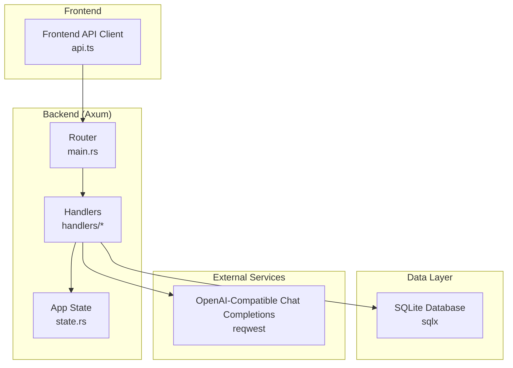
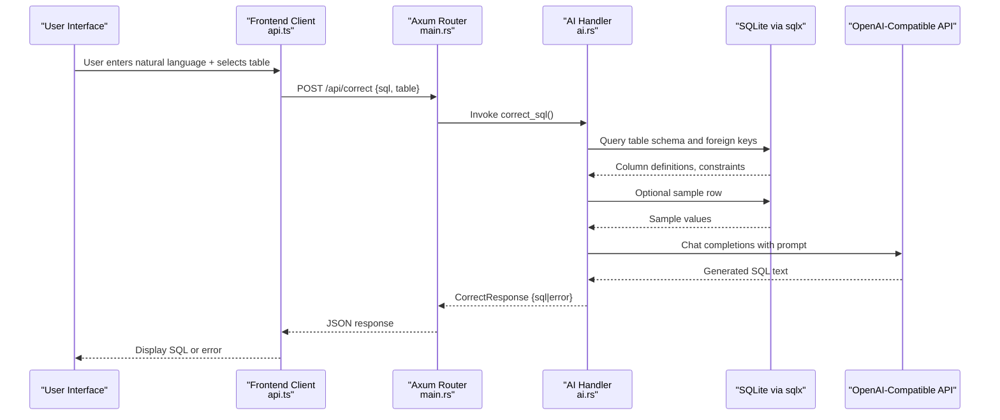
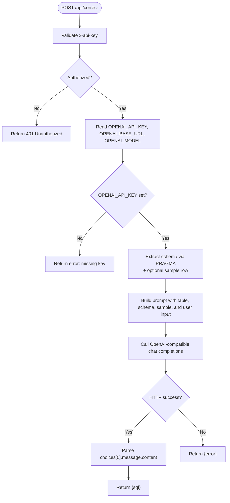
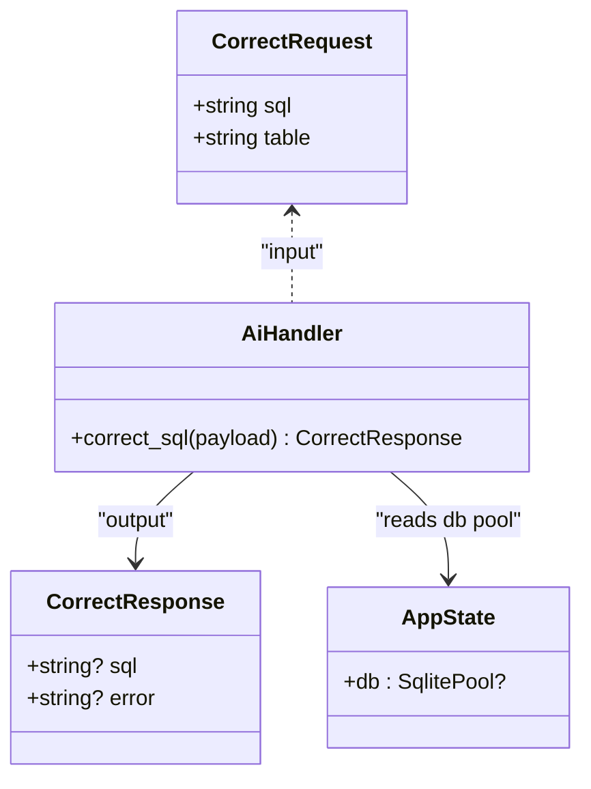
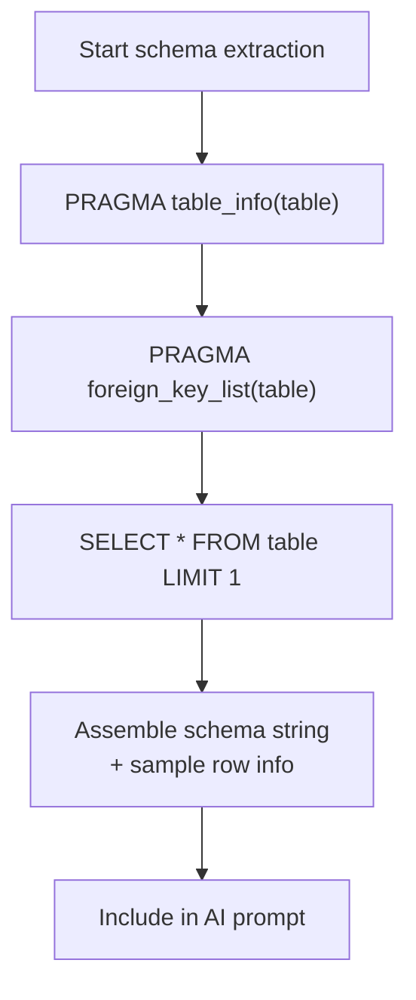
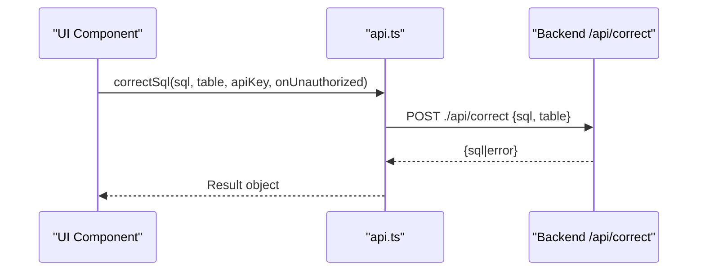
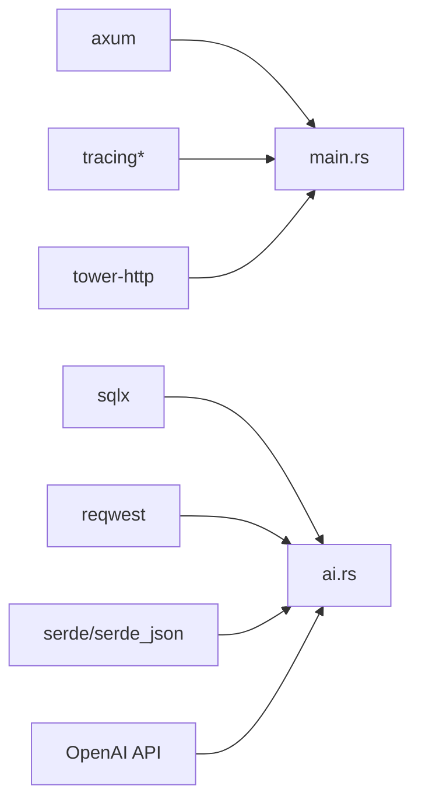

# AI Assistance

<cite>
**Referenced Files in This Document**
- [ai.rs](file://backend/src/handlers/ai.rs)
- [main.rs](file://backend/src/main.rs)
- [state.rs](file://backend/src/state.rs)
- [api.ts](file://frontend/src/lib/api.ts)
- [query.rs](file://backend/src/handlers/query.rs)
- [Cargo.toml](file://backend/Cargo.toml)
</cite>

## Table of Contents
1. [Introduction](#introduction)
2. [Project Structure](#project-structure)
3. [Core Components](#core-components)
4. [Architecture Overview](#architecture-overview)
5. [Detailed Component Analysis](#detailed-component-analysis)
6. [Dependency Analysis](#dependency-analysis)
7. [Performance Considerations](#performance-considerations)
8. [Troubleshooting Guide](#troubleshooting-guide)
9. [Conclusion](#conclusion)

## Introduction
This document provides detailed API documentation for the AI-powered SQL assistance endpoint POST /api/correct. It explains how natural language or partial SQL is converted into SQLite statements using an OpenAI-compatible chat completion service, how table schema and sample data are extracted to provide context, and how clients should integrate with the backend. It also covers authentication, error handling, rate limiting considerations, fallback strategies, and cost optimization recommendations for production deployments.

## Project Structure
The backend exposes REST endpoints under /api, including the AI-assisted correction endpoint. The frontend includes a client library that calls these endpoints.

**Diagram sources**
- [main.rs:52-65](file://backend/src/main.rs#L52-L65)
- [ai.rs:24-148](file://backend/src/handlers/ai.rs#L24-L148)
- [state.rs:5-8](file://backend/src/state.rs#L5-L8)
- [api.ts:66-75](file://frontend/src/lib/api.ts#L66-L75)

**Section sources**
- [main.rs:35-73](file://backend/src/main.rs#L35-L73)
- [state.rs:5-8](file://backend/src/state.rs#L5-L8)
- [api.ts:66-75](file://frontend/src/lib/api.ts#L66-L75)

## Core Components
- CorrectRequest: Request body for POST /api/correct containing the user input and target table name.
- CorrectResponse: Response body containing either a generated SQL string or an error message.
- AppState: Shared application state holding the database connection pool.
- Frontend client function correctSql: Invokes the backend endpoint and returns the result.

Key responsibilities:
- Validate request inputs.
- Extract table schema and optional sample row from SQLite.
- Build a prompt for the AI model with schema context.
- Call the OpenAI-compatible API and parse the response.
- Return corrected/generated SQL or an error.

**Section sources**
- [ai.rs:12-22](file://backend/src/handlers/ai.rs#L12-L22)
- [state.rs:5-8](file://backend/src/state.rs#L5-L8)
- [api.ts:61-75](file://frontend/src/lib/api.ts#L61-L75)

## Architecture Overview
The AI assistance flow integrates the Axum router, handler logic, SQLite metadata queries, and an external OpenAI-compatible chat completions API.

**Diagram sources**
- [main.rs:52-65](file://backend/src/main.rs#L52-L65)
- [ai.rs:24-148](file://backend/src/handlers/ai.rs#L24-L148)
- [api.ts:66-75](file://frontend/src/lib/api.ts#L66-L75)

## Detailed Component Analysis

### Endpoint: POST /api/correct
- Purpose: Convert natural language or partial SQL into a valid SQLite statement for a specified table.
- Authentication: Requires header x-api-key matching the server-side API_KEY environment variable.
- Request Body: CorrectRequest
  - sql: string — Natural language description or partial SQL to be corrected/completed.
  - table: string — Target SQLite table name used to extract schema context.
- Response Body: CorrectResponse
  - sql: string | null — Generated or corrected SQL when successful.
  - error: string | null — Error message when unsuccessful.

Behavior highlights:
- If OPENAI_API_KEY is not configured, returns an error without calling the external API.
- Reads table schema via PRAGMA queries and optionally fetches one sample row to enrich the prompt.
- Builds a system prompt instructing the model to return raw SQL only.
- Calls the OpenAI-compatible chat completions endpoint and parses the first choice’s content.
- Returns the model output as SQL if successful; otherwise returns an error status or network error.

**Diagram sources**
- [main.rs:22-33](file://backend/src/main.rs#L22-L33)
- [ai.rs:24-148](file://backend/src/handlers/ai.rs#L24-L148)

**Section sources**
- [main.rs:22-33](file://backend/src/main.rs#L22-L33)
- [ai.rs:12-22](file://backend/src/handlers/ai.rs#L12-L22)
- [ai.rs:24-148](file://backend/src/handlers/ai.rs#L24-L148)

### CorrectRequest Schema
- Fields:
  - sql: string — Natural language instruction or partial SQL to be corrected/completed.
  - table: string — SQLite table name to use for schema extraction.

Example usage pattern:
- Frontend collects user input and selected table, then sends a POST request with this payload.

**Section sources**
- [ai.rs:12-16](file://backend/src/handlers/ai.rs#L12-L16)
- [api.ts:66-75](file://frontend/src/lib/api.ts#L66-L75)

### CorrectResponse Schema
- Fields:
  - sql: string | null — Generated or corrected SQL on success.
  - error: string | null — Error message on failure.

Notes:
- No confidence score or explanation fields are included in the current response schema.
- Clients should treat presence of sql as success and error as failure.

**Section sources**
- [ai.rs:18-22](file://backend/src/handlers/ai.rs#L18-L22)

### OpenAI Integration and Prompt Engineering
- Environment variables:
  - OPENAI_API_KEY: Required for authentication to the external API.
  - OPENAI_BASE_URL: Defaults to https://api.openai.com/v1 if not set.
  - OPENAI_MODEL: Defaults to gpt-5.4-mini if not set.
- Request format:
  - Uses chat completions with messages array containing a system role and a user role.
  - System role enforces returning raw SQL only.
  - User role contains a prompt built from table name, schema, sample row, and user input.
- Response parsing:
  - Expects choices[0].message.content to contain the SQL string.

Prompt construction approach:
- Includes table name and schema details (columns, types, primary keys, NOT NULL).
- Includes foreign key relationships where available.
- Optionally appends a sample row to clarify expected value formats.
- Instructs the model to default to a simple SELECT * ... LIMIT 10 when intent is ambiguous.

**Diagram sources**
- [ai.rs:12-22](file://backend/src/handlers/ai.rs#L12-L22)
- [state.rs:5-8](file://backend/src/state.rs#L5-L8)
- [ai.rs:24-148](file://backend/src/handlers/ai.rs#L24-L148)

**Section sources**
- [ai.rs:28-37](file://backend/src/handlers/ai.rs#L28-L37)
- [ai.rs:99-121](file://backend/src/handlers/ai.rs#L99-L121)
- [ai.rs:123-148](file://backend/src/handlers/ai.rs#L123-L148)

### Schema Extraction and Context Provision
- Columns and constraints:
  - Uses PRAGMA table_info to retrieve column names, types, NOT NULL flags, and primary key flags.
- Foreign keys:
  - Uses PRAGMA foreign_key_list to capture relationships between tables.
- Sample row:
  - Attempts to fetch one row to include representative values in the prompt.
- Schema string assembly:
  - Concatenates column definitions, constraints, and foreign keys into a single schema block.
  - Appends sample row information when available.

**Diagram sources**
- [ai.rs:39-96](file://backend/src/handlers/ai.rs#L39-L96)

**Section sources**
- [ai.rs:39-96](file://backend/src/handlers/ai.rs#L39-L96)

### Frontend Integration Pattern
- The frontend client function correctSql sends a POST request to ./api/correct with headers including x-api-key and a JSON body containing sql and table.
- It handles 401 responses by invoking an optional callback and throws an error.
- On success, it returns the JSON body directly, which matches CorrectResponse.

**Diagram sources**
- [api.ts:66-75](file://frontend/src/lib/api.ts#L66-L75)

**Section sources**
- [api.ts:12-23](file://frontend/src/lib/api.ts#L12-L23)
- [api.ts:66-75](file://frontend/src/lib/api.ts#L66-L75)

### Practical Examples and Usage Patterns
- Natural language to SQL:
  - Provide a descriptive sentence about what data to retrieve or modify, along with the target table name.
- Partial SQL completion:
  - Supply a partially written query to be completed or corrected based on the table schema.
- Ambiguous intent:
  - When intent is unclear, the model defaults to a simple SELECT * ... LIMIT 10 for safety.

Note: These examples describe usage patterns rather than specific code snippets.

**Section sources**
- [ai.rs:100-107](file://backend/src/handlers/ai.rs#L100-L107)

## Dependency Analysis
- Backend dependencies:
  - axum: HTTP routing and middleware.
  - sqlx: SQLite database access and PRAGMA queries.
  - reqwest: HTTP client to call OpenAI-compatible APIs.
  - serde/serde_json: Serialization/deserialization of requests/responses.
  - tracing/tracing-subscriber: Logging and observability.
  - tower-http: Tracing layer and static file serving.
- External dependency:
  - OpenAI-compatible chat completions API.

**Diagram sources**
- [Cargo.toml:6-18](file://backend/Cargo.toml#L6-L18)
- [main.rs:1-18](file://backend/src/main.rs#L1-L18)
- [ai.rs:1-10](file://backend/src/handlers/ai.rs#L1-L10)

**Section sources**
- [Cargo.toml:6-18](file://backend/Cargo.toml#L6-L18)
- [main.rs:1-18](file://backend/src/main.rs#L1-L18)
- [ai.rs:1-10](file://backend/src/handlers/ai.rs#L1-L10)

## Performance Considerations
- Database reads:
  - Schema extraction uses PRAGMA queries and an optional sample row. Ensure the target table exists and is accessible.
- Network latency:
  - External API calls introduce latency; consider caching prompts or results for repeated identical inputs at the application level if appropriate.
- Concurrency:
  - The database pool is wrapped in a read lock per request; avoid long-running operations inside handlers.
- Model selection:
  - Use smaller/faster models for high-throughput scenarios to reduce latency and cost.

[No sources needed since this section provides general guidance]

## Troubleshooting Guide
Common issues and resolutions:
- Missing API key:
  - Symptom: Response includes an error indicating OPENAI_API_KEY not configured.
  - Resolution: Set OPENAI_API_KEY in the environment before starting the server.
- Unauthorized access:
  - Symptom: 401 Unauthorized from the backend.
  - Resolution: Ensure the x-api-key header matches the server-side API_KEY environment variable.
- External API errors:
  - Symptom: Response includes an error describing the remote API status or network error.
  - Resolution: Verify OPENAI_BASE_URL and OPENAI_MODEL; check network connectivity and quotas.
- Table not found or empty schema:
  - Symptom: Empty schema in prompt; model may return generic queries.
  - Resolution: Confirm the table name and that the database is connected.

Operational tips:
- Enable logging via RUST_LOG to inspect prompts and responses for debugging.
- Monitor external API status codes and handle retries gracefully in the client.

**Section sources**
- [ai.rs:28-37](file://backend/src/handlers/ai.rs#L28-L37)
- [ai.rs:123-148](file://backend/src/handlers/ai.rs#L123-L148)
- [main.rs:22-33](file://backend/src/main.rs#L22-L33)

## Conclusion
The POST /api/correct endpoint provides AI-powered SQL generation and correction grounded in real table schema and optional sample data. It integrates seamlessly with an OpenAI-compatible chat completions service and exposes a straightforward JSON interface for frontend integration. For production, ensure robust authentication, configure environment variables correctly, implement client-side retry and fallback mechanisms, and adopt cost-conscious model selection and prompt engineering practices.

[No sources needed since this section summarizes without analyzing specific files]