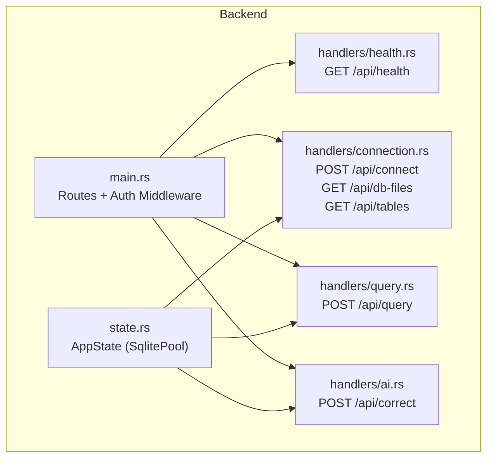
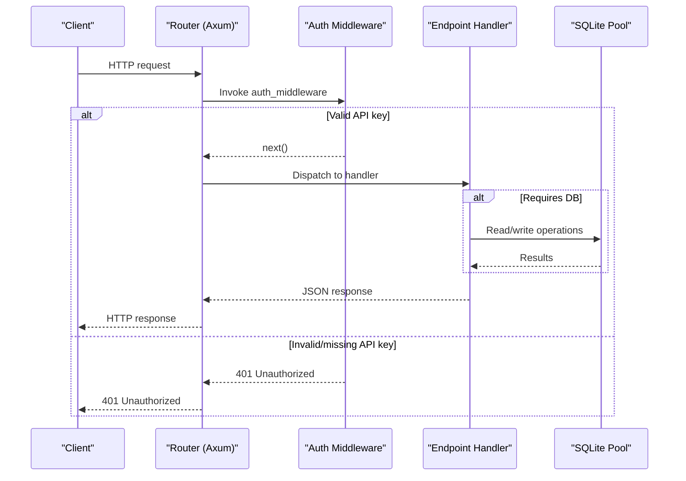
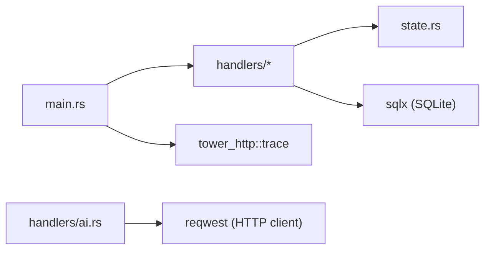

# API Reference

<cite>
**Referenced Files in This Document**
- [main.rs](file://backend/src/main.rs)
- [health.rs](file://backend/src/handlers/health.rs)
- [connection.rs](file://backend/src/handlers/connection.rs)
- [query.rs](file://backend/src/handlers/query.rs)
- [ai.rs](file://backend/src/handlers/ai.rs)
- [state.rs](file://backend/src/state.rs)
- [Cargo.toml](file://backend/Cargo.toml)
</cite>

## Table of Contents
1. [Introduction](#introduction)
2. [Project Structure](#project-structure)
3. [Core Components](#core-components)
4. [Architecture Overview](#architecture-overview)
5. [Detailed Component Analysis](#detailed-component-analysis)
6. [Dependency Analysis](#dependency-analysis)
7. [Performance Considerations](#performance-considerations)
8. [Troubleshooting Guide](#troubleshooting-guide)
9. [Conclusion](#conclusion)

## Introduction
This document provides comprehensive API documentation for the backend endpoints that manage SQLite connections, discover database files, list tables, execute SQL queries, and assist with natural language to SQL conversion. It also documents authentication via API keys, error handling patterns, and operational considerations such as rate limiting and versioning.

The backend is built with Axum and exposes a RESTful API under the /api prefix. Authentication is enforced through an API key passed in the x-api-key header. The health endpoint is public; all other endpoints require authentication.

## Project Structure
The backend application defines routes, middleware, handlers, and shared state:
- Routing and middleware are defined in the main module.
- Handlers implement individual endpoints for health checks, connection management, query execution, and AI assistance.
- Shared application state holds the active SQLite connection pool.

**Diagram sources**
- [main.rs:52-65](file://backend/src/main.rs#L52-L65)
- [health.rs:3-5](file://backend/src/handlers/health.rs#L3-L5)
- [connection.rs:20-129](file://backend/src/handlers/connection.rs#L20-L129)
- [query.rs:101-200](file://backend/src/handlers/query.rs#L101-L200)
- [ai.rs:24-148](file://backend/src/handlers/ai.rs#L24-L148)
- [state.rs:5-8](file://backend/src/state.rs#L5-L8)

**Section sources**
- [main.rs:1-74](file://backend/src/main.rs#L1-L74)
- [state.rs:1-9](file://backend/src/state.rs#L1-L9)

## Core Components
- Authentication middleware: Validates the x-api-key header against the API_KEY environment variable. Returns 401 Unauthorized if missing or invalid.
- Health check: Public endpoint returning status and version information.
- Connection management:
  - POST /api/connect: Establishes or creates a SQLite database connection using a path relative to the db directory.
  - GET /api/db-files: Recursively lists .db files under the db directory.
  - GET /api/tables: Lists table names from the currently connected database.
- Query execution:
  - POST /api/query: Executes arbitrary SQL statements and returns structured results or affected row counts.
- AI assistance:
  - POST /api/correct: Converts natural language into SQLite SQL by calling an external OpenAI-compatible API.

Authentication requirements:
- All endpoints except GET /api/health require a valid x-api-key header.

Error responses:
- 401 Unauthorized: Missing or invalid API key.
- 400 Bad Request: Invalid input or no database connected where required.
- 404 Not Found: Database file not found when connecting without create mode.
- 500 Internal Server Error: Unexpected server-side failures.

Rate limiting:
- No built-in rate limiting is implemented. Clients should implement client-side retries with exponential backoff.

Versioning:
- The API does not include explicit versioning in URLs. Version metadata is available via the health endpoint.

**Section sources**
- [main.rs:22-33](file://backend/src/main.rs#L22-L33)
- [main.rs:52-65](file://backend/src/main.rs#L52-L65)
- [health.rs:3-5](file://backend/src/handlers/health.rs#L3-L5)
- [connection.rs:62-129](file://backend/src/handlers/connection.rs#L62-L129)
- [query.rs:101-200](file://backend/src/handlers/query.rs#L101-L200)
- [ai.rs:24-148](file://backend/src/handlers/ai.rs#L24-L148)

## Architecture Overview
The API follows a layered architecture:
- Router layer: Defines HTTP routes and applies global middleware.
- Middleware layer: Enforces API key authentication.
- Handler layer: Implements business logic for each endpoint.
- State layer: Holds the active SQLite connection pool across requests.

**Diagram sources**
- [main.rs:22-33](file://backend/src/main.rs#L22-L33)
- [main.rs:52-65](file://backend/src/main.rs#L52-L65)
- [connection.rs:62-129](file://backend/src/handlers/connection.rs#L62-L129)
- [query.rs:101-200](file://backend/src/handlers/query.rs#L101-L200)
- [ai.rs:24-148](file://backend/src/handlers/ai.rs#L24-L148)

## Detailed Component Analysis

### Authentication Mechanism
- Header: x-api-key
- Validation: Compared against the API_KEY environment variable.
- Behavior:
  - If present and matches: proceed to handler.
  - Otherwise: return 401 Unauthorized.

Notes:
- The default fallback value is used only when the environment variable is not set.
- For production, ensure API_KEY is configured securely.

**Section sources**
- [main.rs:22-33](file://backend/src/main.rs#L22-L33)

### Health Check Endpoint
- Method: GET
- URL: /api/health
- Authentication: None (public)
- Response schema:
  - status: string (e.g., "ok")
  - version: string (from build-time or runtime env)
- Example response:
  - { "status": "ok", "version": "0.2.3" }

Use cases:
- Liveness probe for orchestrators.
- Version discovery for clients.

**Section sources**
- [health.rs:3-5](file://backend/src/handlers/health.rs#L3-L5)
- [main.rs:60-65](file://backend/src/main.rs#L60-L65)

### Connection Management Endpoints

#### POST /api/connect
- Purpose: Establish a connection to a SQLite database file under the db directory. Optionally create the file if it does not exist.
- Authentication: Required (x-api-key)
- Request body schema:
  - path: string (relative path within db/)
  - create: boolean (optional, default false)
- Behavior:
  - Rejects paths containing ".." to prevent directory traversal.
  - Creates the db directory if missing.
  - Connects with WAL journal mode and busy timeout.
  - Stores the connection pool in AppState.
- Success response:
  - Status: 200 OK
  - Body: plain text "Connected"
- Error responses:
  - 400 Bad Request: Invalid path or directory creation failure.
  - 404 Not Found: File not found and create=false.
  - 500 Internal Server Error: Connection failure.

Example usage:
- Request:
  - POST /api/connect
  - Headers: x-api-key: YOUR_API_KEY
  - Body: { "path": "mydb.db", "create": true }
- Response:
  - 200 OK
  - Body: Connected

**Section sources**
- [connection.rs:13-18](file://backend/src/handlers/connection.rs#L13-L18)
- [connection.rs:62-109](file://backend/src/handlers/connection.rs#L62-L109)
- [main.rs:52-58](file://backend/src/main.rs#L52-L58)

#### GET /api/db-files
- Purpose: Discover SQLite database files under the db directory.
- Authentication: Required (x-api-key)
- Response schema:
  - Array of strings representing relative paths from the db root.
- Behavior:
  - Recursively scans directories.
  - Excludes SQLite WAL/SHM files.
  - Only includes files ending with .db.
- Success response:
  - 200 OK
  - Body: ["subdir/mydb.db", "other.db"]
- Error responses:
  - 500 Internal Server Error: Directory creation failure.

Example usage:
- Request:
  - GET /api/db-files
  - Headers: x-api-key: YOUR_API_KEY
- Response:
  - 200 OK
  - Body: ["data/users.db", "logs/app.db"]

**Section sources**
- [connection.rs:20-60](file://backend/src/handlers/connection.rs#L20-L60)
- [main.rs:54-55](file://backend/src/main.rs#L54-L55)

#### GET /api/tables
- Purpose: Retrieve table names from the currently connected database.
- Authentication: Required (x-api-key)
- Response schema:
  - Array of strings (table names).
- Behavior:
  - Queries sqlite_master for user-defined tables.
  - Requires an active connection.
- Success response:
  - 200 OK
  - Body: ["users", "orders"]
- Error responses:
  - 400 Bad Request: No database connected.
  - 500 Internal Server Error: Query failure.

Example usage:
- Request:
  - GET /api/tables
  - Headers: x-api-key: YOUR_API_KEY
- Response:
  - 200 OK
  - Body: ["users", "orders"]

**Section sources**
- [connection.rs:111-129](file://backend/src/handlers/connection.rs#L111-L129)
- [main.rs:55-56](file://backend/src/main.rs#L55-L56)

### Query Execution Endpoint

#### POST /api/query
- Purpose: Execute SQL statements against the connected SQLite database.
- Authentication: Required (x-api-key)
- Request body schema:
  - sql: string (SQL statement)
- Response schema:
  - columns: array of strings (column names)
  - column_types: array of strings (column type names)
  - rows: array of arrays (each inner array is a row of values)
  - affected_rows: number or null (for non-query statements)
  - execution_time: number (milliseconds)
  - error: string or null (error message if any)
- Behavior:
  - Determines whether to fetch rows based on SQL prefixes (SELECT, PRAGMA, EXPLAIN, WITH) or presence of RETURNING.
  - Serializes column types and values robustly.
  - Measures execution time in milliseconds.
- Success responses:
  - 200 OK with structured result.
- Error responses:
  - 200 OK with error field populated when SQL execution fails.
  - Note: Errors are embedded in the response body rather than HTTP error codes for query errors.

Example usage:
- Request:
  - POST /api/query
  - Headers: x-api-key: YOUR_API_KEY
  - Body: { "sql": "SELECT id, name FROM users LIMIT 10" }
- Response:
  - 200 OK
  - Body:
    - {
        "columns": ["id", "name"],
        "column_types": ["INTEGER", "TEXT"],
        "rows": [[1, "Alice"], [2, "Bob"]],
        "affected_rows": null,
        "execution_time": 1.23,
        "error": null
      }

**Section sources**
- [query.rs:12-25](file://backend/src/handlers/query.rs#L12-L25)
- [query.rs:101-200](file://backend/src/handlers/query.rs#L101-L200)
- [main.rs:56-57](file://backend/src/main.rs#L56-L57)

### AI Assistance Endpoint

#### POST /api/correct
- Purpose: Convert natural language descriptions into SQLite SQL statements using an external AI service.
- Authentication: Required (x-api-key)
- Request body schema:
  - sql: string (natural language description)
  - table: string (target table name)
- Response schema:
  - sql: string or null (generated SQL)
  - error: string or null (error details)
- Behavior:
  - Reads OPENAI_API_KEY, OPENAI_BASE_URL, and OPENAI_MODEL from environment variables.
  - Retrieves table schema and foreign keys via pragma_table_info and pragma_foreign_key_list.
  - Optionally samples one row from the target table to enrich the prompt.
  - Calls the configured OpenAI-compatible chat completions endpoint.
- Success responses:
  - 200 OK with generated SQL.
- Error responses:
  - 200 OK with error field populated when:
    - OPENAI_API_KEY is not configured.
    - External API call fails or returns an error status.

Example usage:
- Request:
  - POST /api/correct
  - Headers: x-api-key: YOUR_API_KEY
  - Body: { "sql": "Show me the top 10 users by signup date", "table": "users" }
- Response:
  - 200 OK
  - Body: { "sql": "SELECT * FROM users ORDER BY created_at DESC LIMIT 10", "error": null }

Environment variables:
- OPENAI_API_KEY: Required for AI functionality.
- OPENAI_BASE_URL: Optional; defaults to https://api.openai.com/v1.
- OPENAI_MODEL: Optional; defaults to gpt-5.4-mini.

**Section sources**
- [ai.rs:12-22](file://backend/src/handlers/ai.rs#L12-L22)
- [ai.rs:24-148](file://backend/src/handlers/ai.rs#L24-L148)
- [main.rs:57-58](file://backend/src/main.rs#L57-L58)

## Dependency Analysis
The backend depends on:
- Axum for routing and middleware.
- Sqlx for SQLite connectivity and querying.
- Reqwest for outbound HTTP calls to the AI provider.
- Tracing for logging and observability.
- Tower HTTP for tracing and static file serving.

**Diagram sources**
- [main.rs:1-20](file://backend/src/main.rs#L1-L20)
- [query.rs:1-10](file://backend/src/handlers/query.rs#L1-L10)
- [ai.rs:1-10](file://backend/src/handlers/ai.rs#L1-L10)
- [state.rs:1-8](file://backend/src/state.rs#L1-L8)

**Section sources**
- [Cargo.toml:6-18](file://backend/Cargo.toml#L6-L18)
- [main.rs:1-20](file://backend/src/main.rs#L1-L20)

## Performance Considerations
- Connection pooling: Uses SqlitePool to manage concurrent access safely.
- WAL mode: Enabled for better concurrency and durability.
- Busy timeout: Set to reduce contention under concurrent writes.
- Query serialization: Column type detection and value mapping are performed per row; consider caching column metadata for repeated queries on the same table.
- Logging: Tracing is enabled; adjust log levels via RUST_LOG.

Recommendations:
- Implement client-side rate limiting and retry with backoff.
- Monitor execution_time in responses to detect slow queries.
- Avoid large result sets; paginate or limit queries appropriately.

[No sources needed since this section provides general guidance]

## Troubleshooting Guide
Common issues and resolutions:
- 401 Unauthorized:
  - Ensure x-api-key header matches the configured API_KEY environment variable.
- No database connected:
  - Call POST /api/connect before querying or listing tables.
- Database file not found:
  - Verify path correctness and consider setting create=true if appropriate.
- AI endpoint returns error:
  - Confirm OPENAI_API_KEY is set and accessible.
  - Validate OPENAI_BASE_URL and OPENAI_MODEL configuration.
- Directory creation failures:
  - Ensure the process has write permissions to the working directory.

Operational tips:
- Use GET /api/health to verify service liveness and version.
- Inspect logs via RUST_LOG to trace request flows and errors.

**Section sources**
- [main.rs:22-33](file://backend/src/main.rs#L22-L33)
- [connection.rs:62-109](file://backend/src/handlers/connection.rs#L62-L109)
- [ai.rs:24-37](file://backend/src/handlers/ai.rs#L24-L37)

## Conclusion
This API provides a secure and straightforward interface for managing SQLite databases, executing queries, and leveraging AI-assisted SQL generation. Authentication is enforced via API keys, and the health endpoint offers basic operational visibility. While no built-in rate limiting exists, clients can implement resilient retry strategies. Versioning is exposed through the health endpoint, and the design supports future enhancements such as explicit API versions and additional security controls.

[No sources needed since this section summarizes without analyzing specific files]