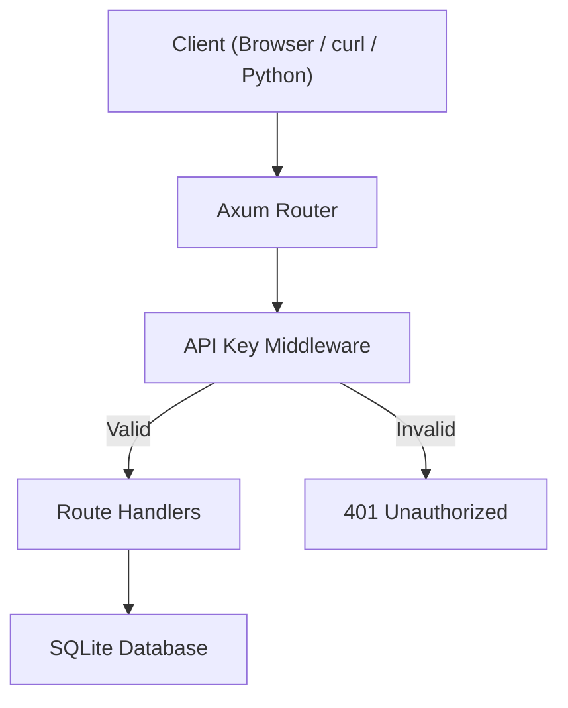
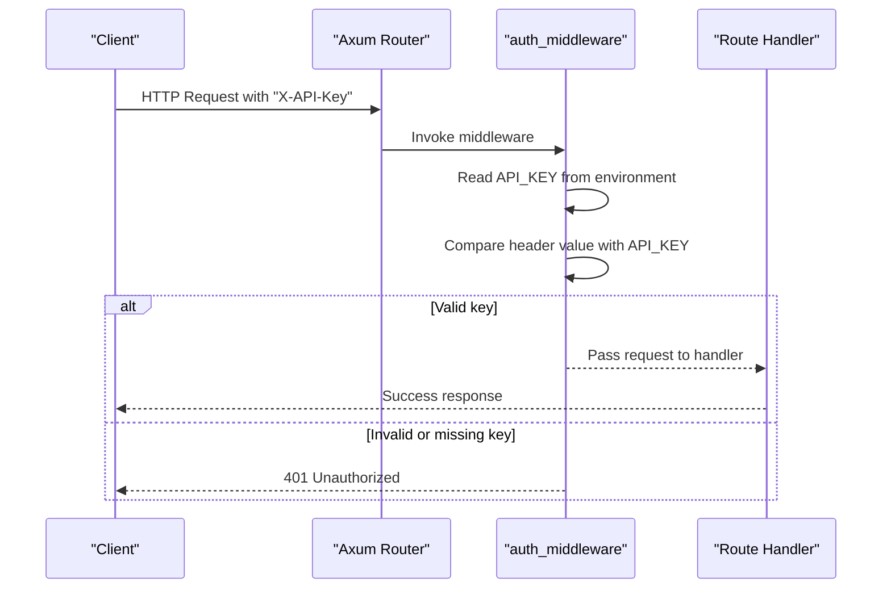
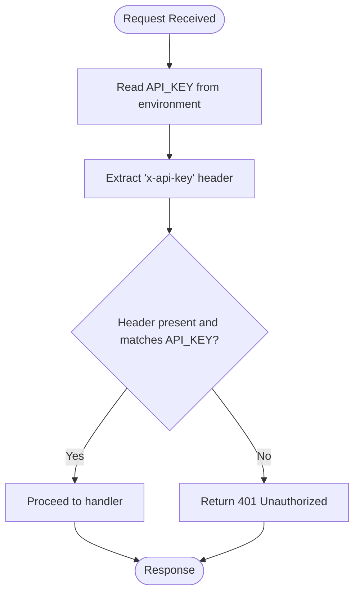
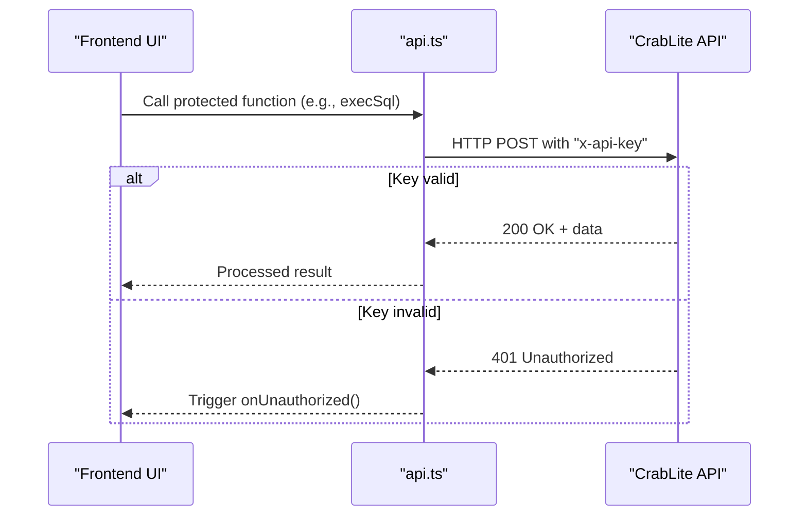
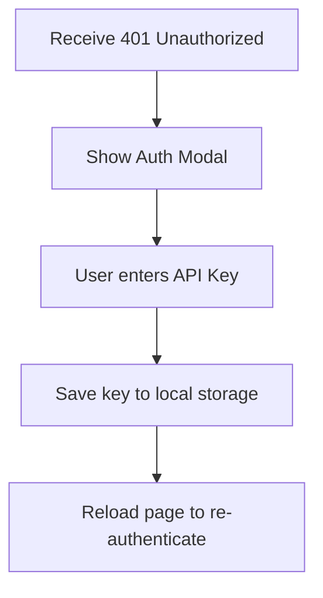
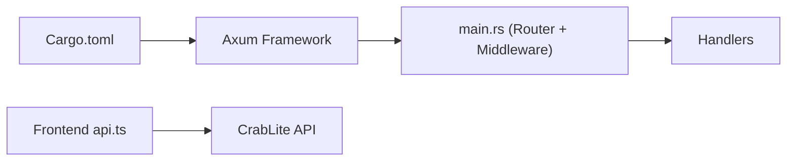

# Authentication

<cite>
**Referenced Files in This Document**
- [main.rs](file://backend/src/main.rs)
- [Cargo.toml](file://backend/Cargo.toml)
- [api.ts](file://frontend/src/lib/api.ts)
- [AuthModal.tsx](file://frontend/src/components/AuthModal.tsx)
</cite>

## Table of Contents
1. [Introduction](#introduction)
2. [Project Structure](#project-structure)
3. [Core Components](#core-components)
4. [Architecture Overview](#architecture-overview)
5. [Detailed Component Analysis](#detailed-component-analysis)
6. [Dependency Analysis](#dependency-analysis)
7. [Performance Considerations](#performance-considerations)
8. [Troubleshooting Guide](#troubleshooting-guide)
9. [Conclusion](#conclusion)

## Introduction
This document explains the authentication model for the CrabLite API. All protected endpoints require an API key passed via the HTTP header named "X-API-Key". The server validates this header using a middleware before invoking route handlers. If the header is missing or incorrect, the server responds with 401 Unauthorized.

The API key is read from the environment variable API_KEY at runtime. A default fallback value exists in development code; do not rely on it in production.

## Project Structure
Authentication spans two layers:
- Backend (Rust/Axum): defines and enforces the API key check via middleware.
- Frontend (TypeScript/SolidJS): includes the API key in requests and handles 401 responses by prompting users to enter their key.

**Diagram sources**
- [main.rs:22-33](file://backend/src/main.rs#L22-L33)
- [main.rs:52-58](file://backend/src/main.rs#L52-L58)

**Section sources**
- [main.rs:22-33](file://backend/src/main.rs#L22-L33)
- [main.rs:52-58](file://backend/src/main.rs#L52-L58)

## Core Components
- API Key Header: Clients must include "X-API-Key" with the configured secret.
- Environment Variable: The server reads API_KEY from the process environment.
- Middleware: Validates the header against the configured key before allowing access to protected routes.
- Error Handling: Missing or invalid keys return 401 Unauthorized.

Protected endpoints are grouped under "/api" and include:
- POST /api/connect
- GET /api/db-files
- GET /api/tables
- POST /api/query
- POST /api/correct

The health endpoint (/api/health) is not protected by the API key middleware.

**Section sources**
- [main.rs:22-33](file://backend/src/main.rs#L22-L33)
- [main.rs:52-58](file://backend/src/main.rs#L52-L58)

## Architecture Overview
The request flow for authenticated endpoints:

**Diagram sources**
- [main.rs:22-33](file://backend/src/main.rs#L22-L33)
- [main.rs:52-58](file://backend/src/main.rs#L52-L58)

## Detailed Component Analysis

### Backend Authentication Middleware
- Reads the API key from the environment variable API_KEY.
- Compares the incoming "x-api-key" header with the configured value.
- Allows the request to proceed if they match; otherwise returns 401 Unauthorized.
- Is applied to all routes under "/api" except "/api/health".

**Diagram sources**
- [main.rs:22-33](file://backend/src/main.rs#L22-L33)

**Section sources**
- [main.rs:22-33](file://backend/src/main.rs#L22-L33)
- [main.rs:52-58](file://backend/src/main.rs#L52-L58)

### Frontend API Integration
- Adds "x-api-key" to every protected request.
- Centralizes headers via a helper function.
- Detects 401 responses and triggers an unauthorized callback to prompt the user.
- Provides functions for tables, queries, database connection, and SQL correction.

**Diagram sources**
- [api.ts:12-23](file://frontend/src/lib/api.ts#L12-L23)
- [api.ts:36-59](file://frontend/src/lib/api.ts#L36-L59)

**Section sources**
- [api.ts:12-23](file://frontend/src/lib/api.ts#L12-L23)
- [api.ts:36-59](file://frontend/src/lib/api.ts#L36-L59)
- [api.ts:98-115](file://frontend/src/lib/api.ts#L98-L115)

### User Experience for API Key Entry
- When a 401 is received, the frontend shows an authentication modal prompting the user to enter the API key.
- The entered key is stored locally and used for subsequent requests.

**Diagram sources**
- [AuthModal.tsx:4-16](file://frontend/src/components/AuthModal.tsx#L4-L16)

**Section sources**
- [AuthModal.tsx:4-16](file://frontend/src/components/AuthModal.tsx#L4-L16)

## Dependency Analysis
- The backend uses Axum for routing and middleware composition.
- The dotenv crate is included but the middleware directly reads the environment variable at runtime.
- The frontend uses fetch to call the API and injects the API key into headers.

**Diagram sources**
- [Cargo.toml:6-18](file://backend/Cargo.toml#L6-L18)
- [main.rs:1-20](file://backend/src/main.rs#L1-L20)
- [api.ts:12-23](file://frontend/src/lib/api.ts#L12-L23)

**Section sources**
- [Cargo.toml:6-18](file://backend/Cargo.toml#L6-L18)
- [main.rs:1-20](file://backend/src/main.rs#L1-L20)
- [api.ts:12-23](file://frontend/src/lib/api.ts#L12-L23)

## Performance Considerations
- The middleware performs a simple string comparison per request; overhead is negligible.
- Avoid logging sensitive values such as API keys in logs or error messages.
- Keep the API key out of client-side source control; use secure storage mechanisms in production.

[No sources needed since this section provides general guidance]

## Troubleshooting Guide

Common issues and resolutions:
- Missing API key header: Ensure your client sends "X-API-Key" with every protected request.
- Incorrect API key: Verify that the value matches the server’s API_KEY environment variable.
- Development fallback: In development, a default key may be used; replace it with a strong secret in production.
- Health endpoint: /api/health does not require authentication; other endpoints do.

Practical examples:

- curl
  - Include the header: --header "X-API-Key: YOUR_API_KEY"
  - Example calls:
    - GET /api/tables
    - POST /api/query with JSON body {"sql": "..."}
    - POST /api/connect with JSON body {"path": "...", "create": false}

- JavaScript (browser fetch)
  - Set headers: { "Content-Type": "application/json", "x-api-key": apiKey }
  - Handle 401 by prompting the user to update the stored key.

- Python (requests)
  - Add headers: {"X-API-Key": "YOUR_API_KEY"}
  - Send POST /api/query with json payload {"sql": "..."}

Best practices for API key management:
- Store API_KEY in a secure secrets manager or environment configuration system.
- Rotate keys periodically and revoke compromised keys immediately.
- Restrict network access to the API server and enforce TLS.
- Do not log API keys or include them in error responses.
- Use short-lived tokens where possible; consider token rotation strategies.

**Section sources**
- [main.rs:22-33](file://backend/src/main.rs#L22-L33)
- [api.ts:12-23](file://frontend/src/lib/api.ts#L12-L23)
- [api.ts:36-59](file://frontend/src/lib/api.ts#L36-L59)
- [api.ts:98-115](file://frontend/src/lib/api.ts#L98-L115)

## Conclusion
CrabLite protects its API endpoints with a straightforward API key mechanism enforced by middleware. Clients must send the "X-API-Key" header with the correct secret configured via the API_KEY environment variable. Proper configuration, secure storage, and careful handling of 401 responses ensure a robust and secure integration across clients.