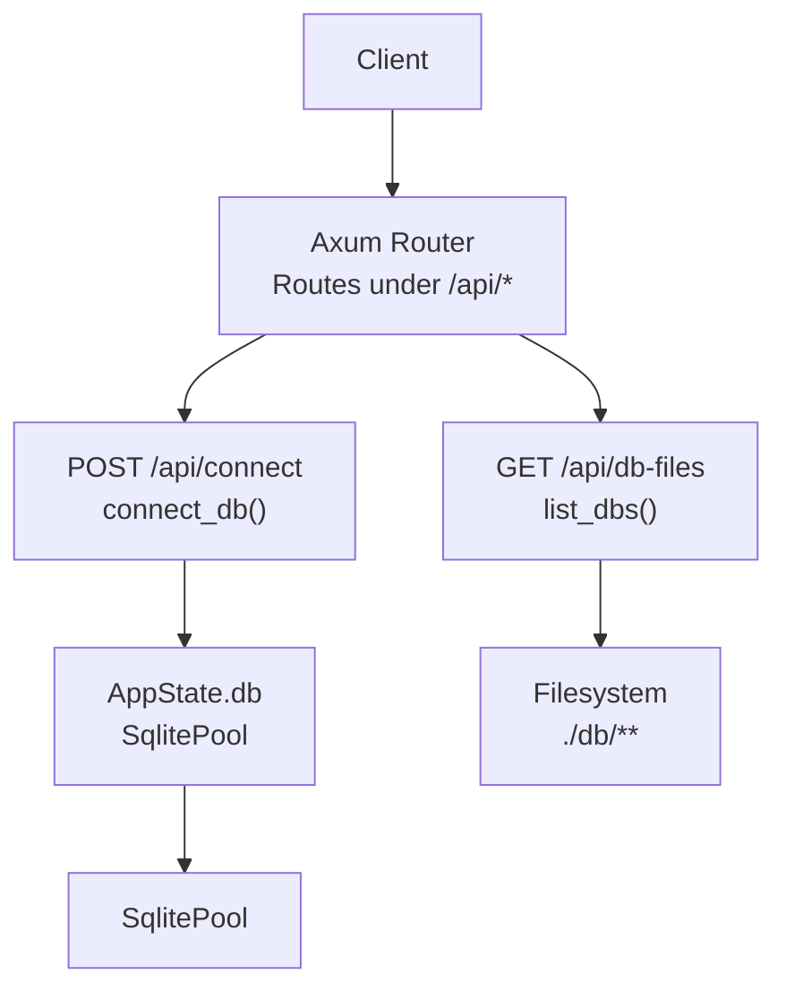
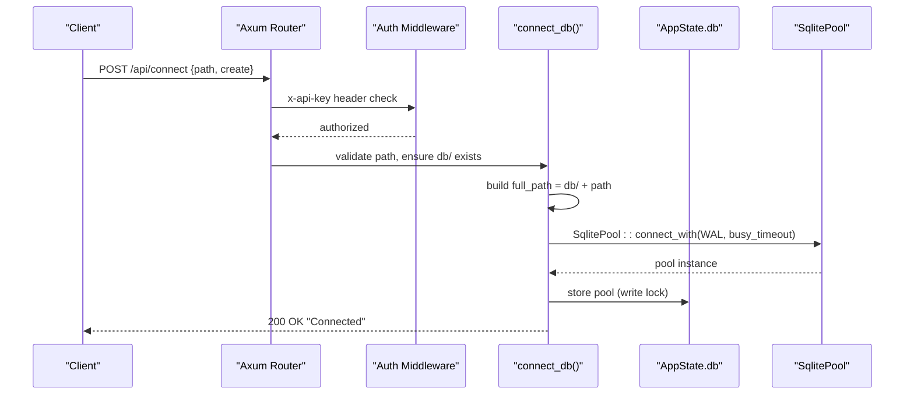
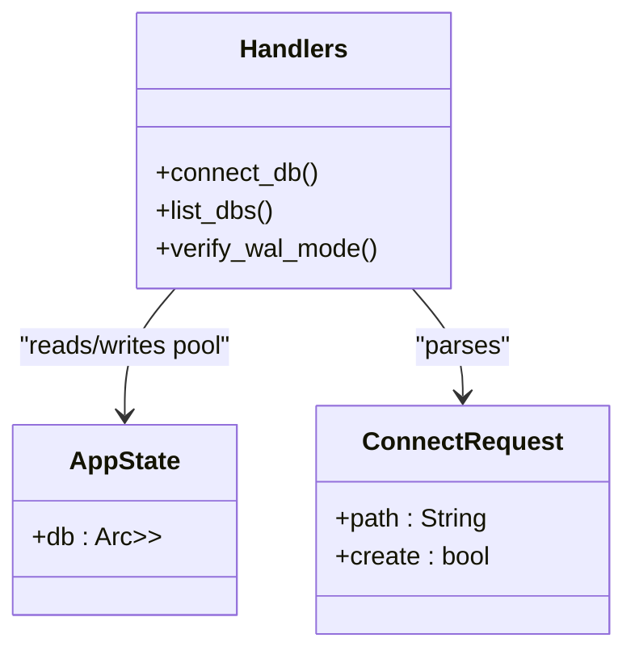
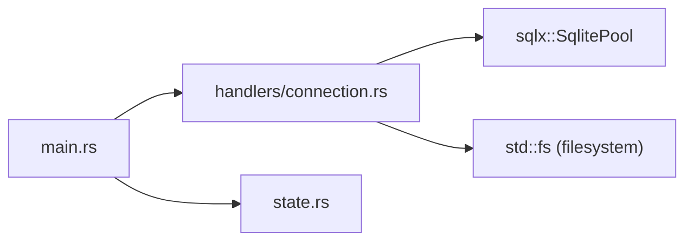

# Connection Management

<cite>
**Referenced Files in This Document**
- [connection.rs](file://backend/src/handlers/connection.rs)
- [main.rs](file://backend/src/main.rs)
- [state.rs](file://backend/src/state.rs)
- [design.md](file://doc/design.md)
</cite>

## Table of Contents
1. [Introduction](#introduction)
2. [Project Structure](#project-structure)
3. [Core Components](#core-components)
4. [Architecture Overview](#architecture-overview)
5. [Detailed Component Analysis](#detailed-component-analysis)
6. [Dependency Analysis](#dependency-analysis)
7. [Performance Considerations](#performance-considerations)
8. [Troubleshooting Guide](#troubleshooting-guide)
9. [Conclusion](#conclusion)

## Introduction
This document provides detailed API documentation for database connection management endpoints that manage SQLite connections and discover database files under the db/ directory. It covers:
- POST /api/connect: Establishing a SQLite connection with ConnectRequest schema (path, create), path validation, directory traversal protection, and WAL mode configuration.
- GET /api/db-files: Recursive discovery of .db files under db/, including filtering rules and response format.
- Request/response examples, error scenarios, connection lifecycle, security considerations, performance implications, and troubleshooting guidance.

## Project Structure
The backend is implemented in Rust using Axum. The relevant components are:
- Route registration and middleware in main.rs
- Connection handlers and utilities in handlers/connection.rs
- Global application state in state.rs

**Diagram sources**
- [main.rs:52-65](file://backend/src/main.rs#L52-L65)
- [connection.rs:20-109](file://backend/src/handlers/connection.rs#L20-L109)
- [state.rs:5-8](file://backend/src/state.rs#L5-L8)

**Section sources**
- [main.rs:1-74](file://backend/src/main.rs#L1-L74)
- [connection.rs:1-145](file://backend/src/handlers/connection.rs#L1-L145)
- [state.rs:1-9](file://backend/src/state.rs#L1-L9)

## Core Components
- ConnectRequest schema: Defines the request body for establishing a connection.
- connect_db handler: Validates input, ensures db/ exists, constructs full path, configures SQLite options (WAL mode, busy timeout), creates or connects to the pool, and stores it in AppState.
- list_dbs handler: Recursively scans db/ for .db files, excludes WAL/SHM artifacts, and returns relative paths from db/.
- verify_wal_mode utility: Verifies that the active journal mode is WAL after connecting.

Key responsibilities:
- Security: Block directory traversal via ".." checks; restrict access to db/ base path.
- Reliability: Use WAL mode and busy_timeout to reduce contention and prevent corruption.
- Discoverability: Provide recursive listing of database files under db/.

**Section sources**
- [connection.rs:13-18](file://backend/src/handlers/connection.rs#L13-L18)
- [connection.rs:62-109](file://backend/src/handlers/connection.rs#L62-L109)
- [connection.rs:20-60](file://backend/src/handlers/connection.rs#L20-L60)
- [connection.rs:131-144](file://backend/src/handlers/connection.rs#L131-L144)

## Architecture Overview
The connection management flow integrates routing, authentication middleware, and handlers:

**Diagram sources**
- [main.rs:22-33](file://backend/src/main.rs#L22-L33)
- [main.rs:52-65](file://backend/src/main.rs#L52-L65)
- [connection.rs:62-109](file://backend/src/handlers/connection.rs#L62-L109)
- [state.rs:5-8](file://backend/src/state.rs#L5-L8)

## Detailed Component Analysis

### POST /api/connect
Establishes a SQLite connection based on the provided path and optional creation flag.

- Method: POST
- Path: /api/connect
- Authentication: Requires x-api-key header (configured via API_KEY env var). Default value is used if not set.
- Request Body Schema: ConnectRequest
  - path: string (required). Relative path under db/. Subdirectories allowed. Directory traversal ("..") is blocked.
  - create: boolean (optional, default false). If true, create the file if it does not exist.
- Response:
  - 200 OK: "Connected" when successful.
  - 400 Bad Request: Invalid path (directory traversal detected).
  - 404 Not Found: Database file not found and create=false.
  - 500 Internal Server Error: Failed to create db/ directory or failed to connect.

Processing logic:
- Validate path for directory traversal ("..").
- Ensure db/ directory exists; create it if missing.
- Construct full_path by joining db/ with path.
- If full_path does not exist and create=false, return 404.
- Configure SqliteConnectOptions:
  - filename(full_path)
  - create_if_missing(create)
  - journal_mode(WAL)
  - busy_timeout(30s)
- Create SqlitePool and optionally verify WAL mode.
- Store pool in AppState.db (replaces previous connection).

Security considerations:
- Only allows subpaths under db/.
- Blocks directory traversal attempts.
- All requests require x-api-key header unless health endpoint is accessed.

Error scenarios:
- Missing db/ directory: Handler attempts to create it; failure returns 500.
- File not found and create=false: Returns 404.
- Permission issues creating directories or connecting: Returns 500 with error details logged.

Connection lifecycle:
- Each successful call replaces the existing pool in AppState.db.
- WAL mode is enforced at connection time.
- Busy timeout reduces contention for concurrent access.

Request example:
- JSON body: {"path": "test.db", "create": true}

Response example:
- Status: 200
- Body: "Connected"

**Section sources**
- [main.rs:22-33](file://backend/src/main.rs#L22-L33)
- [main.rs:52-65](file://backend/src/main.rs#L52-L65)
- [connection.rs:13-18](file://backend/src/handlers/connection.rs#L13-L18)
- [connection.rs:62-109](file://backend/src/handlers/connection.rs#L62-L109)
- [connection.rs:131-144](file://backend/src/handlers/connection.rs#L131-L144)

### GET /api/db-files
Recursively discovers database files under the db/ directory.

- Method: GET
- Path: /api/db-files
- Authentication: Requires x-api-key header.
- Behavior:
  - If db/ does not exist, attempt to create it; if creation fails, return 500.
  - Recursively scan all subdirectories under db/.
  - Include only files ending with ".db".
  - Exclude SQLite WAL/SHM artifacts (files ending with "-wal" or "-shm").
  - Return relative paths from db/ root.
- Response:
  - 200 OK: JSON array of strings representing relative paths under db/.
  - 500 Internal Server Error: Failed to create db/ directory.

Filtering rules:
- Only include files with ".db" extension.
- Exclude files ending with "-wal" or "-shm".
- Paths are returned relative to db/ (e.g., "rust/sqlite.db").

Performance considerations:
- Recursive scanning can be expensive on large directory trees.
- Consider caching results if called frequently.
- Avoid scanning during high-load periods if possible.

Example response:
- JSON array: ["test.db", "rust/sqlite.db", "logs/app.db"]

**Section sources**
- [connection.rs:20-60](file://backend/src/handlers/connection.rs#L20-L60)
- [main.rs:52-65](file://backend/src/main.rs#L52-L65)

### Connection Lifecycle and State Management
- AppState holds an Arc<RwLock<Option<SqlitePool>>> allowing safe concurrent access.
- connect_db updates the global pool, replacing any prior connection.
- Other handlers (e.g., table listing) read from this shared pool.

**Diagram sources**
- [state.rs:5-8](file://backend/src/state.rs#L5-L8)
- [connection.rs:13-18](file://backend/src/handlers/connection.rs#L13-L18)
- [connection.rs:62-109](file://backend/src/handlers/connection.rs#L62-L109)

## Dependency Analysis
- main.rs registers routes and applies auth middleware.
- handlers/connection.rs implements connect_db, list_dbs, and verify_wal_mode.
- state.rs defines AppState holding the SqlitePool.

**Diagram sources**
- [main.rs:52-65](file://backend/src/main.rs#L52-L65)
- [connection.rs:1-10](file://backend/src/handlers/connection.rs#L1-L10)
- [state.rs:1-9](file://backend/src/state.rs#L1-L9)

**Section sources**
- [main.rs:52-65](file://backend/src/main.rs#L52-L65)
- [connection.rs:1-10](file://backend/src/handlers/connection.rs#L1-L10)
- [state.rs:1-9](file://backend/src/state.rs#L1-L9)

## Performance Considerations
- WAL mode improves concurrency and reduces locking overhead compared to default journal modes.
- busy_timeout(30s) prevents immediate failures under contention but may delay responses if locks persist.
- Recursive scanning in list_dbs can be costly; consider:
  - Caching results with invalidation on filesystem changes.
  - Limiting depth or providing pagination.
  - Running scans asynchronously and returning partial results.

[No sources needed since this section provides general guidance]

## Troubleshooting Guide
Common issues and resolutions:
- Directory traversal blocked:
  - Symptom: 400 Bad Request with message indicating invalid path.
  - Cause: Request contains ".." in path.
  - Resolution: Use valid subpaths under db/ without "..".
- Database file not found:
  - Symptom: 404 Not Found.
  - Cause: File does not exist and create=false.
  - Resolution: Set create=true or ensure the file exists under db/.
- Failed to create db/ directory:
  - Symptom: 500 Internal Server Error.
  - Cause: Insufficient permissions or invalid mount.
  - Resolution: Ensure the process has write permissions to create db/.
- Connection failures:
  - Symptom: 500 Internal Server Error with error details.
  - Cause: Permissions on target file, corrupted database, or resource constraints.
  - Resolution: Check file permissions, integrity, and system resources; review logs.
- WAL mode verification warnings:
  - Symptom: Warning logs about WAL mode verification.
  - Cause: Journal mode not set to WAL.
  - Resolution: Verify SqliteConnectOptions configuration and re-connect.

Operational tips:
- Always set x-api-key header to match API_KEY environment variable.
- Monitor logs for tracing errors and warnings related to directory creation and connection failures.
- Validate client-side before sending requests to avoid unnecessary retries.

**Section sources**
- [connection.rs:62-109](file://backend/src/handlers/connection.rs#L62-L109)
- [connection.rs:20-60](file://backend/src/handlers/connection.rs#L20-L60)
- [main.rs:22-33](file://backend/src/main.rs#L22-L33)

## Conclusion
The connection management endpoints provide secure and reliable ways to establish SQLite connections and discover database files under db/. They enforce directory traversal protection, configure WAL mode for better concurrency, and offer recursive file discovery with appropriate filtering. For production use, consider enhancing performance through caching and robust error handling, and ensure proper authentication and permissions are configured.

[No sources needed since this section summarizes without analyzing specific files]