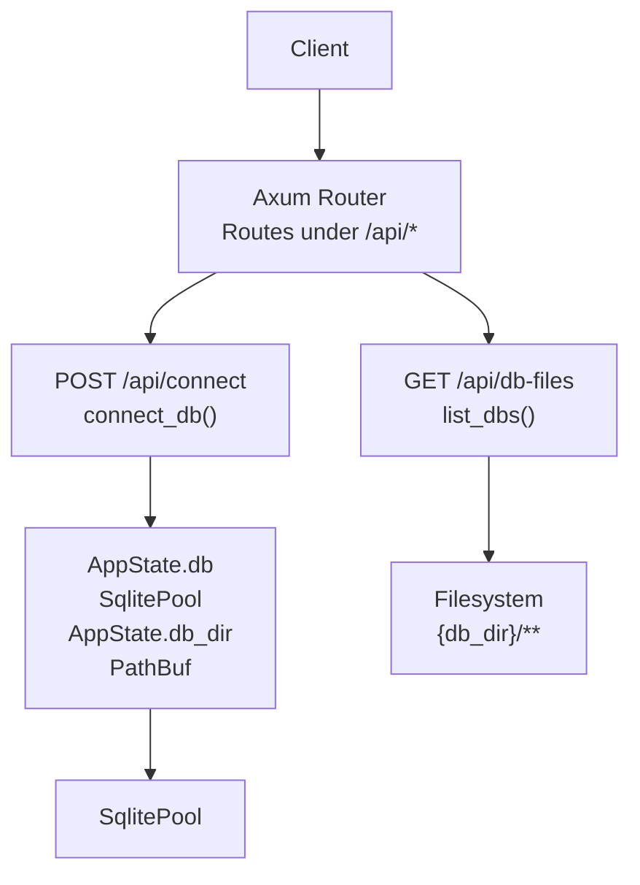
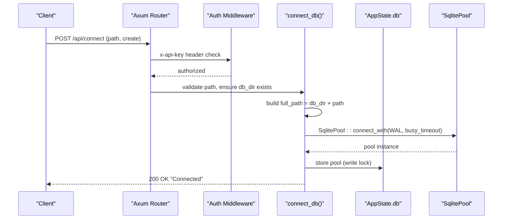
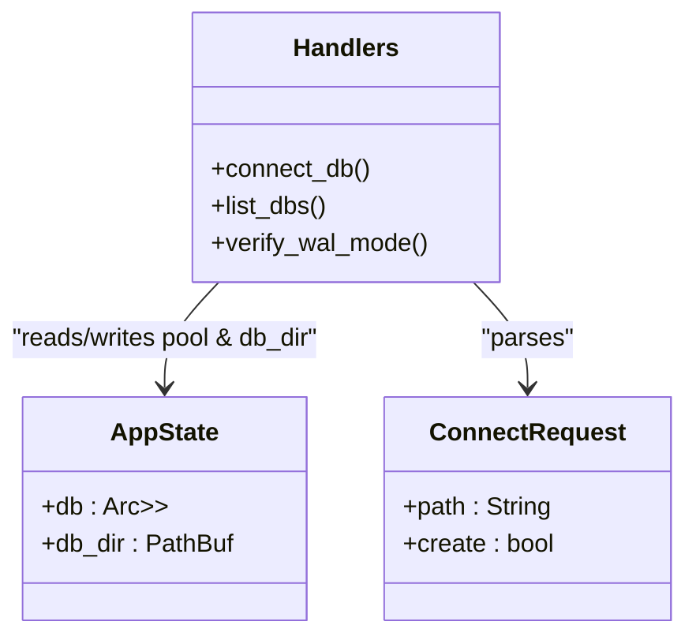
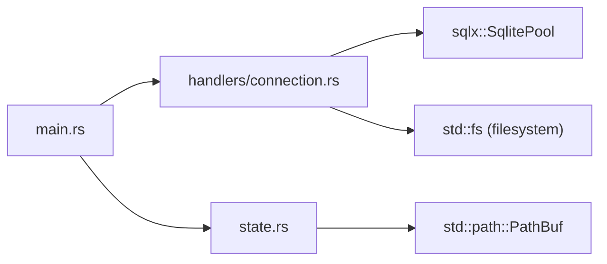

Based on my analysis of the codebase, I can see the key changes that need to be reflected in the documentation:

1. **Configurable database directory support**: The application now supports a configurable `DB_DIR` environment variable instead of hardcoding "db"
2. **Enhanced path validation and security**: Improved directory traversal protection with better error handling
3. **Improved connection handling**: Better error logging and WAL mode verification

Let me update the documentation to reflect these changes:

# Connection Management

<cite>
**Referenced Files in This Document**
- [connection.rs](file://backend/src/handlers/connection.rs)
- [main.rs](file://backend/src/main.rs)
- [state.rs](file://backend/src/state.rs)
- [mod.rs](file://backend/src/handlers/mod.rs)
</cite>

## Update Summary
**Changes Made**
- Updated configuration section to document configurable database directory support via DB_DIR environment variable
- Enhanced security considerations with improved path validation details
- Updated connection lifecycle documentation to reflect enhanced error handling and logging
- Added detailed troubleshooting guidance for new configuration scenarios

## Table of Contents
1. [Introduction](#introduction)
2. [Project Structure](#project-structure)
3. [Core Components](#core-components)
4. [Architecture Overview](#architecture-overview)
5. [Detailed Component Analysis](#detailed-component-analysis)
6. [Dependency Analysis](#dependency-analysis)
7. [Performance Considerations](#performance-considerations)
8. [Troubleshooting Guide](#troubleshooting-guide)
9. [Conclusion](#conclusion)

## Introduction
This document provides detailed API documentation for database connection management endpoints that manage SQLite connections and discover database files under a configurable database directory. It covers:
- POST /api/connect: Establishing a SQLite connection with ConnectRequest schema (path, create), enhanced path validation, directory traversal protection, and WAL mode configuration.
- GET /api/db-files: Recursive discovery of .db files under the configured database directory, including filtering rules and response format.
- Request/response examples, error scenarios, connection lifecycle, security considerations, performance implications, and troubleshooting guidance.

## Project Structure
The backend is implemented in Rust using Axum. The relevant components are:
- Route registration and middleware in main.rs
- Connection handlers and utilities in handlers/connection.rs
- Global application state in state.rs

**Diagram sources**
- [main.rs:48-55](file://backend/src/main.rs#L48-L55)
- [main.rs:58-64](file://backend/src/main.rs#L58-L64)
- [connection.rs:20-109](file://backend/src/handlers/connection.rs#L20-L109)
- [state.rs:6-10](file://backend/src/state.rs#L6-L10)

**Section sources**
- [main.rs:1-84](file://backend/src/main.rs#L1-L84)
- [connection.rs:1-145](file://backend/src/handlers/connection.rs#L1-L145)
- [state.rs:1-11](file://backend/src/state.rs#L1-L11)

## Core Components
- ConnectRequest schema: Defines the request body for establishing a connection.
- connect_db handler: Validates input with enhanced security checks, ensures database directory exists, constructs full path, configures SQLite options (WAL mode, busy timeout), creates or connects to the pool, and stores it in AppState.
- list_dbs handler: Recursively scans the configured database directory for .db files, excludes WAL/SHM artifacts, and returns relative paths from the database root.
- verify_wal_mode utility: Verifies that the active journal mode is WAL after connecting.

Key responsibilities:
- Security: Block directory traversal via ".." checks; restrict access to configured database base path with enhanced validation.
- Reliability: Use WAL mode and busy_timeout to reduce contention and prevent corruption.
- Discoverability: Provide recursive listing of database files under the configured database directory.
- Configuration: Support configurable database directory via DB_DIR environment variable.

**Section sources**
- [connection.rs:13-18](file://backend/src/handlers/connection.rs#L13-L18)
- [connection.rs:62-109](file://backend/src/handlers/connection.rs#L62-L109)
- [connection.rs:20-60](file://backend/src/handlers/connection.rs#L20-L60)
- [connection.rs:131-144](file://backend/src/handlers/connection.rs#L131-L144)

## Architecture Overview
The connection management flow integrates routing, authentication middleware, and handlers with configurable database directory support:

**Diagram sources**
- [main.rs:23-34](file://backend/src/main.rs#L23-L34)
- [main.rs:48-55](file://backend/src/main.rs#L48-L55)
- [main.rs:58-64](file://backend/src/main.rs#L58-L64)
- [connection.rs:62-109](file://backend/src/handlers/connection.rs#L62-L109)
- [state.rs:6-10](file://backend/src/state.rs#L6-L10)

## Detailed Component Analysis

### POST /api/connect
Establishes a SQLite connection based on the provided path and optional creation flag with enhanced security and configuration support.

- Method: POST
- Path: /api/connect
- Authentication: Requires x-api-key header (configured via API_KEY env var). Default value is used if not set.
- Request Body Schema: ConnectRequest
  - path: string (required). Relative path under the configured database directory. Subdirectories allowed. Directory traversal ("..") is blocked.
  - create: boolean (optional, default false). If true, create the file if it does not exist.
- Response:
  - 200 OK: "Connected" when successful.
  - 400 Bad Request: Invalid path (directory traversal detected).
  - 404 Not Found: Database file not found and create=false.
  - 500 Internal Server Error: Failed to create database directory or failed to connect.

Processing logic:
- Enhanced security validation: Check path for directory traversal ("..").
- Ensure configured database directory exists; create it if missing with proper error handling.
- Construct full_path by joining configured database directory with path.
- If full_path does not exist and create=false, return 404.
- Configure SqliteConnectOptions:
  - filename(full_path)
  - create_if_missing(create)
  - journal_mode(WAL)
  - busy_timeout(30s)
- Create SqlitePool and optionally verify WAL mode with enhanced logging.
- Store pool in AppState.db (replaces previous connection).

Security considerations:
- Only allows subpaths under the configured database directory.
- Blocks directory traversal attempts with immediate rejection.
- All requests require x-api-key header unless health endpoint is accessed.
- Enhanced error handling prevents information leakage.

Error scenarios:
- Missing database directory: Handler attempts to create it with comprehensive error logging; failure returns 500.
- File not found and create=false: Returns 404.
- Permission issues creating directories or connecting: Returns 500 with error details logged.

Connection lifecycle:
- Each successful call replaces the existing pool in AppState.db.
- WAL mode is enforced at connection time with verification.
- Busy timeout reduces contention for concurrent access.

Request example:
- JSON body: {"path": "test.db", "create": true}

Response example:
- Status: 200
- Body: "Connected"

**Updated** Enhanced security validation and configurable database directory support added.

**Section sources**
- [main.rs:23-34](file://backend/src/main.rs#L23-L34)
- [main.rs:48-55](file://backend/src/main.rs#L48-L55)
- [main.rs:58-64](file://backend/src/main.rs#L58-L64)
- [connection.rs:13-18](file://backend/src/handlers/connection.rs#L13-L18)
- [connection.rs:62-109](file://backend/src/handlers/connection.rs#L62-L109)
- [connection.rs:131-144](file://backend/src/handlers/connection.rs#L131-L144)

### GET /api/db-files
Recursively discovers database files under the configured database directory.

- Method: GET
- Path: /api/db-files
- Authentication: Requires x-api-key header.
- Behavior:
  - Uses configured database directory from AppState.db_dir.
  - If database directory does not exist, attempt to create it; if creation fails, return 500.
  - Recursively scan all subdirectories under the configured database directory.
  - Include only files ending with ".db".
  - Exclude SQLite WAL/SHM artifacts (files ending with "-wal" or "-shm").
  - Return relative paths from the configured database directory root.
- Response:
  - 200 OK: JSON array of strings representing relative paths under the database directory.
  - 500 Internal Server Error: Failed to create database directory.

Filtering rules:
- Only include files with ".db" extension.
- Exclude files ending with "-wal" or "-shm".
- Paths are returned relative to the configured database directory (e.g., "rust/sqlite.db").

Performance considerations:
- Recursive scanning can be expensive on large directory trees.
- Consider caching results if called frequently.
- Avoid scanning during high-load periods if possible.

Example response:
- JSON array: ["test.db", "rust/sqlite.db", "logs/app.db"]

**Updated** Now uses configurable database directory instead of hardcoded "db" path.

**Section sources**
- [connection.rs:20-60](file://backend/src/handlers/connection.rs#L20-L60)
- [main.rs:48-55](file://backend/src/main.rs#L48-L55)

### Configuration and Environment Variables
The application supports configurable database directory through environment variables:

- DB_DIR: Configurable database directory path (default: "db")
- API_KEY: API key for authentication (default: "your-super-secure-key")
- PORT: Server port (default: "3000")
- RUST_LOG: Logging configuration (default: "rust_sqlite_webui=debug,tower_http=debug")

Database directory initialization:
- Application reads DB_DIR environment variable
- Falls back to "db" if not specified
- Creates directory automatically if it doesn't exist
- Logs the configured database directory path

**New Section** Added configuration documentation for enhanced flexibility.

**Section sources**
- [main.rs:48-55](file://backend/src/main.rs#L48-L55)

### Connection Lifecycle and State Management
- AppState holds an Arc<RwLock<Option<SqlitePool>>> allowing safe concurrent access.
- AppState also contains the configured database directory (db_dir: PathBuf).
- connect_db updates the global pool, replacing any prior connection.
- Other handlers (e.g., table listing) read from this shared pool.

**Diagram sources**
- [state.rs:6-10](file://backend/src/state.rs#L6-L10)
- [connection.rs:13-18](file://backend/src/handlers/connection.rs#L13-L18)
- [connection.rs:62-109](file://backend/src/handlers/connection.rs#L62-L109)

**Updated** Added db_dir field to AppState class diagram.

## Dependency Analysis
- main.rs registers routes and applies auth middleware with configurable database directory support.
- handlers/connection.rs implements connect_db, list_dbs, and verify_wal_mode with enhanced security.
- state.rs defines AppState holding both the SqlitePool and configured database directory.

**Diagram sources**
- [main.rs:48-55](file://backend/src/main.rs#L48-L55)
- [connection.rs:1-10](file://backend/src/handlers/connection.rs#L1-L10)
- [state.rs:1-11](file://backend/src/state.rs#L1-L11)

**Section sources**
- [main.rs:48-55](file://backend/src/main.rs#L48-L55)
- [connection.rs:1-10](file://backend/src/handlers/connection.rs#L1-L10)
- [state.rs:1-11](file://backend/src/state.rs#L1-L11)

## Performance Considerations
- WAL mode improves concurrency and reduces locking overhead compared to default journal modes.
- busy_timeout(30s) prevents immediate failures under contention but may delay responses if locks persist.
- Recursive scanning in list_dbs can be costly; consider:
  - Caching results with invalidation on filesystem changes.
  - Limiting depth or providing pagination.
  - Running scans asynchronously and returning partial results.
- Configurable database directory allows optimization for different deployment scenarios.

[No sources needed since this section provides general guidance]

## Troubleshooting Guide
Common issues and resolutions:
- Directory traversal blocked:
  - Symptom: 400 Bad Request with message indicating invalid path.
  - Cause: Request contains ".." in path.
  - Resolution: Use valid subpaths under the configured database directory without "..".
- Database file not found:
  - Symptom: 404 Not Found.
  - Cause: File does not exist and create=false.
  - Resolution: Set create=true or ensure the file exists under the configured database directory.
- Failed to create database directory:
  - Symptom: 500 Internal Server Error.
  - Cause: Insufficient permissions or invalid mount.
  - Resolution: Ensure the process has write permissions to create the configured database directory.
- Connection failures:
  - Symptom: 500 Internal Server Error with error details.
  - Cause: Permissions on target file, corrupted database, or resource constraints.
  - Resolution: Check file permissions, integrity, and system resources; review logs.
- WAL mode verification warnings:
  - Symptom: Warning logs about WAL mode verification.
  - Cause: Journal mode not set to WAL.
  - Resolution: Verify SqliteConnectOptions configuration and re-connect.
- Database directory configuration issues:
  - Symptom: Application starts but cannot find database files.
  - Cause: Incorrect DB_DIR environment variable or permission issues.
  - Resolution: Verify DB_DIR setting and ensure the directory exists with proper permissions.

Operational tips:
- Always set x-api-key header to match API_KEY environment variable.
- Monitor logs for tracing errors and warnings related to directory creation and connection failures.
- Validate client-side before sending requests to avoid unnecessary retries.
- Configure DB_DIR appropriately for your deployment environment.
- Use absolute paths for DB_DIR in production environments for consistency.

**Updated** Added troubleshooting for database directory configuration issues.

**Section sources**
- [connection.rs:62-109](file://backend/src/handlers/connection.rs#L62-L109)
- [connection.rs:20-60](file://backend/src/handlers/connection.rs#L20-L60)
- [main.rs:48-55](file://backend/src/main.rs#L48-L55)

## Conclusion
The connection management endpoints provide secure and reliable ways to establish SQLite connections and discover database files under a configurable database directory. They enforce enhanced directory traversal protection, configure WAL mode for better concurrency, offer recursive file discovery with appropriate filtering, and support flexible database directory configuration. For production use, consider enhancing performance through caching and robust error handling, ensure proper authentication and permissions are configured, and optimize the database directory setup for your specific deployment requirements.

[No sources needed since this section summarizes without analyzing specific files]