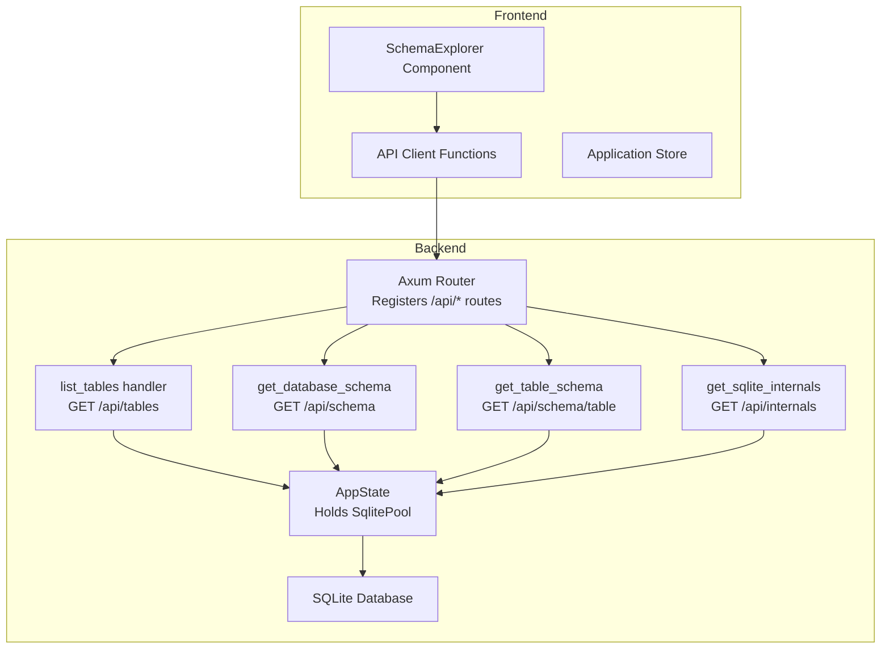
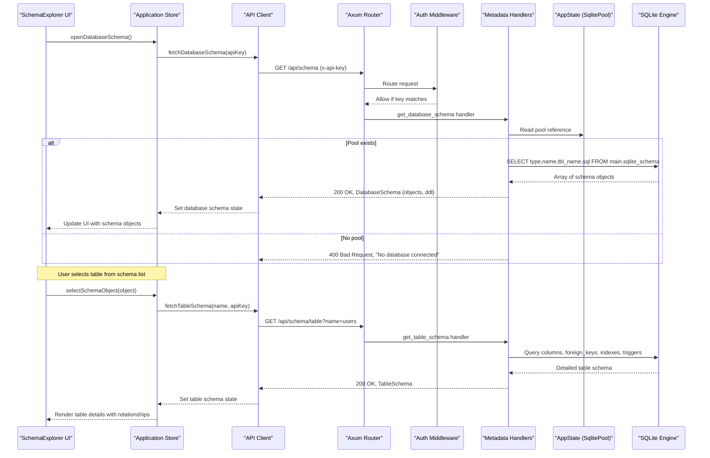
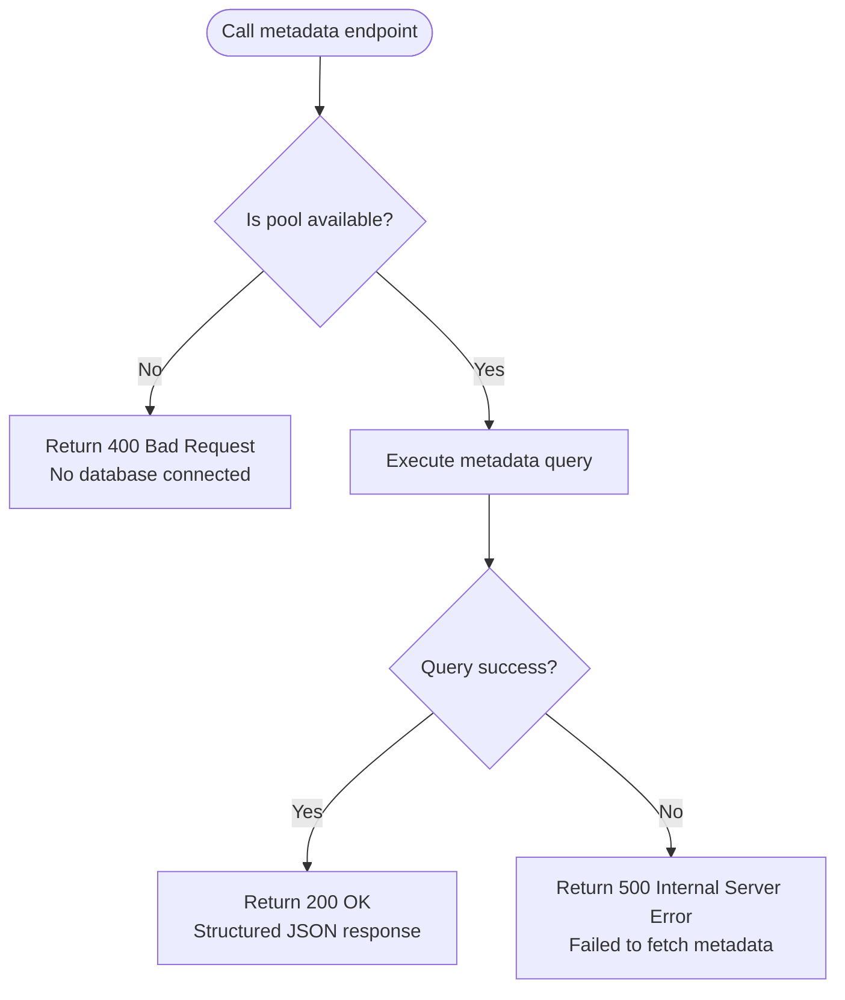
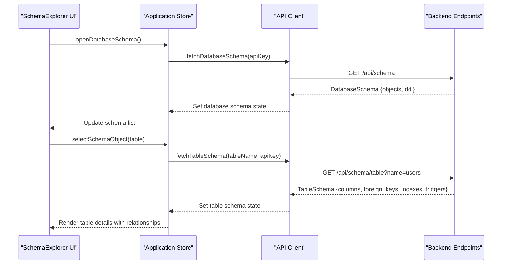
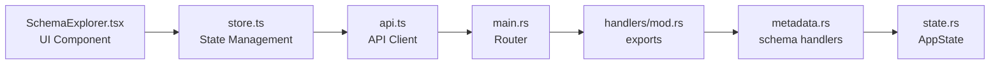

# Database Metadata

<cite>
**Referenced Files in This Document**
- [main.rs](file://backend/src/main.rs)
- [metadata.rs](file://backend/src/handlers/metadata.rs)
- [connection.rs](file://backend/src/handlers/connection.rs)
- [state.rs](file://backend/src/state.rs)
- [api.ts](file://frontend/src/lib/api.ts)
- [SchemaExplorer.tsx](file://frontend/src/components/SchemaExplorer.tsx)
- [store.ts](file://frontend/src/lib/store.ts)
- [design.md](file://doc/design.md)
</cite>

## Update Summary
**Changes Made**
- Added comprehensive schema explorer endpoints for detailed database object information
- Documented new GET /api/schema endpoint returning database-wide schema with combined DDL
- Documented new GET /api/schema/table endpoint providing detailed table metadata including foreign keys, indexes, and triggers
- Documented new GET /api/internals endpoint exposing SQLite internals and system metadata
- Updated architecture diagrams to reflect the enhanced schema exploration capabilities
- Added frontend integration patterns for the schema explorer UI components

## Table of Contents
1. [Introduction](#introduction)
2. [Project Structure](#project-structure)
3. [Core Components](#core-components)
4. [Architecture Overview](#architecture-overview)
5. [Detailed Component Analysis](#detailed-component-analysis)
6. [Dependency Analysis](#dependency-analysis)
7. [Performance Considerations](#performance-considerations)
8. [Troubleshooting Guide](#troubleshooting-guide)
9. [Conclusion](#conclusion)

## Introduction
This document provides comprehensive API documentation for database metadata retrieval endpoints, focusing on both the basic table enumeration functionality and the enhanced schema explorer endpoints. The system now includes:

- **Basic Table Enumeration**: GET /api/tables returns simple table names from the currently connected SQLite database
- **Database Schema Explorer**: GET /api/schema provides comprehensive database object information including tables, views, indexes, and triggers with combined DDL generation
- **Table Schema Details**: GET /api/schema/table offers detailed table metadata including columns, foreign key relationships, indexes, and triggers
- **SQLite Internals**: GET /api/internals exposes low-level SQLite database, connection, and engine metadata

The documentation covers SQL queries against sqlite_master and pragma functions, filtering rules, response formats, error handling, and integration patterns with the frontend schema explorer components.

## Project Structure
The backend is an Axum-based HTTP server that exposes REST endpoints under /api. The routing includes both basic table enumeration and advanced schema exploration endpoints. The connection state (a pooled SQLite connection) is stored in shared application state and accessed by handlers. The frontend includes a sophisticated schema explorer component that visualizes database structure and relationships.

**Diagram sources**
- [main.rs:61-70](file://backend/src/main.rs#L61-L70)
- [metadata.rs:334-437](file://backend/src/handlers/metadata.rs#L334-L437)
- [connection.rs:111-129](file://backend/src/handlers/connection.rs#L111-L129)
- [state.rs:5-8](file://backend/src/state.rs#L5-L8)
- [api.ts:95-130](file://frontend/src/lib/api.ts#L95-L130)

**Section sources**
- [main.rs:61-70](file://backend/src/main.rs#L61-L70)
- [metadata.rs:334-437](file://backend/src/handlers/metadata.rs#L334-L437)
- [connection.rs:111-129](file://backend/src/handlers/connection.rs#L111-L129)
- [state.rs:5-8](file://backend/src/state.rs#L5-L8)
- [api.ts:95-130](file://frontend/src/lib/api.ts#L95-L130)

## Core Components
The metadata API system now provides multiple levels of database introspection:

### Basic Table Enumeration
- **GET /api/tables**: Returns a JSON array of table names for the currently connected SQLite database
- Uses sqlite_master system table with filtering to exclude internal tables
- Simple string array response format

### Enhanced Schema Explorer
- **GET /api/schema**: Returns comprehensive database schema with all user-defined objects (tables, views, indexes, triggers) and combined DDL
- **GET /api/schema/table?name=<table>**: Provides detailed table metadata including:
  - Column definitions with constraints, defaults, and visibility
  - Foreign key relationships with referential actions
  - Index definitions with column ordering and collation
  - Trigger definitions with associated SQL
- **GET /api/internals**: Exposes SQLite internals including database configuration, connection settings, engine version, and complete sqlite_schema entries

### Frontend Integration
- **SchemaExplorer Component**: Sophisticated UI for browsing database structure
- **API Client Functions**: Type-safe TypeScript interfaces for all metadata endpoints
- **Application Store**: Centralized state management for schema data and loading states

Key behaviors:
- Authentication: All API routes except health are protected by an x-api-key header middleware
- Response formats: Structured JSON responses with comprehensive metadata
- Error handling: Consistent error responses across all endpoints
- Performance: Optimized queries using SQLite pragmas and efficient data structures

**Section sources**
- [main.rs:61-70](file://backend/src/main.rs#L61-L70)
- [metadata.rs:12-102](file://backend/src/handlers/metadata.rs#L12-L102)
- [metadata.rs:334-437](file://backend/src/handlers/metadata.rs#L334-L437)
- [api.ts:11-79](file://frontend/src/lib/api.ts#L11-L79)

## Architecture Overview
The enhanced metadata system follows a layered architecture where the frontend schema explorer component orchestrates calls to multiple backend endpoints to provide comprehensive database introspection capabilities.

**Diagram sources**
- [main.rs:61-70](file://backend/src/main.rs#L61-L70)
- [metadata.rs:334-377](file://backend/src/handlers/metadata.rs#L334-L377)
- [store.ts:70-99](file://frontend/src/lib/store.ts#L70-L99)
- [api.ts:118-127](file://frontend/src/lib/api.ts#L118-L127)

## Detailed Component Analysis

### Endpoint Specifications

#### GET /api/tables - Basic Table Enumeration
- **Method**: GET
- **Path**: /api/tables
- **Authentication**: Required via x-api-key header
- **Request body**: None
- **Success response**:
  - Status: 200 OK
  - Body: JSON array of strings, e.g., ["users", "orders"]
- **Error responses**:
  - 400 Bad Request: No database connected
  - 500 Internal Server Error: Failed to fetch tables

SQL query details:
- System table: sqlite_master
- Filter conditions: type = 'table' AND name NOT LIKE 'sqlite_%'
- Ordering: ORDER BY name

#### GET /api/schema - Database Schema Explorer
- **Method**: GET
- **Path**: /api/schema
- **Authentication**: Required via x-api-key header
- **Request body**: None
- **Success response**:
  - Status: 200 OK
  - Body: DatabaseSchema object containing:
    - objects: Array of SchemaObject {object_type, name, table_name, sql}
    - ddl: Combined DDL string of all user-defined objects
- **Error responses**:
  - 400 Bad Request: No database connected
  - 500 Internal Server Error: Failed to fetch database schema

SQL query details:
- System table: main.sqlite_schema
- Filter conditions: type IN ('table', 'view', 'index', 'trigger') AND name NOT LIKE 'sqlite_%'
- Ordering: Custom order by object type then name

#### GET /api/schema/table?name=<table> - Detailed Table Schema
- **Method**: GET
- **Path**: /api/schema/table
- **Query parameters**: name (required) - table name to inspect
- **Authentication**: Required via x-api-key header
- **Request body**: None
- **Success response**:
  - Status: 200 OK
  - Body: TableSchema object containing:
    - name: Table name
    - sql: Original CREATE TABLE statement
    - columns: Array of ColumnSchema with constraints and properties
    - foreign_keys: Array of ForeignKeySchema with relationship details
    - indexes: Array of IndexSchema with column definitions
    - triggers: Array of TriggerSchema with SQL definitions
- **Error responses**:
  - 400 Bad Request: No database connected
  - 404 Not Found: Table not found
  - 500 Internal Server Error: Failed to fetch table schema

SQL queries used:
- Column metadata: pragma_table_xinfo(table_name, 'main')
- Foreign keys: pragma_foreign_key_list(table_name, 'main')
- Indexes: pragma_index_list(table_name, 'main') + pragma_index_xinfo(index_name, 'main')
- Triggers: SELECT name, sql FROM main.sqlite_schema WHERE type = 'trigger' AND tbl_name = ?

#### GET /api/internals - SQLite Internals
- **Method**: GET
- **Path**: /api/internals
- **Authentication**: Required via x-api-key header
- **Request body**: None
- **Success response**:
  - Status: 200 OK
  - Body: SqliteInternals object containing:
    - database: Array of MetadataValue for database configuration
    - connection: Array of MetadataValue for connection settings
    - engine: Array of MetadataValue for engine information
    - schema_entries: Array of SqliteSchemaEntry for all schema objects
- **Error responses**:
  - 400 Bad Request: No database connected
  - 500 Internal Server Error: Failed to fetch SQLite internals

PRAGMA queries used:
- Database: database_list, page_size, page_count, freelist_count, journal_mode, encoding, user_version, schema_version, application_id, auto_vacuum
- Connection: foreign_keys, busy_timeout, synchronous, cache_size
- Engine: sqlite_version(), compile_options

**Section sources**
- [metadata.rs:334-437](file://backend/src/handlers/metadata.rs#L334-L437)
- [metadata.rs:109-268](file://backend/src/handlers/metadata.rs#L109-L268)
- [metadata.rs:291-332](file://backend/src/handlers/metadata.rs#L291-L332)

### Data Structures and Types

#### Schema Object Model
The schema explorer uses comprehensive data structures to represent database objects:

- **SchemaObject**: Represents any database object (table, view, index, trigger)
- **DatabaseSchema**: Container for all schema objects and combined DDL
- **ColumnSchema**: Detailed column information including constraints and visibility
- **ForeignKeySchema**: Foreign key relationships with referential actions
- **IndexSchema**: Index definitions with column specifications
- **TriggerSchema**: Trigger definitions with associated SQL
- **TableSchema**: Complete table definition with all related objects
- **SqliteInternals**: Low-level SQLite system information

#### Frontend Type Definitions
The frontend maintains parallel TypeScript interfaces for type safety:
- SchemaObject, DatabaseSchema, ColumnSchema, ForeignKeySchema
- IndexSchema, TableSchema, MetadataValue, SqliteSchemaEntry, SqliteInternals

These types ensure consistent data flow between backend and frontend while providing IntelliSense support for developers.

**Section sources**
- [metadata.rs:12-102](file://backend/src/handlers/metadata.rs#L12-L102)
- [api.ts:11-79](file://frontend/src/lib/api.ts#L11-L79)

### Connection Management Integration
The enhanced metadata system integrates seamlessly with the existing connection management:

- **Connection establishment**: POST /api/connect creates pooled connections with WAL mode
- **State management**: AppState.db holds the SqlitePool accessible by all metadata handlers
- **Error handling**: Consistent "No database connected" responses when pool is unavailable
- **Resource management**: Proper connection pooling and cleanup through the shared state

**Diagram sources**
- [metadata.rs:334-437](file://backend/src/handlers/metadata.rs#L334-L437)

**Section sources**
- [connection.rs:62-109](file://backend/src/handlers/connection.rs#L62-L109)
- [connection.rs:111-129](file://backend/src/handlers/connection.rs#L111-L129)
- [state.rs:5-8](file://backend/src/state.rs#L5-L8)

### Frontend Integration Pattern
The frontend implements a sophisticated schema explorer with multiple views and interactive features:

#### Schema Explorer Component Features
- **Database Schema View**: Browse all user-defined objects (tables, views, indexes, triggers)
- **Table Detail View**: Inspect individual table structure with columns, relationships, and constraints
- **SQLite Internals View**: Access low-level database and engine information
- **DDL Export**: Copy combined DDL for backup or migration purposes
- **Interactive Navigation**: Click-through navigation between different schema objects

#### API Client Integration
The frontend API client provides type-safe methods for all metadata endpoints:
- fetchDatabaseSchema(): Loads complete database schema
- fetchTableSchema(): Gets detailed table information
- fetchSqliteInternals(): Retrieves SQLite system information
- fetchTables(): Basic table enumeration for legacy compatibility

#### Store Management
The application store manages schema state with:
- Loading states for async operations
- Error handling and display
- Selection state for current schema object
- Refresh capabilities for updated metadata

**Diagram sources**
- [SchemaExplorer.tsx:24-308](file://frontend/src/components/SchemaExplorer.tsx#L24-L308)
- [store.ts:70-121](file://frontend/src/lib/store.ts#L70-L121)
- [api.ts:118-130](file://frontend/src/lib/api.ts#L118-L130)

**Section sources**
- [SchemaExplorer.tsx:24-308](file://frontend/src/components/SchemaExplorer.tsx#L24-L308)
- [store.ts:70-121](file://frontend/src/lib/store.ts#L70-L121)
- [api.ts:118-130](file://frontend/src/lib/api.ts#L118-L130)

### Practical Workflows

#### Schema Exploration Workflow
1. **Connect to database**: Use POST /api/connect to establish connection
2. **Load schema**: Call GET /api/schema to retrieve all database objects
3. **Explore objects**: Navigate through tables, views, indexes, and triggers
4. **Inspect details**: Use GET /api/schema/table for detailed table information
5. **Export DDL**: Copy combined DDL for backup or deployment

#### Advanced Metadata Analysis
1. **Access internals**: Call GET /api/internals for low-level SQLite information
2. **Analyze relationships**: Review foreign key constraints and referential integrity
3. **Performance tuning**: Examine indexes and their column specifications
4. **Debug triggers**: Inspect trigger definitions and their associated SQL

Integration tips:
- Cache schema data during active sessions to avoid repeated queries
- Implement progressive loading for large databases
- Provide refresh mechanisms for real-time updates after DDL changes
- Handle authentication errors gracefully with user feedback

**Section sources**
- [connection.rs:62-109](file://backend/src/handlers/connection.rs#L62-L109)
- [metadata.rs:334-437](file://backend/src/handlers/metadata.rs#L334-L437)
- [store.ts:70-121](file://frontend/src/lib/store.ts#L70-L121)

## Dependency Analysis
The enhanced metadata system has clear dependency relationships between components:

### Backend Dependencies
- **Routing**: main.rs registers all metadata endpoints (/api/tables, /api/schema, /api/schema/table, /api/internals)
- **Handlers**: metadata.rs implements all schema exploration logic with comprehensive SQL queries
- **State**: state.rs provides shared AppState with SqlitePool access
- **Connection**: connection.rs handles database connection lifecycle

### Frontend Dependencies
- **Components**: SchemaExplorer.tsx provides the main UI for schema exploration
- **API Client**: api.ts defines type-safe methods for all metadata endpoints
- **Store**: store.ts manages application state and data flow
- **Types**: Shared TypeScript interfaces ensure type safety across the stack

**Diagram sources**
- [main.rs:61-70](file://backend/src/main.rs#L61-L70)
- [metadata.rs:334-437](file://backend/src/handlers/metadata.rs#L334-L437)
- [state.rs:5-8](file://backend/src/state.rs#L5-L8)
- [SchemaExplorer.tsx:24-308](file://frontend/src/components/SchemaExplorer.tsx#L24-L308)
- [store.ts:70-121](file://frontend/src/lib/store.ts#L70-L121)
- [api.ts:118-130](file://frontend/src/lib/api.ts#L118-L130)

**Section sources**
- [main.rs:61-70](file://backend/src/main.rs#L61-L70)
- [metadata.rs:334-437](file://backend/src/handlers/metadata.rs#L334-L437)
- [state.rs:5-8](file://backend/src/state.rs#L5-L8)
- [SchemaExplorer.tsx:24-308](file://frontend/src/components/SchemaExplorer.tsx#L24-L308)
- [store.ts:70-121](file://frontend/src/lib/store.ts#L70-L121)
- [api.ts:118-130](file://frontend/src/lib/api.ts#L118-L130)

## Performance Considerations
The enhanced metadata system is designed for optimal performance even with large databases:

### Query Optimization
- **Efficient schema queries**: Uses sqlite_schema directly rather than multiple pragma calls
- **Batched data retrieval**: Combines related metadata in single queries where possible
- **Indexed access**: Leverages SQLite's internal indexing on sqlite_schema
- **Filtered results**: Excludes internal tables and objects by default

### Memory Management
- **Streaming responses**: Large DDL strings are handled efficiently without excessive memory usage
- **Lazy loading**: Table details are loaded on-demand rather than upfront
- **Caching strategies**: Frontend caches schema data during active sessions

### Concurrency and Scalability
- **Connection pooling**: Reuses database connections for concurrent requests
- **WAL mode**: Enables concurrent reads without blocking writes
- **Asynchronous processing**: Non-blocking API calls prevent UI freezing

### Frontend Performance
- **Progressive loading**: Shows partial results while fetching additional data
- **Virtual scrolling**: Handles large schema lists efficiently
- **Debounced searches**: Prevents excessive API calls during rapid user input
- **Selective updates**: Only re-renders changed parts of the schema tree

Best practices:
- Monitor query execution times for large schemas
- Implement pagination for extremely large databases
- Use browser caching for repeated schema inspections
- Provide manual refresh controls for users to control update frequency

## Troubleshooting Guide

### Common Issues and Resolutions

#### No Active Connection
- **Symptom**: 400 Bad Request with "No database connected" message
- **Resolution**: Ensure POST /api/connect has been called successfully before accessing metadata endpoints
- **Prevention**: Add connection status checks in frontend before making metadata requests

#### Database Access Failures
- **Symptom**: 500 Internal Server Error with generic failure messages
- **Resolution**: Check database file permissions, disk space, and integrity
- **Investigation**: Review server logs for detailed error messages from SQLite operations

#### Authentication Errors
- **Symptom**: 401 Unauthorized responses
- **Resolution**: Verify x-api-key header matches server configuration
- **Debugging**: Check API_KEY environment variable and client-side header injection

#### Schema Loading Issues
- **Symptom**: Empty schema objects or missing table details
- **Resolution**: Verify database contains user-defined objects beyond system tables
- **Validation**: Test with simple test database to isolate environment issues

#### Performance Problems
- **Symptom**: Slow schema loading or UI responsiveness issues
- **Resolution**: Implement caching, reduce query complexity, or add pagination
- **Monitoring**: Track query execution times and memory usage

### Diagnostic Queries
Use these diagnostic approaches to troubleshoot metadata issues:

1. **Verify connection**: Test basic connectivity with simple queries
2. **Check schema existence**: Query sqlite_schema directly to verify objects exist
3. **Validate permissions**: Ensure the database process has read access to files
4. **Monitor resources**: Check disk space and memory availability

### Operational Checks
- Verify server logs contain detailed error information
- Validate database directory exists and is writable
- Confirm path provided to POST /api/connect passes security validation
- Test with known-good database files to isolate environment-specific issues

**Section sources**
- [metadata.rs:334-437](file://backend/src/handlers/metadata.rs#L334-L437)
- [connection.rs:62-109](file://backend/src/handlers/connection.rs#L62-L109)
- [main.rs:26-37](file://backend/src/main.rs#L26-L37)

## Conclusion
The enhanced database metadata system provides comprehensive introspection capabilities for SQLite databases, extending far beyond simple table enumeration. The new schema explorer endpoints enable detailed analysis of database structure, relationships, and system internals through well-designed APIs and a sophisticated frontend interface.

Key achievements:
- **Comprehensive schema exploration**: Full visibility into tables, views, indexes, and triggers
- **Relationship mapping**: Detailed foreign key constraint analysis and visualization
- **System insights**: Access to low-level SQLite configuration and performance indicators
- **Developer experience**: Intuitive UI with DDL export and interactive navigation
- **Performance optimization**: Efficient queries and responsive interface design

The system maintains backward compatibility with the original /api/tables endpoint while providing powerful new capabilities for database exploration and analysis. With proper error handling, caching strategies, and performance optimizations, it serves as a robust foundation for database administration and development workflows.

Future enhancements could include query result caching, schema comparison tools, and automated migration generation based on the captured DDL.