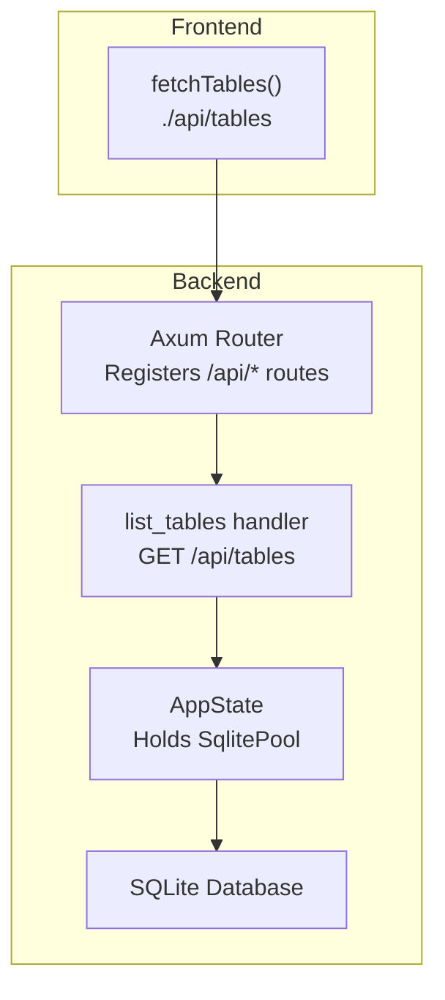
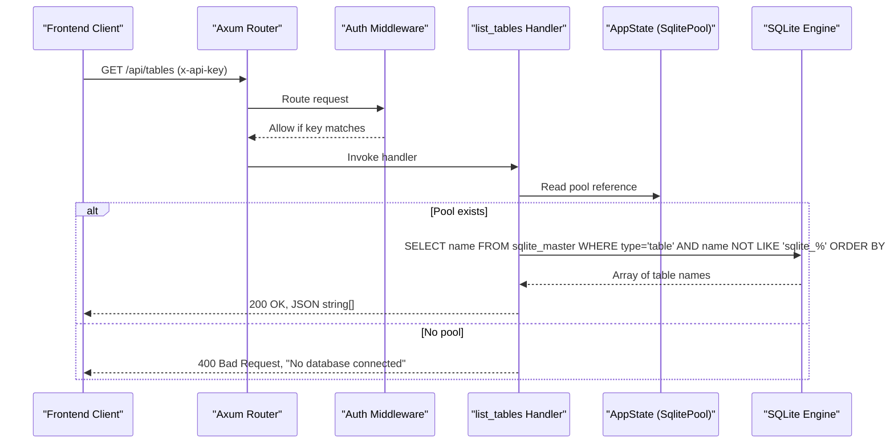
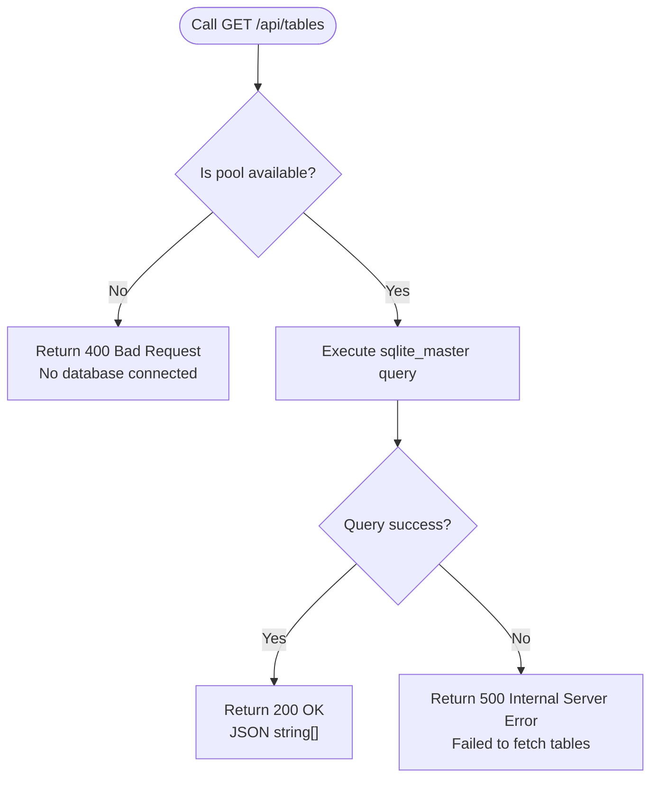
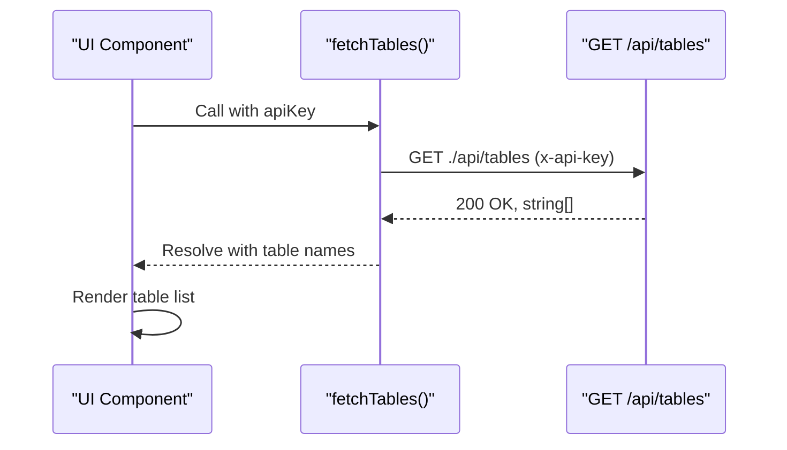
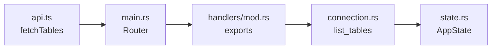

# Database Metadata

<cite>
**Referenced Files in This Document**
- [main.rs](file://backend/src/main.rs)
- [connection.rs](file://backend/src/handlers/connection.rs)
- [state.rs](file://backend/src/state.rs)
- [api.ts](file://frontend/src/lib/api.ts)
- [design.md](file://doc/design.md)
</cite>

## Table of Contents
1. [Introduction](#introduction)
2. [Project Structure](#project-structure)
3. [Core Components](#core-components)
4. [Architecture Overview](#architecture-overview)
5. [Detailed Component Analysis](#detailed-component-analysis)
6. [Dependency Analysis](#dependency-analysis)
7. [Performance Considerations](#performance-considerations)
8. [Troubleshooting Guide](#troubleshooting-guide)
9. [Conclusion](#conclusion)

## Introduction
This document provides API documentation for database metadata retrieval, focusing on the GET /api/tables endpoint that returns table names from the currently connected SQLite database. It explains the underlying SQL query against sqlite_master, filtering rules to exclude internal tables, response format as a string array, and error handling for common scenarios such as no active connection or database access failures. It also outlines integration patterns with frontend components and performance considerations when enumerating tables in large databases. Finally, it clarifies how this endpoint integrates with the connection management system.

## Project Structure
The backend is an Axum-based HTTP server that exposes REST endpoints under /api. The /api/tables route is registered in the application router and implemented by the list_tables handler. The connection state (a pooled SQLite connection) is stored in shared application state and accessed by handlers. The frontend includes a helper function to call /api/tables and consume the returned string array.

**Diagram sources**
- [main.rs:52-65](file://backend/src/main.rs#L52-L65)
- [connection.rs:111-129](file://backend/src/handlers/connection.rs#L111-L129)
- [state.rs:5-8](file://backend/src/state.rs#L5-L8)
- [api.ts:25-34](file://frontend/src/lib/api.ts#L25-L34)

**Section sources**
- [main.rs:52-65](file://backend/src/main.rs#L52-L65)
- [connection.rs:111-129](file://backend/src/handlers/connection.rs#L111-L129)
- [state.rs:5-8](file://backend/src/state.rs#L5-L8)
- [api.ts:25-34](file://frontend/src/lib/api.ts#L25-L34)

## Core Components
- GET /api/tables: Returns a JSON array of table names for the currently connected SQLite database.
- Connection management: POST /api/connect establishes a pooled connection to a SQLite file and stores it in AppState.
- Frontend client: fetchTables() calls ./api/tables and expects a string array.

Key behaviors:
- Authentication: All API routes except health are protected by an x-api-key header middleware.
- Response format: A JSON array of strings representing table names.
- Filtering: Internal SQLite tables prefixed with sqlite_ are excluded.
- Error responses:
  - No active connection: 400 Bad Request with a message indicating no database is connected.
  - Query failure: 500 Internal Server Error with a generic message.

**Section sources**
- [main.rs:22-33](file://backend/src/main.rs#L22-L33)
- [main.rs:52-65](file://backend/src/main.rs#L52-L65)
- [connection.rs:111-129](file://backend/src/handlers/connection.rs#L111-L129)
- [api.ts:25-34](file://frontend/src/lib/api.ts#L25-L34)

## Architecture Overview
The endpoint flow involves the frontend calling the API, the Axum router dispatching to the handler, the handler reading the current connection from shared state, executing a metadata query against sqlite_master, and returning the result.

**Diagram sources**
- [main.rs:22-33](file://backend/src/main.rs#L22-L33)
- [main.rs:52-65](file://backend/src/main.rs#L52-L65)
- [connection.rs:111-129](file://backend/src/handlers/connection.rs#L111-L129)

## Detailed Component Analysis

### Endpoint Specification: GET /api/tables
- Method: GET
- Path: /api/tables
- Authentication: Required via x-api-key header unless disabled; default behavior requires a valid API key.
- Request body: None
- Success response:
  - Status: 200 OK
  - Body: JSON array of strings, e.g., ["users", "orders"]
- Error responses:
  - 400 Bad Request: No database connected
  - 500 Internal Server Error: Failed to fetch tables (database access failure)

SQL query details:
- System table: sqlite_master
- Filter conditions:
  - type = 'table'
  - name NOT LIKE 'sqlite_%'
- Ordering: ORDER BY name

Response schema:
- Type: string[]
- Example: ["categories", "products", "users"]

Security and constraints:
- The endpoint reads only metadata and does not modify data.
- Access to the underlying database depends on the connection established via POST /api/connect.

**Section sources**
- [connection.rs:111-129](file://backend/src/handlers/connection.rs#L111-L129)
- [main.rs:52-65](file://backend/src/main.rs#L52-L65)
- [main.rs:22-33](file://backend/src/main.rs#L22-L33)

### Connection Management Integration
- Connection establishment:
  - POST /api/connect accepts a path and optional create flag.
  - Validates path safety (no directory traversal).
  - Creates a SqlitePool with WAL journal mode and busy_timeout.
  - Stores the pool in AppState.db.
- Relationship to /api/tables:
  - list_tables reads the pool from AppState.db.
  - If no pool is present, returns 400 Bad Request.

**Diagram sources**
- [connection.rs:111-129](file://backend/src/handlers/connection.rs#L111-L129)

**Section sources**
- [connection.rs:62-109](file://backend/src/handlers/connection.rs#L62-L109)
- [connection.rs:111-129](file://backend/src/handlers/connection.rs#L111-L129)
- [state.rs:5-8](file://backend/src/state.rs#L5-L8)

### Frontend Integration Pattern
- The frontend uses fetchTables(apiKey) to call ./api/tables.
- It attaches the x-api-key header and handles 401 Unauthorized via a callback.
- On success, it receives a Promise<string[]> which can be used to populate UI components like sidebars or dropdowns.

**Diagram sources**
- [api.ts:25-34](file://frontend/src/lib/api.ts#L25-L34)

**Section sources**
- [api.ts:25-34](file://frontend/src/lib/api.ts#L25-L34)

### Practical Workflows
- Enumerate tables after connecting:
  1. Connect to a database file using POST /api/connect.
  2. Call GET /api/tables to retrieve table names.
  3. Populate UI elements (e.g., sidebar) with the returned array.
- Conditional rendering:
  - If GET /api/tables returns 400, prompt the user to connect to a database first.
  - If 500 occurs, show a retry option and log the error.

Integration tips:
- Cache the table list briefly to avoid repeated queries during navigation.
- Debounce rapid UI interactions that trigger table enumeration.

**Section sources**
- [connection.rs:62-109](file://backend/src/handlers/connection.rs#L62-L109)
- [connection.rs:111-129](file://backend/src/handlers/connection.rs#L111-L129)
- [api.ts:25-34](file://frontend/src/lib/api.ts#L25-L34)

## Dependency Analysis
- Routing:
  - main.rs registers /api/tables route pointing to list_tables.
- Handler:
  - connection.rs implements list_tables, reads AppState.db, executes sqlite_master query.
- State:
  - state.rs defines AppState holding an Arc<RwLock<Option<SqlitePool>>>.
- Frontend:
  - api.ts provides fetchTables() to call the endpoint and handle auth errors.

**Diagram sources**
- [main.rs:52-65](file://backend/src/main.rs#L52-L65)
- [connection.rs:111-129](file://backend/src/handlers/connection.rs#L111-L129)
- [state.rs:5-8](file://backend/src/state.rs#L5-L8)
- [api.ts:25-34](file://frontend/src/lib/api.ts#L25-L34)

**Section sources**
- [main.rs:52-65](file://backend/src/main.rs#L52-L65)
- [connection.rs:111-129](file://backend/src/handlers/connection.rs#L111-L129)
- [state.rs:5-8](file://backend/src/state.rs#L5-L8)
- [api.ts:25-34](file://frontend/src/lib/api.ts#L25-L34)

## Performance Considerations
- Query efficiency:
  - The sqlite_master query is lightweight and typically fast, even for large databases, because it retrieves only table names.
- Concurrency:
  - The connection uses a pool and WAL mode, improving concurrent read performance.
- Caching:
  - Consider caching the table list on the frontend for short periods to reduce repeated requests.
- Indexes and ordering:
  - sqlite_master is a system table; ordering by name is inexpensive. Avoid unnecessary filters or joins.
- Large databases:
  - For extremely large schemas, consider pagination or lazy loading in the UI if needed, though sqlite_master usually remains efficient.

[No sources needed since this section provides general guidance]

## Troubleshooting Guide
Common issues and resolutions:
- No active connection:
  - Symptom: 400 Bad Request with message indicating no database connected.
  - Resolution: Ensure POST /api/connect has been called successfully before calling GET /api/tables.
- Database access failures:
  - Symptom: 500 Internal Server Error with a generic message.
  - Resolution: Check database file permissions, disk space, and integrity. Verify that the connection was established correctly and that the database file is accessible by the server process.
- Authentication errors:
  - Symptom: 401 Unauthorized.
  - Resolution: Provide a valid x-api-key header matching the server’s configured API_KEY.
- WAL mode verification warnings:
  - While not directly affecting /api/tables, WAL misconfiguration may indicate environment issues. Confirm WAL mode and file presence (.db, .db-wal, .db-shm).

Operational checks:
- Verify the server logs for detailed error messages when 500 occurs.
- Validate that the db directory exists and is writable.
- Confirm that the path provided to POST /api/connect is correct and not blocked by directory traversal checks.

**Section sources**
- [connection.rs:111-129](file://backend/src/handlers/connection.rs#L111-L129)
- [connection.rs:62-109](file://backend/src/handlers/connection.rs#L62-L109)
- [main.rs:22-33](file://backend/src/main.rs#L22-L33)

## Conclusion
The GET /api/tables endpoint provides a simple and efficient way to enumerate table names from the currently connected SQLite database. It leverages sqlite_master with explicit filtering to exclude internal tables and returns a straightforward JSON string array. Proper integration requires a successful connection via POST /api/connect and adherence to authentication requirements. With careful error handling and optional frontend caching, this endpoint supports responsive UI workflows even for large databases.

[No sources needed since this section summarizes without analyzing specific files]