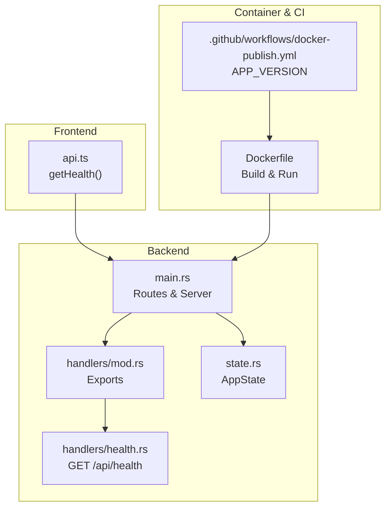
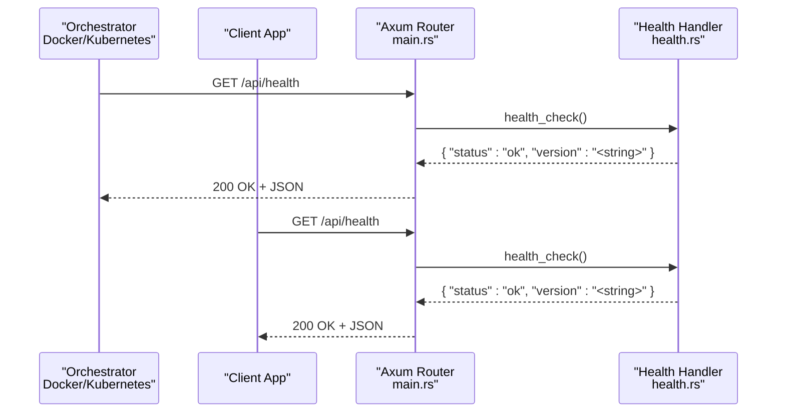
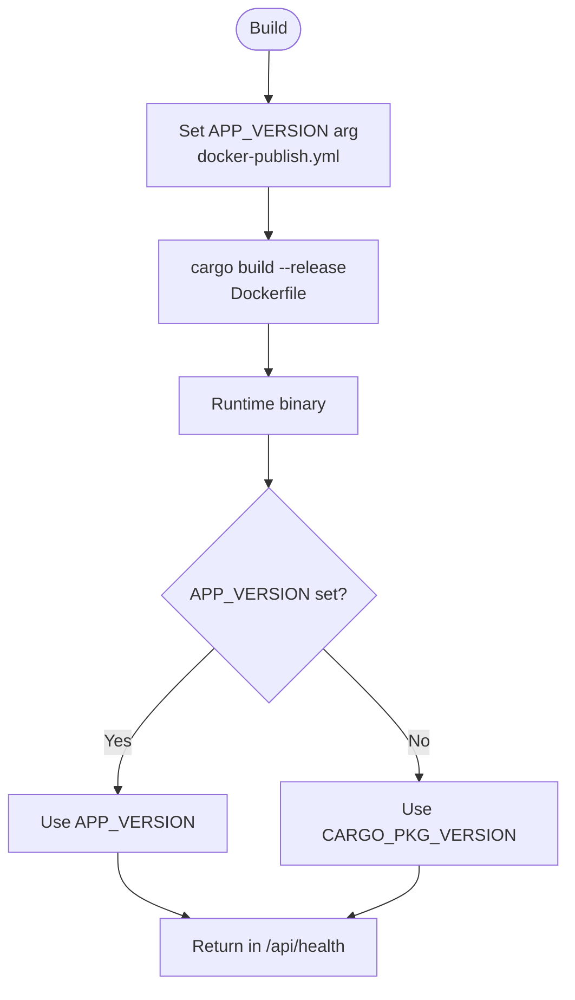
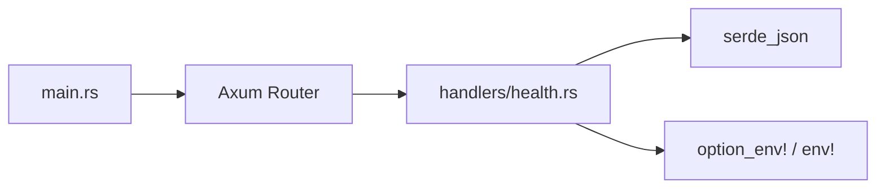

# Health Monitoring

<cite>
**Referenced Files in This Document**
- [health.rs](file://backend/src/handlers/health.rs)
- [main.rs](file://backend/src/main.rs)
- [state.rs](file://backend/src/state.rs)
- [api.ts](file://frontend/src/lib/api.ts)
- [Dockerfile](file://Dockerfile)
- [docker-publish.yml](file://.github/workflows/docker-publish.yml)
- [design.md](file://doc/design.md)
</cite>

## Table of Contents
1. [Introduction](#introduction)
2. [Project Structure](#project-structure)
3. [Core Components](#core-components)
4. [Architecture Overview](#architecture-overview)
5. [Detailed Component Analysis](#detailed-component-analysis)
6. [Dependency Analysis](#dependency-analysis)
7. [Performance Considerations](#performance-considerations)
8. [Troubleshooting Guide](#troubleshooting-guide)
9. [Conclusion](#conclusion)

## Introduction
This document provides API documentation for the health check and monitoring endpoints, focusing on GET /api/health. It explains the response format, how to integrate with container orchestration systems (Docker, Kubernetes), client usage examples, dashboard integrations, alerting configurations, performance considerations, extension points, and troubleshooting unhealthy states.

The application is a Rust backend using Axum, serving both API routes and static frontend assets. The health endpoint returns a minimal JSON payload indicating application status and version information.

## Project Structure
The health endpoint is implemented in the backend handlers and registered in the main router. The frontend includes a helper to call the health endpoint. Containerization and CI/CD are configured via Docker and GitHub Actions.

**Diagram sources**
- [main.rs:52-65](file://backend/src/main.rs#L52-L65)
- [health.rs:3-5](file://backend/src/handlers/health.rs#L3-L5)
- [api.ts:88-96](file://frontend/src/lib/api.ts#L88-L96)
- [Dockerfile:34-55](file://Dockerfile#L34-L55)
- [docker-publish.yml:24-41](file://.github/workflows/docker-publish.yml#L24-L41)

**Section sources**
- [main.rs:1-74](file://backend/src/main.rs#L1-L74)
- [health.rs:1-6](file://backend/src/handlers/health.rs#L1-L6)
- [api.ts:88-96](file://frontend/src/lib/api.ts#L88-L96)
- [Dockerfile:1-56](file://Dockerfile#L1-L56)
- [docker-publish.yml:1-59](file://.github/workflows/docker-publish.yml#L1-L59)

## Core Components
- Health handler: Implements GET /api/health returning a JSON object with status and version fields.
- Router registration: Mounts /api/health as a public route without authentication middleware.
- Frontend client: Provides getHealth() to fetch and parse the health response.
- Build-time version: APP_VERSION is injected during build; fallback to package version if not provided.

Key responsibilities:
- Provide a lightweight, fast endpoint for liveness/readiness probes.
- Expose version metadata for observability.

**Section sources**
- [health.rs:3-5](file://backend/src/handlers/health.rs#L3-L5)
- [main.rs:60-62](file://backend/src/main.rs#L60-L62)
- [api.ts:88-96](file://frontend/src/lib/api.ts#L88-L96)
- [Dockerfile:34-35](file://Dockerfile#L34-L35)
- [docker-publish.yml:24-41](file://.github/workflows/docker/docker-publish.yml#L24-L41)

## Architecture Overview
The health endpoint is a simple HTTP GET that returns a small JSON payload. It does not require authentication and does not access the database, making it suitable for frequent probing by orchestrators.

**Diagram sources**
- [main.rs:60-62](file://backend/src/main.rs#L60-L62)
- [health.rs:3-5](file://backend/src/handlers/health.rs#L3-L5)

## Detailed Component Analysis

### GET /api/health
- Method: GET
- Path: /api/health
- Authentication: Not required (public route)
- Response: JSON object
  - status: string — indicates overall health (e.g., "ok")
  - version: string — application version from build-time APP_VERSION or package version

Example responses:
- Healthy:
  - { "status": "ok", "version": "0.2.3" }
- Unhealthy (conceptual):
  - { "status": "degraded", "version": "0.2.3" }

Notes:
- The endpoint currently returns only status and version. Database connectivity and system metrics are not included in this implementation.

**Section sources**
- [health.rs:3-5](file://backend/src/handlers/health.rs#L3-L5)
- [main.rs:60-62](file://backend/src/main.rs#L60-L62)
- [design.md:71-71](file://doc/design.md#L71-L71)

### Version Injection and Build-Time Metadata
- APP_VERSION is passed as a build argument during Docker build.
- If APP_VERSION is not set at runtime, the handler falls back to the package version embedded at compile time.

**Diagram sources**
- [docker-publish.yml:24-41](file://.github/workflows/docker-publish.yml#L24-L41)
- [Dockerfile:34-35](file://Dockerfile#L34-L35)
- [health.rs:4-4](file://backend/src/handlers/health.rs#L4-L4)

**Section sources**
- [docker-publish.yml:24-41](file://.github/workflows/docker-publish.yml#L24-L41)
- [Dockerfile:34-35](file://Dockerfile#L34-L35)
- [health.rs:4-4](file://backend/src/handlers/health.rs#L4-L4)

### Frontend Integration Example
The frontend exposes a helper function to call the health endpoint and parse the result into a typed interface.

- Function: getHealth()
- Returns: Promise resolving to an object with status and optional version.

Usage pattern:
- Call getHealth() periodically to display app status or gate UI features until healthy.

**Section sources**
- [api.ts:88-96](file://frontend/src/lib/api.ts#L88-L96)

### Container Orchestration Integration

#### Docker
- Liveness probe: Configure a container-level liveness probe that calls GET /api/health.
- Readiness probe: Optionally use the same endpoint for readiness checks.

Example concepts:
- LivenessProbe: HTTP GET /api/health, expect 200 OK.
- ReadinessProbe: HTTP GET /api/health, expect 200 OK.

Note: These are conceptual configurations; ensure your deployment tool supports HTTP probes.

#### Kubernetes
- LivenessProbe:
  - httpGet.path: /api/health
  - initialDelaySeconds, periodSeconds, failureThreshold tuned per environment.
- ReadinessProbe:
  - httpGet.path: /api/health
  - initialDelaySeconds, periodSeconds, successThreshold/failureThreshold tuned per environment.

Best practices:
- Keep probes lightweight and fast.
- Avoid expensive operations in health checks.
- Use separate readiness and liveness semantics if you extend the endpoint later.

[No sources needed since this section provides general guidance]

### Monitoring Dashboard Integrations
- Prometheus:
  - Implement a /metrics endpoint (not present in current codebase) to expose counters and histograms.
  - Scrape target should include /api/health for basic availability.
- Grafana:
  - Visualize uptime and error rates based on scrape results.
- Alertmanager:
  - Alert when /api/health fails consecutively beyond thresholds.

[No sources needed since this section provides general guidance]

### Custom Health Check Extensions
To add database connectivity and system metrics:
- Add a new handler module (e.g., handlers/health_extended.rs).
- Register additional routes under /api/health or a dedicated path like /api/health/detailed.
- Include:
  - Database connectivity status (e.g., pool health, last query latency).
  - System metrics (e.g., memory, CPU, request rate).
- Ensure these checks remain fast and idempotent.

Implementation outline:
- Extend AppState to hold metrics collectors or DB pool references.
- Create async functions to gather metrics and DB status.
- Return structured JSON with nested fields for status, db, metrics.

[No sources needed since this section provides general guidance]

### Troubleshooting Unhealthy Application States
Common causes and diagnostics:
- Port binding issues:
  - Verify server binds to expected port (default 3000).
- Environment variables:
  - RUST_LOG controls log verbosity.
  - API_KEY affects other endpoints but not /api/health.
- Build-time version:
  - Confirm APP_VERSION is passed correctly during build.
- Container networking:
  - Ensure container port 3000 is exposed and mapped.

Diagnostic steps:
- Inspect logs via RUST_LOG.
- Test locally with curl against /api/health.
- Validate container exposure and ingress routing.

**Section sources**
- [main.rs:67-72](file://backend/src/main.rs#L67-L72)
- [Dockerfile:50-55](file://Dockerfile#L50-L55)
- [docker-publish.yml:34-41](file://.github/workflows/docker-publish.yml#L34-L41)

## Dependency Analysis
The health endpoint depends on:
- Axum router for route registration.
- serde_json for JSON serialization.
- Build-time constants for version injection.

**Diagram sources**
- [main.rs:1-8](file://backend/src/main.rs#L1-L8)
- [health.rs:1-5](file://backend/src/handlers/health.rs#L1-L5)

**Section sources**
- [main.rs:1-8](file://backend/src/main.rs#L1-L8)
- [health.rs:1-5](file://backend/src/handlers/health.rs#L1-L5)

## Performance Considerations
- The current /api/health is extremely lightweight: no DB access, no heavy computation.
- Recommended probe intervals:
  - Liveness: every 10–30 seconds.
  - Readiness: every 5–15 seconds.
- Avoid adding blocking I/O to health checks.
- If extending with metrics, prefer non-blocking reads and cached values.

[No sources needed since this section provides general guidance]

## Troubleshooting Guide
- Endpoint not reachable:
  - Confirm server is listening on port 3000.
  - Check firewall and ingress rules.
- Incorrect version in response:
  - Verify APP_VERSION is passed during build.
  - Check docker-publish.yml and Dockerfile ARG handling.
- Logs and debugging:
  - Adjust RUST_LOG to debug or info levels.
  - Inspect container logs for startup errors.

**Section sources**
- [main.rs:67-72](file://backend/src/main.rs#L67-L72)
- [Dockerfile:50-55](file://Dockerfile#L50-L55)
- [docker-publish.yml:34-41](file://.github/workflows/docker-publish.yml#L34-L41)

## Conclusion
The /api/health endpoint provides a minimal, fast health check suitable for container orchestration probes. It returns status and version information, with version derived from build-time configuration. For richer observability, consider extending the endpoint to include database connectivity and system metrics while maintaining low overhead. Integrate with Docker and Kubernetes probes, and pair with monitoring dashboards and alerting for comprehensive operational visibility.