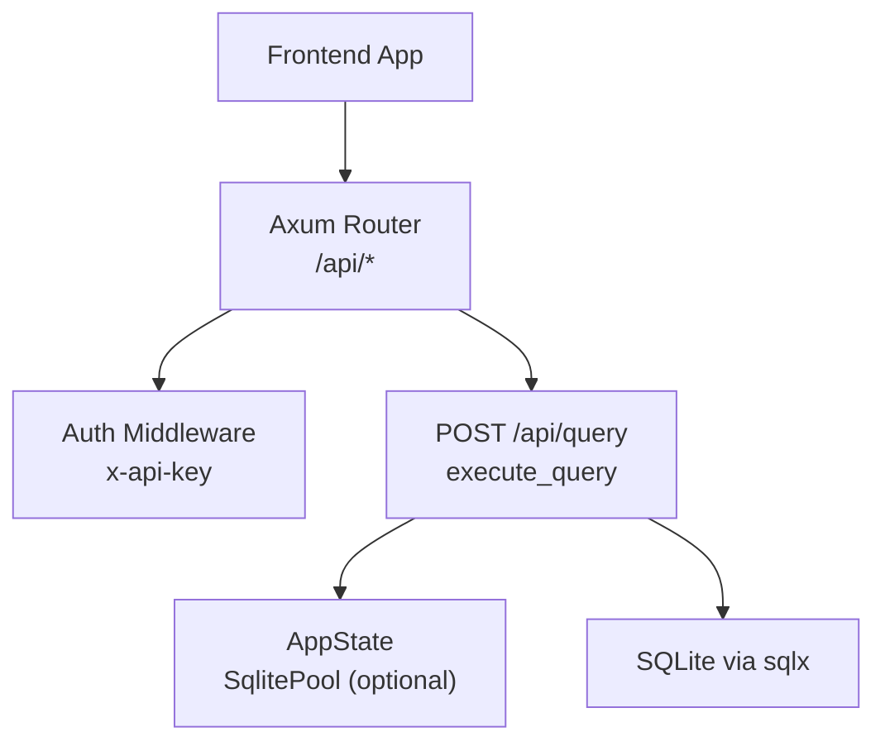
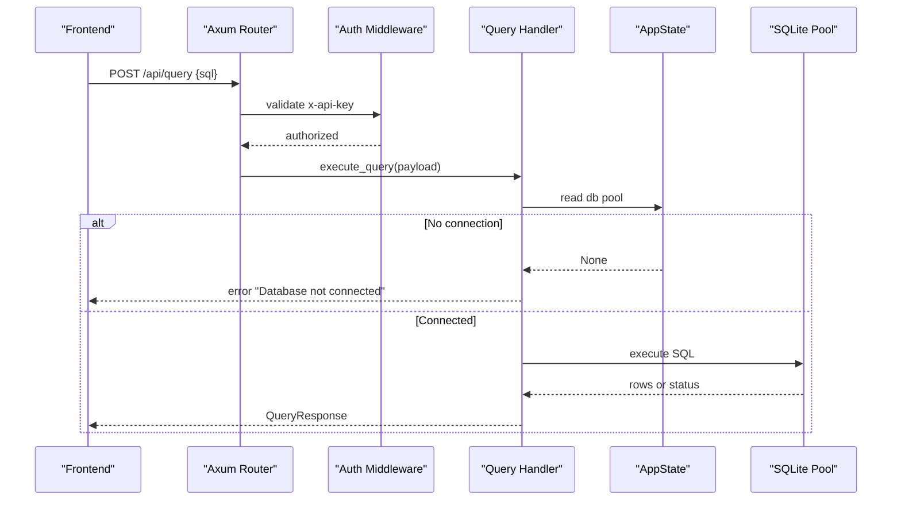
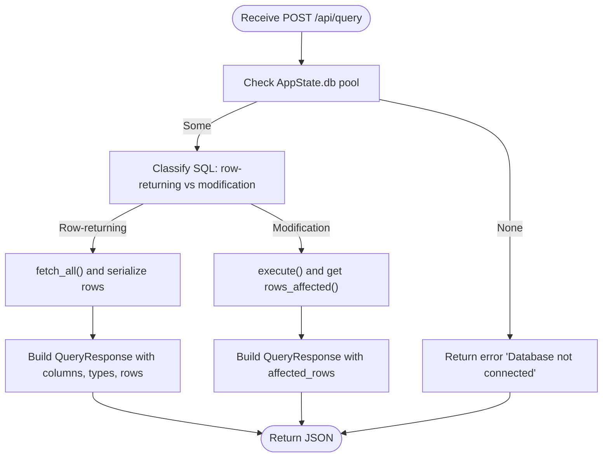
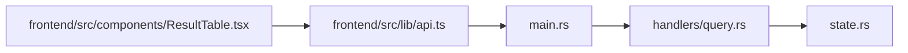

# Query Execution

<cite>
**Referenced Files in This Document**
- [backend/src/handlers/query.rs](file://backend/src/handlers/query.rs)
- [backend/src/main.rs](file://backend/src/main.rs)
- [backend/src/state.rs](file://backend/src/state.rs)
- [frontend/src/lib/api.ts](file://frontend/src/lib/api.ts)
- [frontend/src/components/ResultTable.tsx](file://frontend/src/components/ResultTable.tsx)
- [README.md](file://README.md)
</cite>

## Table of Contents
1. [Introduction](#introduction)
2. [Project Structure](#project-structure)
3. [Core Components](#core-components)
4. [Architecture Overview](#architecture-overview)
5. [Detailed Component Analysis](#detailed-component-analysis)
6. [Dependency Analysis](#dependency-analysis)
7. [Performance Considerations](#performance-considerations)
8. [Troubleshooting Guide](#troubleshooting-guide)
9. [Conclusion](#conclusion)

## Introduction
This document provides comprehensive API documentation for the SQL query execution endpoint that executes SELECT, INSERT, UPDATE, and DELETE statements against connected SQLite databases. It covers request/response schemas, security controls, performance monitoring fields, error handling, and practical usage patterns including CRUD operations, batch processing, and integration with frontend data grids.

## Project Structure
The backend exposes a single query execution route under /api/query. The frontend calls this endpoint to execute SQL and render results in a table component.

**Diagram sources**
- [backend/src/main.rs:52-65](file://backend/src/main.rs#L52-L65)
- [backend/src/handlers/query.rs:101-200](file://backend/src/handlers/query.rs#L101-L200)
- [backend/src/state.rs:5-8](file://backend/src/state.rs#L5-L8)

**Section sources**
- [backend/src/main.rs:35-73](file://backend/src/main.rs#L35-L73)
- [backend/src/handlers/query.rs:101-200](file://backend/src/handlers/query.rs#L101-L200)
- [backend/src/state.rs:5-8](file://backend/src/state.rs#L5-L8)

## Core Components
- Endpoint: POST /api/query
- Request schema: QueryRequest
- Response schema: QueryResponse
- Authentication: x-api-key header required by middleware
- Database state: Optional SqlitePool held in AppState

Key responsibilities:
- Validate authentication via middleware
- Execute SQL using sqlx
- Return structured JSON responses with metadata and timing

**Section sources**
- [backend/src/main.rs:22-33](file://backend/src/main.rs#L22-L33)
- [backend/src/main.rs:52-65](file://backend/src/main.rs#L52-L65)
- [backend/src/handlers/query.rs:12-25](file://backend/src/handlers/query.rs#L12-L25)
- [backend/src/state.rs:5-8](file://backend/src/state.rs#L5-L8)

## Architecture Overview
The query execution flow is as follows:
1. Frontend sends POST /api/query with JSON body containing the SQL statement.
2. Axum routes the request through auth_middleware, which checks the x-api-key header.
3. The execute_query handler reads the shared database pool from AppState.
4. The handler determines whether the SQL returns rows or modifies data.
5. For row-returning queries, it fetches all rows and serializes them into JSON-safe values.
6. For modification queries, it executes and returns affected row counts.
7. In both cases, it measures execution time and includes it in the response.

**Diagram sources**
- [backend/src/main.rs:52-65](file://backend/src/main.rs#L52-L65)
- [backend/src/handlers/query.rs:101-200](file://backend/src/handlers/query.rs#L101-L200)
- [backend/src/state.rs:5-8](file://backend/src/state.rs#L5-L8)

## Detailed Component Analysis

### Endpoint: POST /api/query
- Path: /api/query
- Method: POST
- Content-Type: application/json
- Authentication: Required header x-api-key; otherwise returns 401 Unauthorized

Request body: QueryRequest
- Fields:
  - sql: string (required). The SQL statement to execute.

Notes on parameter binding:
- The current implementation does not support parameterized queries. The SQL string is executed directly without placeholders or bound parameters.

Execution behavior:
- Row-returning queries are detected by prefixes like SELECT, PRAGMA, EXPLAIN, WITH, or presence of RETURNING. These use fetch_all and return columns, column_types, and rows.
- Modification queries (INSERT, UPDATE, DELETE, DDL/DML without returning rows) use execute and return affected_rows.

Response body: QueryResponse
- Fields:
  - columns: array of strings (column names)
  - column_types: array of strings (column type names)
  - rows: array of arrays of JSON-compatible values
  - affected_rows: integer or null (for non-row-returning queries)
  - execution_time: number (milliseconds)
  - error: string or null (error message if any)

Error handling:
- If no database is connected, returns a JSON response with error set to "Database not connected".
- If SQL execution fails, returns a JSON response with error set to the underlying error message.

Security considerations:
- SQL injection prevention is not implemented at the API layer because parameter binding is not supported. Treat the endpoint as privileged and restrict access via network policies, reverse proxies, and strong API keys.

Practical examples:
- SELECT: Send { "sql": "SELECT * FROM users LIMIT 10" } → returns columns, column_types, rows, execution_time.
- INSERT: Send { "sql": "INSERT INTO users(name,email) VALUES('Alice','alice@example.com')" } → returns affected_rows, execution_time.
- UPDATE: Send { "sql": "UPDATE users SET email='new@example.com' WHERE id=1" } → returns affected_rows, execution_time.
- DELETE: Send { "sql": "DELETE FROM users WHERE id=1" } → returns affected_rows, execution_time.

Batch processing patterns:
- Since parameter binding is not supported, batch operations must be sent as multiple requests or combined into multi-statement SQL where appropriate. Be mindful of transaction semantics and error handling per request.

Integration with frontend data grids:
- The frontend maps the backend response to a QueryResult interface and renders columns, rows, and execution stats. It also displays errors when present.

**Section sources**
- [backend/src/handlers/query.rs:12-25](file://backend/src/handlers/query.rs#L12-L25)
- [backend/src/handlers/query.rs:101-200](file://backend/src/handlers/query.rs#L101-L200)
- [frontend/src/lib/api.ts:2-9](file://frontend/src/lib/api.ts#L2-L9)
- [frontend/src/lib/api.ts:36-59](file://frontend/src/lib/api.ts#L36-L59)
- [frontend/src/components/ResultTable.tsx:40-59](file://frontend/src/components/ResultTable.tsx#L40-L59)

### Request Schema: QueryRequest
- Type: Object
- Properties:
  - sql: string (required). The SQL statement text.

Validation:
- No server-side validation beyond JSON parsing. Ensure the SQL is valid for your SQLite schema.

Parameter binding:
- Not supported. Use direct SQL strings only.

Example payload:
- { "sql": "SELECT id, name FROM users WHERE active = 1" }

**Section sources**
- [backend/src/handlers/query.rs:12-15](file://backend/src/handlers/query.rs#L12-L15)

### Response Schema: QueryResponse
- Type: Object
- Properties:
  - columns: array of strings. Column names for row-returning queries.
  - column_types: array of strings. Column type names for row-returning queries.
  - rows: array of arrays. Each inner array represents a row with JSON-compatible values.
  - affected_rows: integer or null. Number of rows affected by modification queries.
  - execution_time: number. Time taken to execute the query in milliseconds.
  - error: string or null. Error message if execution failed.

Row serialization details:
- NULL values are represented as null.
- Numeric types are serialized as numbers when possible.
- Boolean-like types are serialized as booleans when possible.
- BLOBs are serialized as hex strings prefixed with x'.
- Other types fall back to string representations.

Examples:
- SELECT result:
  - { "columns": ["id","name"], "column_types": ["INTEGER","TEXT"], "rows": [[1,"Alice"]], "affected_rows": null, "execution_time": 1.23, "error": null }
- INSERT result:
  - { "columns": [], "column_types": [], "rows": [], "affected_rows": 1, "execution_time": 0.87, "error": null }

**Section sources**
- [backend/src/handlers/query.rs:17-25](file://backend/src/handlers/query.rs#L17-L25)
- [backend/src/handlers/query.rs:28-99](file://backend/src/handlers/query.rs#L28-L99)
- [backend/src/handlers/query.rs:130-172](file://backend/src/handlers/query.rs#L130-L172)
- [backend/src/handlers/query.rs:173-199](file://backend/src/handlers/query.rs#L173-L199)

### Security and Authentication
- Authentication: All /api/* routes require the x-api-key header. Missing or incorrect key returns 401 Unauthorized.
- Key configuration: The API key is read from environment variable API_KEY with a default fallback value.
- Recommendation: Always set API_KEY in production and restrict access via firewall rules or reverse proxy.

**Section sources**
- [backend/src/main.rs:22-33](file://backend/src/main.rs#L22-L33)
- [README.md:74-83](file://README.md#L74-L83)

### Performance Monitoring
- Execution time: The response includes execution_time in milliseconds, measured around the SQL execution.
- Logging: The handler logs the executed SQL statement using tracing.
- Frontend display: The ResultTable component shows execution time and either returned row count or affected row count.

Recommendations:
- Monitor execution_time in client-side analytics.
- Use RUST_LOG to adjust logging verbosity for diagnostics.

**Section sources**
- [backend/src/handlers/query.rs:105](file://backend/src/handlers/query.rs#L105)
- [backend/src/handlers/query.rs:122-132](file://backend/src/handlers/query.rs#L122-L132)
- [backend/src/handlers/query.rs:174-175](file://backend/src/handlers/query.rs#L174-L175)
- [frontend/src/components/ResultTable.tsx:44-51](file://frontend/src/components/ResultTable.tsx#L44-L51)
- [README.md:74-83](file://README.md#L74-L83)

### Query Timeout Handling
- Current implementation: No explicit timeout is configured for query execution. Long-running queries may block until completion.
- Recommendation: Add timeouts at the application level or via reverse proxy/load balancer to prevent resource exhaustion.

[No sources needed since this section provides general guidance]

### Data Flow and Processing Logic

**Diagram sources**
- [backend/src/handlers/query.rs:101-200](file://backend/src/handlers/query.rs#L101-L200)

## Dependency Analysis
- Backend routing: main.rs defines /api/query route and applies auth middleware.
- Handler: handlers/query.rs implements execute_query and response models.
- State: state.rs holds optional SqlitePool inside AppState.
- Frontend: lib/api.ts calls /api/query and maps backend response to QueryResult.
- UI: components/ResultTable.tsx renders results and errors.

**Diagram sources**
- [backend/src/main.rs:52-65](file://backend/src/main.rs#L52-L65)
- [backend/src/handlers/query.rs:101-200](file://backend/src/handlers/query.rs#L101-L200)
- [backend/src/state.rs:5-8](file://backend/src/state.rs#L5-L8)
- [frontend/src/lib/api.ts:36-59](file://frontend/src/lib/api.ts#L36-L59)
- [frontend/src/components/ResultTable.tsx:40-59](file://frontend/src/components/ResultTable.tsx#L40-L59)

**Section sources**
- [backend/src/main.rs:52-65](file://backend/src/main.rs#L52-L65)
- [backend/src/handlers/query.rs:101-200](file://backend/src/handlers/query.rs#L101-L200)
- [backend/src/state.rs:5-8](file://backend/src/state.rs#L5-L8)
- [frontend/src/lib/api.ts:36-59](file://frontend/src/lib/api.ts#L36-L59)
- [frontend/src/components/ResultTable.tsx:40-59](file://frontend/src/components/ResultTable.tsx#L40-L59)

## Performance Considerations
- Execution time measurement: The handler measures elapsed time around SQL execution and returns it in execution_time.
- Large result sets: Row-returning queries load all rows into memory before serialization. Consider pagination or limiting results in SQL.
- Serialization overhead: Complex types (e.g., BLOBs) are converted to strings, which can increase payload size.
- Logging: SQL statements are logged; ensure sensitive data is not included in logs.

[No sources needed since this section provides general guidance]

## Troubleshooting Guide
Common issues and resolutions:
- 401 Unauthorized:
  - Cause: Missing or incorrect x-api-key header.
  - Resolution: Provide the correct API key configured via API_KEY.
- Database not connected:
  - Cause: No SqlitePool initialized in AppState.
  - Resolution: Connect to a database file first via the connect endpoint before executing queries.
- Invalid SQL or constraint violations:
  - Cause: Syntax errors or constraint failures.
  - Resolution: Inspect the error field in the response and fix the SQL accordingly.
- Empty results:
  - Behavior: For row-returning queries with no rows, the response contains empty columns and rows arrays.
  - Resolution: Verify query conditions and data existence.

Frontend error display:
- The ResultTable component shows an alert when error is present in the response.

**Section sources**
- [backend/src/main.rs:22-33](file://backend/src/main.rs#L22-L33)
- [backend/src/handlers/query.rs:107-120](file://backend/src/handlers/query.rs#L107-L120)
- [backend/src/handlers/query.rs:162-171](file://backend/src/handlers/query.rs#L162-L171)
- [backend/src/handlers/query.rs:188-196](file://backend/src/handlers/query.rs#L188-L196)
- [frontend/src/components/ResultTable.tsx:54-59](file://frontend/src/components/ResultTable.tsx#L54-L59)

## Conclusion
The POST /api/query endpoint provides a straightforward way to execute SQL against SQLite. It returns structured responses suitable for rendering in data grids and includes execution timing for monitoring. While parameter binding is not supported, the endpoint’s simplicity makes it easy to integrate. For production deployments, enforce strict authentication, consider adding timeouts, and monitor performance metrics based on execution_time.