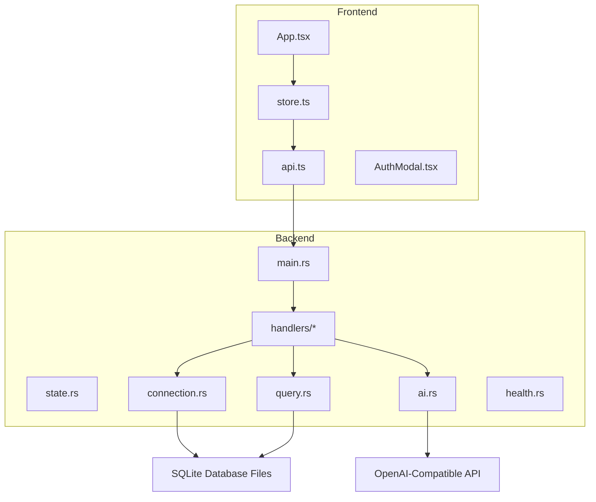
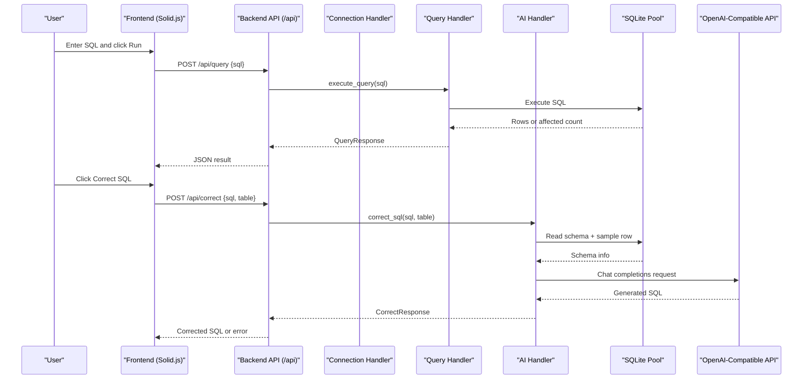
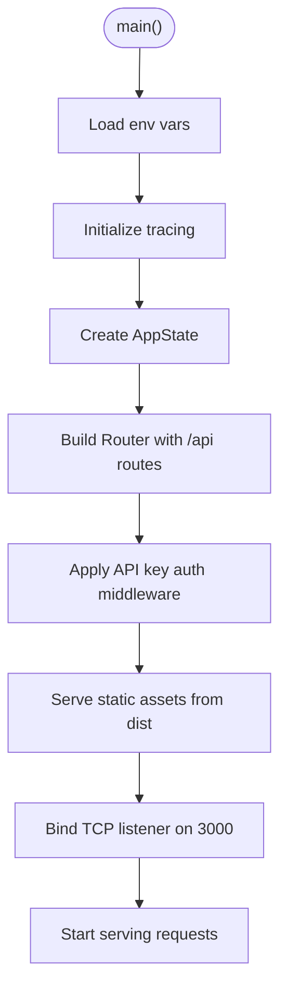
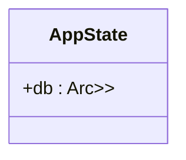
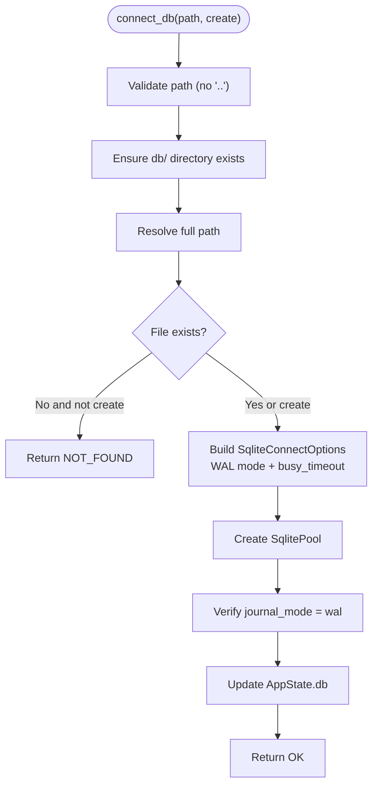
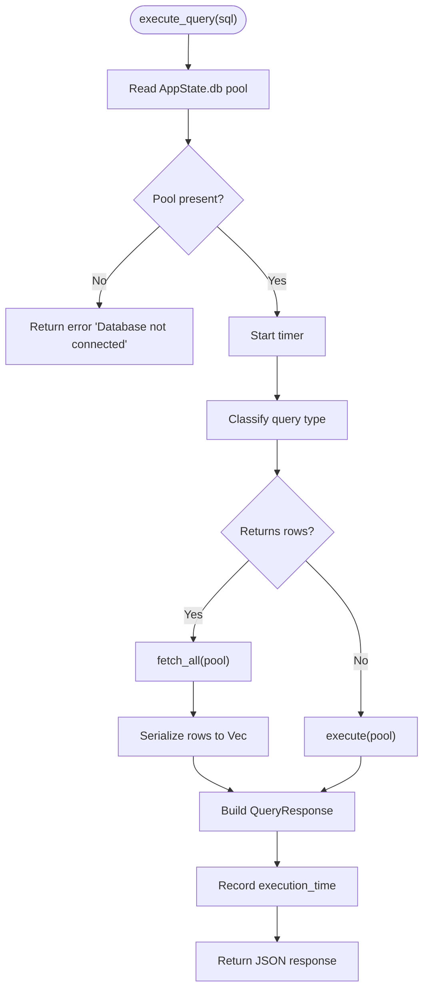
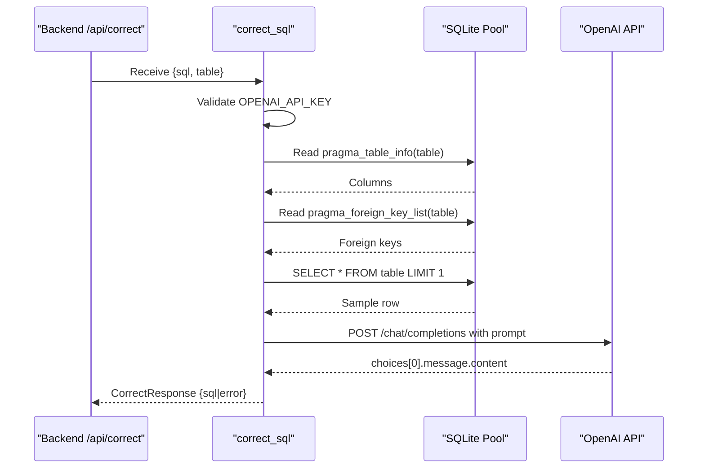
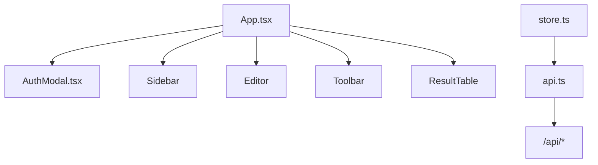
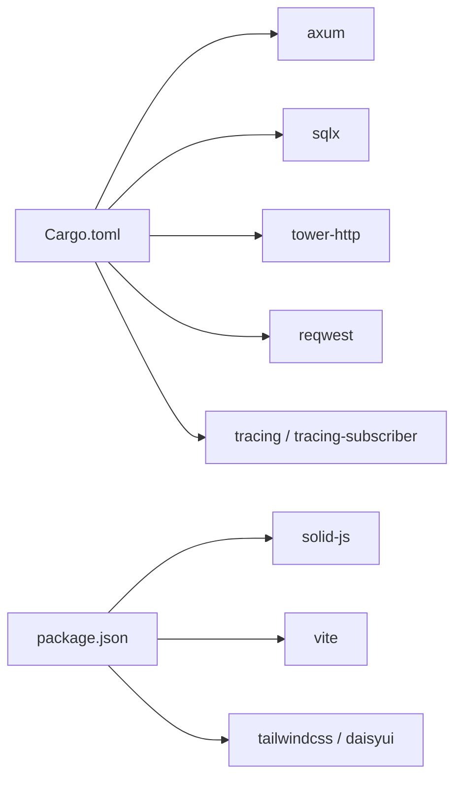
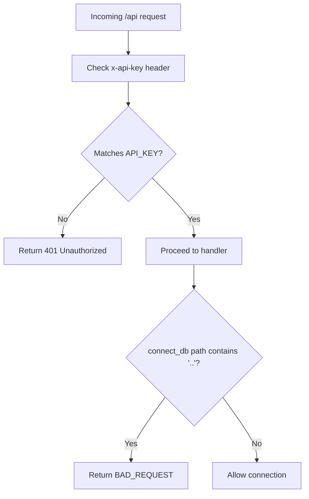

# Architecture & Design

<cite>
**Referenced Files in This Document**
- [main.rs](file://backend/src/main.rs)
- [state.rs](file://backend/src/state.rs)
- [handlers/mod.rs](file://backend/src/handlers/mod.rs)
- [connection.rs](file://backend/src/handlers/connection.rs)
- [query.rs](file://backend/src/handlers/query.rs)
- [ai.rs](file://backend/src/handlers/ai.rs)
- [health.rs](file://backend/src/handlers/health.rs)
- [Cargo.toml](file://backend/Cargo.toml)
- [App.tsx](file://frontend/src/App.tsx)
- [api.ts](file://frontend/src/lib/api.ts)
- [store.ts](file://frontend/src/lib/store.ts)
- [AuthModal.tsx](file://frontend/src/components/AuthModal.tsx)
- [README.md](file://README.md)
</cite>

## Table of Contents
1. [Introduction](#introduction)
2. [Project Structure](#project-structure)
3. [Core Components](#core-components)
4. [Architecture Overview](#architecture-overview)
5. [Detailed Component Analysis](#detailed-component-analysis)
6. [Dependency Analysis](#dependency-analysis)
7. [Performance Considerations](#performance-considerations)
8. [Security Architecture](#security-architecture)
9. [Scalability and Deployment Topology](#scalability-and-deployment-topology)
10. [Troubleshooting Guide](#troubleshooting-guide)
11. [Conclusion](#conclusion)

## Introduction
CrabLite is a lightweight SQLite Web administration tool with a Rust backend (Axum) and a Solid.js frontend. The system provides:
- A web UI for browsing SQLite databases, executing SQL queries, and managing connections.
- An AI-assisted SQL correction feature that integrates with an external OpenAI-compatible API.
- Secure access via API key authentication middleware.
- Efficient database connection management using a shared pool with WAL mode enabled.

This document explains the high-level architecture, component interactions, data flows, security model, and deployment considerations.

## Project Structure
The repository is organized into two primary layers:
- Backend (Rust/Axum): HTTP server, handlers, state management, and integrations.
- Frontend (Solid.js/Vite): UI components, API client, and local store.

**Diagram sources**
- [main.rs:52-65](file://backend/src/main.rs#L52-L65)
- [handlers/mod.rs:1-10](file://backend/src/handlers/mod.rs#L1-L10)
- [connection.rs:20-109](file://backend/src/handlers/connection.rs#L20-L109)
- [query.rs:101-200](file://backend/src/handlers/query.rs#L101-L200)
- [ai.rs:24-148](file://backend/src/handlers/ai.rs#L24-L148)
- [health.rs:3-5](file://backend/src/handlers/health.rs#L3-L5)
- [App.tsx:9-26](file://frontend/src/App.tsx#L9-L26)
- [store.ts:30-115](file://frontend/src/lib/store.ts#L30-L115)
- [api.ts:25-115](file://frontend/src/lib/api.ts#L25-L115)

**Section sources**
- [README.md:10-26](file://README.md#L10-L26)
- [main.rs:35-73](file://backend/src/main.rs#L35-L73)
- [App.tsx:9-26](file://frontend/src/App.tsx#L9-L26)

## Core Components
- Backend entrypoint and routing:
  - Initializes tracing, loads environment variables, constructs AppState, registers API routes under /api, serves static frontend assets from dist, and binds to port 3000.
  - Applies API key authentication middleware to all /api routes.
- State management:
  - AppState holds a thread-safe reference to an optional SqlitePool protected by RwLock.
- Handlers:
  - Connection handler: lists available .db files, connects to a selected database, validates paths, sets WAL mode, and verifies journal mode.
  - Query handler: executes SELECT-like or DDL/DML statements, serializes rows, measures execution time, and returns structured results.
  - AI handler: builds schema context, calls OpenAI-compatible chat completions endpoint, and returns corrected SQL or error.
  - Health handler: returns status and version info.
- Frontend:
  - App composes UI components including AuthModal, Navbar, Sidebar, Editor, Toolbar, and ResultTable.
  - Store manages application state, triggers API calls, and updates UI accordingly.
  - API client encapsulates HTTP requests with API key headers and response handling.

**Section sources**
- [main.rs:22-33](file://backend/src/main.rs#L22-L33)
- [main.rs:35-73](file://backend/src/main.rs#L35-L73)
- [state.rs:5-8](file://backend/src/state.rs#L5-L8)
- [handlers/mod.rs:1-10](file://backend/src/handlers/mod.rs#L1-L10)
- [connection.rs:20-109](file://backend/src/handlers/connection.rs#L20-L109)
- [query.rs:101-200](file://backend/src/handlers/query.rs#L101-L200)
- [ai.rs:24-148](file://backend/src/handlers/ai.rs#L24-L148)
- [health.rs:3-5](file://backend/src/handlers/health.rs#L3-L5)
- [App.tsx:9-26](file://frontend/src/App.tsx#L9-L26)
- [store.ts:30-115](file://frontend/src/lib/store.ts#L30-L115)
- [api.ts:25-115](file://frontend/src/lib/api.ts#L25-L115)

## Architecture Overview
The system follows a clear separation between frontend and backend:
- Frontend communicates with backend via REST endpoints under /api.
- Backend exposes handlers for health checks, database connection management, query execution, and AI-assisted SQL correction.
- Database layer uses SQLite with a pooled connection and WAL mode for concurrency safety.
- External AI service integration is handled through an HTTP client calling an OpenAI-compatible API.

**Diagram sources**
- [api.ts:36-75](file://frontend/src/lib/api.ts#L36-L75)
- [store.ts:49-115](file://frontend/src/lib/store.ts#L49-L115)
- [main.rs:52-65](file://backend/src/main.rs#L52-L65)
- [query.rs:101-200](file://backend/src/handlers/query.rs#L101-L200)
- [ai.rs:24-148](file://backend/src/handlers/ai.rs#L24-L148)

## Detailed Component Analysis

### Backend Entry Point and Routing
- Initializes tracing subscriber with configurable log levels.
- Loads environment variables via dotenv.
- Creates AppState with a shared RwLock<Option<SqlitePool>>.
- Registers API routes under /api with auth middleware applied.
- Serves static frontend assets from dist directory.
- Binds to port 3000 and starts Axum server.

**Diagram sources**
- [main.rs:35-73](file://backend/src/main.rs#L35-L73)

**Section sources**
- [main.rs:35-73](file://backend/src/main.rs#L35-L73)

### State Management
- AppState wraps an Arc<RwLock<Option<SqlitePool>>> to allow concurrent read access and exclusive write access when connecting/disconnecting databases.

**Diagram sources**
- [state.rs:5-8](file://backend/src/state.rs#L5-L8)

**Section sources**
- [state.rs:5-8](file://backend/src/state.rs#L5-L8)

### Connection Handler
Responsibilities:
- List available .db files recursively under db/, excluding WAL/SHM files.
- Connect to a specified database file with path traversal protection.
- Enable WAL mode and busy timeout to prevent corruption under concurrent access.
- Verify WAL mode after connection.

**Diagram sources**
- [connection.rs:62-109](file://backend/src/handlers/connection.rs#L62-L109)
- [connection.rs:131-144](file://backend/src/handlers/connection.rs#L131-L144)

**Section sources**
- [connection.rs:20-109](file://backend/src/handlers/connection.rs#L20-L109)
- [connection.rs:111-129](file://backend/src/handlers/connection.rs#L111-L129)
- [connection.rs:131-144](file://backend/src/handlers/connection.rs#L131-L144)

### Query Handler
Responsibilities:
- Execute SQL queries and return structured results.
- Detect whether a query returns rows based on prefixes like SELECT, PRAGMA, EXPLAIN, WITH, or RETURNING.
- Serialize rows with type-aware mapping to JSON values.
- Measure execution time and include metadata in responses.

**Diagram sources**
- [query.rs:101-200](file://backend/src/handlers/query.rs#L101-L200)

**Section sources**
- [query.rs:101-200](file://backend/src/handlers/query.rs#L101-L200)

### AI Handler
Responsibilities:
- Validate OPENAI_API_KEY presence.
- Read table schema and foreign keys; optionally fetch a sample row.
- Construct a prompt with schema and user input.
- Call OpenAI-compatible chat completions endpoint.
- Return corrected SQL or error message.

**Diagram sources**
- [ai.rs:24-148](file://backend/src/handlers/ai.rs#L24-L148)

**Section sources**
- [ai.rs:24-148](file://backend/src/handlers/ai.rs#L24-L148)

### Health Handler
- Returns a simple JSON object with status and version information.

**Section sources**
- [health.rs:3-5](file://backend/src/handlers/health.rs#L3-L5)

### Frontend Application
- App composes UI components and renders the main layout.
- AuthModal prompts for API key if unauthorized.
- Store manages signals for tables, SQL content, query results, and control flags.
- API client handles HTTP requests with API key headers and response validation.

**Diagram sources**
- [App.tsx:9-26](file://frontend/src/App.tsx#L9-L26)
- [AuthModal.tsx:4-43](file://frontend/src/components/AuthModal.tsx#L4-L43)
- [store.ts:30-115](file://frontend/src/lib/store.ts#L30-L115)
- [api.ts:25-115](file://frontend/src/lib/api.ts#L25-L115)

**Section sources**
- [App.tsx:9-26](file://frontend/src/App.tsx#L9-L26)
- [AuthModal.tsx:4-43](file://frontend/src/components/AuthModal.tsx#L4-L43)
- [store.ts:30-115](file://frontend/src/lib/store.ts#L30-L115)
- [api.ts:25-115](file://frontend/src/lib/api.ts#L25-L115)

## Dependency Analysis
- Backend dependencies:
  - axum: HTTP framework and routing.
  - sqlx: Async database driver for SQLite with pooling.
  - tower-http: Static file serving, tracing, and CORS features.
  - reqwest: HTTP client for AI service integration.
  - tracing/tracing-subscriber: Structured logging.
  - clap: CLI argument parsing (unused in current flow).
- Frontend dependencies:
  - solid-js: Reactive UI framework.
  - vite: Build tool and dev server.
  - tailwindcss/daisyui: Styling utilities and components.

**Diagram sources**
- [Cargo.toml:6-18](file://backend/Cargo.toml#L6-L18)
- [package.json:10-20](file://frontend/package.json#L10-L20)

**Section sources**
- [Cargo.toml:6-18](file://backend/Cargo.toml#L6-L18)
- [package.json:10-20](file://frontend/package.json#L10-L20)

## Performance Considerations
- Concurrency and safety:
  - SQLite pool with WAL mode and busy_timeout reduces contention and prevents corruption under concurrent access.
- Query processing:
  - Type-aware serialization avoids unnecessary conversions and ensures consistent JSON output.
  - Execution time measurement enables performance monitoring at the API level.
- Binary optimizations:
  - Release profile includes strip, LTO, and reduced codegen units for smaller binaries and faster startup.
- Frontend reactivity:
  - Solid.js signals minimize unnecessary re-renders and improve UI responsiveness.

[No sources needed since this section provides general guidance]

## Security Architecture
- API Key Authentication Middleware:
  - All /api routes require the x-api-key header matching the configured API_KEY environment variable.
  - Unauthorized requests receive 401 responses.
- Path Traversal Protection:
  - connect_db rejects paths containing ".." to prevent directory traversal attacks.
  - Only .db files are listed; WAL/SHM files are excluded.
- Environment-based Secrets:
  - API keys and AI credentials are loaded from environment variables; defaults are provided for development but should be overridden in production.

**Diagram sources**
- [main.rs:22-33](file://backend/src/main.rs#L22-L33)
- [connection.rs:62-69](file://backend/src/handlers/connection.rs#L62-L69)

**Section sources**
- [main.rs:22-33](file://backend/src/main.rs#L22-L33)
- [connection.rs:62-69](file://backend/src/handlers/connection.rs#L62-L69)

## Scalability and Deployment Topology
- Single-node deployment:
  - The backend serves both API and static frontend assets from one process on port 3000.
  - Suitable for small-scale usage and local development.
- Containerized deployment:
  - Docker image size is minimal (~10MB), enabling fast deployments.
  - Volume mounts allow persistent SQLite files and configuration via environment variables.
- Horizontal scaling:
  - SQLite is file-based; horizontal scaling requires careful coordination or sharding strategies.
  - For multi-instance setups, consider read replicas or moving to a client-server RDBMS.
- Reverse proxy:
  - Place behind Nginx/Traefik for TLS termination, rate limiting, and caching of static assets.
- AI service integration:
  - External dependency on OpenAI-compatible API introduces latency and potential failure points.
  - Implement retries, timeouts, and graceful degradation (e.g., disable AI correction if unavailable).

[No sources needed since this section provides general guidance]

## Troubleshooting Guide
- Authentication failures:
  - Ensure x-api-key header matches API_KEY environment variable.
  - Frontend stores API key in localStorage and reloads to apply changes.
- Database connection errors:
  - Verify db/ directory exists and has proper permissions.
  - Confirm path does not contain ".." and points to a valid .db file.
  - Check WAL mode verification logs if connection succeeds but queries fail.
- Query execution issues:
  - Inspect QueryResponse.error field for SQL syntax or runtime errors.
  - Use PRAGMA and EXPLAIN queries to diagnose performance or schema issues.
- AI correction failures:
  - Validate OPENAI_API_KEY is set and accessible.
  - Check network connectivity to OPENAI_BASE_URL and model availability.
  - Review logs for prompt construction and API response details.

**Section sources**
- [AuthModal.tsx:4-43](file://frontend/src/components/AuthModal.tsx#L4-L43)
- [connection.rs:62-109](file://backend/src/handlers/connection.rs#L62-L109)
- [query.rs:101-200](file://backend/src/handlers/query.rs#L101-L200)
- [ai.rs:24-148](file://backend/src/handlers/ai.rs#L24-L148)

## Conclusion
CrabLite’s architecture cleanly separates concerns between a reactive Solid.js frontend and a performant Rust/Axum backend. The system emphasizes security through API key authentication and path validation, robustness via SQLite pooling and WAL mode, and extensibility through AI-assisted SQL correction. With minimal resource footprint and container-friendly design, it is well-suited for lightweight SQLite administration tasks while offering clear pathways for scaling and hardening in production environments.

[No sources needed since this section summarizes without analyzing specific files]