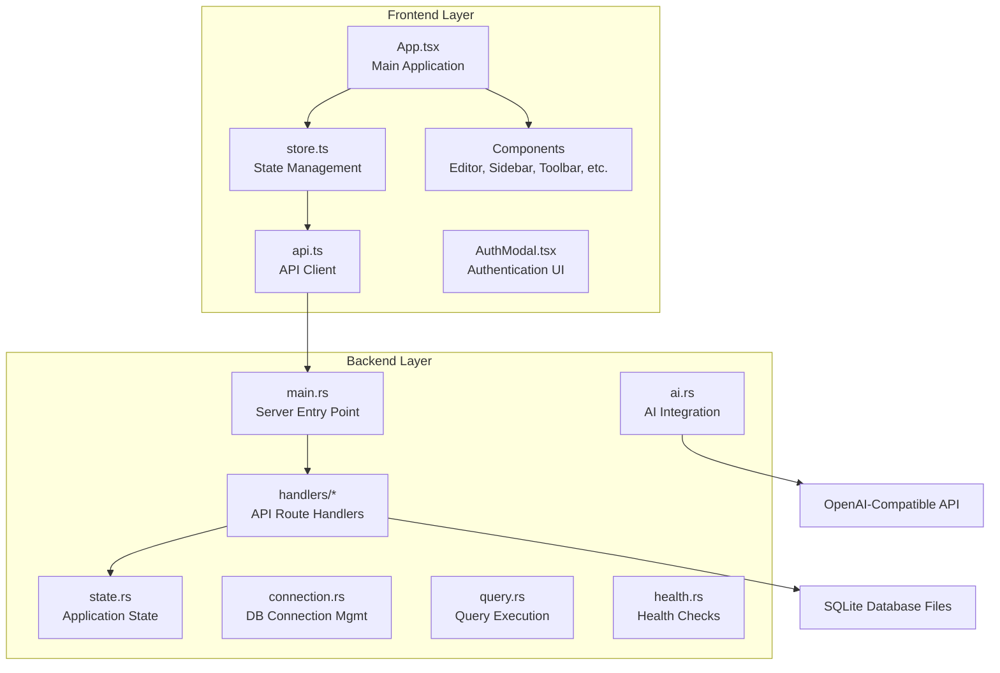
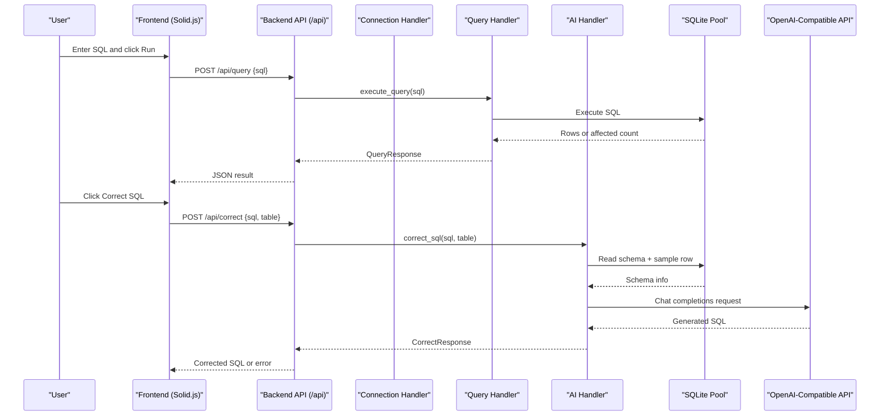
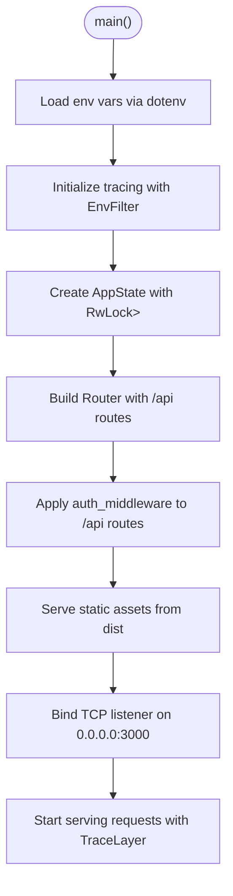
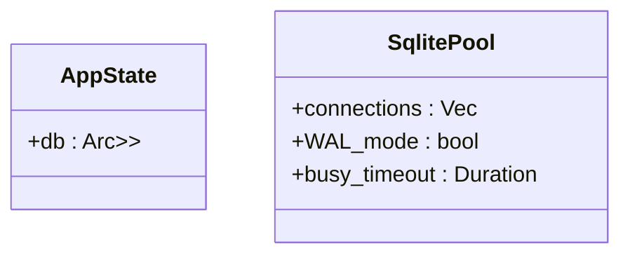
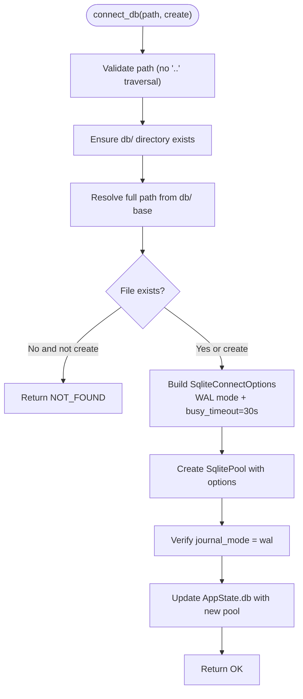
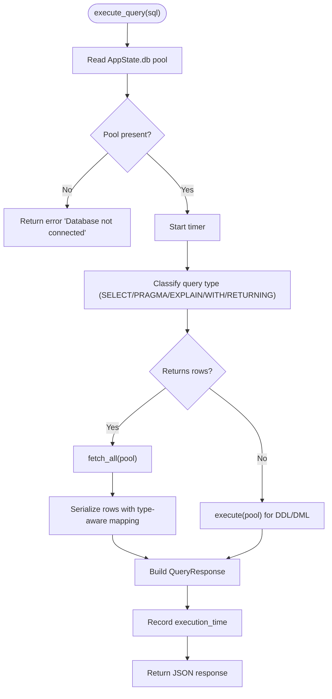
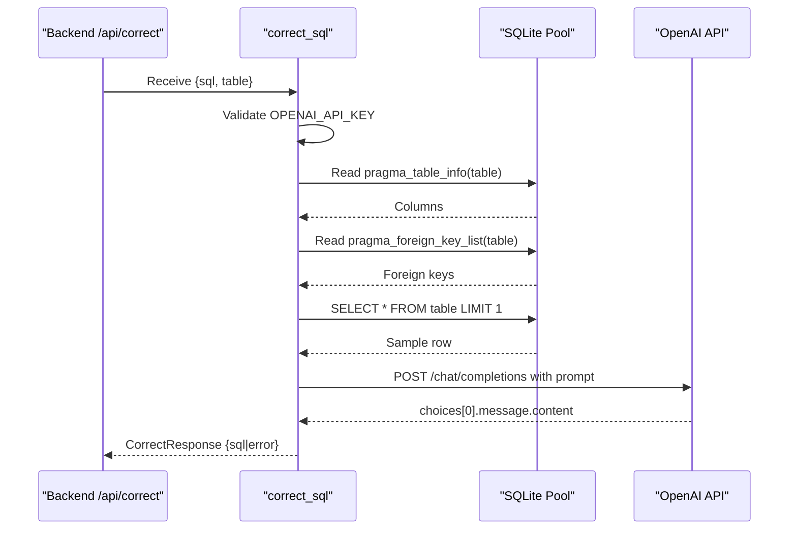
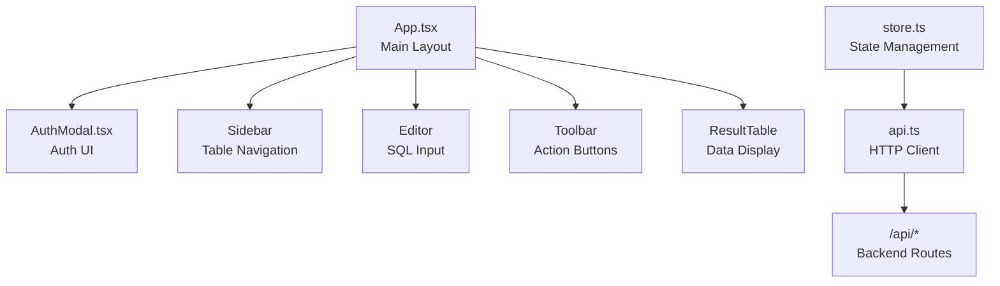
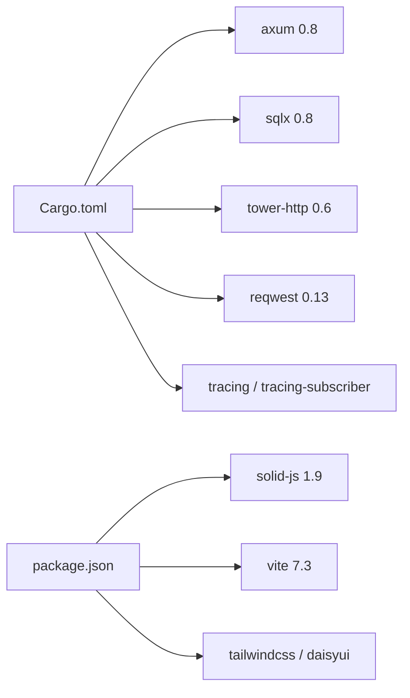
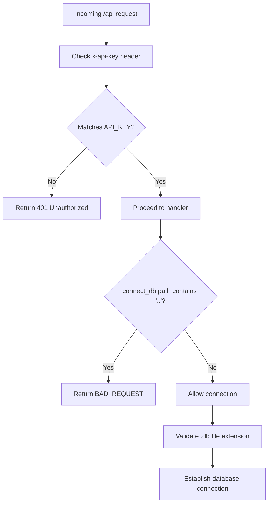

# Architecture & Design

<cite>
**Referenced Files in This Document**
- [main.rs](file://backend/src/main.rs)
- [state.rs](file://backend/src/state.rs)
- [handlers/mod.rs](file://backend/src/handlers/mod.rs)
- [connection.rs](file://backend/src/handlers/connection.rs)
- [query.rs](file://backend/src/handlers/query.rs)
- [ai.rs](file://backend/src/handlers/ai.rs)
- [health.rs](file://backend/src/handlers/health.rs)
- [Cargo.toml](file://backend/Cargo.toml)
- [App.tsx](file://frontend/src/App.tsx)
- [api.ts](file://frontend/src/lib/api.ts)
- [store.ts](file://frontend/src/lib/store.ts)
- [AuthModal.tsx](file://frontend/src/components/AuthModal.tsx)
- [README.md](file://README.md)
</cite>

## Update Summary
**Changes Made**
- Updated backend routing structure to reflect actual Axum router configuration
- Enhanced security architecture section with detailed authentication middleware implementation
- Added comprehensive database connection flow documentation with WAL mode verification
- Expanded AI assistant integration details with OpenAI-compatible API support
- Updated frontend component architecture to reflect Solid.js reactive patterns
- Enhanced deployment topology section with Docker and containerization strategies
- Improved performance considerations with specific optimization techniques

## Table of Contents
1. [Introduction](#introduction)
2. [Project Structure](#project-structure)
3. [Core Components](#core-components)
4. [Architecture Overview](#architecture-overview)
5. [Detailed Component Analysis](#detailed-component-analysis)
6. [Dependency Analysis](#dependency-analysis)
7. [Performance Considerations](#performance-considerations)
8. [Security Architecture](#security-architecture)
9. [Scalability and Deployment Topology](#scalability-and-deployment-topology)
10. [Troubleshooting Guide](#troubleshooting-guide)
11. [Conclusion](#conclusion)

## Introduction
CrabLite is a lightweight SQLite Web administration tool built with Rust (Axum) backend and Solid.js frontend. The system provides:
- A modern web UI for browsing SQLite databases, executing SQL queries, and managing connections.
- An AI-assisted SQL correction feature that integrates with external OpenAI-compatible APIs.
- Secure access via API key authentication middleware protecting all API endpoints.
- Efficient database connection management using pooled connections with WAL mode enabled for concurrent access safety.

This document explains the high-level architecture, component interactions, data flows, security model, and deployment considerations.

## Project Structure
The repository follows a clear separation between backend and frontend concerns:
- **Backend (Rust/Axum)**: HTTP server, API handlers, state management, and external service integrations.
- **Frontend (Solid.js/Vite)**: Reactive UI components, API client layer, and local state management.

**Diagram sources**
- [main.rs:52-65](file://backend/src/main.rs#L52-L65)
- [handlers/mod.rs:1-10](file://backend/src/handlers/mod.rs#L1-L10)
- [App.tsx:9-26](file://frontend/src/App.tsx#L9-L26)

**Section sources**
- [README.md:10-26](file://README.md#L10-L26)
- [main.rs:35-73](file://backend/src/main.rs#L35-L73)
- [App.tsx:9-26](file://frontend/src/App.tsx#L9-L26)

## Core Components

### Backend Components
- **Server Entry Point**: Initializes tracing, loads environment variables, constructs AppState, registers API routes under `/api`, serves static frontend assets from `dist`, and binds to port 3000.
- **Authentication Middleware**: Validates `x-api-key` header against configured `API_KEY` environment variable for all `/api` routes.
- **State Management**: `AppState` holds a thread-safe reference to an optional `SqlitePool` protected by `RwLock`.
- **Connection Handler**: Lists available `.db` files, connects to selected databases with path validation, enables WAL mode, and verifies journal mode.
- **Query Handler**: Executes SELECT-like or DDL/DML statements, serializes rows with type-aware mapping, measures execution time, and returns structured results.
- **AI Handler**: Builds schema context, calls OpenAI-compatible chat completions endpoint, and returns corrected SQL or error messages.
- **Health Handler**: Returns status and version information for monitoring.

### Frontend Components
- **Application Shell**: Composes UI components including AuthModal, Navbar, Sidebar, Editor, Toolbar, and ResultTable.
- **State Management**: Uses Solid.js signals for reactive state management, triggers API calls, and updates UI accordingly.
- **API Client**: Encapsulates HTTP requests with API key headers, response handling, and error management.
- **Authentication Modal**: Prompts for API key when unauthorized access is detected.

**Section sources**
- [main.rs:22-33](file://backend/src/main.rs#L22-L33)
- [main.rs:35-73](file://backend/src/main.rs#L35-L73)
- [state.rs:5-8](file://backend/src/state.rs#L5-L8)
- [handlers/mod.rs:1-10](file://backend/src/handlers/mod.rs#L1-L10)
- [connection.rs:20-109](file://backend/src/handlers/connection.rs#L20-L109)
- [query.rs:101-200](file://backend/src/handlers/query.rs#L101-L200)
- [ai.rs:24-148](file://backend/src/handlers/ai.rs#L24-L148)
- [health.rs:3-5](file://backend/src/handlers/health.rs#L3-L5)
- [App.tsx:9-26](file://frontend/src/App.tsx#L9-L26)
- [store.ts:30-115](file://frontend/src/lib/store.ts#L30-L115)
- [api.ts:25-115](file://frontend/src/lib/api.ts#L25-L115)

## Architecture Overview
The system follows a clear separation between frontend and backend with well-defined responsibilities:
- **Frontend communicates with backend** via REST endpoints under `/api`.
- **Backend exposes handlers** for health checks, database connection management, query execution, and AI-assisted SQL correction.
- **Database layer uses SQLite** with pooled connections and WAL mode for concurrency safety.
- **External AI service integration** is handled through an HTTP client calling OpenAI-compatible APIs.

**Diagram sources**
- [api.ts:36-75](file://frontend/src/lib/api.ts#L36-L75)
- [store.ts:49-115](file://frontend/src/lib/store.ts#L49-L115)
- [main.rs:52-65](file://backend/src/main.rs#L52-L65)
- [query.rs:101-200](file://backend/src/handlers/query.rs#L101-L200)
- [ai.rs:24-148](file://backend/src/handlers/ai.rs#L24-L148)

## Detailed Component Analysis

### Backend Entry Point and Routing
The main application initializes the Axum server with comprehensive setup:
- Initializes tracing subscriber with configurable log levels via `RUST_LOG` environment variable.
- Loads environment variables via dotenv for development convenience.
- Creates `AppState` with shared `RwLock<Option<SqlitePool>>` for thread-safe database pool access.
- Registers API routes under `/api` with authentication middleware applied globally.
- Serves static frontend assets from `dist` directory for production deployments.
- Binds to port 3000 and starts the Axum server with HTTP tracing enabled.

**Diagram sources**
- [main.rs:35-73](file://backend/src/main.rs#L35-L73)

**Section sources**
- [main.rs:35-73](file://backend/src/main.rs#L35-L73)

### State Management
The application state is designed for concurrent access patterns:
- `AppState` wraps an `Arc<RwLock<Option<SqlitePool>>>` to allow concurrent read access and exclusive write access when connecting/disconnecting databases.
- The `Option<SqlitePool>` pattern allows lazy initialization and graceful shutdown.
- Thread-safe access ensures multiple handlers can safely read database connections while only one handler can modify the connection state.

**Diagram sources**
- [state.rs:5-8](file://backend/src/state.rs#L5-L8)

**Section sources**
- [state.rs:5-8](file://backend/src/state.rs#L5-L8)

### Connection Handler
The connection management system provides secure and robust database connectivity:
- **Directory Scanning**: Recursively scans `db/` directory for `.db` files, excluding WAL/SHM temporary files.
- **Path Validation**: Implements path traversal protection by rejecting paths containing `..` sequences.
- **WAL Mode Configuration**: Enables Write-Ahead Logging mode and sets busy timeout to prevent corruption under concurrent access.
- **Connection Verification**: Verifies WAL mode is properly activated after connection establishment.

**Diagram sources**
- [connection.rs:62-109](file://backend/src/handlers/connection.rs#L62-L109)
- [connection.rs:131-144](file://backend/src/handlers/connection.rs#L131-L144)

**Section sources**
- [connection.rs:20-109](file://backend/src/handlers/connection.rs#L20-L109)
- [connection.rs:111-129](file://backend/src/handlers/connection.rs#L111-L129)
- [connection.rs:131-144](file://backend/src/handlers/connection.rs#L131-L144)

### Query Handler
The query execution engine provides comprehensive SQL processing capabilities:
- **Query Classification**: Detects whether a query returns rows based on prefixes like SELECT, PRAGMA, EXPLAIN, WITH, or RETURNING clauses.
- **Type-Aware Serialization**: Maps SQLite column types to JSON values with proper handling of NULL, INTEGER, REAL, BOOLEAN, BLOB, and custom types.
- **Execution Time Measurement**: Tracks query execution time in milliseconds for performance monitoring.
- **Structured Response Format**: Returns consistent JSON responses with columns, column_types, rows, affected_rows, execution_time, and error fields.

**Diagram sources**
- [query.rs:101-200](file://backend/src/handlers/query.rs#L101-L200)

**Section sources**
- [query.rs:101-200](file://backend/src/handlers/query.rs#L101-L200)

### AI Handler
The AI integration provides intelligent SQL assistance through OpenAI-compatible APIs:
- **Configuration Management**: Reads OPENAI_API_KEY, OPENAI_BASE_URL, and OPENAI_MODEL from environment variables.
- **Schema Context Building**: Extracts table schema information including columns, constraints, and foreign keys.
- **Sample Data Inclusion**: Optionally fetches sample rows to provide context for AI-generated SQL.
- **Prompt Engineering**: Constructs detailed prompts with schema information and user input for optimal AI responses.
- **Error Handling**: Provides graceful error handling for API failures and invalid configurations.

**Diagram sources**
- [ai.rs:24-148](file://backend/src/handlers/ai.rs#L24-L148)

**Section sources**
- [ai.rs:24-148](file://backend/src/handlers/ai.rs#L24-L148)

### Health Handler
Provides simple health check functionality for monitoring and load balancer health probes:
- Returns JSON object with status field set to "ok" and version information.
- Version is determined at compile time using CARGO_PKG_VERSION or APP_VERSION environment variable.
- No authentication required for health endpoints to enable easy monitoring.

**Section sources**
- [health.rs:3-5](file://backend/src/handlers/health.rs#L3-L5)

### Frontend Application
The frontend implements a reactive UI architecture using Solid.js:
- **Component Composition**: App component composes UI components including AuthModal, Navbar, Sidebar, Editor, Toolbar, and ResultTable.
- **Reactive State Management**: Uses Solid.js signals for fine-grained reactivity and minimal re-renders.
- **API Client Layer**: Centralized API client handles HTTP requests with automatic API key injection and response validation.
- **Authentication Flow**: Automatic detection of unauthorized responses triggers authentication modal display.

**Diagram sources**
- [App.tsx:9-26](file://frontend/src/App.tsx#L9-L26)
- [AuthModal.tsx:4-43](file://frontend/src/components/AuthModal.tsx#L4-L43)
- [store.ts:30-115](file://frontend/src/lib/store.ts#L30-L115)
- [api.ts:25-115](file://frontend/src/lib/api.ts#L25-L115)

**Section sources**
- [App.tsx:9-26](file://frontend/src/App.tsx#L9-L26)
- [AuthModal.tsx:4-43](file://frontend/src/components/AuthModal.tsx#L4-L43)
- [store.ts:30-115](file://frontend/src/lib/store.ts#L30-L115)
- [api.ts:25-115](file://frontend/src/lib/api.ts#L25-L115)

## Dependency Analysis
The project leverages modern, well-maintained dependencies for both backend and frontend:

### Backend Dependencies
- **axum**: High-performance HTTP framework and routing for Rust.
- **sqlx**: Async database driver for SQLite with connection pooling and type safety.
- **tower-http**: Static file serving, tracing, and CORS features for HTTP middleware.
- **reqwest**: Async HTTP client for AI service integration.
- **tracing/tracing-subscriber**: Structured logging with environment-based filtering.
- **clap**: CLI argument parsing (available but unused in current flow).

### Frontend Dependencies
- **solid-js**: Reactive UI framework with fine-grained reactivity.
- **vite**: Modern build tool and development server.
- **tailwindcss/daisyui**: Utility-first CSS framework with pre-built components.

**Diagram sources**
- [Cargo.toml:6-18](file://backend/Cargo.toml#L6-L18)
- [package.json:10-20](file://frontend/package.json#L10-L20)

**Section sources**
- [Cargo.toml:6-18](file://backend/Cargo.toml#L6-L18)
- [package.json:10-20](file://frontend/package.json#L10-L20)

## Performance Considerations
The system incorporates several performance optimizations:

### Concurrency and Safety
- **SQLite Pool with WAL Mode**: Reduces contention and prevents corruption under concurrent access through Write-Ahead Logging.
- **Busy Timeout Configuration**: Prevents database locking issues with 30-second timeout for concurrent operations.
- **Thread-Safe State Management**: Uses `Arc<RwLock<Option<SqlitePool>>>` for safe concurrent access patterns.

### Query Processing Optimization
- **Type-Aware Serialization**: Avoids unnecessary conversions and ensures consistent JSON output across different SQLite column types.
- **Execution Time Measurement**: Enables performance monitoring and query optimization at the API level.
- **Efficient Row Mapping**: Optimized serialization function handles various SQLite data types efficiently.

### Binary and Runtime Optimizations
- **Release Profile Optimizations**: Includes strip, LTO (Link Time Optimization), and reduced codegen units for smaller binaries and faster startup.
- **Minimal Memory Footprint**: Runtime memory usage is approximately 1MB for typical operations.
- **Docker Image Size**: Container image size is only ~10MB, enabling fast deployments.

### Frontend Performance
- **Solid.js Reactivity**: Minimizes unnecessary re-renders through fine-grained reactivity system.
- **Optimized Bundle Size**: Vite build process creates optimized production bundles.

## Security Architecture
The system implements comprehensive security measures:

### API Key Authentication Middleware
- **Header-Based Authentication**: All `/api` routes require the `x-api-key` header matching the configured `API_KEY` environment variable.
- **Automatic Unauthorized Handling**: Requests without valid API keys receive 401 Unauthorized responses.
- **Environment-Based Configuration**: API keys are loaded from environment variables with sensible defaults for development.

### Path Traversal Protection
- **Input Validation**: `connect_db` rejects paths containing `..` to prevent directory traversal attacks.
- **Base Directory Restriction**: Database files are restricted to the `db/` directory with recursive scanning.
- **File Type Filtering**: Only `.db` files are listed; WAL/SHM temporary files are excluded.

### Database Security
- **WAL Mode Enforcement**: Ensures database integrity under concurrent access patterns.
- **Connection Pooling**: Limits concurrent database connections to prevent resource exhaustion.
- **Error Sanitization**: Database errors are sanitized before being returned to clients.

**Diagram sources**
- [main.rs:22-33](file://backend/src/main.rs#L22-L33)
- [connection.rs:62-69](file://backend/src/handlers/connection.rs#L62-L69)

**Section sources**
- [main.rs:22-33](file://backend/src/main.rs#L22-L33)
- [connection.rs:62-69](file://backend/src/handlers/connection.rs#L62-L69)

## Scalability and Deployment Topology
The system supports multiple deployment scenarios:

### Single-Node Deployment
- **Self-Contained Application**: Backend serves both API and static frontend assets from one process on port 3000.
- **Local Development**: Suitable for small-scale usage and local development environments.
- **Simple Configuration**: Minimal setup requirements with environment-based configuration.

### Containerized Deployment
- **Docker Support**: Official Docker image with minimal footprint (~10MB).
- **Volume Mounting**: Supports persistent SQLite files and configuration via environment variables.
- **Kubernetes Ready**: Stateless design enables horizontal scaling behind load balancers.

### Horizontal Scaling Considerations
- **SQLite Limitations**: File-based storage requires careful coordination for multi-instance setups.
- **Read Replicas**: Consider implementing read replicas for read-heavy workloads.
- **Database Sharding**: For large datasets, consider sharding strategies across multiple SQLite instances.

### Reverse Proxy Integration
- **TLS Termination**: Place behind Nginx/Traefik for SSL termination and security headers.
- **Rate Limiting**: Implement rate limiting at the proxy layer for API protection.
- **Caching Strategy**: Cache static assets and frequently accessed data at the proxy level.

### AI Service Integration Patterns
- **External Dependency Management**: OpenAI-compatible API introduces latency and potential failure points.
- **Graceful Degradation**: System continues to function without AI features if external API is unavailable.
- **Retry Logic**: Implement retry mechanisms for transient AI service failures.

## Troubleshooting Guide
Common issues and their solutions:

### Authentication Failures
- **API Key Configuration**: Ensure `x-api-key` header matches `API_KEY` environment variable.
- **Frontend Storage**: Frontend stores API key in localStorage and reloads to apply changes.
- **Network Issues**: Verify network connectivity to backend service.

### Database Connection Errors
- **Directory Permissions**: Verify `db/` directory exists and has proper permissions.
- **Path Validation**: Confirm path does not contain `..` and points to a valid `.db` file.
- **WAL Mode Issues**: Check WAL mode verification logs if connection succeeds but queries fail.
- **File Conflicts**: Ensure no other processes are accessing the same SQLite database file.

### Query Execution Issues
- **SQL Syntax Errors**: Inspect `QueryResponse.error` field for SQL syntax or runtime errors.
- **Performance Problems**: Use PRAGMA and EXPLAIN queries to diagnose performance or schema issues.
- **Connection State**: Verify database connection is established before executing queries.

### AI Correction Failures
- **API Key Configuration**: Validate `OPENAI_API_KEY` is set and accessible.
- **Network Connectivity**: Check network connectivity to `OPENAI_BASE_URL` and model availability.
- **Model Configuration**: Verify `OPENAI_MODEL` setting matches available models.
- **Schema Context**: Ensure table name and schema information are correctly provided.

**Section sources**
- [AuthModal.tsx:4-43](file://frontend/src/components/AuthModal.tsx#L4-L43)
- [connection.rs:62-109](file://backend/src/handlers/connection.rs#L62-L109)
- [query.rs:101-200](file://backend/src/handlers/query.rs#L101-L200)
- [ai.rs:24-148](file://backend/src/handlers/ai.rs#L24-L148)

## Conclusion
CrabLite's architecture cleanly separates concerns between a reactive Solid.js frontend and a performant Rust/Axum backend. The system emphasizes security through API key authentication and path validation, robustness via SQLite pooling and WAL mode, and extensibility through AI-assisted SQL correction. With minimal resource footprint and container-friendly design, it is well-suited for lightweight SQLite administration tasks while offering clear pathways for scaling and hardening in production environments.

The modular architecture enables easy extension with additional features, while the comprehensive security model ensures safe operation in various deployment scenarios. The combination of high-performance backend technologies and modern frontend frameworks creates a responsive and user-friendly database administration experience.