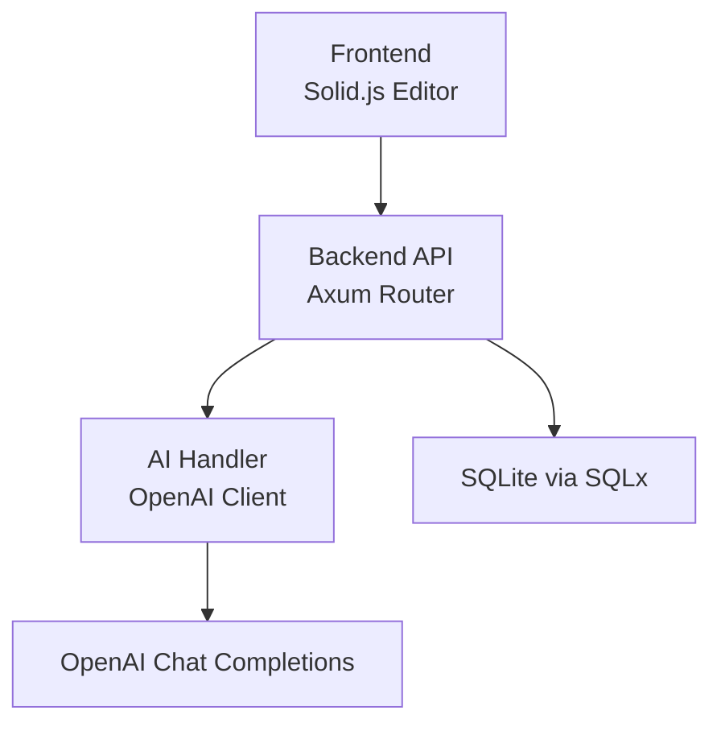
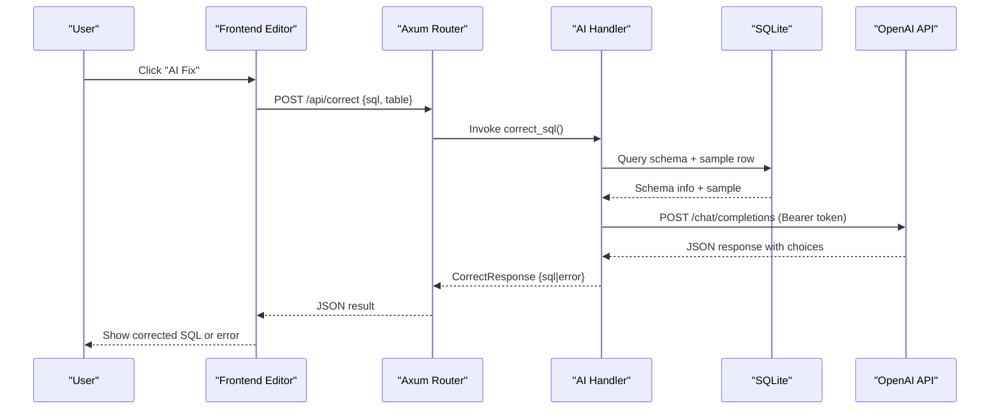
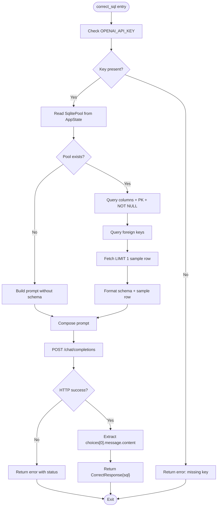
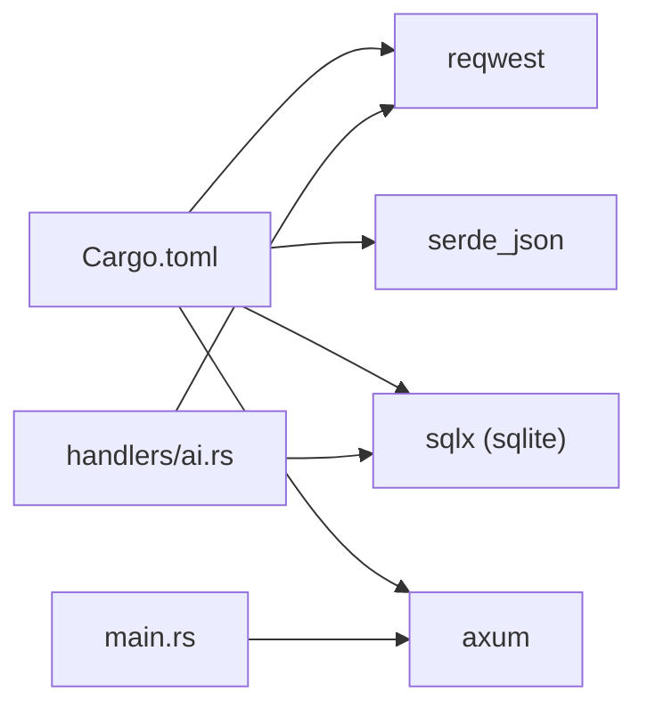
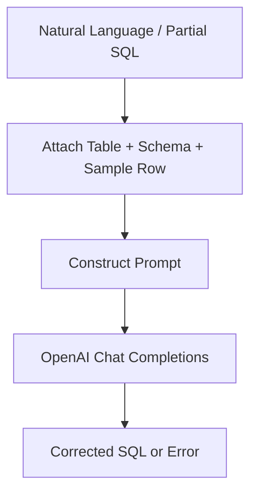

# AI Integration & SQL Assistance

<cite>
**Referenced Files in This Document**
- [ai.rs](file://backend/src/handlers/ai.rs)
- [main.rs](file://backend/src/main.rs)
- [state.rs](file://backend/src/state.rs)
- [Cargo.toml](file://backend/Cargo.toml)
- [Editor.tsx](file://frontend/src/components/Editor.tsx)
- [api.ts](file://frontend/src/lib/api.ts)
- [README.md](file://README.md)
- [design.md](file://doc/design.md)
</cite>

## Table of Contents
1. [Introduction](#introduction)
2. [Project Structure](#project-structure)
3. [Core Components](#core-components)
4. [Architecture Overview](#architecture-overview)
5. [Detailed Component Analysis](#detailed-component-analysis)
6. [Dependency Analysis](#dependency-analysis)
7. [Performance Considerations](#performance-considerations)
8. [Troubleshooting Guide](#troubleshooting-guide)
9. [Conclusion](#conclusion)
10. [Appendices](#appendices)

## Introduction
This document explains the AI-powered SQL assistance feature that integrates with OpenAI to correct, translate, and complete user-provided SQL statements against a local SQLite database. It covers request formatting, response parsing, error handling, schema extraction for context-aware prompts, prompt engineering strategies, natural language to SQL conversion workflow, syntax correction capabilities, customization options, alternative provider integration, fallback mechanisms, rate limiting, cost optimization, privacy considerations, and extensibility for custom models or local processing.

## Project Structure
The AI SQL assistance spans both backend and frontend:
- Backend (Rust/Axum): exposes an endpoint to correct/translate SQL using OpenAI, extracts table schema and sample data from SQLite, and returns corrected SQL or errors.
- Frontend (Solid.js): provides an editor UI with an “AI Fix” button that triggers the backend correction endpoint.

**Diagram sources**
- [main.rs:52-58](file://backend/src/main.rs#L52-L58)
- [ai.rs:24-148](file://backend/src/handlers/ai.rs#L24-L148)
- [Editor.tsx:21-45](file://frontend/src/components/Editor.tsx#L21-L45)
- [api.ts:66-75](file://frontend/src/lib/api.ts#L66-L75)

**Section sources**
- [main.rs:1-74](file://backend/src/main.rs#L1-L74)
- [ai.rs:1-149](file://backend/src/handlers/ai.rs#L1-L149)
- [Editor.tsx:1-49](file://frontend/src/components/Editor.tsx#L1-L49)
- [api.ts:1-116](file://frontend/src/lib/api.ts#L1-L116)

## Core Components
- AI Correction Endpoint: Accepts user SQL and target table, extracts schema and sample row, builds a prompt, calls OpenAI, parses response, and returns corrected SQL or error.
- Frontend Editor: Provides a textarea for SQL input and an “AI Fix” button that calls the correction endpoint.
- API Client: Encapsulates HTTP calls to the backend, including authentication headers and error handling.

Key responsibilities:
- Request formatting: JSON payload with sql and table fields; bearer auth to OpenAI.
- Schema extraction: Column metadata, foreign keys, and one sample row.
- Prompt engineering: System role instructing raw SQL output; user prompt includes table name, schema, and user input.
- Response parsing: Extract content from choices[0].message.content.
- Error handling: Missing API key, HTTP status errors, network errors.

**Section sources**
- [ai.rs:12-22](file://backend/src/handlers/ai.rs#L12-L22)
- [ai.rs:24-148](file://backend/src/handlers/ai.rs#L24-L148)
- [Editor.tsx:21-45](file://frontend/src/components/Editor.tsx#L21-L45)
- [api.ts:66-75](file://frontend/src/lib/api.ts#L66-L75)

## Architecture Overview
The AI SQL assistance follows a clear flow:
1. User edits SQL in the frontend and clicks “AI Fix”.
2. Frontend sends POST /api/correct with { sql, table } and x-api-key header.
3. Backend handler reads environment variables (OPENAI_API_KEY, OPENAI_BASE_URL, OPENAI_MODEL).
4. Backend queries SQLite for schema and a sample row.
5. Backend constructs a prompt and calls OpenAI chat completions.
6. Backend parses the response and returns corrected SQL or error.

**Diagram sources**
- [main.rs:52-58](file://backend/src/main.rs#L52-L58)
- [ai.rs:24-148](file://backend/src/handlers/ai.rs#L24-L148)
- [Editor.tsx:21-45](file://frontend/src/components/Editor.tsx#L21-L45)
- [api.ts:66-75](file://frontend/src/lib/api.ts#L66-L75)

## Detailed Component Analysis

### AI Correction Endpoint (Backend)
Responsibilities:
- Validate configuration (OPENAI_API_KEY).
- Extract schema and sample row from SQLite.
- Build a prompt with system instruction and user context.
- Call OpenAI chat completions with bearer auth.
- Parse response and return corrected SQL or error.

Data structures:
- CorrectRequest: sql, table.
- CorrectResponse: sql (optional), error (optional).

Processing logic:
- If OPENAI_API_KEY is missing, return error immediately.
- Read db pool from AppState; if available, query pragma_table_info and pragma_foreign_key_list for the given table.
- Append column definitions, primary key and NOT NULL constraints, and foreign key references.
- Fetch one sample row and serialize field values into a string for clarity.
- Compose prompt with system message (“SQL expert”, “single raw SQL string”) and user message containing table, schema, and user input.
- Send request to OpenAI base URL + /chat/completions with model and messages.
- On success, extract content from choices[0].message.content; on failure, return HTTP status or network error.

Error handling:
- Missing OPENAI_API_KEY: immediate error response.
- Non-success HTTP status from OpenAI: error message with status code.
- Network errors: error message with exception details.

Optimization opportunities:
- Cache schema per table to avoid repeated PRAGMA queries.
- Add retries with exponential backoff for transient failures.
- Add timeouts and cancellation for long-running requests.
- Sanitize and limit sample row size to reduce prompt length.

**Diagram sources**
- [ai.rs:24-148](file://backend/src/handlers/ai.rs#L24-L148)

**Section sources**
- [ai.rs:12-22](file://backend/src/handlers/ai.rs#L12-L22)
- [ai.rs:24-148](file://backend/src/handlers/ai.rs#L24-L148)

### Frontend Editor and API Client
- Editor component renders a textarea bound to sqlContent and an “AI Fix” button that invokes correctSql from the store.
- The api.ts module defines correctSql function that POSTs to ./api/correct with { sql, table } and x-api-key header, returning CorrectResult.

Integration points:
- Authentication: x-api-key header required by backend middleware.
- Error handling: handleResponse treats 401 as unauthorized and throws; other errors propagate.

Customization:
- Users can adjust the table selection in the UI to provide the correct table context for AI correction.

**Section sources**
- [Editor.tsx:1-49](file://frontend/src/components/Editor.tsx#L1-L49)
- [api.ts:12-23](file://frontend/src/lib/api.ts#L12-L23)
- [api.ts:66-75](file://frontend/src/lib/api.ts#L66-L75)

### Configuration and Routing
- Environment variables:
  - OPENAI_API_KEY: Required for AI assistant.
  - OPENAI_BASE_URL: Defaults to https://api.openai.com/v1.
  - OPENAI_MODEL: Defaults to gpt-5.4-mini.
  - API_KEY: Used for x-api-key authentication.
- Routes:
  - POST /api/correct maps to correct_sql handler.

**Section sources**
- [README.md:74-83](file://README.md#L74-L83)
- [main.rs:52-58](file://backend/src/main.rs#L52-L58)
- [ai.rs:28-31](file://backend/src/handlers/ai.rs#L28-L31)

## Dependency Analysis
External dependencies relevant to AI integration:
- reqwest: HTTP client used to call OpenAI.
- serde_json: JSON serialization/deserialization for request/response payloads.
- sqlx: Database driver for SQLite to extract schema and sample rows.
- axum: Web framework for routing and middleware.

**Diagram sources**
- [Cargo.toml:6-18](file://backend/Cargo.toml#L6-L18)
- [ai.rs:1-10](file://backend/src/handlers/ai.rs#L1-L10)
- [main.rs:1-20](file://backend/src/main.rs#L1-L20)

**Section sources**
- [Cargo.toml:1-24](file://backend/Cargo.toml#L1-L24)
- [ai.rs:1-10](file://backend/src/handlers/ai.rs#L1-L10)
- [main.rs:1-20](file://backend/src/main.rs#L1-L20)

## Performance Considerations
- Schema caching: Repeatedly querying PRAGMA_TABLE_INFO and PRAGMA_FOREIGN_KEY_LIST per request adds overhead. Consider caching schema per table within the process lifetime.
- Sample row size: Limiting to one row reduces payload size; ensure truncation of large text/blob fields before inclusion in prompts.
- Timeouts and concurrency: Use reqwest timeouts and consider connection pooling for external AI providers to avoid blocking.
- Model selection: Smaller/faster models reduce latency and cost; tune OPENAI_MODEL accordingly.
- Logging: Avoid logging sensitive data (e.g., full prompts containing PII); use structured logs with redaction where needed.

[No sources needed since this section provides general guidance]

## Troubleshooting Guide
Common issues and resolutions:
- Missing OPENAI_API_KEY:
  - Symptom: Immediate error response indicating missing key.
  - Resolution: Set OPENAI_API_KEY environment variable.
- Unauthorized (401):
  - Symptom: Frontend throws “Unauthorized”; backend rejects requests without valid x-api-key.
  - Resolution: Ensure x-api-key header matches API_KEY configured in backend.
- OpenAI API errors:
  - Symptom: Non-success HTTP status returned; error message includes status code.
  - Resolution: Check API quota, model availability, and base URL correctness.
- Network errors:
  - Symptom: Exception details returned in error field.
  - Resolution: Verify network connectivity and proxy settings; add retries/backoff.

Operational checks:
- Health endpoint: GET /api/health to verify service status.
- Logs: Configure RUST_LOG to capture detailed traces during development.

**Section sources**
- [ai.rs:28-37](file://backend/src/handlers/ai.rs#L28-L37)
- [ai.rs:123-147](file://backend/src/handlers/ai.rs#L123-L147)
- [api.ts:17-23](file://frontend/src/lib/api.ts#L17-L23)
- [README.md:74-83](file://README.md#L74-L83)

## Conclusion
The AI-powered SQL assistance integrates OpenAI’s chat completions to correct and translate SQL against a local SQLite database. The backend extracts schema and sample data to build context-rich prompts, while the frontend provides a simple editor interface. With proper configuration, error handling, and performance tuning, the feature offers robust natural language to SQL conversion and syntax correction capabilities. Extensibility allows integrating alternative providers and implementing fallbacks, while respecting rate limits, costs, and privacy.

[No sources needed since this section summarizes without analyzing specific files]

## Appendices

### Natural Language to SQL Conversion Workflow
- Input: User writes natural language or partial SQL in the editor.
- Context: Backend injects table name, schema, and sample row into the prompt.
- Model behavior: System instruction enforces single raw SQL output; user prompt guides dialect and intent.
- Output: Backend returns corrected SQL or error.

[No sources needed since this diagram shows conceptual workflow, not actual code structure]

### Customizing AI Behavior
- Change model: Set OPENAI_MODEL to a different model identifier.
- Adjust base URL: Set OPENAI_BASE_URL to point to a compatible provider or proxy.
- Modify prompt strategy: Update system and user prompt composition in the handler to emphasize dialect, style, or safety constraints.

**Section sources**
- [ai.rs:28-31](file://backend/src/handlers/ai.rs#L28-L31)
- [ai.rs:100-119](file://backend/src/handlers/ai.rs#L100-L119)

### Integrating Alternative AI Providers
- Compatible endpoints: Implement a provider abstraction that maps to any OpenAI-compatible /chat/completions endpoint.
- Bearer authentication: Ensure provider supports bearer tokens; configure credentials via environment variables.
- Fallback mechanism: Implement retry with alternate provider or local model when primary fails.

[No sources needed since this section provides general guidance]

### Rate Limiting and Cost Optimization
- Rate limiting: Integrate a token bucket or leaky bucket around AI calls; queue requests and return appropriate errors when throttled.
- Cost control: Prefer smaller models, shorten prompts, cache schemas, and avoid unnecessary retries.
- Quota monitoring: Track usage metrics and alert on approaching limits.

[No sources needed since this section provides general guidance]

### Privacy Considerations
- Data minimization: Avoid sending sensitive data in prompts; sanitize inputs and truncate large fields.
- Redaction: Log only non-sensitive parts of prompts/responses.
- Compliance: Ensure alignment with organizational policies regarding external AI services.

[No sources needed since this section provides general guidance]

### Extending with Custom Models or Local Processing
- Local models: Replace OpenAI client with a local inference server (e.g., llama.cpp, vLLM) exposing a compatible REST API.
- Provider abstraction: Create a trait/interface for AI providers and implement multiple backends (OpenAI, local).
- Configuration-driven switching: Select provider via environment variables and route requests accordingly.

[No sources needed since this section provides general guidance]