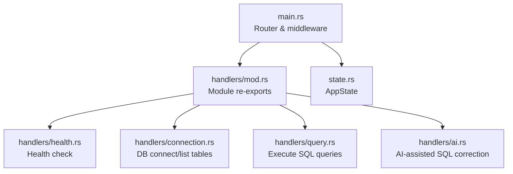
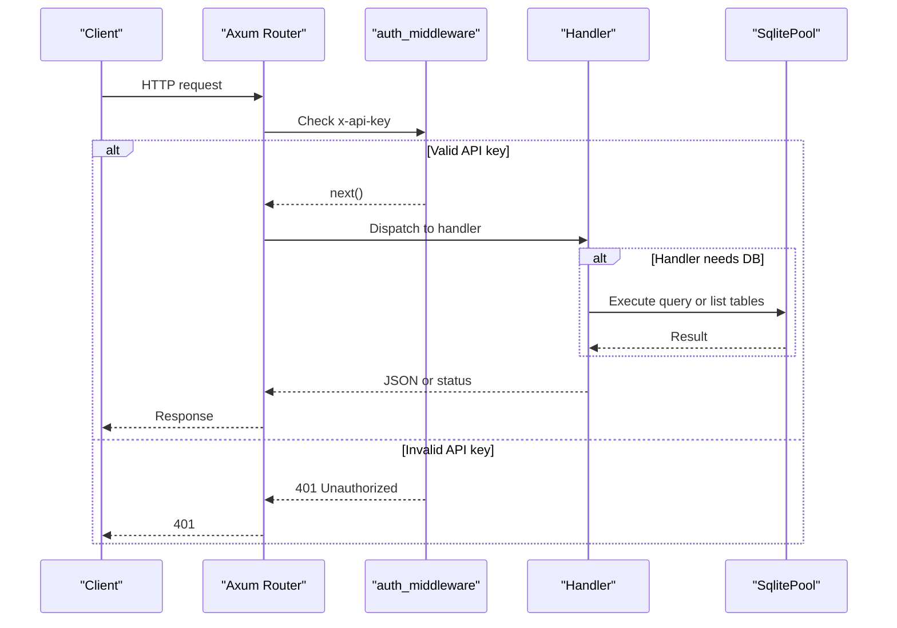
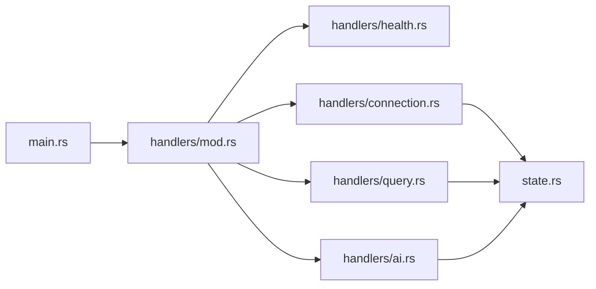

# API Endpoints & Request Handlers

<cite>
**Referenced Files in This Document**
- [main.rs](file://backend/src/main.rs)
- [mod.rs](file://backend/src/handlers/mod.rs)
- [health.rs](file://backend/src/handlers/health.rs)
- [connection.rs](file://backend/src/handlers/connection.rs)
- [query.rs](file://backend/src/handlers/query.rs)
- [ai.rs](file://backend/src/handlers/ai.rs)
- [state.rs](file://backend/src/state.rs)
- [Cargo.toml](file://backend/Cargo.toml)
</cite>

## Table of Contents
1. [Introduction](#introduction)
2. [Project Structure](#project-structure)
3. [Core Components](#core-components)
4. [Architecture Overview](#architecture-overview)
5. [Detailed Component Analysis](#detailed-component-analysis)
6. [Dependency Analysis](#dependency-analysis)
7. [Performance Considerations](#performance-considerations)
8. [Troubleshooting Guide](#troubleshooting-guide)
9. [Conclusion](#conclusion)
10. [Appendices](#appendices)

## Introduction
This document describes the backend API endpoints and their handlers for the SQLite WebUI service. It focuses on:
- The health check endpoint (/api/health) for monitoring and status reporting
- Handler organization using mod.rs for module exports and routing
- Request/response formats, parameter validation, and error structures
- Middleware integration (API key authentication), request processing pipelines, and response transformation
- Guidance for adding new endpoints, testing, debugging, and implementing custom validators

The backend is implemented with Axum, uses a shared application state to hold a database pool, and exposes REST endpoints under /api.

## Project Structure
The backend source code is organized by feature modules under handlers/, with a central router in main.rs that wires routes to handler functions. Application-wide state is defined in state.rs and injected into handlers via Axum’s State extractor.

**Diagram sources**
- [main.rs:1-74](file://backend/src/main.rs#L1-L74)
- [mod.rs:1-10](file://backend/src/handlers/mod.rs#L1-L10)
- [health.rs:1-6](file://backend/src/handlers/health.rs#L1-L6)
- [connection.rs:1-145](file://backend/src/handlers/connection.rs#L1-L145)
- [query.rs:1-201](file://backend/src/handlers/query.rs#L1-L201)
- [ai.rs:1-149](file://backend/src/handlers/ai.rs#L1-L149)
- [state.rs:1-9](file://backend/src/state.rs#L1-L9)

**Section sources**
- [main.rs:1-74](file://backend/src/main.rs#L1-L74)
- [mod.rs:1-10](file://backend/src/handlers/mod.rs#L1-L10)
- [state.rs:1-9](file://backend/src/state.rs#L1-L9)

## Core Components
- Router and middleware: main.rs defines the HTTP server, global middleware, and route definitions.
- Health endpoint: handlers/health.rs provides a simple health check returning status and version.
- Connection handlers: handlers/connection.rs handles listing available .db files, connecting to a SQLite database, and listing tables.
- Query handler: handlers/query.rs executes SQL against the connected database and returns structured results.
- AI helper: handlers/ai.rs calls an external LLM API to correct or generate SQL based on table schema and sample data.
- Shared state: state.rs defines AppState holding an optional SqlitePool protected by RwLock.

Key responsibilities:
- Routing and middleware orchestration live in main.rs.
- Business logic for each domain is encapsulated in dedicated handler modules.
- Data access and persistence are performed via sqlx against a SQLite pool stored in AppState.

**Section sources**
- [main.rs:22-65](file://backend/src/main.rs#L22-L65)
- [health.rs:1-6](file://backend/src/handlers/health.rs#L1-L6)
- [connection.rs:13-145](file://backend/src/handlers/connection.rs#L13-L145)
- [query.rs:12-201](file://backend/src/handlers/query.rs#L12-L201)
- [ai.rs:12-149](file://backend/src/handlers/ai.rs#L12-L149)
- [state.rs:5-8](file://backend/src/state.rs#L5-L8)

## Architecture Overview
The request lifecycle:
1. Client sends an HTTP request to the server.
2. Global TraceLayer logs request/response details.
3. For /api/* routes, auth_middleware validates the x-api-key header against the configured API_KEY environment variable.
4. The router dispatches to the appropriate handler function.
5. Handlers may read/write AppState (e.g., set or read the database pool).
6. Handlers return JSON responses or standard status codes.

**Diagram sources**
- [main.rs:22-65](file://backend/src/main.rs#L22-L65)
- [connection.rs:62-109](file://backend/src/handlers/connection.rs#L62-L109)
- [query.rs:101-201](file://backend/src/handlers/query.rs#L101-L201)

## Detailed Component Analysis

### Health Check Endpoint (/api/health)
Purpose:
- Provide a lightweight endpoint for service monitoring and readiness checks.
- Returns a JSON body with status and version information.

Behavior:
- Responds with a JSON object containing:
  - status: always "ok"
  - version: APP_VERSION if set at compile time; otherwise falls back to CARGO_PKG_VERSION

Request:
- Method: GET
- Path: /api/health
- Headers: None required

Response:
- Status: 200 OK
- Body: JSON object with fields status and version

Example response shape:
{
  "status": "ok",
  "version": "0.2.3"
}

Notes:
- No authentication is required for this endpoint.
- Version resolution uses compile-time constants.

**Section sources**
- [main.rs:60-62](file://backend/src/main.rs#L60-L62)
- [health.rs:1-6](file://backend/src/handlers/health.rs#L1-L6)

### Module Organization Pattern (handlers/mod.rs)
Pattern:
- Each handler group lives in its own file under handlers/.
- handlers/mod.rs declares public modules and re-exports handler functions for use in main.rs.

Benefits:
- Clean separation of concerns
- Centralized routing imports
- Easy discovery of available endpoints

Exported handlers:
- health_check from health.rs
- connect_db, list_dbs, list_tables from connection.rs
- execute_query from query.rs
- correct_sql from ai.rs

**Section sources**
- [mod.rs:1-10](file://backend/src/handlers/mod.rs#L1-L10)

### Authentication Middleware
Purpose:
- Protect API routes under /api with an API key.

Mechanism:
- Reads API_KEY from environment variables (with a default fallback).
- Validates the incoming x-api-key header.
- Returns 401 Unauthorized if missing or invalid.

Scope:
- Applied to all routes nested under /api.

Usage:
- Add new endpoints under /api to automatically benefit from this protection.

Error behavior:
- Missing or incorrect API key yields 401 Unauthorized.

**Section sources**
- [main.rs:22-33](file://backend/src/main.rs#L22-L33)
- [main.rs:52-58](file://backend/src/main.rs#L52-L58)

### Database Connection Endpoints

#### POST /api/connect
Purpose:
- Connect to a SQLite database file under the db directory.

Request:
- Method: POST
- Path: /api/connect
- Content-Type: application/json
- Body:
  {
    "path": "<relative path under db/>",
    "create": <boolean, optional, default false>
  }

Validation:
- Rejects paths containing ".." to prevent directory traversal.
- Ensures the db directory exists (creates it if missing).
- If the target file does not exist and create is false, returns 404 Not Found.

Response:
- On success: 200 OK with a plain text message indicating connection established.
- On failure:
  - 400 Bad Request for invalid path
  - 404 Not Found if file missing and not creating
  - 500 Internal Server Error for connection errors

Side effects:
- Establishes a SqlitePool and stores it in AppState.db.
- Verifies WAL mode after connection (non-fatal warning if verification fails).

Security considerations:
- Only allows relative paths within db/ and blocks traversal attempts.

**Section sources**
- [connection.rs:13-18](file://backend/src/handlers/connection.rs#L13-L18)
- [connection.rs:62-109](file://backend/src/handlers/connection.rs#L62-L109)

#### GET /api/db-files
Purpose:
- List available SQLite database files under the db directory recursively.

Request:
- Method: GET
- Path: /api/db-files

Response:
- 200 OK with a JSON array of relative paths to .db files.
- Excludes SQLite auxiliary files (-wal, -shm).

Edge cases:
- Creates the db directory if missing and returns an empty array.

**Section sources**
- [connection.rs:20-60](file://backend/src/handlers/connection.rs#L20-L60)

#### GET /api/tables
Purpose:
- List user-defined tables in the currently connected database.

Request:
- Method: GET
- Path: /api/tables

Response:
- 200 OK with a JSON array of table names.
- 400 Bad Request if no database is connected.

Implementation notes:
- Queries sqlite_master to retrieve table names excluding internal tables.

**Section sources**
- [connection.rs:111-129](file://backend/src/handlers/connection.rs#L111-L129)

### Query Execution Endpoint

#### POST /api/query
Purpose:
- Execute arbitrary SQL against the connected SQLite database.

Request:
- Method: POST
- Path: /api/query
- Content-Type: application/json
- Body:
  {
    "sql": "<SQL statement>"
  }

Processing:
- Determines whether the SQL returns rows based on prefixes like SELECT, PRAGMA, EXPLAIN, WITH, or presence of RETURNING.
- For row-returning statements: fetches rows and maps column metadata and values to JSON.
- For non-row statements: executes and reports affected rows.

Response:
- Always returns a JSON object with the following structure:
  {
    "columns": ["col1", "col2"],
    "column_types": ["TEXT", "INTEGER"],
    "rows": [[...], [...]],
    "affected_rows": null | number,
    "execution_time": <milliseconds>,
    "error": null | string
  }

Type mapping highlights:
- NULL values are represented as null.
- INTEGER/INT/BIGINT mapped to numbers when possible.
- REAL/FLOAT/DOUBLE mapped to numbers when representable.
- BOOLEAN/BOOL mapped to booleans when possible.
- BLOB mapped to hex-prefixed strings.
- Unknown types fall back to string representations.

Error handling:
- If no database is connected, returns a response with error field set.
- Query errors are captured and returned in the error field without changing HTTP status.

**Section sources**
- [query.rs:12-25](file://backend/src/handlers/query.rs#L12-L25)
- [query.rs:28-99](file://backend/src/handlers/query.rs#L28-L99)
- [query.rs:101-201](file://backend/src/handlers/query.rs#L101-L201)

### AI-Assisted SQL Correction Endpoint

#### POST /api/correct
Purpose:
- Use an external LLM API to correct, translate, or complete a user-provided SQL snippet based on table schema and sample data.

Request:
- Method: POST
- Path: /api/correct
- Content-Type: application/json
- Body:
  {
    "sql": "<user input>",
    "table": "<target table name>"
  }

Environment requirements:
- OPENAI_API_KEY must be set.
- OPENAI_BASE_URL defaults to OpenAI-compatible endpoint.
- OPENAI_MODEL defaults to a specified model name.

Processing:
- Retrieves table schema and foreign keys from SQLite.
- Optionally samples one row from the table to include context.
- Constructs a prompt and calls the external chat completions endpoint.

Response:
- JSON object:
  {
    "sql": null | string,
    "error": null | string
  }

Error handling:
- If OPENAI_API_KEY is missing, returns error indicating configuration issue.
- Network or API errors are returned in the error field.

**Section sources**
- [ai.rs:12-22](file://backend/src/handlers/ai.rs#L12-L22)
- [ai.rs:24-149](file://backend/src/handlers/ai.rs#L24-L149)

## Dependency Analysis
High-level dependencies between components:

External dependencies:
- axum: HTTP framework and routing
- tower-http: tracing layer and static file serving
- sqlx: async SQLite driver
- reqwest: HTTP client for AI endpoint
- serde/serde_json: serialization/deserialization
- tracing/tracing-subscriber: logging

Build-time configuration:
- APP_VERSION can be set during build to override package version in health endpoint.

**Diagram sources**
- [main.rs:1-74](file://backend/src/main.rs#L1-L74)
- [mod.rs:1-10](file://backend/src/handlers/mod.rs#L1-L10)
- [Cargo.toml:1-24](file://backend/Cargo.toml#L1-L24)

**Section sources**
- [Cargo.toml:1-24](file://backend/Cargo.toml#L1-L24)

## Performance Considerations
- Database pooling: Using SqlitePool improves concurrency and reduces connection overhead.
- WAL mode: Enabled for better concurrent read performance and reduced locking issues.
- Tracing: TraceLayer provides request/response metrics; tune RUST_LOG to control verbosity.
- Query execution: Row mapping is type-aware but still involves conversions; consider caching column metadata for repeated queries if needed.
- Static assets: ServeDir serves frontend assets; ensure dist is built and up-to-date.

[No sources needed since this section provides general guidance]

## Troubleshooting Guide
Common issues and resolutions:
- 401 Unauthorized on /api/*:
  - Ensure x-api-key header matches the configured API_KEY environment variable.
- No database connected:
  - Call POST /api/connect before querying or listing tables.
- Database file not found:
  - Verify the path provided to /api/connect exists under db/ or set create=true.
- Empty table list:
  - Confirm the connected database contains user tables; internal tables are excluded.
- Query returns error field:
  - Inspect the error string in the response body; fix the SQL or ensure the database is connected.
- AI correction fails:
  - Verify OPENAI_API_KEY is set and network connectivity to the configured base URL.

Debugging tips:
- Enable detailed logs via RUST_LOG=rust_sqlite_webui=debug,tower_http=debug.
- Use curl or Postman to test endpoints and inspect headers and bodies.
- Validate environment variables with dotenv or system environment.

**Section sources**
- [main.rs:22-33](file://backend/src/main.rs#L22-L33)
- [connection.rs:62-109](file://backend/src/handlers/connection.rs#L62-L109)
- [query.rs:101-201](file://backend/src/handlers/query.rs#L101-L201)
- [ai.rs:24-149](file://backend/src/handlers/ai.rs#L24-L149)

## Conclusion
The backend provides a clear, modular API surface for managing SQLite databases and executing queries, with robust middleware protection and comprehensive error reporting. The health endpoint enables straightforward service monitoring. Following the established patterns in handlers/mod.rs and main.rs makes adding new endpoints straightforward and consistent.

[No sources needed since this section summarizes without analyzing specific files]

## Appendices

### Adding a New Endpoint: Step-by-Step
1. Create a new handler function in a dedicated file under handlers/ (e.g., handlers/my_feature.rs).
2. Export the handler from handlers/mod.rs.
3. Register the route in main.rs under the /api router.
4. If the handler requires AppState, extract it via axum::extract::State<AppState>.
5. Define request/response types using serde for validation and serialization.
6. Implement error handling and return appropriate status codes or JSON error payloads.
7. Test the endpoint with curl or a client tool, ensuring x-api-key is set for /api routes.

Example pattern references:
- Handler definition and JSON I/O: [query.rs:12-25](file://backend/src/handlers/query.rs#L12-L25)
- Route registration: [main.rs:52-58](file://backend/src/main.rs#L52-L58)
- Module export: [mod.rs:1-10](file://backend/src/handlers/mod.rs#L1-L10)

**Section sources**
- [query.rs:12-25](file://backend/src/handlers/query.rs#L12-L25)
- [main.rs:52-58](file://backend/src/main.rs#L52-L58)
- [mod.rs:1-10](file://backend/src/handlers/mod.rs#L1-L10)

### Testing Endpoints
- Health check:
  - GET /api/health
  - Expect 200 OK with JSON containing status and version.
- Connect:
  - POST /api/connect with JSON payload including path and optional create flag.
  - Expect 200 OK on success or appropriate error codes.
- List databases:
  - GET /api/db-files
  - Expect 200 OK with JSON array of paths.
- List tables:
  - GET /api/tables
  - Expect 200 OK with JSON array of table names or 400 if not connected.
- Execute query:
  - POST /api/query with JSON payload including sql.
  - Expect 200 OK with JSON result structure.
- Correct SQL:
  - POST /api/correct with JSON payload including sql and table.
  - Expect 200 OK with corrected SQL or error message.

Authentication:
- Include header x-api-key matching the configured API_KEY for all /api routes except /api/health.

**Section sources**
- [main.rs:52-62](file://backend/src/main.rs#L52-L62)
- [connection.rs:20-109](file://backend/src/handlers/connection.rs#L20-L109)
- [query.rs:101-201](file://backend/src/handlers/query.rs#L101-L201)
- [ai.rs:24-149](file://backend/src/handlers/ai.rs#L24-L149)

### Custom Request Validators
Patterns to follow:
- Use serde Deserialize structs to define typed request bodies.
- Perform explicit validation in handlers (e.g., path traversal checks).
- Return meaningful error responses with appropriate HTTP status codes.

References:
- Validation example in connect handler: [connection.rs:62-83](file://backend/src/handlers/connection.rs#L62-L83)
- Typed request/response models: [query.rs:12-25](file://backend/src/handlers/query.rs#L12-L25)

**Section sources**
- [connection.rs:62-83](file://backend/src/handlers/connection.rs#L62-L83)
- [query.rs:12-25](file://backend/src/handlers/query.rs#L12-L25)