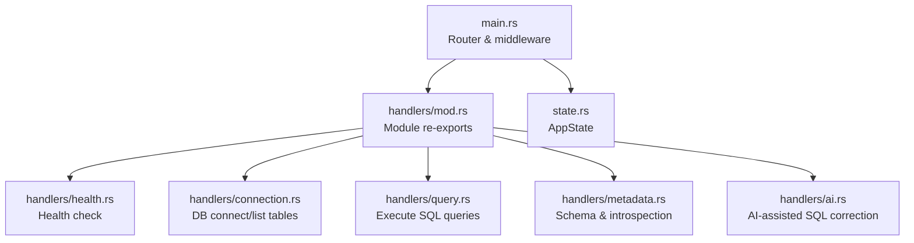
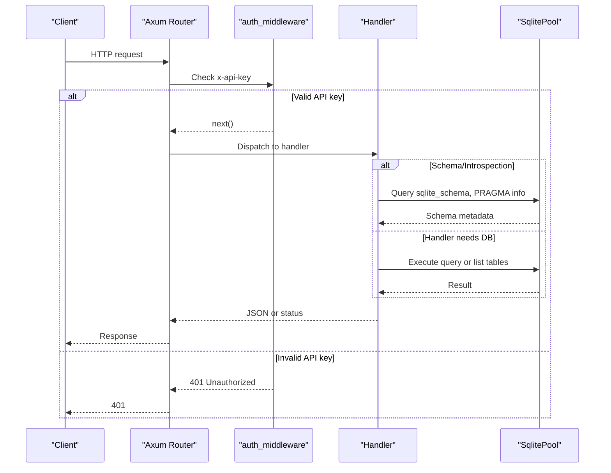
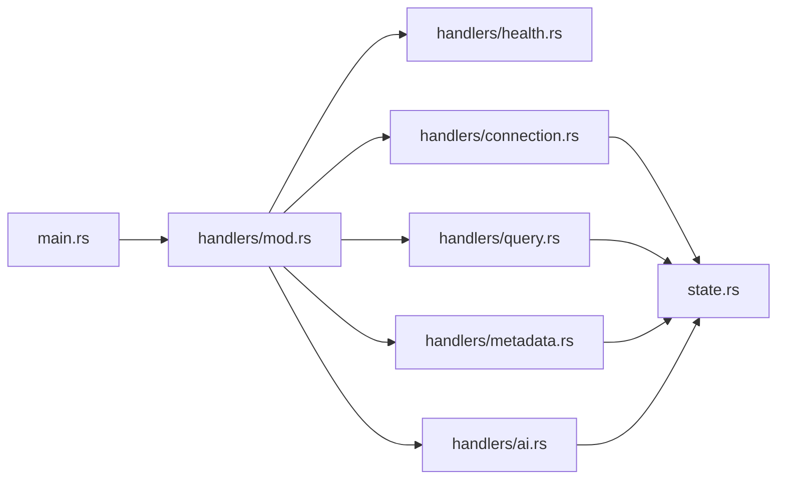

# API Endpoints & Request Handlers

<cite>
**Referenced Files in This Document**
- [main.rs](file://backend/src/main.rs)
- [mod.rs](file://backend/src/handlers/mod.rs)
- [health.rs](file://backend/src/handlers/health.rs)
- [connection.rs](file://backend/src/handlers/connection.rs)
- [query.rs](file://backend/src/handlers/query.rs)
- [metadata.rs](file://backend/src/handlers/metadata.rs)
- [ai.rs](file://backend/src/handlers/ai.rs)
- [state.rs](file://backend/src/state.rs)
- [api.ts](file://frontend/src/lib/api.ts)
- [Cargo.toml](file://backend/Cargo.toml)
</cite>

## Update Summary
**Changes Made**
- Added documentation for three new REST API endpoints: `/api/schema`, `/api/schema/table`, and `/api/internals`
- Updated handler organization section to include metadata.rs module
- Enhanced architecture overview with new schema exploration capabilities
- Added comprehensive documentation for schema and internals endpoints
- Updated testing section with new endpoint examples

## Table of Contents
1. [Introduction](#introduction)
2. [Project Structure](#project-structure)
3. [Core Components](#core-components)
4. [Architecture Overview](#architecture-overview)
5. [Detailed Component Analysis](#detailed-component-analysis)
6. [Dependency Analysis](#dependency-analysis)
7. [Performance Considerations](#performance-considerations)
8. [Troubleshooting Guide](#troubleshooting-guide)
9. [Conclusion](#conclusion)
10. [Appendices](#appendices)

## Introduction
This document describes the backend API endpoints and their handlers for the SQLite WebUI service. It focuses on:
- The health check endpoint (/api/health) for monitoring and status reporting
- **New schema exploration endpoints** (/api/schema, /api/schema/table, /api/internals) for database introspection
- Handler organization using mod.rs for module exports and routing
- Request/response formats, parameter validation, and error structures
- Middleware integration (API key authentication), request processing pipelines, and response transformation
- Guidance for adding new endpoints, testing, debugging, and implementing custom validators

The backend is implemented with Axum, uses a shared application state to hold a database pool, and exposes REST endpoints under /api.

## Project Structure
The backend source code is organized by feature modules under handlers/, with a central router in main.rs that wires routes to handler functions. Application-wide state is defined in state.rs and injected into handlers via Axum's State extractor.

**Diagram sources**
- [main.rs:1-90](file://backend/src/main.rs#L1-L90)
- [mod.rs:1-12](file://backend/src/handlers/mod.rs#L1-L12)
- [health.rs:1-6](file://backend/src/handlers/health.rs#L1-L6)
- [connection.rs:1-145](file://backend/src/handlers/connection.rs#L1-L145)
- [query.rs:1-201](file://backend/src/handlers/query.rs#L1-L201)
- [metadata.rs:1-612](file://backend/src/handlers/metadata.rs#L1-L612)
- [ai.rs:1-149](file://backend/src/handlers/ai.rs#L1-L149)
- [state.rs:1-9](file://backend/src/state.rs#L1-L9)

**Section sources**
- [main.rs:1-90](file://backend/src/main.rs#L1-L90)
- [mod.rs:1-12](file://backend/src/handlers/mod.rs#L1-L12)
- [state.rs:1-9](file://backend/src/state.rs#L1-L9)

## Core Components
- Router and middleware: main.rs defines the HTTP server, global middleware, and route definitions.
- Health endpoint: handlers/health.rs provides a simple health check returning status and version.
- Connection handlers: handlers/connection.rs handles listing available .db files, connecting to a SQLite database, and listing tables.
- Query handler: handlers/query.rs executes SQL against the connected database and returns structured results.
- **Metadata handlers**: handlers/metadata.rs provides comprehensive schema exploration and database introspection capabilities.
- AI helper: handlers/ai.rs calls an external LLM API to correct or generate SQL based on table schema and sample data.
- Shared state: state.rs defines AppState holding an optional SqlitePool protected by RwLock.

Key responsibilities:
- Routing and middleware orchestration live in main.rs.
- Business logic for each domain is encapsulated in dedicated handler modules.
- Data access and persistence are performed via sqlx against a SQLite pool stored in AppState.
- **Schema exploration and introspection are handled through dedicated metadata endpoints**.

**Section sources**
- [main.rs:22-70](file://backend/src/main.rs#L22-L70)
- [health.rs:1-6](file://backend/src/handlers/health.rs#L1-L6)
- [connection.rs:13-145](file://backend/src/handlers/connection.rs#L13-L145)
- [query.rs:12-201](file://backend/src/handlers/query.rs#L12-L201)
- [metadata.rs:334-437](file://backend/src/handlers/metadata.rs#L334-L437)
- [ai.rs:12-149](file://backend/src/handlers/ai.rs#L12-L149)
- [state.rs:5-8](file://backend/src/state.rs#L5-L8)

## Architecture Overview
The request lifecycle:
1. Client sends an HTTP request to the server.
2. Global TraceLayer logs request/response details.
3. For /api/* routes, auth_middleware validates the x-api-key header against the configured API_KEY environment variable.
4. The router dispatches to the appropriate handler function.
5. Handlers may read/write AppState (e.g., set or read the database pool).
6. Handlers return JSON responses or standard status codes.

**Diagram sources**
- [main.rs:22-70](file://backend/src/main.rs#L22-L70)
- [connection.rs:62-109](file://backend/src/handlers/connection.rs#L62-L109)
- [query.rs:101-201](file://backend/src/handlers/query.rs#L101-L201)
- [metadata.rs:334-437](file://backend/src/handlers/metadata.rs#L334-L437)

## Detailed Component Analysis

### Health Check Endpoint (/api/health)
Purpose:
- Provide a lightweight endpoint for service monitoring and readiness checks.
- Returns a JSON body with status and version information.

Behavior:
- Responds with a JSON object containing:
  - status: always "ok"
  - version: APP_VERSION if set at compile time; otherwise falls back to CARGO_PKG_VERSION

Request:
- Method: GET
- Path: /api/health
- Headers: None required

Response:
- Status: 200 OK
- Body: JSON object with fields status and version

Example response shape:
{
  "status": "ok",
  "version": "0.2.3"
}

Notes:
- No authentication is required for this endpoint.
- Version resolution uses compile-time constants.

**Section sources**
- [main.rs:73](file://backend/src/main.rs#L73)
- [health.rs:1-6](file://backend/src/handlers/health.rs#L1-L6)

### Module Organization Pattern (handlers/mod.rs)
Pattern:
- Each handler group lives in its own file under handlers/.
- handlers/mod.rs declares public modules and re-exports handler functions for use in main.rs.

Benefits:
- Clean separation of concerns
- Centralized routing imports
- Easy discovery of available endpoints

Exported handlers:
- health_check from health.rs
- connect_db, list_dbs, list_tables from connection.rs
- execute_query from query.rs
- get_database_schema, get_table_schema, get_sqlite_internals from metadata.rs
- correct_sql from ai.rs

**Section sources**
- [mod.rs:1-12](file://backend/src/handlers/mod.rs#L1-L12)

### Authentication Middleware
Purpose:
- Protect API routes under /api with an API key.

Mechanism:
- Reads API_KEY from environment variables (with a default fallback).
- Validates the incoming x-api-key header.
- Returns 401 Unauthorized if missing or invalid.

Scope:
- Applied to all routes nested under /api.

Usage:
- Add new endpoints under /api to automatically benefit from this protection.

Error behavior:
- Missing or incorrect API key yields 401 Unauthorized.

**Section sources**
- [main.rs:26-37](file://backend/src/main.rs#L26-L37)
- [main.rs:61-70](file://backend/src/main.rs#L61-L70)

### Database Connection Endpoints

#### POST /api/connect
Purpose:
- Connect to a SQLite database file under the db directory.

Request:
- Method: POST
- Path: /api/connect
- Content-Type: application/json
- Body:
  {
    "path": "<relative path under db/>",
    "create": <boolean, optional, default false>
  }

Validation:
- Rejects paths containing ".." to prevent directory traversal.
- Ensures the db directory exists (creates it if missing).
- If the target file does not exist and create is false, returns 404 Not Found.

Response:
- On success: 200 OK with a plain text message indicating connection established.
- On failure:
  - 400 Bad Request for invalid path
  - 404 Not Found if file missing and not creating
  - 500 Internal Server Error for connection errors

Side effects:
- Establishes a SqlitePool and stores it in AppState.db.
- Verifies WAL mode after connection (non-fatal warning if verification fails).

Security considerations:
- Only allows relative paths within db/ and blocks traversal attempts.

**Section sources**
- [connection.rs:13-18](file://backend/src/handlers/connection.rs#L13-L18)
- [connection.rs:62-109](file://backend/src/handlers/connection.rs#L62-L109)

#### GET /api/db-files
Purpose:
- List available SQLite database files under the db directory recursively.

Request:
- Method: GET
- Path: /api/db-files

Response:
- 200 OK with a JSON array of relative paths to .db files.
- Excludes SQLite auxiliary files (-wal, -shm).

Edge cases:
- Creates the db directory if missing and returns an empty array.

**Section sources**
- [connection.rs:20-60](file://backend/src/handlers/connection.rs#L20-L60)

#### GET /api/tables
Purpose:
- List user-defined tables in the currently connected database.

Request:
- Method: GET
- Path: /api/tables

Response:
- 200 OK with a JSON array of table names.
- 400 Bad Request if no database is connected.

Implementation notes:
- Queries sqlite_master to retrieve table names excluding internal tables.

**Section sources**
- [connection.rs:111-129](file://backend/src/handlers/connection.rs#L111-L129)

### Schema Exploration Endpoints

#### GET /api/schema
Purpose:
- Retrieve comprehensive database schema information including all user-defined objects and combined DDL.

Request:
- Method: GET
- Path: /api/schema

Response:
- 200 OK with JSON object containing:
  - objects: Array of SchemaObject entries (tables, views, indexes, triggers)
  - ddl: Combined DDL string of all user-defined objects

SchemaObject structure:
{
  "object_type": "table|view|index|trigger",
  "name": "object_name",
  "table_name": "associated_table",
  "sql": "CREATE statement or null"
}

Error handling:
- 400 Bad Request if no database is connected
- 500 Internal Server Error for schema loading failures

**Section sources**
- [main.rs:65](file://backend/src/main.rs#L65)
- [metadata.rs:334-354](file://backend/src/handlers/metadata.rs#L334-L354)

#### GET /api/schema/table
Purpose:
- Get detailed schema information for a specific table including columns, foreign keys, indexes, and triggers.

Request:
- Method: GET
- Path: /api/schema/table
- Query Parameters:
  - name: Table name (supports special characters and quotes)

Response:
- 200 OK with TableSchema object containing:
  - name: Table name
  - sql: Original CREATE TABLE statement
  - columns: Column definitions with types, constraints, and properties
  - foreign_keys: Foreign key relationships
  - indexes: Index definitions and column mappings
  - triggers: Trigger definitions

TableSchema structure:
{
  "name": "table_name",
  "sql": "CREATE TABLE statement",
  "columns": [...],
  "foreign_keys": [...],
  "indexes": [...],
  "triggers": [...]
}

Error handling:
- 400 Bad Request if no database is connected
- 404 Not Found if table doesn't exist
- 500 Internal Server Error for schema loading failures

**Section sources**
- [main.rs:66](file://backend/src/main.rs#L66)
- [metadata.rs:356-377](file://backend/src/handlers/metadata.rs#L356-L377)

#### GET /api/internals
Purpose:
- Access SQLite engine internals, database configuration, and connection settings for advanced diagnostics.

Request:
- Method: GET
- Path: /api/internals

Response:
- 200 OK with SqliteInternals object containing:
  - database: Database-level PRAGMA values (page_size, journal_mode, etc.)
  - connection: Connection-specific settings (foreign_keys, busy_timeout, etc.)
  - engine: Engine information (sqlite_version, compile_options)
  - schema_entries: Complete sqlite_schema table contents

SqliteInternals structure:
{
  "database": [{name: "pragma_name", values: ["value1", "value2"]}],
  "connection": [{name: "setting", values: ["value"]}],
  "engine": [{name: "info", values: ["value"]}],
  "schema_entries": [{object_type, name, table_name, root_page, sql}]
}

Error handling:
- 400 Bad Request if no database is connected
- 500 Internal Server Error for internals loading failures

**Section sources**
- [main.rs:67](file://backend/src/main.rs#L67)
- [metadata.rs:379-437](file://backend/src/handlers/metadata.rs#L379-L437)

### Query Execution Endpoint

#### POST /api/query
Purpose:
- Execute arbitrary SQL against the connected SQLite database.

Request:
- Method: POST
- Path: /api/query
- Content-Type: application/json
- Body:
  {
    "sql": "<SQL statement>"
  }

Processing:
- Determines whether the SQL returns rows based on prefixes like SELECT, PRAGMA, EXPLAIN, WITH, or presence of RETURNING.
- For row-returning statements: fetches rows and maps column metadata and values to JSON.
- For non-row statements: executes and reports affected rows.

Response:
- Always returns a JSON object with the following structure:
  {
    "columns": ["col1", "col2"],
    "column_types": ["TEXT", "INTEGER"],
    "rows": [[...], [...]],
    "affected_rows": null | number,
    "execution_time": <milliseconds>,
    "error": null | string
  }

Type mapping highlights:
- NULL values are represented as null.
- INTEGER/INT/BIGINT mapped to numbers when possible.
- REAL/FLOAT/DOUBLE mapped to numbers when representable.
- BOOLEAN/BOOL mapped to booleans when possible.
- BLOB mapped to hex-prefixed strings.
- Unknown types fall back to string representations.

Error handling:
- If no database is connected, returns a response with error field set.
- Query errors are captured and returned in the error field without changing HTTP status.

**Section sources**
- [query.rs:12-25](file://backend/src/handlers/query.rs#L12-L25)
- [query.rs:28-99](file://backend/src/handlers/query.rs#L28-L99)
- [query.rs:101-201](file://backend/src/handlers/query.rs#L101-L201)

### AI-Assisted SQL Correction Endpoint

#### POST /api/correct
Purpose:
- Use an external LLM API to correct, translate, or complete a user-provided SQL snippet based on table schema and sample data.

Request:
- Method: POST
- Path: /api/correct
- Content-Type: application/json
- Body:
  {
    "sql": "<user input>",
    "table": "<target table name>"
  }

Environment requirements:
- OPENAI_API_KEY must be set.
- OPENAI_BASE_URL defaults to OpenAI-compatible endpoint.
- OPENAI_MODEL defaults to a specified model name.

Processing:
- Retrieves table schema and foreign keys from SQLite.
- Optionally samples one row from the table to include context.
- Constructs a prompt and calls the external chat completions endpoint.

Response:
- JSON object:
  {
    "sql": null | string,
    "error": null | string
  }

Error handling:
- If OPENAI_API_KEY is missing, returns error indicating configuration issue.
- Network or API errors are returned in the error field.

**Section sources**
- [ai.rs:12-22](file://backend/src/handlers/ai.rs#L12-L22)
- [ai.rs:24-149](file://backend/src/handlers/ai.rs#L24-L149)

## Dependency Analysis
High-level dependencies between components:

External dependencies:
- axum: HTTP framework and routing
- tower-http: tracing layer and static file serving
- sqlx: async SQLite driver
- reqwest: HTTP client for AI endpoint
- serde/serde_json: serialization/deserialization
- tracing/tracing-subscriber: logging

Build-time configuration:
- APP_VERSION can be set during build to override package version in health endpoint.

**Diagram sources**
- [main.rs:1-90](file://backend/src/main.rs#L1-L90)
- [mod.rs:1-12](file://backend/src/handlers/mod.rs#L1-L12)
- [Cargo.toml:1-24](file://backend/Cargo.toml#L1-L24)

**Section sources**
- [Cargo.toml:1-24](file://backend/Cargo.toml#L1-L24)

## Performance Considerations
- Database pooling: Using SqlitePool improves concurrency and reduces connection overhead.
- WAL mode: Enabled for better concurrent read performance and reduced locking issues.
- Tracing: TraceLayer provides request/response metrics; tune RUST_LOG to control verbosity.
- Query execution: Row mapping is type-aware but still involves conversions; consider caching column metadata for repeated queries if needed.
- Static assets: ServeDir serves frontend assets; ensure dist is built and up-to-date.
- **Schema introspection**: Uses efficient PRAGMA queries and bound parameters to avoid SQL injection while providing comprehensive metadata access.

[No sources needed since this section provides general guidance]

## Troubleshooting Guide
Common issues and resolutions:
- 401 Unauthorized on /api/*:
  - Ensure x-api-key header matches the configured API_KEY environment variable.
- No database connected:
  - Call POST /api/connect before querying or listing tables.
- Database file not found:
  - Verify the path provided to /api/connect exists under db/ or set create=true.
- Empty table list:
  - Confirm the connected database contains user tables; internal tables are excluded.
- Query returns error field:
  - Inspect the error string in the response body; fix the SQL or ensure the database is connected.
- AI correction fails:
  - Verify OPENAI_API_KEY is set and network connectivity to the configured base URL.
- **Schema endpoints return 400 Bad Request**:
  - Ensure a database is connected via /api/connect before accessing schema endpoints.
- **Table schema returns 404 Not Found**:
  - Verify the table name exists and is properly escaped if it contains special characters.
- **Internals endpoint fails**:
  - Check database permissions and ensure SQLite supports the requested PRAGMA operations.

Debugging tips:
- Enable detailed logs via RUST_LOG=rust_sqlite_webui=debug,tower_http=debug.
- Use curl or Postman to test endpoints and inspect headers and bodies.
- Validate environment variables with dotenv or system environment.
- **For schema issues, examine the sqlite_schema table directly to verify object existence**.

**Section sources**
- [main.rs:26-37](file://backend/src/main.rs#L26-L37)
- [connection.rs:62-109](file://backend/src/handlers/connection.rs#L62-L109)
- [query.rs:101-201](file://backend/src/handlers/query.rs#L101-L201)
- [metadata.rs:334-437](file://backend/src/handlers/metadata.rs#L334-L437)
- [ai.rs:24-149](file://backend/src/handlers/ai.rs#L24-L149)

## Conclusion
The backend provides a clear, modular API surface for managing SQLite databases and executing queries, with robust middleware protection and comprehensive error reporting. The health endpoint enables straightforward service monitoring. **The new schema exploration and introspection endpoints provide powerful tools for database analysis and debugging**. Following the established patterns in handlers/mod.rs and main.rs makes adding new endpoints straightforward and consistent.

[No sources needed since this section summarizes without analyzing specific files]

## Appendices

### Adding a New Endpoint: Step-by-Step
1. Create a new handler function in a dedicated file under handlers/ (e.g., handlers/my_feature.rs).
2. Export the handler from handlers/mod.rs.
3. Register the route in main.rs under the /api router.
4. If the handler requires AppState, extract it via axum::extract::State<AppState>.
5. Define request/response types using serde for validation and serialization.
6. Implement error handling and return appropriate status codes or JSON error payloads.
7. Test the endpoint with curl or a client tool, ensuring x-api-key is set for /api routes.

Example pattern references:
- Handler definition and JSON I/O: [query.rs:12-25](file://backend/src/handlers/query.rs#L12-L25)
- Route registration: [main.rs:61-70](file://backend/src/main.rs#L61-L70)
- Module export: [mod.rs:1-12](file://backend/src/handlers/mod.rs#L1-L12)

**Section sources**
- [query.rs:12-25](file://backend/src/handlers/query.rs#L12-L25)
- [main.rs:61-70](file://backend/src/main.rs#L61-L70)
- [mod.rs:1-12](file://backend/src/handlers/mod.rs#L1-L12)

### Testing Endpoints
- Health check:
  - GET /api/health
  - Expect 200 OK with JSON containing status and version.
- Connect:
  - POST /api/connect with JSON payload including path and optional create flag.
  - Expect 200 OK on success or appropriate error codes.
- List databases:
  - GET /api/db-files
  - Expect 200 OK with JSON array of paths.
- List tables:
  - GET /api/tables
  - Expect 200 OK with JSON array of table names or 400 if not connected.
- **Database schema**:
  - GET /api/schema
  - Expect 200 OK with JSON containing objects array and combined DDL string.
- **Table schema**:
  - GET /api/schema/table?name=<table_name>
  - Expect 200 OK with detailed table schema or 404 if table not found.
- **SQLite internals**:
  - GET /api/internals
  - Expect 200 OK with database, connection, engine, and schema_entries data.
- Execute query:
  - POST /api/query with JSON payload including sql.
  - Expect 200 OK with JSON result structure.
- Correct SQL:
  - POST /api/correct with JSON payload including sql and table.
  - Expect 200 OK with corrected SQL or error message.

Authentication:
- Include header x-api-key matching the configured API_KEY for all /api routes except /api/health.

**Section sources**
- [main.rs:61-74](file://backend/src/main.rs#L61-L74)
- [connection.rs:20-109](file://backend/src/handlers/connection.rs#L20-L109)
- [metadata.rs:334-437](file://backend/src/handlers/metadata.rs#L334-L437)
- [query.rs:101-201](file://backend/src/handlers/query.rs#L101-L201)
- [ai.rs:24-149](file://backend/src/handlers/ai.rs#L24-L149)

### Custom Request Validators
Patterns to follow:
- Use serde Deserialize structs to define typed request bodies.
- Perform explicit validation in handlers (e.g., path traversal checks).
- Return meaningful error responses with appropriate HTTP status codes.

References:
- Validation example in connect handler: [connection.rs:62-83](file://backend/src/handlers/connection.rs#L62-L83)
- Typed request/response models: [query.rs:12-25](file://backend/src/handlers/query.rs#L12-L25)
- **Query parameter validation**: [metadata.rs:104-107](file://backend/src/handlers/metadata.rs#L104-L107)

**Section sources**
- [connection.rs:62-83](file://backend/src/handlers/connection.rs#L62-L83)
- [query.rs:12-25](file://backend/src/handlers/query.rs#L12-L25)
- [metadata.rs:104-107](file://backend/src/handlers/metadata.rs#L104-L107)

### Schema Exploration API Reference
The new schema exploration endpoints provide comprehensive database introspection capabilities:

**GET /api/schema** - Database Schema Overview
- Returns all user-defined objects (tables, views, indexes, triggers)
- Provides combined DDL for all objects
- Filters out internal SQLite objects (sqlite_*)

**GET /api/schema/table?name=<table>** - Detailed Table Schema
- Returns complete table structure including columns, types, constraints
- Includes foreign key relationships and definitions
- Lists all indexes with column mappings and properties
- Shows trigger definitions associated with the table
- Supports special characters and quoted identifiers

**GET /api/internals** - SQLite Engine Internals
- Database-level configuration (page_size, journal_mode, encoding, etc.)
- Connection-specific settings (foreign_keys, busy_timeout, synchronous)
- Engine information (sqlite_version, compile_options)
- Complete sqlite_schema table contents for deep inspection

All schema endpoints require proper database connection and return appropriate error codes for missing connections or invalid table names.

**Section sources**
- [metadata.rs:109-146](file://backend/src/handlers/metadata.rs#L109-L146)
- [metadata.rs:148-268](file://backend/src/handlers/metadata.rs#L148-L268)
- [metadata.rs:312-332](file://backend/src/handlers/metadata.rs#L312-L332)
- [metadata.rs:334-437](file://backend/src/handlers/metadata.rs#L334-L437)