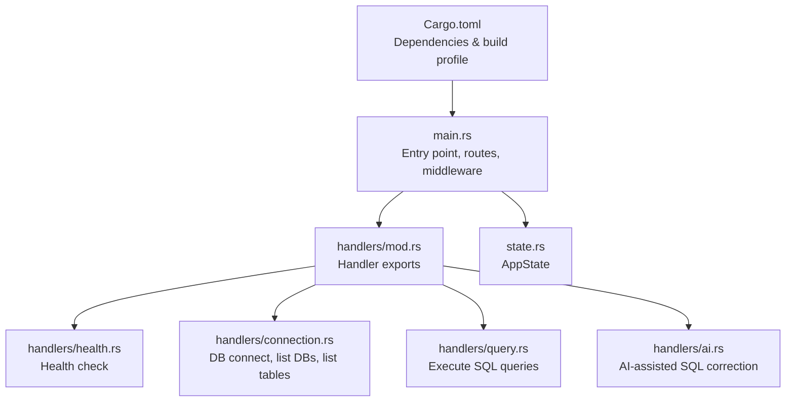
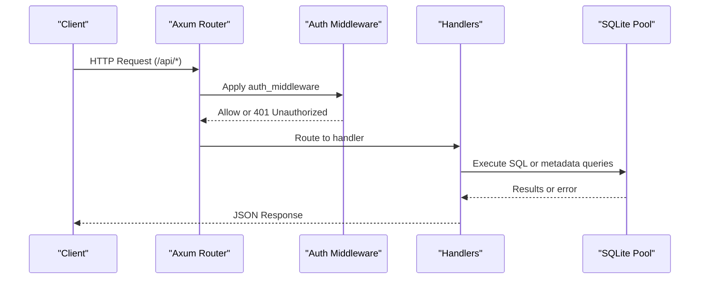
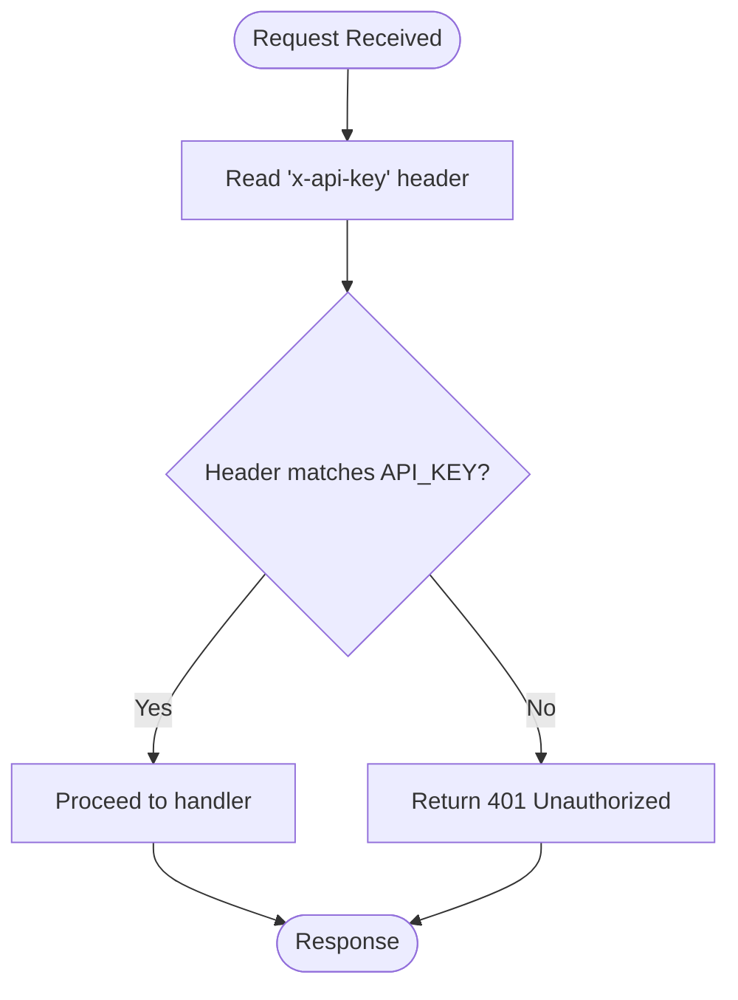
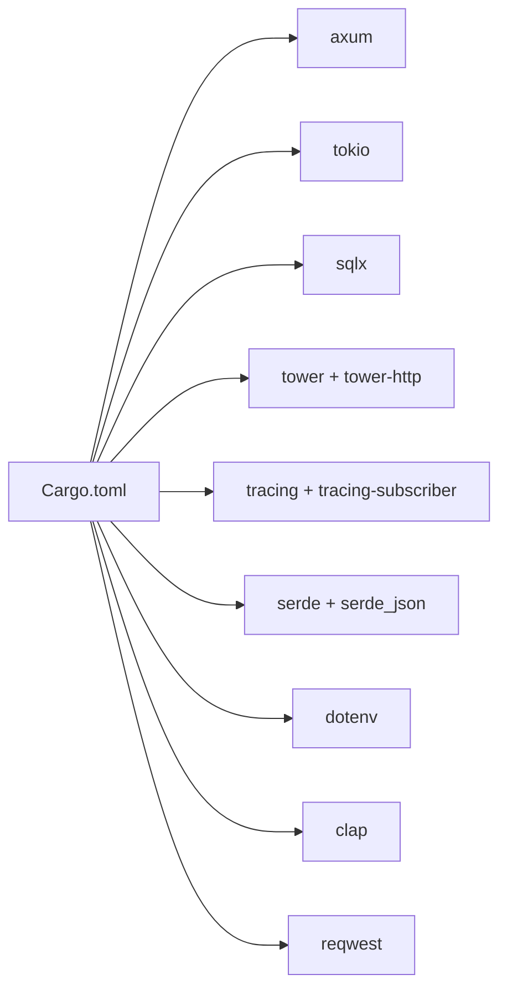

# Application Setup & Configuration

<cite>
**Referenced Files in This Document**
- [backend/Cargo.toml](file://backend/Cargo.toml)
- [backend/src/main.rs](file://backend/src/main.rs)
- [backend/src/state.rs](file://backend/src/state.rs)
- [backend/src/handlers/mod.rs](file://backend/src/handlers/mod.rs)
- [backend/src/handlers/health.rs](file://backend/src/handlers/health.rs)
- [backend/src/handlers/connection.rs](file://backend/src/handlers/connection.rs)
- [backend/src/handlers/query.rs](file://backend/src/handlers/query.rs)
- [backend/src/handlers/ai.rs](file://backend/src/handlers/ai.rs)
- [README.md](file://README.md)
</cite>

## Table of Contents
1. [Introduction](#introduction)
2. [Project Structure](#project-structure)
3. [Core Components](#core-components)
4. [Architecture Overview](#architecture-overview)
5. [Detailed Component Analysis](#detailed-component-analysis)
6. [Dependency Analysis](#dependency-analysis)
7. [Performance Considerations](#performance-considerations)
8. [Troubleshooting Guide](#troubleshooting-guide)
9. [Conclusion](#conclusion)
10. [Appendices](#appendices)

## Introduction
This document explains how to set up and configure the CrabLite backend application, a lightweight SQLite Web administration tool built with Rust and Axum. It covers the Rust project structure, dependency management via Cargo, environment configuration, the main entry point (including tracing initialization, middleware setup, and route registration), authentication middleware using API key validation via the x-api-key header, and environment variables such as API_KEY and RUST_LOG. Step-by-step setup instructions, dependency installation, initial configuration examples, and troubleshooting tips for development environments are included.

## Project Structure
The backend is a Rust workspace module under backend/. The primary components include:
- Entry point and routing: backend/src/main.rs
- Shared state: backend/src/state.rs
- HTTP handlers: backend/src/handlers/{health, connection, query, ai}.rs
- Dependency manifest: backend/Cargo.toml

**Diagram sources**
- [backend/src/main.rs:1-74](file://backend/src/main.rs#L1-L74)
- [backend/src/handlers/mod.rs:1-10](file://backend/src/handlers/mod.rs#L1-L10)
- [backend/src/state.rs:1-9](file://backend/src/state.rs#L1-L9)
- [backend/Cargo.toml:1-24](file://backend/Cargo.toml#L1-L24)

**Section sources**
- [backend/src/main.rs:1-74](file://backend/src/main.rs#L1-L74)
- [backend/Cargo.toml:1-24](file://backend/Cargo.toml#L1-L24)

## Core Components
- Application state: AppState holds an optional, thread-safe SQLite pool used by handlers.
- Handlers:
  - Health: returns service status and version.
  - Connection: lists available .db files, connects to a selected database, and lists tables.
  - Query: executes SQL and returns structured results or errors.
  - AI: corrects or translates natural language into SQLite using OpenAI-compatible APIs.
- Middleware:
  - Authentication: validates requests against an API key provided in the x-api-key header.
  - Tracing: request-level HTTP tracing via tower-http.

Key responsibilities:
- main.rs initializes logging, builds routes, applies middleware, and starts the server on port 3000.
- handlers implement business logic and interact with SQLite through sqlx.
- Cargo.toml defines dependencies and release optimizations.

**Section sources**
- [backend/src/state.rs:1-9](file://backend/src/state.rs#L1-L9)
- [backend/src/handlers/health.rs:1-6](file://backend/src/handlers/health.rs#L1-L6)
- [backend/src/handlers/connection.rs:1-145](file://backend/src/handlers/connection.rs#L1-L145)
- [backend/src/handlers/query.rs:1-201](file://backend/src/handlers/query.rs#L1-L201)
- [backend/src/handlers/ai.rs:1-149](file://backend/src/handlers/ai.rs#L1-L149)
- [backend/src/main.rs:1-74](file://backend/src/main.rs#L1-L74)

## Architecture Overview
The backend exposes REST endpoints under /api and serves static frontend assets from dist. Requests flow through tracing and authentication middleware before reaching specific handlers.

**Diagram sources**
- [backend/src/main.rs:22-65](file://backend/src/main.rs#L22-L65)
- [backend/src/handlers/connection.rs:62-109](file://backend/src/handlers/connection.rs#L62-L109)
- [backend/src/handlers/query.rs:101-200](file://backend/src/handlers/query.rs#L101-L200)

## Detailed Component Analysis

### Main Application Entry Point (main.rs)
Responsibilities:
- Loads environment variables via dotenv.
- Initializes tracing with EnvFilter based on RUST_LOG.
- Creates AppState with a shared, optional SQLite pool.
- Registers API routes under /api with authentication middleware.
- Serves health endpoint at /api/health.
- Serves static frontend assets from dist.
- Starts the server on 0.0.0.0:3000.

Key behaviors:
- Tracing: Uses tracing-subscriber with EnvFilter; default log levels configured if RUST_LOG is not set.
- Middleware: auth_middleware enforces API key validation via x-api-key header.
- Routing:
  - POST /api/connect
  - GET /api/db-files
  - GET /api/tables
  - POST /api/query
  - POST /api/correct
- Static file serving: fallback_service serves dist directory for the WebUI.

Environment variables:
- API_KEY: Used by auth_middleware to validate incoming requests.
- RUST_LOG: Controls logging verbosity.

**Section sources**
- [backend/src/main.rs:1-74](file://backend/src/main.rs#L1-L74)

#### Authentication Middleware Flow

**Diagram sources**
- [backend/src/main.rs:22-33](file://backend/src/main.rs#L22-L33)

**Section sources**
- [backend/src/main.rs:22-33](file://backend/src/main.rs#L22-L33)

### State Management (state.rs)
- AppState wraps an Arc<RwLock<Option<SqlitePool>>> to share a database connection across handlers safely.
- Cloneable for use in Axum’s State extractor.

Usage:
- Handlers read/write the pool to manage connections and execute queries.

**Section sources**
- [backend/src/state.rs:1-9](file://backend/src/state.rs#L1-L9)

### Handlers

#### Health Check (health.rs)
- Returns a JSON object with status and version.
- Version uses APP_VERSION env var if present; otherwise falls back to package version.

**Section sources**
- [backend/src/handlers/health.rs:1-6](file://backend/src/handlers/health.rs#L1-L6)

#### Database Connection and Metadata (connection.rs)
- list_dbs: Recursively scans db/ for .db files, excluding WAL/SHM artifacts.
- connect_db: Validates path safety, creates db/ if missing, configures SqliteConnectOptions with WAL mode and busy_timeout, verifies WAL mode, and stores the pool in AppState.
- list_tables: Queries sqlite_master to list user tables when a pool is connected.

Security and robustness:
- Blocks directory traversal attempts.
- Ensures WAL journal mode for concurrency.
- Handles missing directories and invalid paths gracefully.

**Section sources**
- [backend/src/handlers/connection.rs:1-145](file://backend/src/handlers/connection.rs#L1-L145)

#### Query Execution (query.rs)
- execute_query:
  - Reads the current pool from AppState.
  - Determines whether to fetch rows or execute non-select statements.
  - Serializes rows into JSON-friendly structures with column names and types.
  - Measures execution time and returns structured responses including errors.

Data mapping:
- Handles various SQLite types (NULL, INTEGER, REAL, BOOLEAN, BLOB) and maps them to JSON values.

**Section sources**
- [backend/src/handlers/query.rs:1-201](file://backend/src/handlers/query.rs#L1-L201)

#### AI-Assisted SQL Correction (ai.rs)
- correct_sql:
  - Requires OPENAI_API_KEY; reads base URL and model from environment.
  - Retrieves table schema and sample row data from the connected database.
  - Sends a prompt to an OpenAI-compatible chat completions endpoint.
  - Returns corrected SQL or error messages.

Configuration:
- OPENAI_BASE_URL defaults to OpenAI’s standard endpoint.
- OPENAI_MODEL defaults to a specified model name.

**Section sources**
- [backend/src/handlers/ai.rs:1-149](file://backend/src/handlers/ai.rs#L1-L149)

### Environment Variables
- API_KEY: Required for API authentication via x-api-key header.
- RUST_LOG: Logging configuration for tracing-subscriber.
- OPENAI_API_KEY: Required for AI-assisted SQL correction.
- OPENAI_BASE_URL: Base URL for OpenAI-compatible API.
- OPENAI_MODEL: Model name for AI requests.

Defaults and behavior:
- If API_KEY is not set, a placeholder value is used in middleware.
- If RUST_LOG is not set, default debug logs are enabled for the app and tower_http.
- AI features return explicit errors if OPENAI_API_KEY is missing.

**Section sources**
- [backend/src/main.rs:22-45](file://backend/src/main.rs#L22-L45)
- [backend/src/handlers/ai.rs:24-37](file://backend/src/handlers/ai.rs#L24-L37)

## Dependency Analysis
Cargo.toml defines the runtime and build-time dependencies:
- axum: Web framework for routing and middleware.
- tokio: Asynchronous runtime.
- sqlx: Type-safe SQL client with SQLite support.
- tower and tower-http: Middleware and HTTP utilities (CORS, filesystem serving, tracing).
- tracing and tracing-subscriber: Structured logging with environment-based filtering.
- serde and serde_json: Serialization/deserialization.
- dotenv: Load environment variables from .env files.
- clap: CLI argument parsing (declared but not used in main).
- reqwest: HTTP client for AI assistant calls.

Release profile:
- Strips symbols, enables LTO, and sets codegen-units to optimize binary size and performance.

**Diagram sources**
- [backend/Cargo.toml:1-24](file://backend/Cargo.toml#L1-L24)

**Section sources**
- [backend/Cargo.toml:1-24](file://backend/Cargo.toml#L1-L24)

## Performance Considerations
- Release optimizations: Binary stripping, link-time optimization, and reduced parallelism for better performance in production.
- SQLite WAL mode: Improves concurrent read/write performance and reduces locking issues.
- Busy timeout: Prevents contention failures during high-concurrency access.
- Tracing: Use appropriate RUST_LOG levels to minimize overhead in production.

[No sources needed since this section provides general guidance]

## Troubleshooting Guide
Common setup issues and resolutions:
- Missing API_KEY:
  - Symptom: All /api/* requests return 401 Unauthorized.
  - Resolution: Set API_KEY in environment or .env file.
- Incorrect x-api-key header:
  - Symptom: 401 Unauthorized despite having API_KEY configured.
  - Resolution: Ensure the client sends the exact API_KEY value in the x-api-key header.
- RUST_LOG not taking effect:
  - Symptom: Logs are too verbose or too quiet.
  - Resolution: Set RUST_LOG appropriately (e.g., rust_sqlite_webui=info,tower_http=info).
- Database directory not found:
  - Symptom: Errors creating db/ directory or listing databases.
  - Resolution: Ensure the process has write permissions to create db/ or mount a volume to /app/db in Docker.
- WAL mode verification failure:
  - Symptom: Warning about WAL mode after connecting.
  - Resolution: Verify SQLite supports WAL and that the process can create .db-wal and .db-shm files.
- AI assistant not working:
  - Symptom: Error indicating OPENAI_API_KEY not configured.
  - Resolution: Set OPENAI_API_KEY and optionally OPENAI_BASE_URL and OPENAI_MODEL.

Operational checks:
- Health endpoint: GET /api/health should return a JSON status and version.
- Static assets: Ensure dist/ exists and contains the built frontend assets.

**Section sources**
- [backend/src/main.rs:22-45](file://backend/src/main.rs#L22-L45)
- [backend/src/handlers/connection.rs:20-28](file://backend/src/handlers/connection.rs#L20-L28)
- [backend/src/handlers/connection.rs:62-109](file://backend/src/handlers/connection.rs#L62-L109)
- [backend/src/handlers/ai.rs:24-37](file://backend/src/handlers/ai.rs#L24-L37)

## Conclusion
CrabLite’s backend is a concise, secure, and performant service for managing SQLite databases via a web interface. By following the setup steps, configuring environment variables, and understanding the authentication and routing architecture, you can run and extend the application effectively. For production, ensure proper environment configuration, enable release optimizations, and monitor logs using RUST_LOG.

[No sources needed since this section summarizes without analyzing specific files]

## Appendices

### Step-by-Step Setup Instructions
1. Install prerequisites:
   - Rust toolchain (cargo)
   - Node.js v18+ and pnpm (for frontend)
2. Build frontend assets:
   - cd frontend && pnpm install && pnpm build
3. Configure environment variables:
   - Create backend/.env with API_KEY and optional RUST_LOG, OPENAI_* variables.
4. Run the backend:
   - cd backend && cargo run
5. Access the application:
   - Open http://localhost:3000
6. Authenticate requests:
   - Include x-api-key header with the same value as API_KEY.

**Section sources**
- [README.md:85-108](file://README.md#L85-L108)
- [README.md:70-83](file://README.md#L70-L83)

### Initial Configuration Examples
- Environment variables:
  - API_KEY=your-secret-key
  - RUST_LOG=rust_sqlite_webui=debug,tower_http=debug
  - OPENAI_API_KEY=sk-...
  - OPENAI_BASE_URL=https://api.openai.com/v1
  - OPENAI_MODEL=gpt-5.4-mini

Docker example:
- docker run -d -p 3000:3000 -v sqlite.db:/app/db/sqlite.db -e API_KEY=your_secret_key --name sqlite-webui wangyucode/rust-sqlite-webui

**Section sources**
- [README.md:31-55](file://README.md#L31-L55)
- [README.md:70-83](file://README.md#L70-L83)