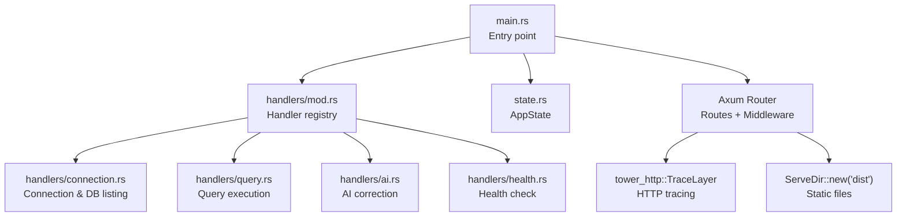
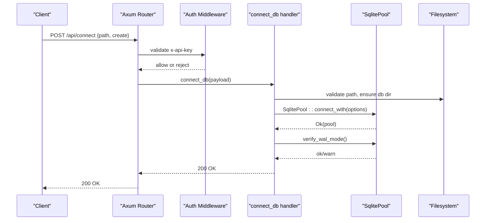
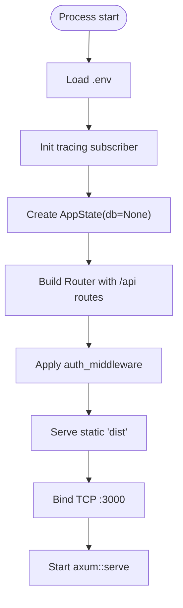
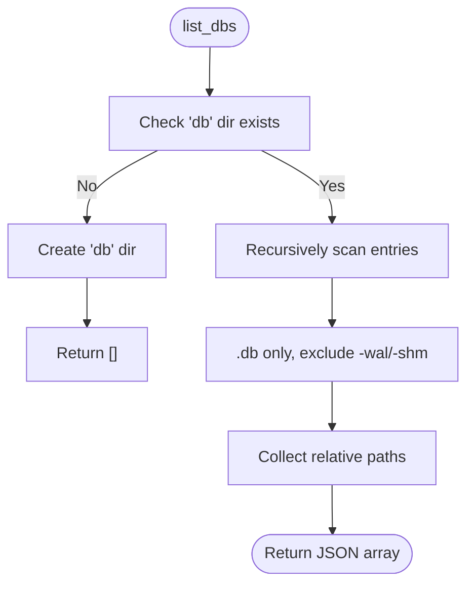
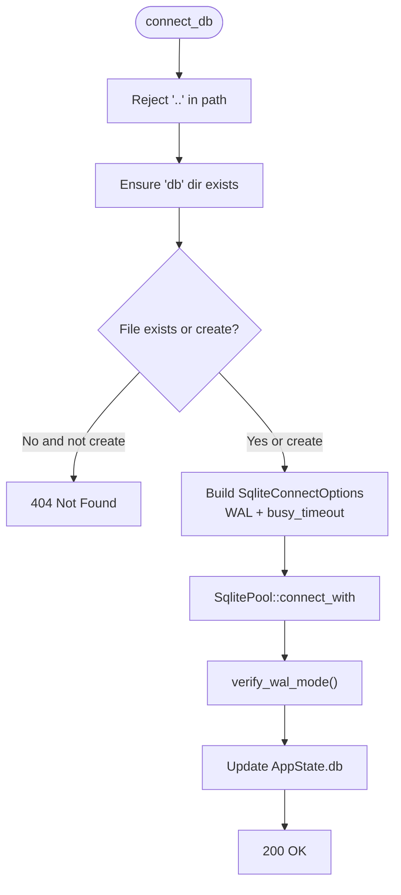
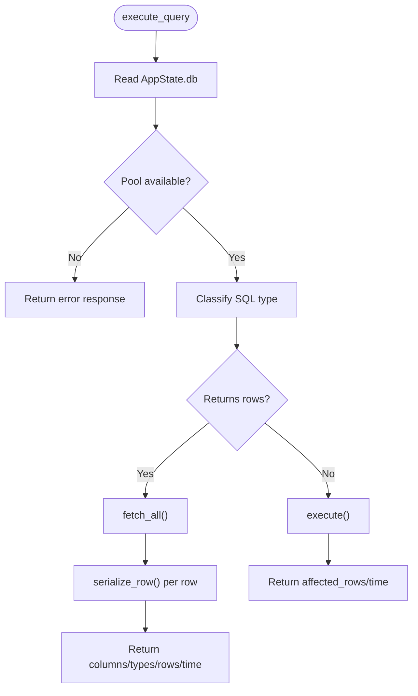
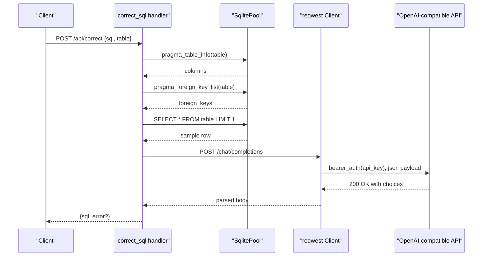
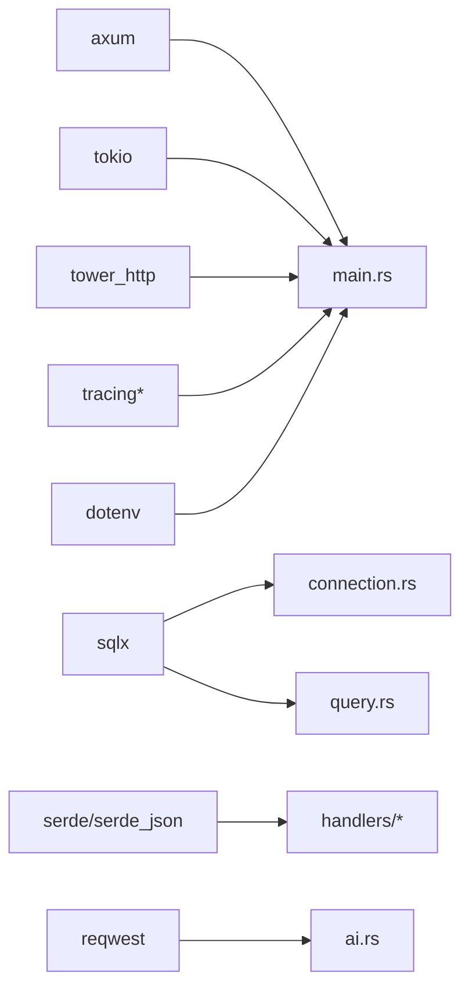

# Backend Development

<cite>
**Referenced Files in This Document**
- [main.rs](file://backend/src/main.rs)
- [state.rs](file://backend/src/state.rs)
- [handlers/mod.rs](file://backend/src/handlers/mod.rs)
- [connection.rs](file://backend/src/handlers/connection.rs)
- [query.rs](file://backend/src/handlers/query.rs)
- [ai.rs](file://backend/src/handlers/ai.rs)
- [health.rs](file://backend/src/handlers/health.rs)
- [Cargo.toml](file://backend/Cargo.toml)
</cite>

## Table of Contents
1. [Introduction](#introduction)
2. [Project Structure](#project-structure)
3. [Core Components](#core-components)
4. [Architecture Overview](#architecture-overview)
5. [Detailed Component Analysis](#detailed-component-analysis)
6. [Dependency Analysis](#dependency-analysis)
7. [Performance Considerations](#performance-considerations)
8. [Troubleshooting Guide](#troubleshooting-guide)
9. [Conclusion](#conclusion)

## Introduction
This document provides comprehensive backend development documentation for the Rust-based server application. It explains the entry point, state management using a shared database pool protected by async read-write locks, handler organization, and the database layer including connection lifecycle, WAL mode configuration, and recursive file discovery with security validation. It also documents API endpoints for connection management, query execution, and AI integration, along with authentication middleware, error handling strategies, logging configuration, and performance considerations such as connection pooling and async I/O patterns.

## Project Structure
The backend is an Axum-based HTTP service that:
- Initializes tracing and environment variables
- Shares a database pool across handlers via application state
- Exposes REST endpoints under /api
- Serves static frontend assets from dist
- Applies authentication middleware to API routes

**Diagram sources**
- [main.rs:35-72](file://backend/src/main.rs#L35-L72)
- [handlers/mod.rs:1-10](file://backend/src/handlers/mod.rs#L1-L10)
- [state.rs:1-9](file://backend/src/state.rs#L1-L9)

**Section sources**
- [main.rs:1-74](file://backend/src/main.rs#L1-L74)
- [handlers/mod.rs:1-10](file://backend/src/handlers/mod.rs#L1-L10)

## Core Components
- Application state: Holds a shared, asynchronously locked optional SQLite pool.
- Handlers: Organized by feature (connection, query, ai, health).
- Database layer: Uses sqlx with Tokio runtime, WAL journal mode, busy timeout, and pool-based connections.
- Authentication: Header-based API key middleware protecting API routes.
- Logging: Tracing subscriber configured via environment variable RUST_LOG.

Key responsibilities:
- main.rs: Bootstraps tracing, constructs AppState, registers routes, applies middleware, binds TCP listener.
- state.rs: Defines AppState with Arc<RwLock<Option<SqlitePool>>>.
- handlers/connection.rs: Lists .db files recursively, connects to a SQLite database, verifies WAL mode, lists tables.
- handlers/query.rs: Executes SQL, serializes rows into JSON, measures execution time.
- handlers/ai.rs: Calls OpenAI-compatible API to correct or generate SQL based on table schema and sample row.
- handlers/health.rs: Returns status and version info.

**Section sources**
- [main.rs:35-72](file://backend/src/main.rs#L35-L72)
- [state.rs:1-9](file://backend/src/state.rs#L1-L9)
- [handlers/connection.rs:20-145](file://backend/src/handlers/connection.rs#L20-L145)
- [handlers/query.rs:101-200](file://backend/src/handlers/query.rs#L101-L200)
- [handlers/ai.rs:24-148](file://backend/src/handlers/ai.rs#L24-L148)
- [handlers/health.rs:1-6](file://backend/src/handlers/health.rs#L1-L6)

## Architecture Overview
The system follows a layered architecture:
- HTTP Layer: Axum router with middleware (auth, tracing) and static file serving.
- Handler Layer: Feature-specific handlers for connection, queries, AI, and health.
- State Layer: Shared AppState containing the database pool.
- Data Layer: SQLite via sqlx with connection pooling and WAL mode.

**Diagram sources**
- [main.rs:22-33](file://backend/src/main.rs#L22-L33)
- [main.rs:52-65](file://backend/src/main.rs#L52-L65)
- [connection.rs:62-109](file://backend/src/handlers/connection.rs#L62-L109)
- [connection.rs:131-144](file://backend/src/handlers/connection.rs#L131-L144)

## Detailed Component Analysis

### Entry Point and Routing (main.rs)
Responsibilities:
- Initialize dotenv and tracing subscriber with EnvFilter and fmt layer.
- Create AppState with Arc<RwLock<Option<SqlitePool>>> initialized to None.
- Register API routes under /api with auth middleware.
- Serve static frontend assets from dist.
- Bind to port 3000 and start the server.

Authentication middleware:
- Reads API_KEY from environment; compares against x-api-key header.
- Returns 401 Unauthorized if mismatch.

Logging:
- Configured via RUST_LOG env var; defaults include debug logs for app and tower_http.

**Diagram sources**
- [main.rs:35-72](file://backend/src/main.rs#L35-L72)

**Section sources**
- [main.rs:1-74](file://backend/src/main.rs#L1-L74)

### State Management (state.rs)
- AppState holds a shared database pool wrapped in Arc<RwLock<Option<SqlitePool>>>.
- Cloneable for sharing across handlers.

Design notes:
- Using RwLock allows concurrent reads and exclusive writes when connecting/disconnecting.
- Option<SqlitePool> indicates no active connection until connect_db is called.

**Section sources**
- [state.rs:1-9](file://backend/src/state.rs#L1-L9)

### Connection Management and File Discovery (handlers/connection.rs)
Endpoints:
- GET /api/db-files: Recursively list .db files under db/, excluding WAL/SHM files.
- POST /api/connect: Connect to a SQLite database at a given path, optionally creating it.
- GET /api/tables: List tables from the connected database.

Security and validation:
- Rejects paths containing ".." to prevent directory traversal.
- Ensures db directory exists; creates it if missing.
- Validates existence unless create flag is set.

Database options:
- Enables WAL journal mode.
- Sets busy_timeout to avoid multi-process contention.
- Verifies WAL mode after connection.

Recursive file discovery:
- Scans db directory recursively.
- Filters only .db files and excludes -wal/-shm suffixes.
- Records relative paths from db root.

**Diagram sources**
- [connection.rs:20-60](file://backend/src/handlers/connection.rs#L20-L60)

**Diagram sources**
- [connection.rs:62-109](file://backend/src/handlers/connection.rs#L62-L109)
- [connection.rs:131-144](file://backend/src/handlers/connection.rs#L131-L144)

**Section sources**
- [connection.rs:20-145](file://backend/src/handlers/connection.rs#L20-L145)

### Query Execution (handlers/query.rs)
Endpoint:
- POST /api/query: Execute arbitrary SQL against the connected SQLite database.

Behavior:
- Determines whether to fetch rows or execute non-select statements based on SQL prefix heuristics (SELECT, PRAGMA, EXPLAIN, WITH, RETURNING).
- Serializes rows into JSON with typed handling for NULL, integers, floats, booleans, blobs, and strings.
- Measures execution time and returns columns, column types, rows, affected_rows, and error messages.

Error handling:
- If no database is connected, returns a structured response indicating the issue.
- Errors are captured and returned in the response payload rather than failing the request.

**Diagram sources**
- [query.rs:101-200](file://backend/src/handlers/query.rs#L101-L200)

**Section sources**
- [query.rs:1-201](file://backend/src/handlers/query.rs#L1-L201)

### AI Integration (handlers/ai.rs)
Endpoint:
- POST /api/correct: Correct or generate SQL using an OpenAI-compatible API.

Flow:
- Reads OPENAI_API_KEY, OPENAI_BASE_URL, OPENAI_MODEL from environment.
- Retrieves table schema via pragma_table_info and foreign keys via pragma_foreign_key_list.
- Optionally samples one row to enrich the prompt.
- Constructs a prompt describing the table schema and user input.
- Sends a chat completion request to the configured base URL.
- Parses the response and returns generated SQL or error details.

Configuration:
- Requires OPENAI_API_KEY; otherwise returns an error response.
- Defaults base URL and model if not provided.

**Diagram sources**
- [ai.rs:24-148](file://backend/src/handlers/ai.rs#L24-L148)

**Section sources**
- [ai.rs:1-149](file://backend/src/handlers/ai.rs#L1-L149)

### Health Check (handlers/health.rs)
Endpoint:
- GET /api/health: Returns status and version information.

Version resolution:
- Uses APP_VERSION environment variable if present; falls back to Cargo package version.

**Section sources**
- [health.rs:1-6](file://backend/src/handlers/health.rs#L1-L6)

## Dependency Analysis
External dependencies and their roles:
- axum: Web framework for routing and middleware.
- tokio: Async runtime.
- sqlx: Database toolkit with SQLite support and Tokio runtime features.
- serde/serde_json: Serialization/deserialization for requests/responses.
- tower_http: Static file serving and HTTP tracing.
- tracing/tracing-subscriber: Structured logging and filtering.
- reqwest: HTTP client for AI provider calls.
- dotenv: Environment variable loading.

**Diagram sources**
- [Cargo.toml:6-18](file://backend/Cargo.toml#L6-L18)
- [main.rs:1-18](file://backend/src/main.rs#L1-L18)
- [connection.rs:1-10](file://backend/src/handlers/connection.rs#L1-L10)
- [query.rs:1-10](file://backend/src/handlers/query.rs#L1-L10)
- [ai.rs:1-10](file://backend/src/handlers/ai.rs#L1-L10)

**Section sources**
- [Cargo.toml:1-24](file://backend/Cargo.toml#L1-L24)

## Performance Considerations
- Connection pooling: SqlitePool manages multiple connections, reducing overhead and enabling concurrent access.
- WAL mode: Improves concurrency and reduces locking issues compared to default journaling.
- Busy timeout: Prevents immediate failures under contention by waiting for lock availability.
- Async I/O: Tokio runtime handles asynchronous operations for HTTP and database interactions.
- Tracing: Use TraceLayer and structured logs to monitor request latency and errors.
- Release optimizations: Binary stripping, LTO, and single codegen unit improve release performance.

Recommendations:
- Tune pool size based on expected concurrency and workload characteristics.
- Monitor WAL mode verification and adjust busy_timeout if needed.
- Profile slow queries and consider indexes or query restructuring.
- Use structured logging levels appropriately to balance verbosity and performance.

[No sources needed since this section provides general guidance]

## Troubleshooting Guide
Common issues and resolutions:
- Unauthorized access: Ensure x-api-key header matches API_KEY environment variable.
- Database not connected: Call /api/connect before executing queries or listing tables.
- WAL mode mismatch: Verify WAL mode after connection; check SQLite permissions and file system behavior.
- Directory traversal blocked: Avoid ".." in requested paths; use allowed subdirectories under db/.
- Missing AI credentials: Set OPENAI_API_KEY; configure OPENAI_BASE_URL and OPENAI_MODEL as needed.
- Static files not served: Ensure dist directory exists and contains built frontend assets.

Operational tips:
- Inspect logs via RUST_LOG to identify errors and request flows.
- Validate environment variables using a .env file loaded by dotenv.
- Test endpoints with curl or Postman, verifying headers and payloads.

**Section sources**
- [main.rs:22-33](file://backend/src/main.rs#L22-L33)
- [connection.rs:62-109](file://backend/src/handlers/connection.rs#L62-L109)
- [ai.rs:24-37](file://backend/src/handlers/ai.rs#L24-L37)

## Conclusion
The backend implements a secure, modular, and performant SQLite web UI server using Axum and sqlx. It leverages connection pooling, WAL mode, and async I/O to handle concurrent workloads efficiently. The handler organization separates concerns clearly, while authentication middleware protects API endpoints. Logging and tracing provide observability. Extensibility points include adding new endpoints, integrating additional AI providers, and expanding database operations through the existing state and handler patterns.

[No sources needed since this section summarizes without analyzing specific files]