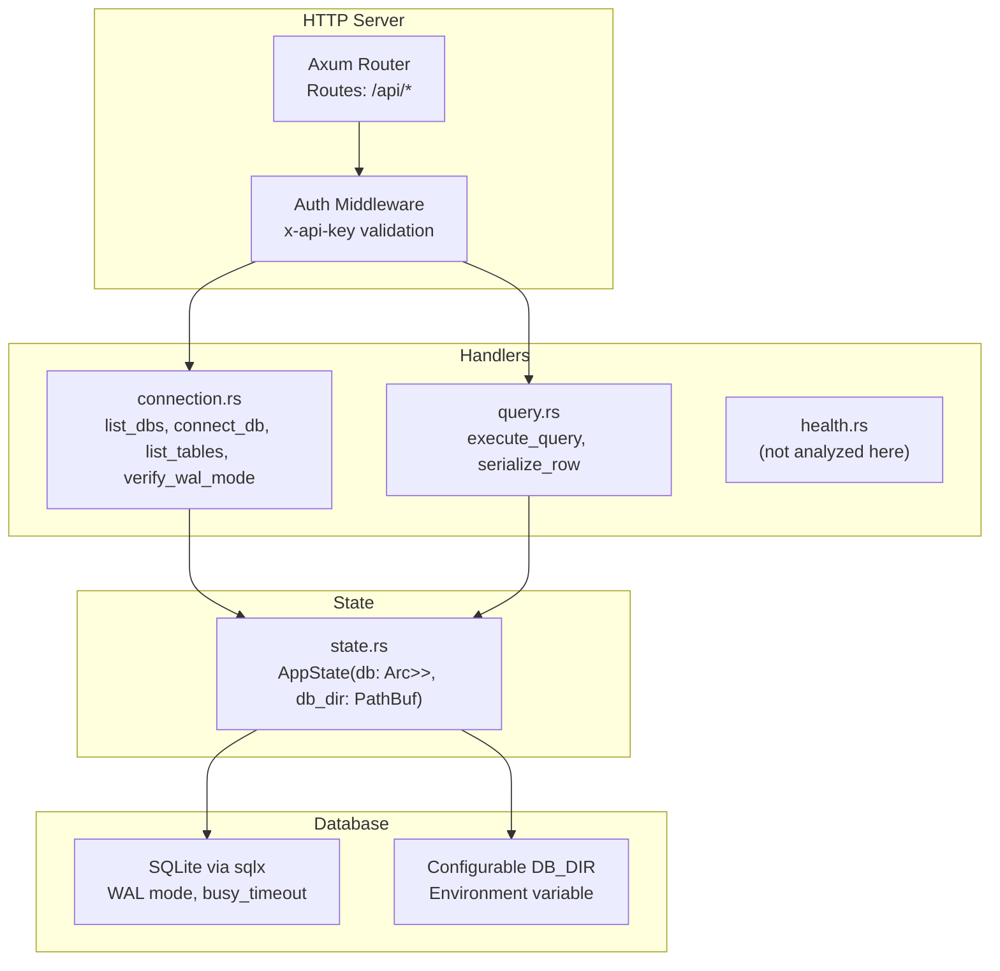
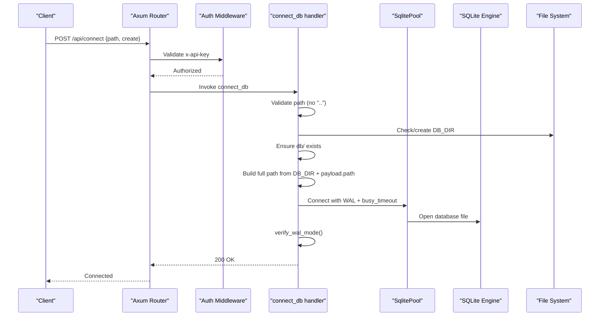
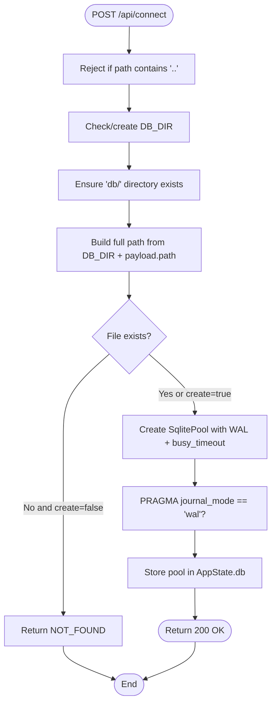
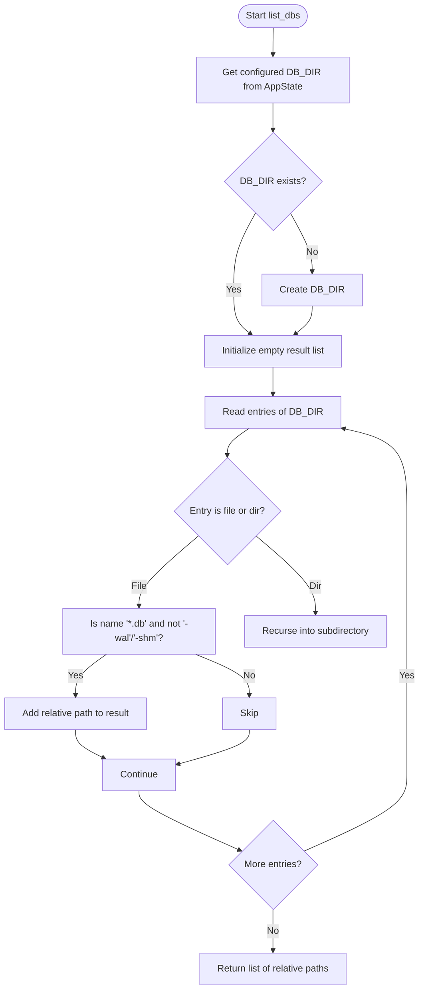
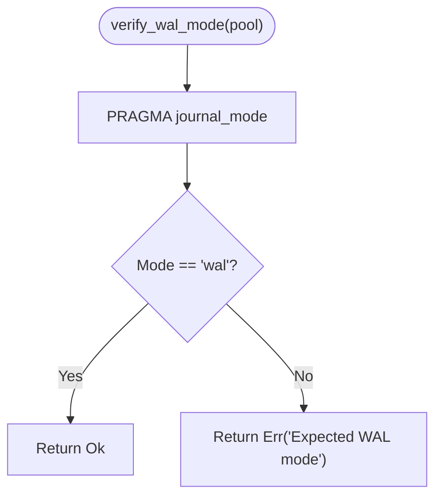
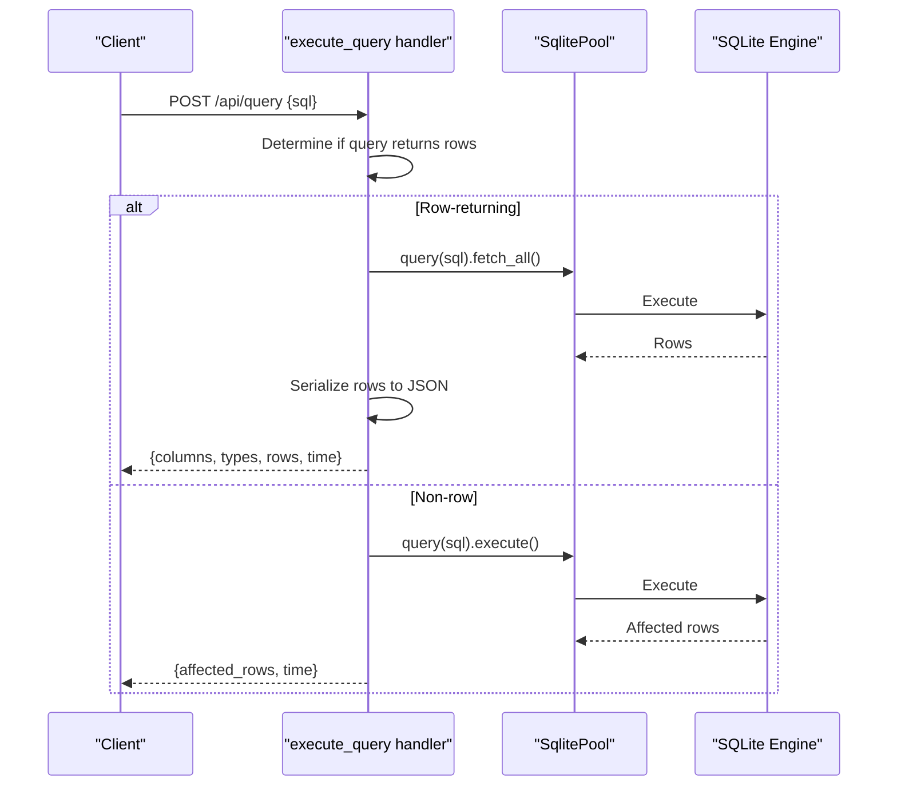
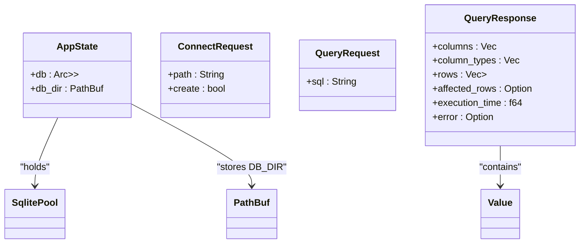
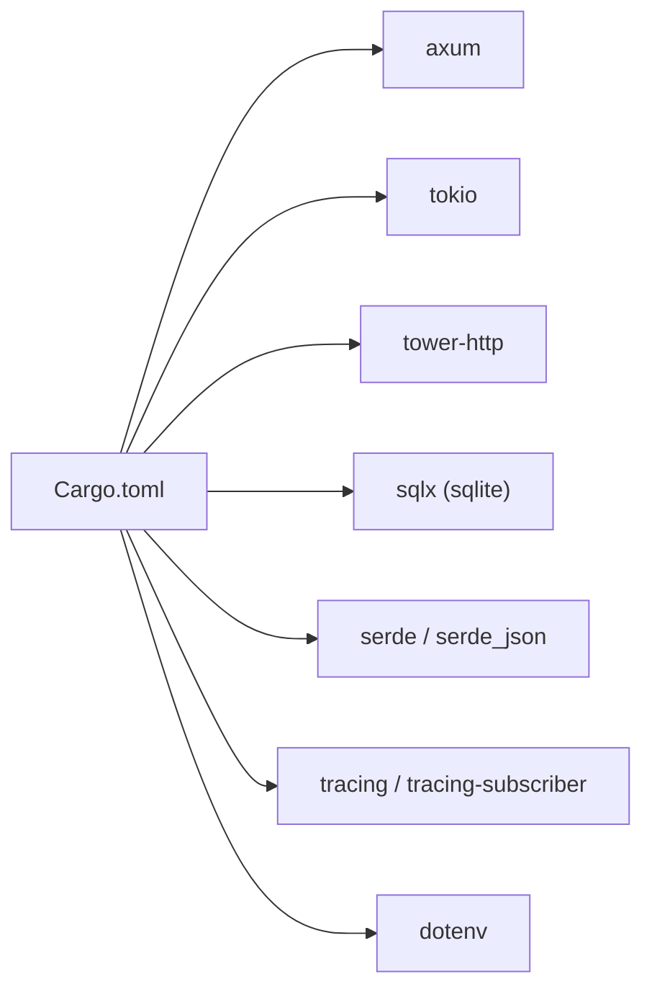

# Database Layer & Connection Management

<cite>
**Referenced Files in This Document**
- [main.rs](file://backend/src/main.rs)
- [state.rs](file://backend/src/state.rs)
- [connection.rs](file://backend/src/handlers/connection.rs)
- [query.rs](file://backend/src/handlers/query.rs)
- [Cargo.toml](file://backend/Cargo.toml)
</cite>

## Update Summary
**Changes Made**
- Updated Recursive File Discovery section to reflect improved scanning logic with configurable DB_DIR support
- Enhanced connection validation documentation to include new directory creation and error handling
- Updated architecture diagrams to show DB_DIR configuration flow
- Added documentation for the new recursive scanning implementation with relative path reporting

## Table of Contents
1. [Introduction](#introduction)
2. [Project Structure](#project-structure)
3. [Core Components](#core-components)
4. [Architecture Overview](#architecture-overview)
5. [Detailed Component Analysis](#detailed-component-analysis)
6. [Dependency Analysis](#dependency-analysis)
7. [Performance Considerations](#performance-considerations)
8. [Troubleshooting Guide](#troubleshooting-guide)
9. [Conclusion](#conclusion)

## Introduction
This document explains the database layer and connection management for the SQLite-backed web service. It covers how connections are established, configured (including WAL mode), validated, and reused; how .db files are discovered recursively within a configurable database directory with path traversal protection; how queries are executed against the active pool; and how errors are handled across failure modes such as permission issues and corruption. It also provides guidance on extending the system with new operations and optimizing performance through connection reuse and resource cleanup.

## Project Structure
The backend is an Axum-based HTTP server that exposes REST endpoints for connecting to a SQLite database, listing available databases, enumerating tables, executing queries, and correcting SQL. The application state holds a shared, thread-safe reference to the current SqlitePool along with the configured database directory path.

**Diagram sources**
- [main.rs:35-72](file://backend/src/main.rs#L35-L72)
- [connection.rs:20-144](file://backend/src/handlers/connection.rs#L20-L144)
- [query.rs:101-200](file://backend/src/handlers/query.rs#L101-L200)
- [state.rs:5-10](file://backend/src/state.rs#L5-L10)

**Section sources**
- [main.rs:1-84](file://backend/src/main.rs#L1-L84)
- [state.rs:1-11](file://backend/src/state.rs#L1-L11)

## Core Components
- Application State: Holds a single, process-wide SqlitePool behind a read-write lock so handlers can safely access or replace the active connection pool, along with the configured database directory path.
- Connection Handler: Exposes endpoints to discover .db files recursively within the configured DB_DIR, establish a connection with WAL enabled, validate WAL mode, and list tables from the connected database.
- Query Handler: Executes arbitrary SQL against the active pool, returning structured results with column metadata and timing information.
- Dependencies: sqlx (SQLite driver), axum (HTTP framework), tokio (async runtime).

Key responsibilities:
- Establishing and configuring the SQLite connection pool (WAL mode, busy timeout).
- Validating the connection's journal mode to ensure concurrent access support.
- Safely scanning the filesystem recursively within DB_DIR for .db files while preventing directory traversal.
- Executing queries and mapping SQLite rows into JSON-compatible structures.

**Section sources**
- [state.rs:5-10](file://backend/src/state.rs#L5-L10)
- [connection.rs:62-109](file://backend/src/handlers/connection.rs#L62-L109)
- [connection.rs:131-144](file://backend/src/handlers/connection.rs#L131-L144)
- [query.rs:101-200](file://backend/src/handlers/query.rs#L101-L200)

## Architecture Overview
The server initializes logging, constructs AppState with a None pool and configured DB_DIR, builds routes under /api, and serves static assets. Requests flow through authentication middleware before reaching handlers. Handlers read/write the shared pool and interact with SQLite via sqlx.

**Diagram sources**
- [main.rs:35-72](file://backend/src/main.rs#L35-L72)
- [connection.rs:62-109](file://backend/src/handlers/connection.rs#L62-L109)
- [connection.rs:131-144](file://backend/src/handlers/connection.rs#L131-L144)

## Detailed Component Analysis

### SQLite Connection Lifecycle
- Establishment:
  - The connect endpoint validates the requested path to prevent directory traversal.
  - It ensures the base directory exists and constructs the full path using the configured DB_DIR.
  - It creates a SqlitePool with:
    - Journal mode set to WAL.
    - busy_timeout configured to mitigate contention.
    - Optional creation if the file does not exist.
- Validation:
  - After establishing the pool, it runs a PRAGMA check to confirm journal_mode is wal.
  - If verification fails, it logs a warning but still proceeds (the pool was created with WAL).
- Storage:
  - The newly created pool replaces the previous one in AppState.db.

**Diagram sources**
- [connection.rs:62-109](file://backend/src/handlers/connection.rs#L62-L109)
- [connection.rs:131-144](file://backend/src/handlers/connection.rs#L131-L144)

**Section sources**
- [connection.rs:62-109](file://backend/src/handlers/connection.rs#L62-L109)
- [connection.rs:131-144](file://backend/src/handlers/connection.rs#L131-L144)

### Recursive File Discovery with Security Controls
**Updated** The database scanning logic has been improved to recursively search within a configurable DB_DIR while maintaining relative path reporting for API responses.

- Scanning:
  - Recursively traverses the configured DB_DIR directory structure.
  - Includes only regular files ending with .db.
  - Excludes SQLite auxiliary files (-wal, -shm).
  - Records relative paths from the DB_DIR root for safe client usage.
  - Automatically creates DB_DIR if it doesn't exist.
- Security:
  - Directory traversal is blocked at the connect endpoint by rejecting payloads containing "..".
  - Only files under the configured DB_DIR are exposed via list_dbs.
  - Relative path reporting ensures clients cannot access files outside the configured directory.

**Diagram sources**
- [connection.rs:20-60](file://backend/src/handlers/connection.rs#L20-L60)

**Section sources**
- [connection.rs:20-60](file://backend/src/handlers/connection.rs#L20-L60)

### Connection Validation (WAL Mode Verification)
- Purpose: Ensures the active connection uses WAL mode to support concurrent readers/writers.
- Mechanism: Queries PRAGMA journal_mode and compares the returned value to "wal".
- Behavior: On mismatch, returns an error string used to log a warning during connect flow.

**Diagram sources**
- [connection.rs:131-144](file://backend/src/handlers/connection.rs#L131-L144)

**Section sources**
- [connection.rs:131-144](file://backend/src/handlers/connection.rs#L131-L144)

### Query Execution Flow
- Determines whether the SQL should return rows based on prefixes like SELECT, PRAGMA, EXPLAIN, WITH, or presence of RETURNING.
- For row-returning queries: fetch_all and map each row to JSON-compatible values using type-aware serialization.
- For non-row queries: execute and report affected_rows.
- Timing: Measures execution time in milliseconds and includes it in the response.

**Diagram sources**
- [query.rs:101-200](file://backend/src/handlers/query.rs#L101-L200)

**Section sources**
- [query.rs:101-200](file://backend/src/handlers/query.rs#L101-L200)

### Data Models and Types
- AppState: Holds the active SqlitePool in a thread-safe container and the configured database directory path.
- ConnectRequest: Contains path and optional create flag.
- QueryRequest/QueryResponse: Define input/output shapes for query execution.

**Diagram sources**
- [state.rs:5-10](file://backend/src/state.rs#L5-L10)
- [connection.rs:13-18](file://backend/src/handlers/connection.rs#L13-L18)
- [query.rs:12-25](file://backend/src/handlers/query.rs#L12-L25)

**Section sources**
- [state.rs:5-10](file://backend/src/state.rs#L5-L10)
- [connection.rs:13-18](file://backend/src/handlers/connection.rs#L13-L18)
- [query.rs:12-25](file://backend/src/handlers/query.rs#L12-L25)

## Dependency Analysis
- Runtime and Framework:
  - axum: HTTP routing and middleware.
  - tokio: Async runtime.
  - tower-http: Tracing and static file serving.
- Database:
  - sqlx with sqlite feature: Provides connection pooling and prepared statements.
- Configuration:
  - dotenv: Loads environment variables including DB_DIR.
  - tracing/tracing-subscriber: Structured logging.

**Diagram sources**
- [Cargo.toml:6-18](file://backend/Cargo.toml#L6-L18)

**Section sources**
- [Cargo.toml:1-24](file://backend/Cargo.toml#L1-L24)

## Performance Considerations
- Connection Reuse:
  - The application maintains a single SqlitePool per process, enabling connection reuse across requests.
  - Replace the pool on connect to switch databases without restarting the server.
- Concurrency and Contention:
  - WAL mode enables concurrent reads and writes.
  - busy_timeout reduces immediate failures under contention by waiting briefly for locks.
- Resource Cleanup:
  - Dropping the old pool when replacing it allows underlying resources to be released.
  - Avoid holding long-lived references to pools outside AppState.
- Query Efficiency:
  - Use parameterized queries where possible to avoid repeated parsing.
  - Limit large result sets in the UI layer to reduce memory pressure.
- I/O and Disk:
  - WAL generates additional files (.db-wal, .db-shm); ensure sufficient disk space and permissions.
  - Keep the DB_DIR on fast storage for better throughput.
- Directory Scanning Optimization:
  - Recursive scanning is performed only when listing databases, not on every request.
  - Relative path reporting reduces path processing overhead.

[No sources needed since this section provides general guidance]

## Troubleshooting Guide
Common issues and resolutions:
- Path Traversal Blocked:
  - Symptom: Request rejected due to invalid path.
  - Cause: Payload contains "..".
  - Resolution: Provide a path relative to the DB_DIR without traversal sequences.
- Database Not Found:
  - Symptom: 404 when connecting.
  - Cause: File does not exist and create flag is false.
  - Resolution: Set create=true or ensure the file exists under DB_DIR.
- Permission Denied:
  - Symptom: Connection fails with OS-level errors.
  - Cause: Process lacks read/write permissions for DB_DIR or target file.
  - Resolution: Adjust filesystem permissions for the running user.
- WAL Mode Mismatch:
  - Symptom: Warning about WAL verification failure.
  - Cause: Existing database opened in a different mode or external tool changed settings.
  - Resolution: Reopen with WAL enabled or convert the database to WAL mode externally.
- Corrupted Database:
  - Symptom: Errors during query execution or table listing.
  - Cause: Incomplete writes or damaged pages.
  - Resolution: Restore from backup or use SQLite recovery tools; avoid forcing writes under contention.
- Busy Timeout Failures:
  - Symptom: Intermittent lock timeouts under heavy concurrency.
  - Cause: Long-running transactions or excessive writers.
  - Resolution: Shorten transaction scope, optimize queries, or tune busy_timeout.
- DB_DIR Configuration Issues:
  - Symptom: Cannot list databases or connect to files.
  - Cause: DB_DIR environment variable not set or incorrect path.
  - Resolution: Set DB_DIR environment variable to the desired database directory path.
- Recursive Scanning Problems:
  - Symptom: Missing databases in list_dbs response.
  - Cause: Insufficient permissions to read subdirectories or nested database files.
  - Resolution: Ensure proper read permissions for all subdirectories within DB_DIR.

**Section sources**
- [connection.rs:62-109](file://backend/src/handlers/connection.rs#L62-L109)
- [connection.rs:131-144](file://backend/src/handlers/connection.rs#L131-L144)
- [query.rs:101-200](file://backend/src/handlers/query.rs#L101-L200)

## Conclusion
The database layer centers around a single, reusable SqlitePool configured with WAL mode and a busy timeout to support concurrent access. The connect endpoint enforces security by blocking directory traversal and optionally creating missing databases. An improved recursive scanner lists available .db files safely within a configurable DB_DIR, maintaining relative path reporting for API responses. Query execution maps SQLite rows to JSON-friendly structures and reports timing. To extend functionality, add new handlers that operate on the shared pool, implement robust error handling, and consider adding explicit connection lifecycle controls (e.g., closing pools) and metrics for observability.

[No sources needed since this section summarizes without analyzing specific files]