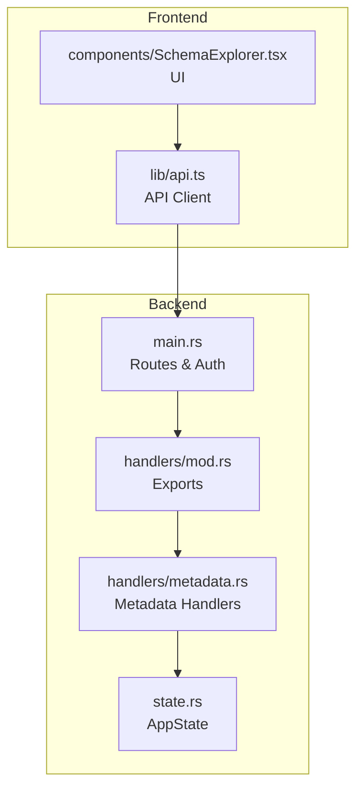
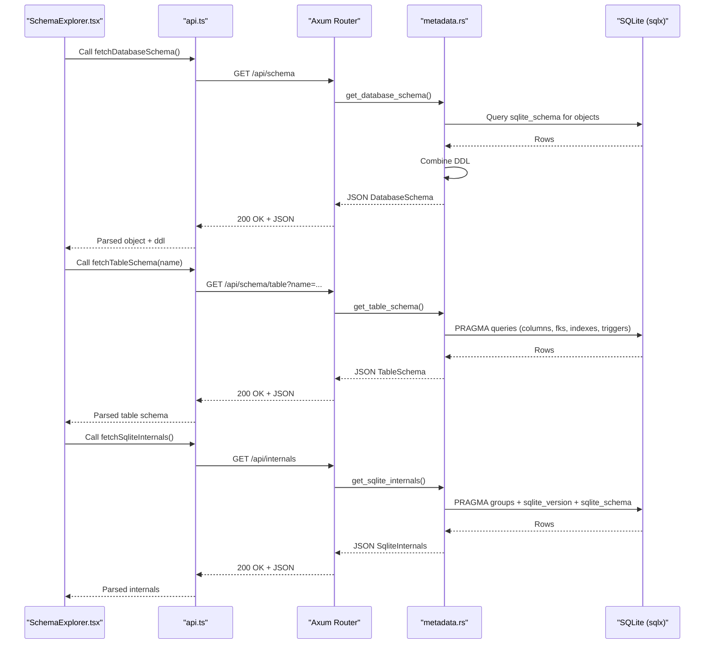
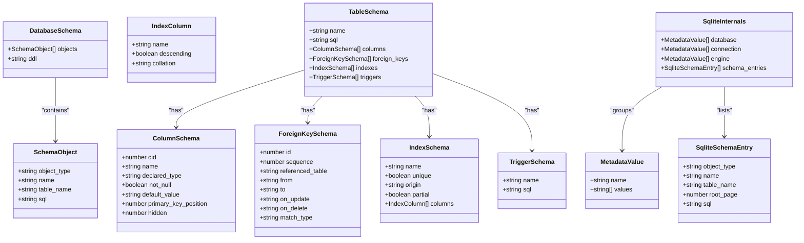
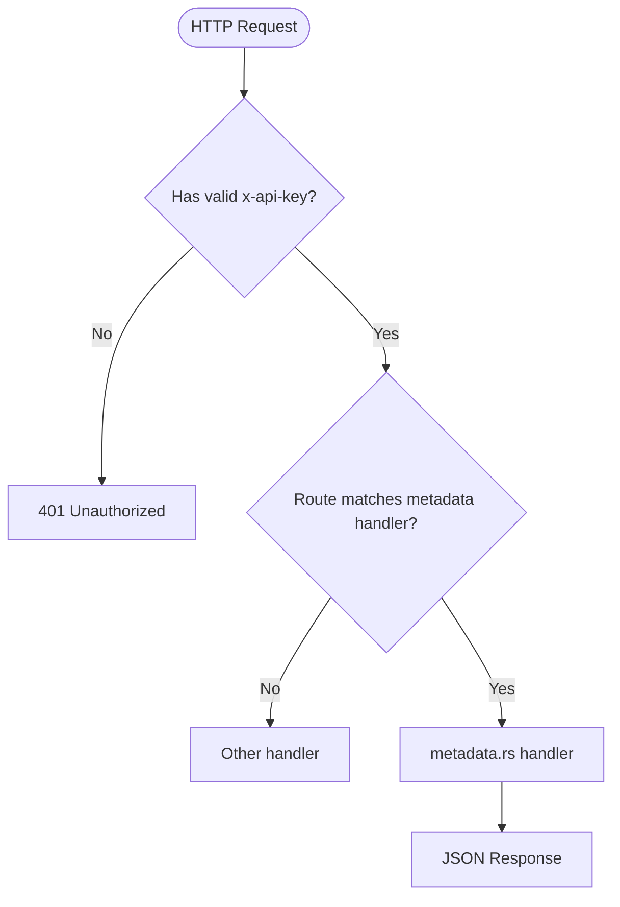
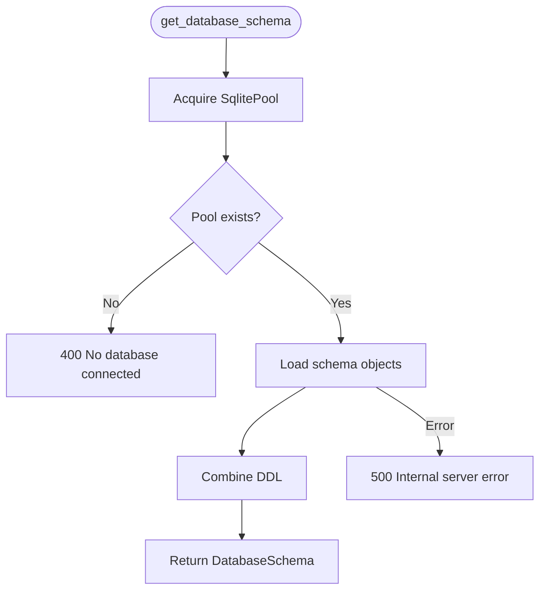
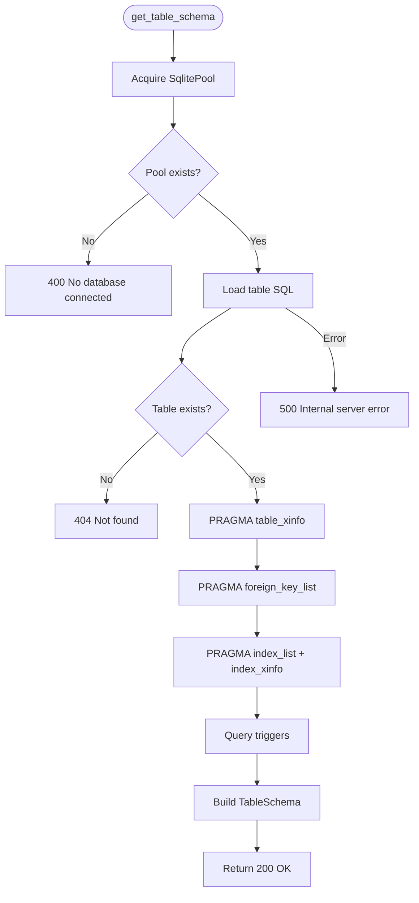
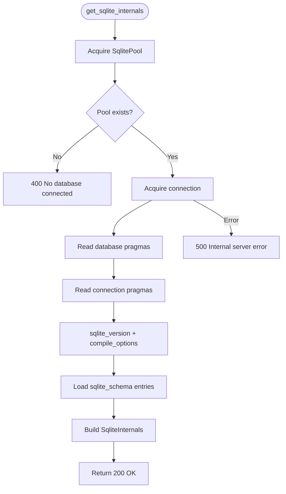
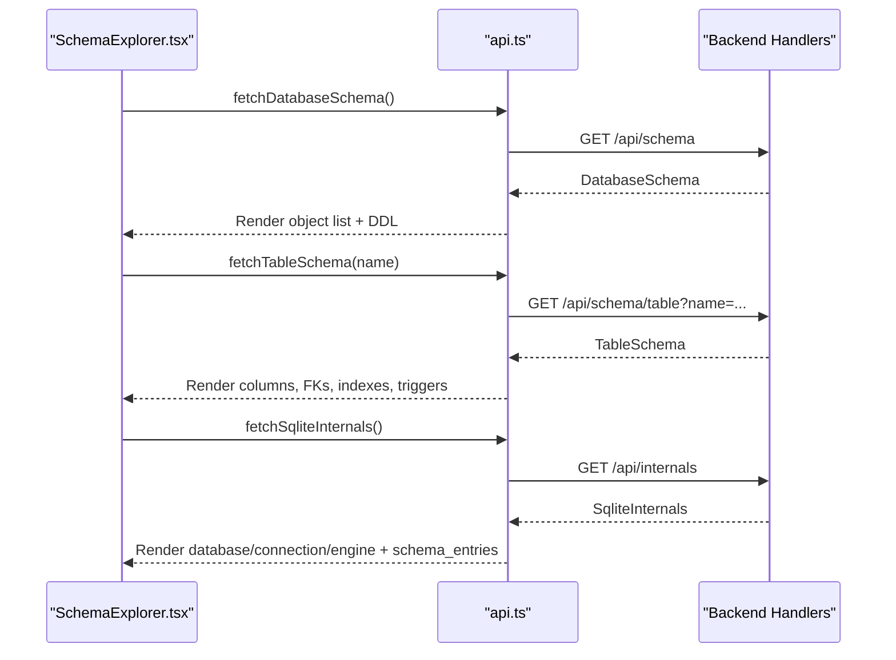
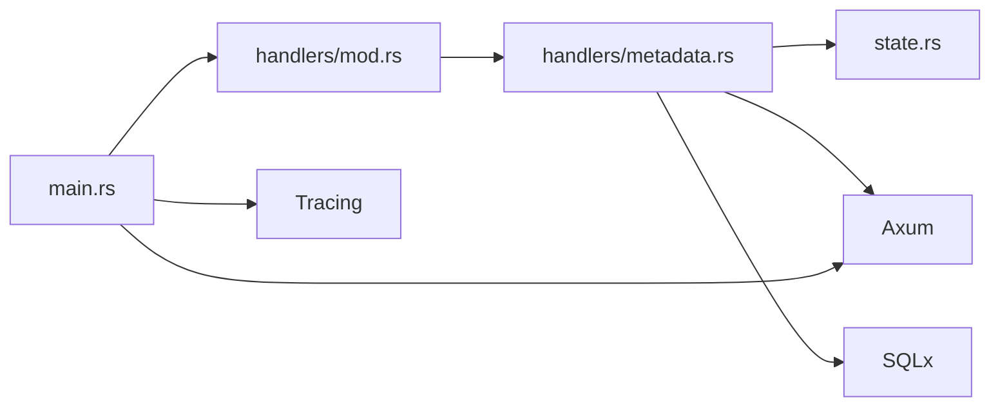

# Metadata Handler

<cite>
**Referenced Files in This Document**
- [metadata.rs](file://backend/src/handlers/metadata.rs)
- [main.rs](file://backend/src/main.rs)
- [state.rs](file://backend/src/state.rs)
- [mod.rs](file://backend/src/handlers/mod.rs)
- [api.ts](file://frontend/src/lib/api.ts)
- [SchemaExplorer.tsx](file://frontend/src/components/SchemaExplorer.tsx)
- [README.md](file://README.md)
</cite>

## Table of Contents
1. [Introduction](#introduction)
2. [Project Structure](#project-structure)
3. [Core Components](#core-components)
4. [Architecture Overview](#architecture-overview)
5. [Detailed Component Analysis](#detailed-component-analysis)
6. [Dependency Analysis](#dependency-analysis)
7. [Performance Considerations](#performance-considerations)
8. [Troubleshooting Guide](#troubleshooting-guide)
9. [Conclusion](#conclusion)

## Introduction
This document explains the Metadata Handler subsystem that powers schema and SQLite internals inspection in the application. It covers how the backend exposes metadata endpoints, how data is read from SQLite using SQLx, how responses are structured, and how the frontend consumes these APIs to render the Schema Explorer and Internals views.

## Project Structure
The metadata functionality spans both backend and frontend:
- Backend: Axum handlers for schema and internals endpoints, state management for database pool access, and route registration.
- Frontend: API client functions and a UI component that fetches and displays schema objects, table details, and SQLite internals.

**Diagram sources**
- [main.rs:60-77](file://backend/src/main.rs#L60-L77)
- [mod.rs:7-11](file://backend/src/handlers/mod.rs#L7-L11)
- [metadata.rs:334-437](file://backend/src/handlers/metadata.rs#L334-L437)
- [state.rs:6-10](file://backend/src/state.rs#L6-L10)
- [api.ts:118-130](file://frontend/src/lib/api.ts#L118-L130)
- [SchemaExplorer.tsx:1-308](file://frontend/src/components/SchemaExplorer.tsx#L1-L308)

**Section sources**
- [main.rs:60-77](file://backend/src/main.rs#L60-L77)
- [mod.rs:7-11](file://backend/src/handlers/mod.rs#L7-L11)
- [state.rs:6-10](file://backend/src/state.rs#L6-L10)
- [api.ts:118-130](file://frontend/src/lib/api.ts#L118-L130)
- [SchemaExplorer.tsx:1-308](file://frontend/src/components/SchemaExplorer.tsx#L1-L308)

## Core Components
- Database schema endpoint: returns user-defined objects (tables, views, indexes, triggers) and combined DDL.
- Table schema endpoint: returns detailed structure for a specific table including columns, foreign keys, indexes, and triggers.
- SQLite internals endpoint: returns grouped pragma values (database, connection, engine), SQLite version, compile options, and raw sqlite_schema entries.

Key response models:
- DatabaseSchema: list of SchemaObject plus combined ddl string.
- TableSchema: name, sql, columns, foreign_keys, indexes, triggers.
- SqliteInternals: database/connection/engine groups and schema_entries.

**Section sources**
- [metadata.rs:12-102](file://backend/src/handlers/metadata.rs#L12-L102)
- [metadata.rs:334-437](file://backend/src/handlers/metadata.rs#L334-L437)

## Architecture Overview
The metadata flow connects the frontend UI to backend handlers, which query SQLite via SQLx and return structured JSON.

**Diagram sources**
- [main.rs:60-77](file://backend/src/main.rs#L60-L77)
- [metadata.rs:334-437](file://backend/src/handlers/metadata.rs#L334-L437)
- [api.ts:118-130](file://frontend/src/lib/api.ts#L118-L130)
- [SchemaExplorer.tsx:1-308](file://frontend/src/components/SchemaExplorer.tsx#L1-L308)

## Detailed Component Analysis

### Endpoints and Data Models
- GET /api/schema
  - Purpose: List user-defined objects and provide combined DDL.
  - Response model: DatabaseSchema { objects: SchemaObject[], ddl: string }
  - Behavior: Reads sqlite_schema excluding internal names; concatenates SQL statements with proper delimiters.

- GET /api/schema/table?name=...
  - Purpose: Return detailed schema for a given table.
  - Response model: TableSchema { name, sql, columns, foreign_keys, indexes, triggers }
  - Behavior: Uses PRAGMA helpers to extract column info, foreign keys, index definitions, and triggers.

- GET /api/internals
  - Purpose: Expose SQLite runtime and engine metadata.
  - Response model: SqliteInternals { database, connection, engine, schema_entries }
  - Behavior: Groups PRAGMA results by category, includes sqlite_version and compile_options, and lists all sqlite_schema entries.

**Diagram sources**
- [metadata.rs:12-102](file://backend/src/handlers/metadata.rs#L12-L102)

**Section sources**
- [metadata.rs:12-102](file://backend/src/handlers/metadata.rs#L12-L102)
- [metadata.rs:334-437](file://backend/src/handlers/metadata.rs#L334-L437)

### Route Registration and Authentication
- Routes:
  - GET /api/schema -> get_database_schema
  - GET /api/schema/table -> get_table_schema
  - GET /api/internals -> get_sqlite_internals
- Authentication:
  - All routes under /api require x-api-key header matching API_KEY environment variable.
  - Unauthorized requests receive 401.

**Diagram sources**
- [main.rs:26-37](file://backend/src/main.rs#L26-L37)
- [main.rs:60-77](file://backend/src/main.rs#L60-L77)

**Section sources**
- [main.rs:26-37](file://backend/src/main.rs#L26-L37)
- [main.rs:60-77](file://backend/src/main.rs#L60-L77)

### Database Schema Endpoint Logic
- Steps:
  1. Acquire database pool from AppState.
  2. Load schema objects from sqlite_schema (excluding internal prefixes).
  3. Combine SQL into a single DDL string with correct statement terminators.
  4. Return DatabaseSchema or error.

**Diagram sources**
- [metadata.rs:334-354](file://backend/src/handlers/metadata.rs#L334-L354)
- [metadata.rs:109-146](file://backend/src/handlers/metadata.rs#L109-L146)

**Section sources**
- [metadata.rs:109-146](file://backend/src/handlers/metadata.rs#L109-L146)
- [metadata.rs:334-354](file://backend/src/handlers/metadata.rs#L334-L354)

### Table Schema Endpoint Logic
- Steps:
  1. Validate presence of database pool.
  2. Fetch CREATE TABLE SQL if present.
  3. Use PRAGMA helpers to retrieve:
     - Columns (including generated and hidden types)
     - Foreign keys
     - Indexes and their columns
     - Triggers
  4. Return TableSchema or appropriate status codes.

**Diagram sources**
- [metadata.rs:148-268](file://backend/src/handlers/metadata.rs#L148-L268)
- [metadata.rs:356-377](file://backend/src/handlers/metadata.rs#L356-L377)

**Section sources**
- [metadata.rs:148-268](file://backend/src/handlers/metadata.rs#L148-L268)
- [metadata.rs:356-377](file://backend/src/handlers/metadata.rs#L356-L377)

### SQLite Internals Endpoint Logic
- Steps:
  1. Acquire database pool and a connection.
  2. Group PRAGMA results into database, connection, and engine categories.
  3. Include sqlite_version and compile_options.
  4. Load all sqlite_schema entries (including internal ones).
  5. Return SqliteInternals or error.

**Diagram sources**
- [metadata.rs:291-332](file://backend/src/handlers/metadata.rs#L291-L332)
- [metadata.rs:379-437](file://backend/src/handlers/metadata.rs#L379-L437)

**Section sources**
- [metadata.rs:291-332](file://backend/src/handlers/metadata.rs#L291-L332)
- [metadata.rs:379-437](file://backend/src/handlers/metadata.rs#L379-L437)

### Frontend Integration
- API client functions:
  - fetchDatabaseSchema
  - fetchTableSchema
  - fetchSqliteInternals
- UI component:
  - SchemaExplorer renders object list, table details, and SQLite internals panels.
  - Supports copying combined DDL and toggling internal-only view.

**Diagram sources**
- [api.ts:118-130](file://frontend/src/lib/api.ts#L118-L130)
- [SchemaExplorer.tsx:1-308](file://frontend/src/components/SchemaExplorer.tsx#L1-L308)

**Section sources**
- [api.ts:118-130](file://frontend/src/lib/api.ts#L118-L130)
- [SchemaExplorer.tsx:1-308](file://frontend/src/components/SchemaExplorer.tsx#L1-L308)

## Dependency Analysis
- Backend dependencies:
  - Axum for routing and middleware.
  - SQLx for async SQLite access.
  - Tokio for async runtime.
  - Tracing for logging.
- State sharing:
  - AppState holds an Arc<RwLock<Option<SqlitePool>>> and db_dir path.
- Handler exports:
  - handlers/mod.rs re-exports metadata handlers for main.rs route registration.

**Diagram sources**
- [main.rs:17-24](file://backend/src/main.rs#L17-L24)
- [mod.rs:1-11](file://backend/src/handlers/mod.rs#L1-L11)
- [metadata.rs:1-10](file://backend/src/handlers/metadata.rs#L1-L10)
- [state.rs:1-10](file://backend/src/state.rs#L1-L10)

**Section sources**
- [main.rs:17-24](file://backend/src/main.rs#L17-L24)
- [mod.rs:1-11](file://backend/src/handlers/mod.rs#L1-L11)
- [metadata.rs:1-10](file://backend/src/handlers/metadata.rs#L1-L10)
- [state.rs:1-10](file://backend/src/state.rs#L1-L10)

## Performance Considerations
- Connection pooling:
  - Using SqlitePool avoids per-request connection overhead.
- Query batching:
  - The internals endpoint groups multiple PRAGMA calls within a single connection to reduce contention.
- DDL composition:
  - Combined DDL is built in memory; ensure large schemas do not cause excessive payload sizes.
- Filtering:
  - Schema listing excludes internal sqlite_ prefixed objects to reduce noise and improve performance.

[No sources needed since this section provides general guidance]

## Troubleshooting Guide
Common issues and resolutions:
- No database connected:
  - Symptom: 400 Bad Request with message indicating no database connected.
  - Cause: AppState.db is None.
  - Resolution: Ensure a database has been connected via the connect endpoint before querying metadata.

- Table not found:
  - Symptom: 404 Not Found when requesting table schema.
  - Cause: Table name does not exist in the database.
  - Resolution: Verify the table name and quoting rules; use exact names as stored.

- Unauthorized:
  - Symptom: 401 Unauthorized.
  - Cause: Missing or incorrect x-api-key header.
  - Resolution: Set API_KEY environment variable and include matching x-api-key in requests.

- Internal server errors:
  - Symptom: 500 Internal Server Error.
  - Cause: SQLx errors during PRAGMA queries or schema reads.
  - Resolution: Check database integrity and permissions; review server logs for stack traces.

**Section sources**
- [metadata.rs:334-354](file://backend/src/handlers/metadata.rs#L334-L354)
- [metadata.rs:356-377](file://backend/src/handlers/metadata.rs#L356-L377)
- [metadata.rs:379-437](file://backend/src/handlers/metadata.rs#L379-L437)
- [main.rs:26-37](file://backend/src/main.rs#L26-L37)

## Conclusion
The Metadata Handler provides robust introspection capabilities for SQLite databases, exposing comprehensive schema details and runtime internals through well-defined endpoints. The frontend integrates seamlessly to visualize and interact with this metadata, enabling efficient database exploration and administration. Proper authentication, error handling, and efficient query patterns ensure reliability and performance across typical usage scenarios.

[No sources needed since this section summarizes without analyzing specific files]