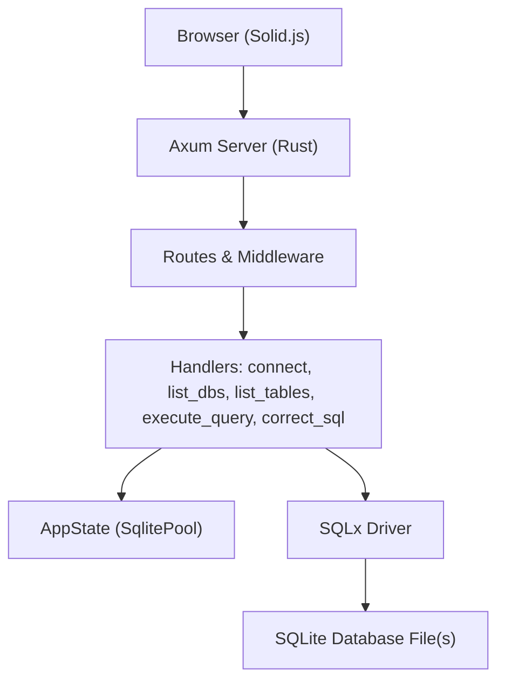
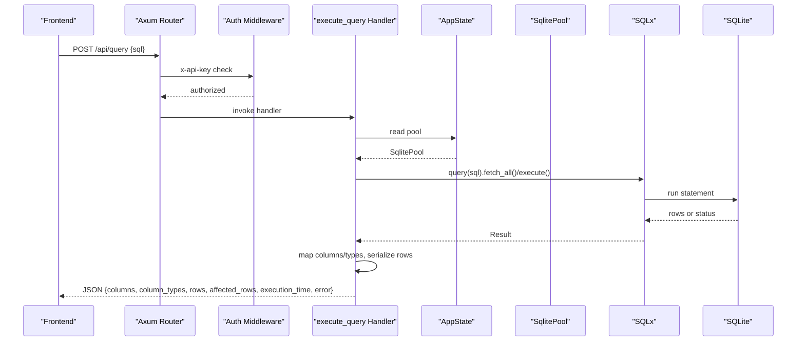
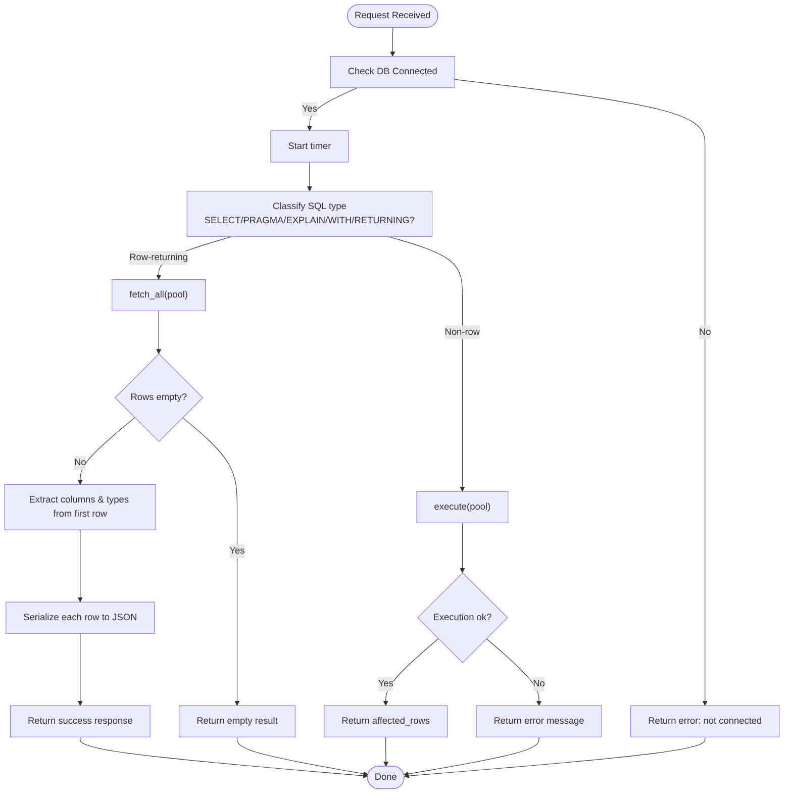
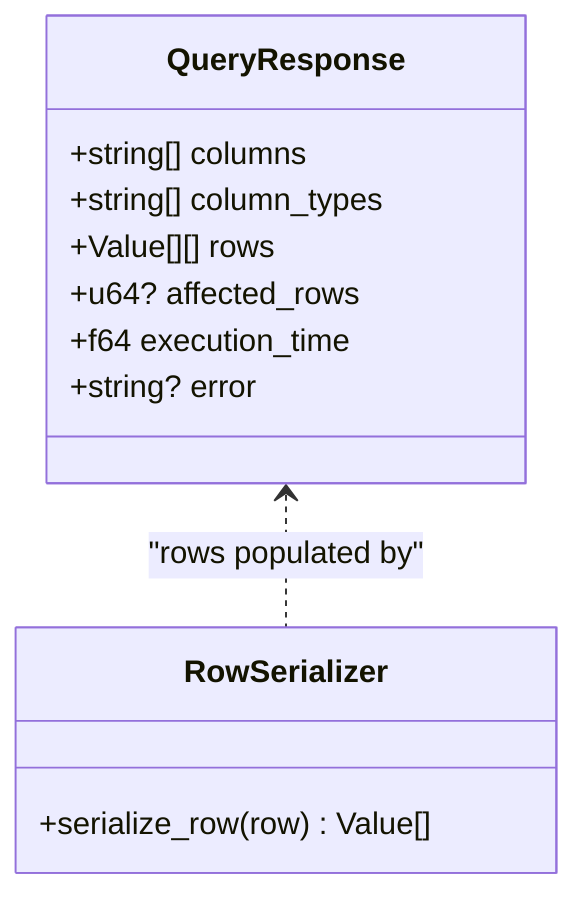
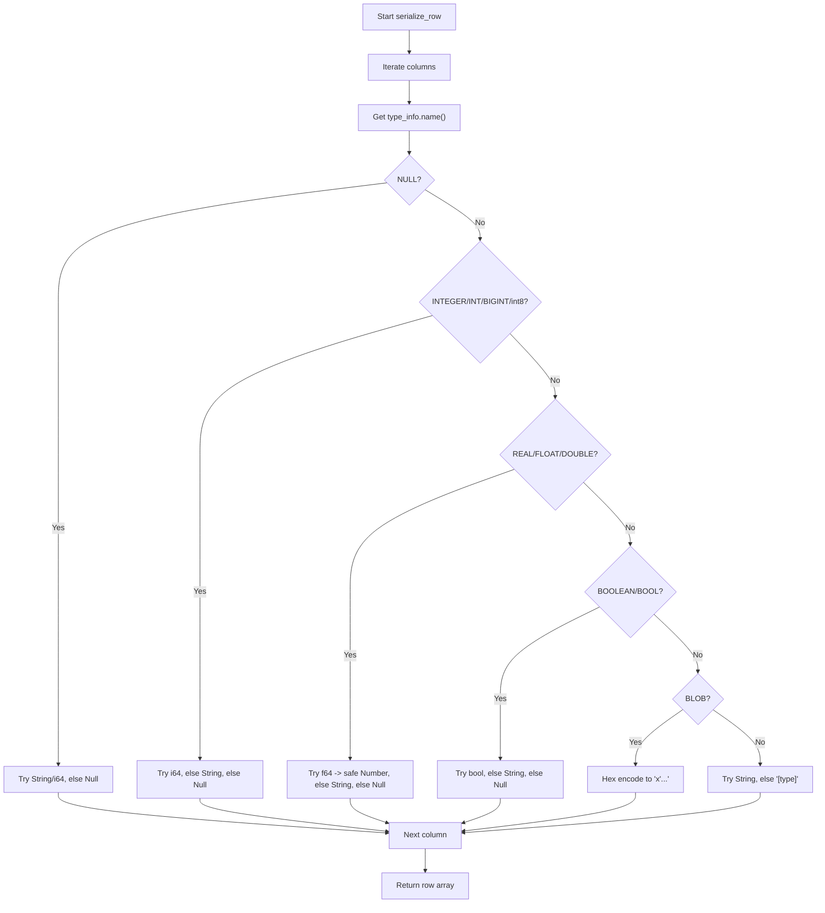
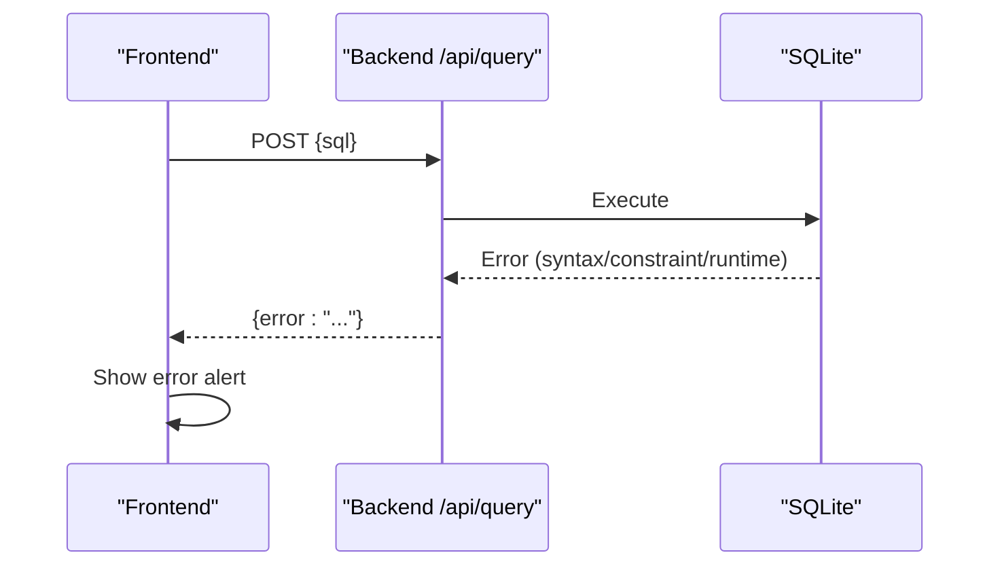
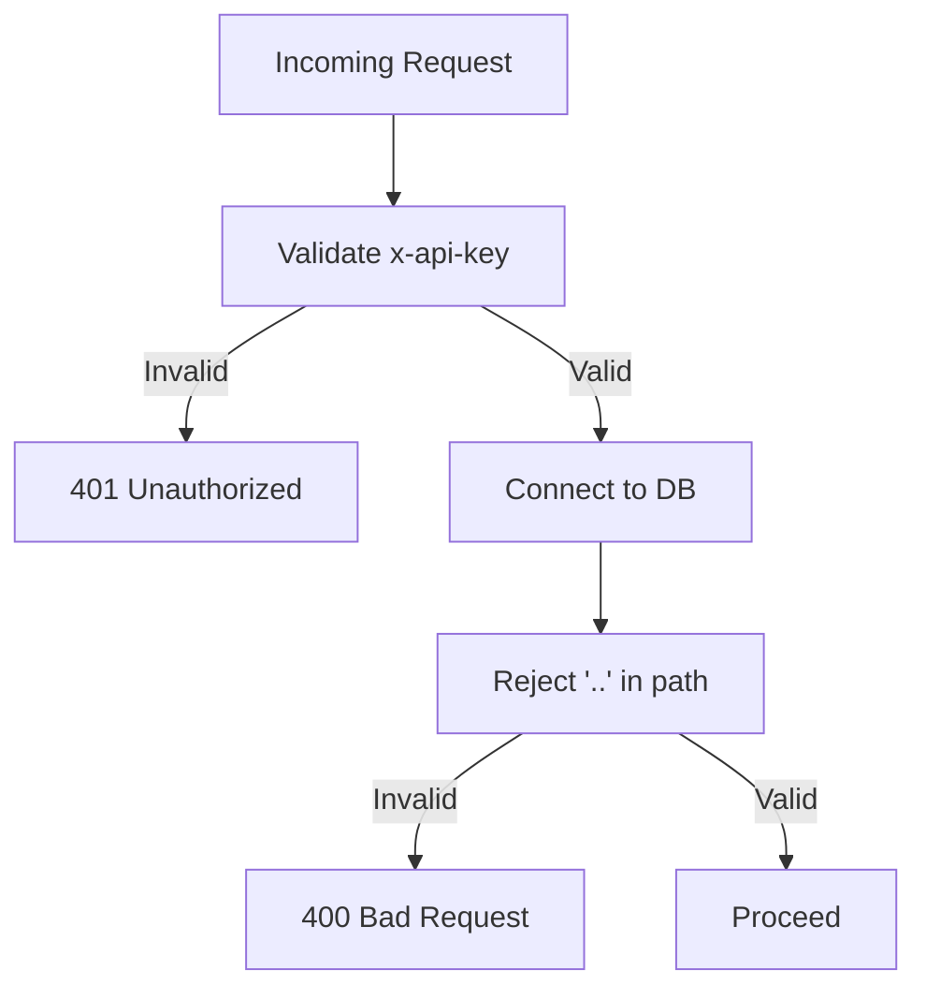
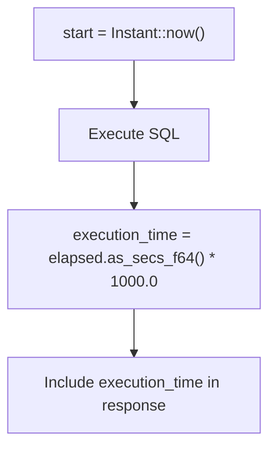
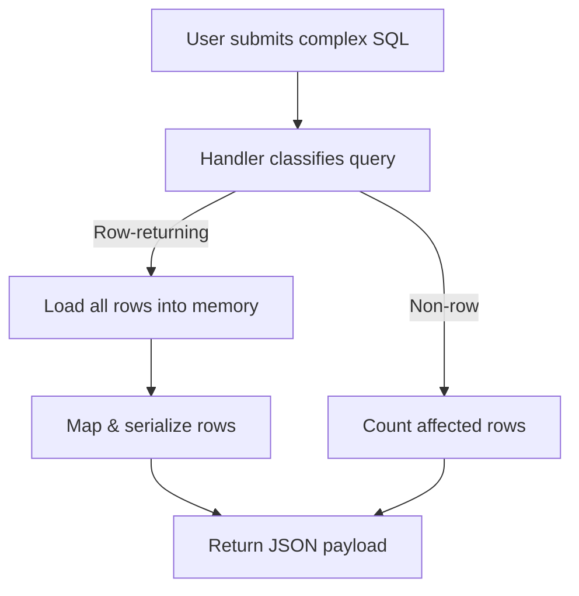
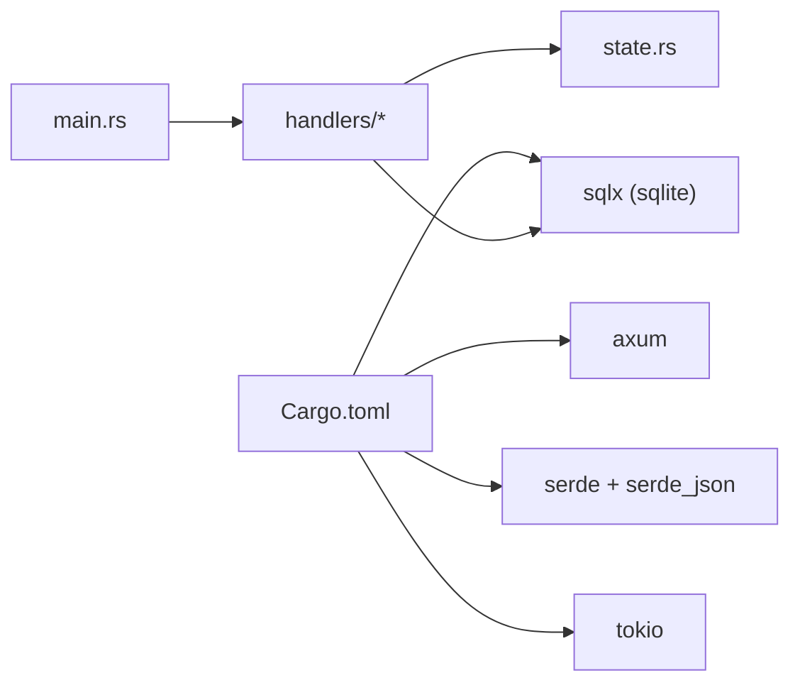

# Query Execution Engine

<cite>
**Referenced Files in This Document**
- [main.rs](file://backend/src/main.rs)
- [query.rs](file://backend/src/handlers/query.rs)
- [connection.rs](file://backend/src/handlers/connection.rs)
- [state.rs](file://backend/src/state.rs)
- [mod.rs](file://backend/src/handlers/mod.rs)
- [ai.rs](file://backend/src/handlers/ai.rs)
- [Cargo.toml](file://backend/Cargo.toml)
- [store.ts](file://frontend/src/lib/store.ts)
- [api.ts](file://frontend/src/lib/api.ts)
- [ResultTable.tsx](file://frontend/src/components/ResultTable.tsx)
- [design.md](file://doc/design.md)
</cite>

## Table of Contents
1. [Introduction](#introduction)
2. [Project Structure](#project-structure)
3. [Core Components](#core-components)
4. [Architecture Overview](#architecture-overview)
5. [Detailed Component Analysis](#detailed-component-analysis)
6. [Dependency Analysis](#dependency-analysis)
7. [Performance Considerations](#performance-considerations)
8. [Troubleshooting Guide](#troubleshooting-guide)
9. [Conclusion](#conclusion)
10. [Appendices](#appendices)

## Introduction
This document explains the SQL query execution engine implemented in the Rust backend. It covers how user SQL is parsed and executed, how result sets are mapped to JSON, how column types are detected, and how data values are serialized. It also documents error handling for syntax errors, constraint violations, and runtime exceptions; performance monitoring via execution time tracking; and security considerations such as API authentication and input validation. Finally, it provides guidance for executing complex queries, handling large result sets, and implementing custom query processors.

## Project Structure
The backend is an Axum-based HTTP service that exposes REST endpoints for database connection, metadata listing, and SQL execution. The frontend (Solid.js) calls these endpoints and renders results.

**Diagram sources**
- [main.rs:52-65](file://backend/src/main.rs#L52-L65)
- [mod.rs:1-10](file://backend/src/handlers/mod.rs#L1-L10)
- [query.rs:101-200](file://backend/src/handlers/query.rs#L101-L200)
- [connection.rs:62-109](file://backend/src/handlers/connection.rs#L62-L109)

**Section sources**
- [main.rs:1-74](file://backend/src/main.rs#L1-L74)
- [design.md:27-60](file://doc/design.md#L27-L60)

## Core Components
- Application entrypoint and routing: defines routes, middleware, and shared state.
- Connection management: connects to a SQLite file, validates paths, configures WAL mode, and verifies journal mode.
- Query execution: parses incoming SQL, determines whether to fetch rows or count affected rows, executes via SQLx, maps columns/types, serializes row values, and returns structured JSON with timing and error fields.
- AI-assisted SQL correction: gathers schema and sample data, calls OpenAI-compatible API, and returns corrected SQL.

Key responsibilities:
- Routing and middleware: [main.rs:52-65](file://backend/src/main.rs#L52-L65), [main.rs:22-33](file://backend/src/main.rs#L22-L33)
- Connection and metadata: [connection.rs:62-109](file://backend/src/handlers/connection.rs#L62-L109), [connection.rs:111-144](file://backend/src/handlers/connection.rs#L111-L144)
- Query execution pipeline: [query.rs:101-200](file://backend/src/handlers/query.rs#L101-L200), [query.rs:28-99](file://backend/src/handlers/query.rs#L28-L99)
- AI correction: [ai.rs:24-148](file://backend/src/handlers/ai.rs#L24-L148)

**Section sources**
- [main.rs:1-74](file://backend/src/main.rs#L1-L74)
- [connection.rs:1-145](file://backend/src/handlers/connection.rs#L1-L145)
- [query.rs:1-201](file://backend/src/handlers/query.rs#L1-L201)
- [ai.rs:1-149](file://backend/src/handlers/ai.rs#L1-L149)

## Architecture Overview
The query execution flow integrates HTTP request handling, authentication, database pooling, SQL execution, and JSON serialization.

**Diagram sources**
- [main.rs:52-65](file://backend/src/main.rs#L52-L65)
- [main.rs:22-33](file://backend/src/main.rs#L22-L33)
- [query.rs:101-200](file://backend/src/handlers/query.rs#L101-L200)
- [state.rs:1-9](file://backend/src/state.rs#L1-L9)

## Detailed Component Analysis

### Query Execution Pipeline
The query handler performs the following steps:
- Validates connection availability.
- Measures execution time.
- Determines if the statement returns rows based on leading keywords and presence of RETURNING.
- Executes either fetch_all (for SELECT-like statements) or execute (for DML/DDL).
- For row-returning queries: extracts column names and types from the first row, then serializes each row into JSON-safe values.
- For non-row queries: returns affected row count.
- Returns structured JSON including timing and optional error messages.

**Diagram sources**
- [query.rs:101-200](file://backend/src/handlers/query.rs#L101-L200)

**Section sources**
- [query.rs:101-200](file://backend/src/handlers/query.rs#L101-L200)

### Result Set Mapping and Column Type Detection
- Columns and types are derived from the first row’s metadata when available.
- Column names are taken from column descriptors.
- Column types are taken from type_info().name(), which reflects SQLite’s dynamic typing labels (e.g., INTEGER, REAL, TEXT, BLOB, NULL).

**Diagram sources**
- [query.rs:17-25](file://backend/src/handlers/query.rs#L17-L25)
- [query.rs:28-99](file://backend/src/handlers/query.rs#L28-L99)

**Section sources**
- [query.rs:17-25](file://backend/src/handlers/query.rs#L17-L25)
- [query.rs:28-99](file://backend/src/handlers/query.rs#L28-L99)

### Data Serialization Logic
The serializer handles various SQLite type hints:
- NULL: attempts String or i64 fallback, otherwise Null.
- Integer-like types: tries i64, falls back to String, else Null.
- Real-like types: tries f64, converts to JSON number safely, else String or Null.
- Boolean-like types: tries bool, else String or Null.
- BLOB: converts bytes to hex string prefixed with x'.
- Fallback: attempts String conversion; if unavailable, uses a placeholder indicating the type name.

**Diagram sources**
- [query.rs:28-99](file://backend/src/handlers/query.rs#L28-L99)

**Section sources**
- [query.rs:28-99](file://backend/src/handlers/query.rs#L28-L99)

### Error Handling
- No connection: returns a structured error field without stack traces.
- Query execution errors: captured and returned in the error field for both row-fetching and non-row-execution paths.
- Frontend mapping: client-side code throws errors when the server response indicates failure, and displays error messages in the UI.

**Diagram sources**
- [query.rs:162-170](file://backend/src/handlers/query.rs#L162-L170)
- [query.rs:188-196](file://backend/src/handlers/query.rs#L188-L196)
- [api.ts:46-58](file://frontend/src/lib/api.ts#L46-L58)
- [ResultTable.tsx:54-59](file://frontend/src/components/ResultTable.tsx#L54-L59)

**Section sources**
- [query.rs:101-200](file://backend/src/handlers/query.rs#L101-L200)
- [api.ts:46-58](file://frontend/src/lib/api.ts#L46-L58)
- [ResultTable.tsx:54-59](file://frontend/src/components/ResultTable.tsx#L54-L59)

### Security Considerations
- API key authentication: all API routes except health require the x-api-key header matching the configured API_KEY environment variable.
- Path validation: database path must not contain directory traversal sequences ("..").
- Database location: files are accessed under a controlled db directory.

**Diagram sources**
- [main.rs:22-33](file://backend/src/main.rs#L22-L33)
- [connection.rs:66-69](file://backend/src/handlers/connection.rs#L66-L69)

**Section sources**
- [main.rs:22-33](file://backend/src/main.rs#L22-L33)
- [connection.rs:66-69](file://backend/src/handlers/connection.rs#L66-L69)

### Performance Monitoring
- Execution time: measured using Instant::now() around query execution and reported in milliseconds.
- Logging: tracing is used to log query execution and other events.
- Frontend display: execution time and affected rows are shown in the UI.

**Diagram sources**
- [query.rs:122-132](file://backend/src/handlers/query.rs#L122-L132)
- [query.rs:174-175](file://backend/src/handlers/query.rs#L174-L175)
- [ResultTable.tsx:44-50](file://frontend/src/components/ResultTable.tsx#L44-L50)

**Section sources**
- [query.rs:122-132](file://backend/src/handlers/query.rs#L122-L132)
- [query.rs:174-175](file://backend/src/handlers/query.rs#L174-L175)
- [ResultTable.tsx:44-50](file://frontend/src/components/ResultTable.tsx#L44-L50)

### Complex Queries and Large Result Sets
- Complex queries: any valid SQLite statement can be executed through the same endpoint. The handler classifies statements by prefix and presence of RETURNING to decide between fetching rows or counting affected rows.
- Large result sets: fetch_all loads all rows into memory. For very large datasets, consider:
  - Using LIMIT/OFFSET or pagination at the application layer.
  - Streaming responses (requires extending the current handler to stream rows).
  - Caching frequently accessed subsets.

**Diagram sources**
- [query.rs:122-175](file://backend/src/handlers/query.rs#L122-L175)

**Section sources**
- [query.rs:122-175](file://backend/src/handlers/query.rs#L122-L175)

### Custom Query Processors
To implement custom processing:
- Extend the handler to pre-process SQL (e.g., rewrite queries, add hints).
- Add post-processing hooks to transform results before serialization.
- Introduce a pluggable processor trait/interface to encapsulate custom logic.
- Ensure consistent error propagation and timing measurement.

[No sources needed since this section provides general guidance]

## Dependency Analysis
The backend depends on Axum for routing, SQLx for database access, Serde for serialization, and Tokio for async runtime. The frontend uses Solid.js and communicates via REST.

**Diagram sources**
- [Cargo.toml:6-18](file://backend/Cargo.toml#L6-L18)
- [main.rs:1-20](file://backend/src/main.rs#L1-L20)
- [mod.rs:1-10](file://backend/src/handlers/mod.rs#L1-L10)

**Section sources**
- [Cargo.toml:1-24](file://backend/Cargo.toml#L1-L24)
- [main.rs:1-20](file://backend/src/main.rs#L1-L20)
- [mod.rs:1-10](file://backend/src/handlers/mod.rs#L1-L10)

## Performance Considerations
- Use connection pools (already provided by SQLx) to handle concurrent requests efficiently.
- Avoid loading entire tables into memory; prefer pagination and selective columns.
- Monitor execution_time and log slow queries for optimization opportunities.
- Keep queries simple and indexed where possible; leverage EXPLAIN plans externally if needed.
- Tune SQLite settings (WAL mode is enabled) for better concurrency.

[No sources needed since this section provides general guidance]

## Troubleshooting Guide
Common issues and resolutions:
- “Database not connected”: ensure a successful connection via /api/connect and verify the path exists or create flag is set.
- Syntax errors: review SQL syntax; use the AI correction endpoint (/api/correct) to assist.
- Constraint violations: check NOT NULL, UNIQUE, PRIMARY KEY, and FOREIGN KEY constraints; adjust inputs accordingly.
- Authentication failures: confirm x-api-key matches the configured API_KEY.
- Path errors: avoid directory traversal patterns and ensure the target path is under the allowed db directory.

**Section sources**
- [query.rs:107-120](file://backend/src/handlers/query.rs#L107-L120)
- [query.rs:162-170](file://backend/src/handlers/query.rs#L162-L170)
- [query.rs:188-196](file://backend/src/handlers/query.rs#L188-L196)
- [main.rs:22-33](file://backend/src/main.rs#L22-L33)
- [connection.rs:66-83](file://backend/src/handlers/connection.rs#L66-L83)

## Conclusion
The query execution engine provides a straightforward, secure, and observable pathway for executing SQLite statements from a web interface. It supports standard SQL operations, robust error reporting, and basic performance metrics. Future enhancements could include streaming for large result sets, richer query optimization suggestions, and more granular permission controls.

[No sources needed since this section summarizes without analyzing specific files]

## Appendices

### API Reference Summary
- POST /api/query
  - Request: { sql: string }
  - Response: { columns: string[], column_types: string[], rows: any[] | null, affected_rows: number | null, execution_time: number, error: string | null }
- POST /api/connect
  - Request: { path: string, create?: boolean }
  - Response: status and message
- GET /api/db-files
  - Response: string[] of relative paths
- GET /api/tables
  - Response: string[] of table names
- POST /api/correct
  - Request: { sql: string, table: string }
  - Response: { sql?: string, error?: string }

**Section sources**
- [design.md:78-100](file://doc/design.md#L78-L100)
- [query.rs:12-25](file://backend/src/handlers/query.rs#L12-L25)
- [connection.rs:13-18](file://backend/src/handlers/connection.rs#L13-L18)
- [ai.rs:12-22](file://backend/src/handlers/ai.rs#L12-L22)