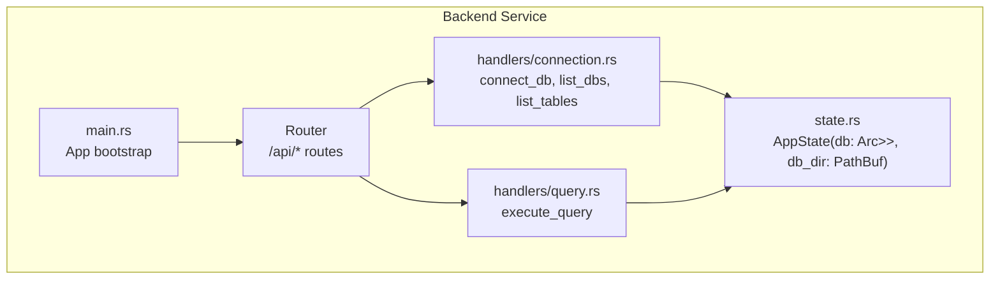
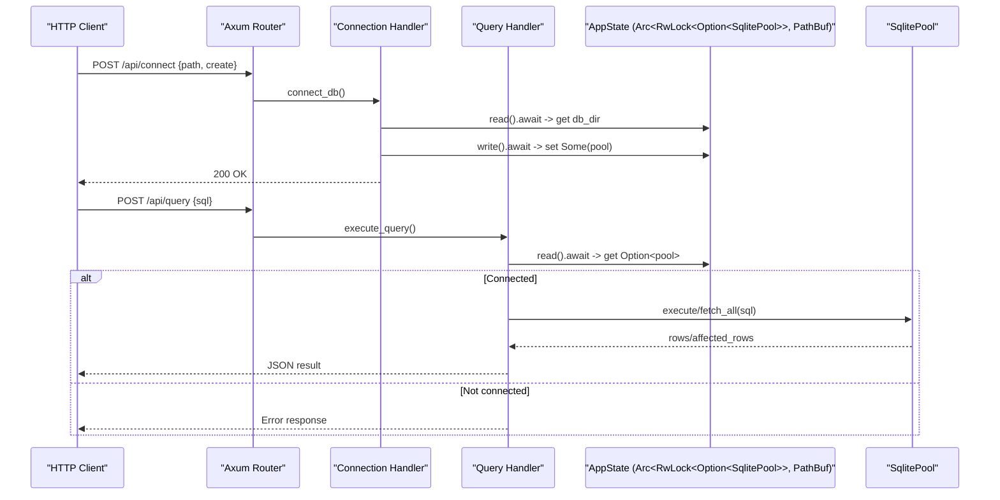
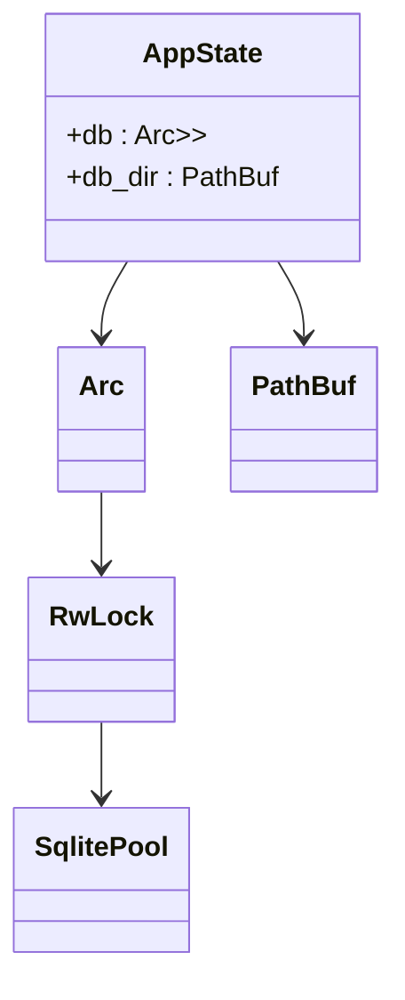
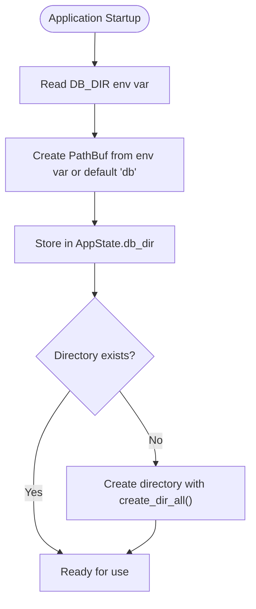
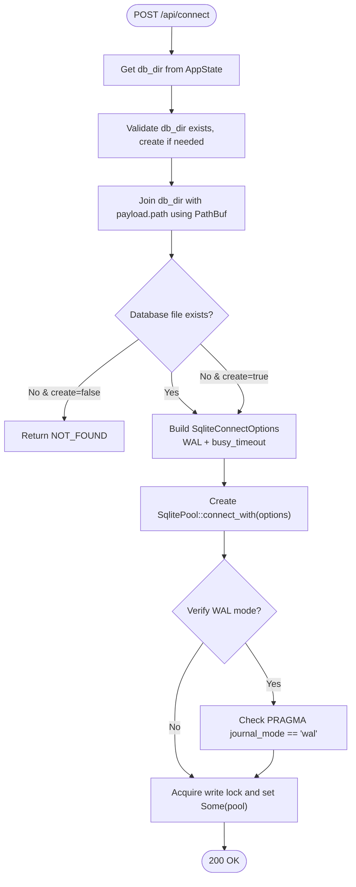
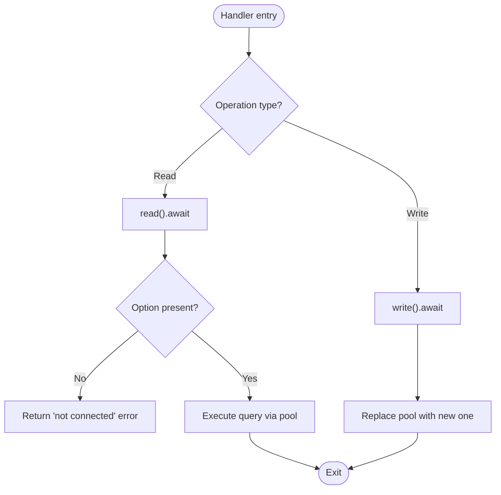
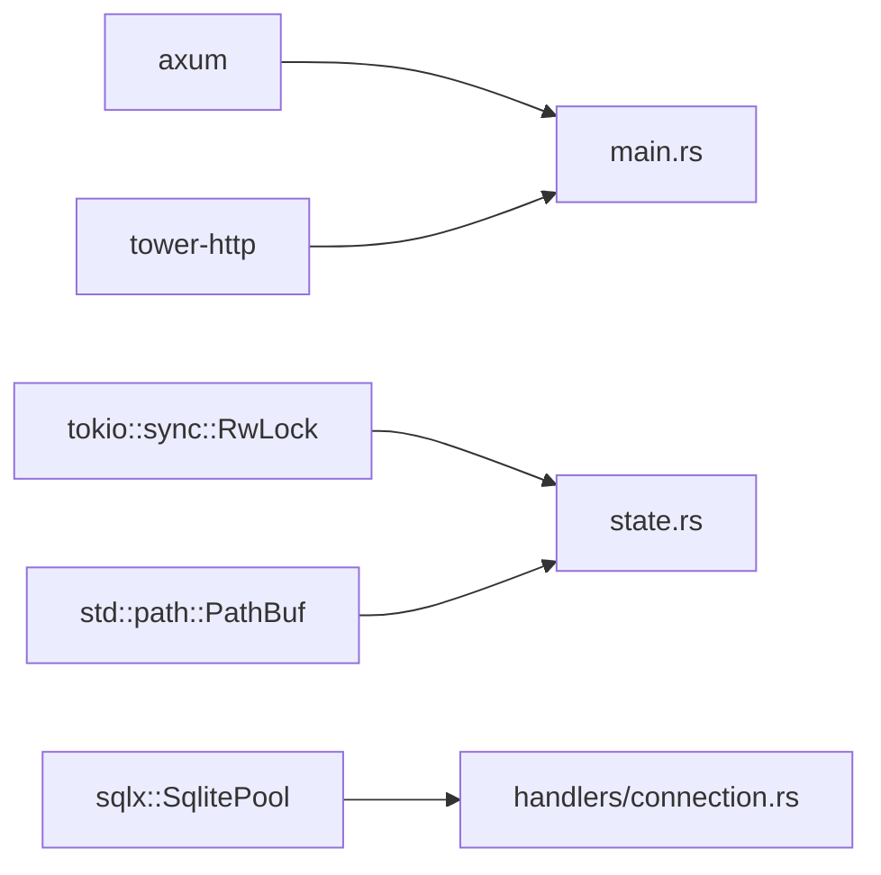

# State Management & Database Connection Pooling

<cite>
**Referenced Files in This Document**
- [state.rs](file://backend/src/state.rs)
- [main.rs](file://backend/src/main.rs)
- [connection.rs](file://backend/src/handlers/connection.rs)
- [query.rs](file://backend/src/handlers/query.rs)
- [Cargo.toml](file://backend/Cargo.toml)
</cite>

## Update Summary
**Changes Made**
- Updated AppState structure documentation to include the new `db_dir: PathBuf` field
- Enhanced database directory management section with PathBuf usage patterns
- Added examples of type-safe path operations using PathBuf
- Updated connection lifecycle documentation to reflect db_dir usage
- Enhanced memory management considerations for PathBuf handling

## Table of Contents
1. [Introduction](#introduction)
2. [Project Structure](#project-structure)
3. [Core Components](#core-components)
4. [Architecture Overview](#architecture-overview)
5. [Detailed Component Analysis](#detailed-component-analysis)
6. [Dependency Analysis](#dependency-analysis)
7. [Performance Considerations](#performance-considerations)
8. [Troubleshooting Guide](#troubleshooting-guide)
9. [Conclusion](#conclusion)
10. [Appendices](#appendices)

## Introduction
This document explains the application state management system and database connection pooling strategy used by the backend service. It focuses on the AppState struct design, which uses Arc<RwLock<Option<SqlitePool>>> to provide thread-safe global access to a SQLite connection pool, along with a type-safe PathBuf-based database directory configuration. You will learn how the pool is initialized, how concurrent read/write access is synchronized, and how handlers safely interact with shared state. The guide also covers memory management, connection pooling best practices, performance implications, and strategies for extending the state structure with additional shared resources.

## Project Structure
The backend is an Axum-based HTTP service that:
- Initializes tracing/logging
- Builds routes under /api
- Shares a single AppState instance across all handlers
- Uses a SqlitePool from sqlx for efficient database connections
- Manages database directories using PathBuf for type-safe path operations



**Diagram sources**
- [main.rs:35-73](file://backend/src/main.rs#L35-L73)
- [connection.rs:62-129](file://backend/src/handlers/connection.rs#L62-L129)
- [query.rs:101-200](file://backend/src/handlers/query.rs#L101-L200)
- [state.rs:5-10](file://backend/src/state.rs#L5-L10)

**Section sources**
- [main.rs:35-73](file://backend/src/main.rs#L35-L73)

## Core Components
- **AppState**: Holds the globally shared database pool behind a read-write lock, plus a PathBuf for the database directory
- **Connection handler**: Creates or connects to a SQLite file, configures WAL mode and busy timeout, and stores the pool into AppState
- **Query handler**: Reads the pool from AppState and executes SQL queries concurrently using the pooled connections

Key responsibilities:
- Thread-safe initialization and replacement of the active database pool
- Safe concurrent reads of the pool for query execution
- Type-safe database directory management using PathBuf
- Clear error handling when no database is connected

**Section sources**
- [state.rs:5-10](file://backend/src/state.rs#L5-L10)
- [connection.rs:62-129](file://backend/src/handlers/connection.rs#L62-L129)
- [query.rs:101-200](file://backend/src/handlers/query.rs#L101-L200)

## Architecture Overview
The application follows a layered architecture:
- Entry point initializes AppState with both the database pool and directory configuration
- Handlers extract AppState via Axum's State extractor
- Handlers use tokio::sync::RwLock to synchronize access to the optional SqlitePool
- sqlx::SqlitePool manages multiple lightweight connections to the same SQLite file
- PathBuf provides type-safe path operations for database directory management



**Diagram sources**
- [main.rs:47-65](file://backend/src/main.rs#L47-L65)
- [connection.rs:62-108](file://backend/src/handlers/connection.rs#L62-L108)
- [query.rs:101-200](file://backend/src/handlers/query.rs#L101-L200)

## Detailed Component Analysis

### AppState Design and Concurrency Model
- **AppState contains**:
  - `db: Arc<RwLock<Option<SqlitePool>>>` - thread-safe database pool access
  - `db_dir: PathBuf` - type-safe database directory path
  - Arc enables cheap cloning and sharing across tasks and handlers
  - RwLock allows multiple concurrent readers and exclusive writers
  - Option<SqlitePool> represents "no connection yet" vs "connected"
  - PathBuf provides type-safe path operations and memory management
- Clone derives allow passing AppState into handlers without extra indirection

Concurrency guarantees:
- Writers (e.g., connecting/replacing the pool) acquire a write lock
- Readers (e.g., executing queries) acquire a read lock
- Only one writer at a time; many readers can proceed concurrently
- PathBuf operations are safe and don't require locking since they're immutable after construction

Memory model:
- Arc ensures the pool lives until all references are dropped
- PathBuf handles memory efficiently with reference counting
- Replacing the pool drops the old pool when no longer referenced

Best practices:
- Keep write sections minimal to reduce contention
- Prefer read locks for query paths
- Avoid holding locks across long-running operations outside the pool
- Use PathBuf for all path operations to ensure type safety



**Diagram sources**
- [state.rs:5-10](file://backend/src/state.rs#L5-L10)

**Section sources**
- [state.rs:5-10](file://backend/src/state.rs#L5-L10)

### Database Directory Management with PathBuf
The enhanced AppState includes a `db_dir: PathBuf` field that provides:
- Type-safe path operations throughout the application
- Automatic memory management for path strings
- Cross-platform path handling capabilities
- Integration with standard library path utilities

Directory initialization flow:
- On startup, AppState.db_dir is initialized from environment variable or default
- PathBuf is created using std::env::var_os() for OS-native path handling
- The directory is validated and created if needed during connection operations



**Diagram sources**
- [main.rs:48-55](file://backend/src/main.rs#L48-L55)
- [connection.rs:20-28](file://backend/src/handlers/connection.rs#L20-L28)

**Section sources**
- [main.rs:48-55](file://backend/src/main.rs#L48-L55)
- [connection.rs:20-28](file://backend/src/handlers/connection.rs#L20-L28)

### Database Connection Lifecycle
Initialization and connection flow:
- On startup, AppState.db is initialized to None inside a RwLock, and AppState.db_dir is set to the configured PathBuf
- When a client calls /api/connect:
  - Validate path and ensure db directory exists using PathBuf operations
  - Build full path using db_dir.join(&payload.path) for type-safe path composition
  - Build SqliteConnectOptions with WAL mode and busy_timeout
  - Create SqlitePool::connect_with(options)
  - Optionally verify WAL mode
  - Acquire write lock and store Some(pool) into AppState.db



**Diagram sources**
- [connection.rs:62-108](file://backend/src/handlers/connection.rs#L62-L108)
- [connection.rs:131-144](file://backend/src/handlers/connection.rs#L131-L144)

**Section sources**
- [connection.rs:62-108](file://backend/src/handlers/connection.rs#L62-L108)
- [connection.rs:131-144](file://backend/src/handlers/connection.rs#L131-L144)

### Concurrent Access Safety Mechanisms
Readers (query execution):
- Acquire read lock to obtain Option<&SqlitePool>
- If None, return an error indicating no database is connected
- If Some, execute queries against the pool
- Access db_dir directly without locking since it's immutable

Writers (connecting/replacing):
- Acquire write lock to replace the pool
- Ensure only one connection operation happens at a time
- PathBuf operations are safe and don't require synchronization



**Diagram sources**
- [query.rs:101-200](file://backend/src/handlers/query.rs#L101-L200)
- [connection.rs:92-108](file://backend/src/handlers/connection.rs#L92-L108)

**Section sources**
- [query.rs:101-200](file://backend/src/handlers/query.rs#L101-L200)
- [connection.rs:92-108](file://backend/src/handlers/connection.rs#L92-L108)

### Example Patterns for Safe Shared-State Access
- Reading the pool in a handler:
  - Use State<AppState> extractor
  - Acquire read lock
  - Match on Option<SqlitePool>
  - Execute queries and map results to JSON
  - Access db_dir directly for path operations
- Writing the pool in a handler:
  - Use State<AppState> extractor
  - Acquire write lock
  - Set the pool to Some(new_pool) after successful connection
  - Use db_dir.join() for type-safe path composition

These patterns appear in:
- Connection handler: creating and storing the pool, using db_dir for path operations
- Query handler: reading the pool to execute queries

**Section sources**
- [connection.rs:62-108](file://backend/src/handlers/connection.rs#L62-L108)
- [query.rs:101-200](file://backend/src/handlers/query.rs#L101-L200)

### Memory Management Considerations
- **Arc reference counting**:
  - Cloning AppState increments the reference count
  - Dropping all clones decrements the count and frees the pool when zero
- **PathBuf memory management**:
  - PathBuf automatically manages memory for path strings
  - No manual string allocation/deallocation needed
  - Efficient copying through PathBuf's internal representation
- **RwLock overhead**:
  - Minimal for short critical sections
  - Avoid long-held locks to prevent contention
- **Pool lifecycle**:
  - When replacing the pool, the old pool is dropped automatically when no longer referenced
  - Ensure no lingering references exist before replacing

Recommendations:
- Keep write sections short
- Avoid blocking I/O while holding locks
- Use drop explicitly if you need to release early within a scope
- Leverage PathBuf's automatic memory management for path operations

**Section sources**
- [state.rs:5-10](file://backend/src/state.rs#L5-L10)
- [connection.rs:92-108](file://backend/src/handlers/connection.rs#L92-L108)

### Connection Pooling Best Practices
- Enable WAL mode for better concurrency with SQLite
- Configure busy_timeout to handle temporary locks gracefully
- Use a single pool per process for a given database file
- Avoid opening multiple pools to the same file simultaneously
- Use PathBuf for all path operations to ensure type safety

Observed configuration:
- WAL mode enabled
- busy_timeout set to a reasonable duration
- Optional verification of journal_mode post-connect
- Type-safe path operations using PathBuf

**Section sources**
- [connection.rs:85-108](file://backend/src/handlers/connection.rs#L85-L108)
- [connection.rs:131-144](file://backend/src/handlers/connection.rs#L131-L144)

### Performance Implications
- Read-heavy workloads benefit from RwLock allowing concurrent readers
- Write operations (pool creation/replacement) are serialized
- Using a pooled connection avoids repeated open/close overhead
- WAL mode improves concurrent read/write throughput compared to default mode
- PathBuf operations are efficient and don't add significant overhead

Trade-offs:
- RwLock introduces small synchronization overhead
- Excessive writes (frequent reconnections) increase contention
- Long-running queries hold read locks briefly but do not block other readers
- PathBuf provides better performance than String for path operations

[No sources needed since this section provides general guidance]

### Extending AppState for Additional Shared Resources
To add more shared state:
- Add fields to AppState
- Wrap each mutable resource in Arc<RwLock<T>> if it needs concurrent access
- Initialize fields in main during AppState construction
- Extract State<AppState> in handlers and use read()/write() as appropriate

Example extension pattern:
- Add cache: Arc<RwLock<HashMap<String, Vec<u8>>>>
- Add config: Arc<RwLock<AppConfig>>
- Initialize in main and access in handlers via read/write locks

Guidelines:
- Prefer immutable data behind Arc where possible
- Minimize write lock scope
- Document ownership and lifetime expectations
- Use PathBuf for any path-related fields to maintain type safety

[No sources needed since this section provides general guidance]

## Dependency Analysis
External dependencies relevant to state and pooling:
- axum: routing, middleware, State extractor
- tokio: async runtime and RwLock
- sqlx: database driver and connection pooling for SQLite
- tower-http: tracing layer and static file serving



**Diagram sources**
- [Cargo.toml:6-18](file://backend/Cargo.toml#L6-L18)
- [main.rs:1-17](file://backend/src/main.rs#L1-L17)
- [state.rs:1-10](file://backend/src/state.rs#L1-L10)
- [connection.rs:1-10](file://backend/src/handlers/connection.rs#L1-L10)

**Section sources**
- [Cargo.toml:6-18](file://backend/Cargo.toml#L6-L18)
- [main.rs:1-17](file://backend/src/main.rs#L1-L17)

## Performance Considerations
- Use read locks for query execution to maximize concurrency
- Batch operations where possible to reduce lock acquisitions
- Monitor slow queries and consider indexing or query optimization
- Tune busy_timeout based on expected contention levels
- Avoid frequent reconnections; reuse the pool across requests
- Leverage PathBuf's efficient memory management for path operations

[No sources needed since this section provides general guidance]

## Troubleshooting Guide
Common issues and resolutions:
- "Database not connected":
  - Ensure /api/connect has been called successfully
  - Verify the database file path and permissions
- WAL mode mismatch:
  - Confirm WAL mode is enabled and verified post-connect
- Busy errors:
  - Increase busy_timeout or reduce concurrent writers
- High CPU or latency:
  - Profile long-running queries
  - Reduce unnecessary reconnections
- Path-related issues:
  - Verify db_dir is correctly configured
  - Check file permissions for the database directory
  - Ensure PathBuf operations are using correct path separators

Operational checks:
- Inspect logs for connection errors and WAL verification warnings
- Validate that the db directory exists and is writable
- Confirm that only one process holds the active pool for a given file
- Verify PathBuf path operations are working correctly

**Section sources**
- [connection.rs:62-108](file://backend/src/handlers/connection.rs#L62-L108)
- [connection.rs:131-144](file://backend/src/handlers/connection.rs#L131-L144)
- [query.rs:101-200](file://backend/src/handlers/query.rs#L101-L200)

## Conclusion
The AppState design leverages Arc<RwLock<Option<SqlitePool>>> combined with PathBuf-based directory management to provide safe, concurrent access to a SQLite connection pool across multiple handlers. The enhanced state structure includes type-safe path operations through PathBuf, improving both safety and memory management. The connection lifecycle is clearly separated: initialization occurs on demand via a dedicated endpoint, and subsequent handlers read from the pool using read locks. This approach balances simplicity with safety and performance. By following the recommended practices—short write scopes, WAL mode, busy_timeout, careful pool management, and PathBuf-based path operations—you can extend the state structure and scale the application effectively.

[No sources needed since this section summarizes without analyzing specific files]

## Appendices

### API Endpoints Related to State and Pooling
- POST /api/connect
  - Purpose: Connect to a SQLite file and store the pool in AppState
  - Behavior: Validates path using db_dir, creates db directory if needed, builds options (WAL + busy_timeout), creates pool, verifies WAL mode, and sets AppState.db
- GET /api/db-files
  - Purpose: List available .db files under the db directory
  - Behavior: Uses db_dir to scan for database files recursively
- GET /api/tables
  - Purpose: List tables from the currently connected database
- POST /api/query
  - Purpose: Execute SQL against the current pool and return results

**Section sources**
- [main.rs:52-65](file://backend/src/main.rs#L52-L65)
- [connection.rs:20-108](file://backend/src/handlers/connection.rs#L20-L108)
- [connection.rs:111-129](file://backend/src/handlers/connection.rs#L111-L129)
- [query.rs:101-200](file://backend/src/handlers/query.rs#L101-L200)

### PathBuf Usage Examples
The enhanced AppState demonstrates proper PathBuf usage patterns:

- **Environment variable integration**:
  ```rust
  let db_dir = std::env::var_os("DB_DIR")
      .map(PathBuf::from)
      .unwrap_or_else(|| PathBuf::from("db"));
  ```

- **Type-safe path composition**:
  ```rust
  let full_path = db_dir.join(&payload.path);
  ```

- **Directory validation and creation**:
  ```rust
  if !db_dir.exists() {
      std::fs::create_dir_all(db_dir)?;
  }
  ```

These patterns ensure type safety and proper memory management throughout the application.

**Section sources**
- [main.rs:48-55](file://backend/src/main.rs#L48-L55)
- [connection.rs:71-83](file://backend/src/handlers/connection.rs#L71-L83)