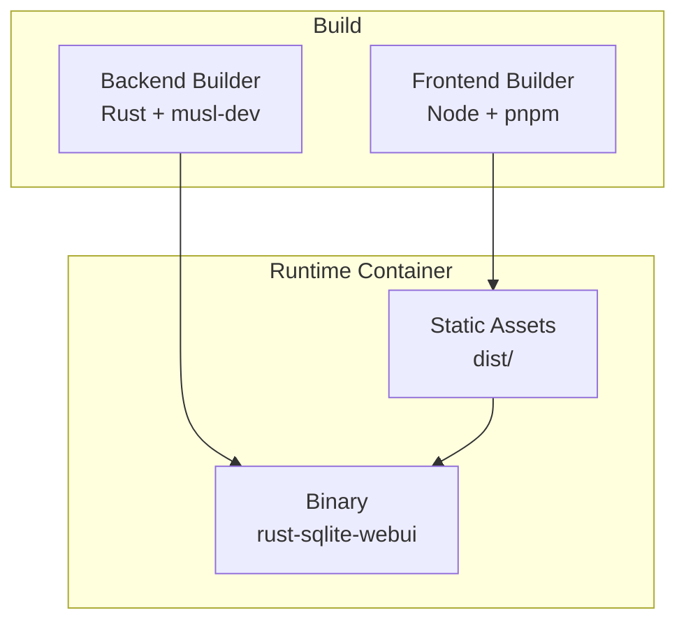
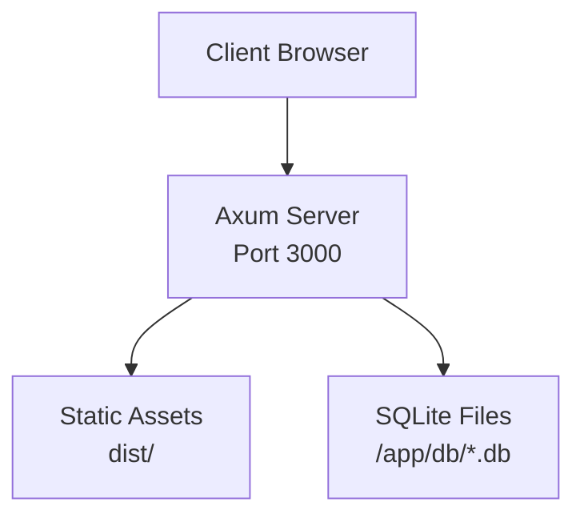
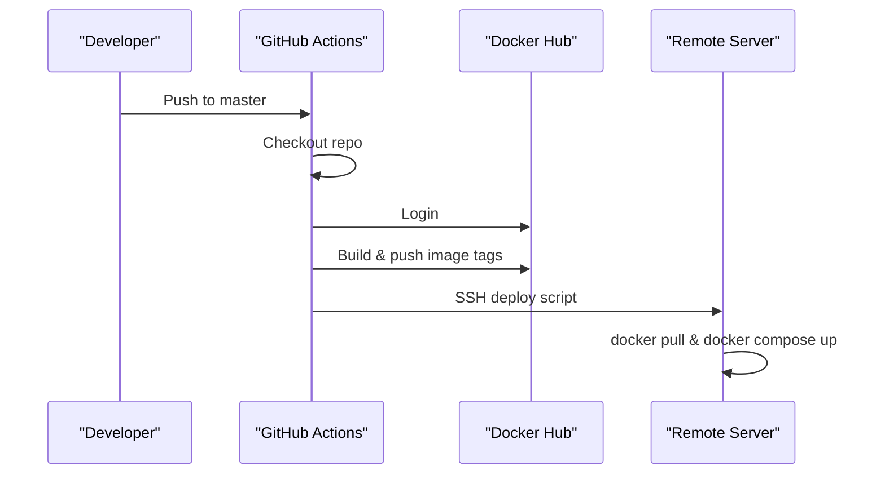
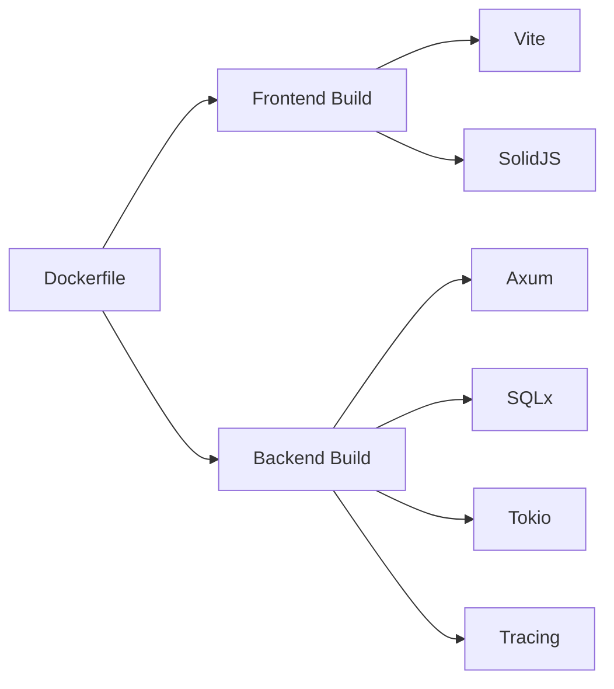

# Deployment & Operations

<cite>
**Referenced Files in This Document**
- [Dockerfile](file://Dockerfile)
- [backend/Cargo.toml](file://backend/Cargo.toml)
- [backend/src/main.rs](file://backend/src/main.rs)
- [frontend/package.json](file://frontend/package.json)
- [frontend/vite.config.ts](file://frontend/vite.config.ts)
- [.github/workflows/docker-publish.yml](file://.github/workflows/docker-publish.yml)
- [README.md](file://README.md)
</cite>

## Table of Contents
1. [Introduction](#introduction)
2. [Project Structure](#project-structure)
3. [Core Components](#core-components)
4. [Architecture Overview](#architecture-overview)
5. [Detailed Component Analysis](#detailed-component-analysis)
6. [Dependency Analysis](#dependency-analysis)
7. [Performance Considerations](#performance-considerations)
8. [Troubleshooting Guide](#troubleshooting-guide)
9. [Conclusion](#conclusion)
10. [Appendices](#appendices)

## Introduction
This document provides comprehensive deployment and operations guidance for CrabLite (rust-sqlite-webui). It covers the multi-stage Docker build, container configuration, volume mounting for SQLite databases, production deployment options (Docker Compose, Kubernetes, bare metal), environment variables, monitoring/logging with RUST_LOG, performance tuning, release process, troubleshooting, security best practices, maintenance procedures, scaling considerations, and backup strategies.

## Project Structure
CrabLite is a two-part application:
- Backend: Rust service using Axum, SQLx, Tokio, and Tracing. Serves API endpoints and static frontend assets.
- Frontend: Solid.js app built with Vite and TailwindCSS/DaisyUI.

**Diagram sources**
- [Dockerfile:1-55](file://Dockerfile#L1-L55)

**Section sources**
- [Dockerfile:1-55](file://Dockerfile#L1-L55)
- [backend/Cargo.toml:1-24](file://backend/Cargo.toml#L1-L24)
- [frontend/package.json:1-23](file://frontend/package.json#L1-L23)

## Core Components
- Multi-stage Dockerfile builds frontend assets and backend binary separately, then assembles a minimal runtime image.
- Backend binds to port 3000, serves API under /api, and serves static files from dist/.
- Authentication is enforced via an x-api-key header matching the API_KEY environment variable.
- Logging uses tracing with EnvFilter controlled by RUST_LOG.

Key responsibilities:
- Dockerfile: orchestrates builds and defines runtime image.
- main.rs: initializes logging, routes, middleware, and server.
- Cargo.toml: declares dependencies and release profile optimizations.
- frontend package.json and vite.config.ts: define frontend build tooling and dev proxy.

**Section sources**
- [Dockerfile:1-55](file://Dockerfile#L1-L55)
- [backend/src/main.rs:22-73](file://backend/src/main.rs#L22-L73)
- [backend/Cargo.toml:1-24](file://backend/Cargo.toml#L1-L24)
- [frontend/package.json:1-23](file://frontend/package.json#L1-L23)
- [frontend/vite.config.ts:1-19](file://frontend/vite.config.ts#L1-L19)

## Architecture Overview
The runtime architecture consists of a single-process HTTP server that:
- Serves REST API endpoints under /api.
- Serves prebuilt frontend assets from dist/.
- Persists data as SQLite database files under /app/db.

**Diagram sources**
- [backend/src/main.rs:51-65](file://backend/src/main.rs#L51-L65)
- [Dockerfile:43-47](file://Dockerfile#L43-L47)

## Detailed Component Analysis

### Multi-Stage Docker Build Process
Stages:
1. Frontend builder: installs pnpm, installs dependencies, copies source, runs build to produce dist/.
2. Backend builder: installs musl-dev, creates dummy project to cache dependencies, compiles release binary.
3. Runtime: minimal Alpine image, installs ca-certificates and tzdata, copies binary and dist/, sets default ENV, exposes port 3000, runs binary.

**Diagram sources**
- [Dockerfile:1-55](file://Dockerfile#L1-L55)

**Section sources**
- [Dockerfile:1-55](file://Dockerfile#L1-L55)

### Container Configuration and Volume Mounting
- Default environment variables:
  - RUST_LOG=info
  - PORT=3000
- Exposed port: 3000
- Working directory: /app
- Binary: ./rust-sqlite-webui
- Database files: scanned recursively under /app/db; mount host directories or files to this path.

Recommended volume mounts:
- Single file: -v sqlite.db:/app/db/sqlite.db
- Directory: -v ./data:/app/db

Security note: The API requires x-api-key header matching API_KEY. Ensure API_KEY is set in production.

**Section sources**
- [Dockerfile:49-55](file://Dockerfile#L49-L55)
- [README.md:70-83](file://README.md#L70-L83)

### Production Deployment Options

#### Docker Run
- Map port 3000 and mount database volumes.
- Set API_KEY and other environment variables as needed.

Example pattern:
- docker run -d -p 3000:3000 -v sqlite.db:/app/db/sqlite.db -e API_KEY=... wangyucode/rust-sqlite-webui

**Section sources**
- [README.md:31-40](file://README.md#L31-L40)

#### Docker Compose
- Define a service exposing port 3000, mounting volumes, and setting environment variables.

Example pattern:
- services.sqlite-webui.image: wangyucode/rust-sqlite-webui
- ports: "3000:3000"
- volumes: sqlite.db:/app/db/sqlite.db
- environment: API_KEY=...

**Section sources**
- [README.md:42-55](file://README.md#L42-L55)

#### Kubernetes
Use a Deployment with a PersistentVolumeClaim mounted at /app/db, ConfigMap/Secret for environment variables, Service to expose port 3000, and optionally Ingress.

- Pod spec:
  - container image: wangyucode/rust-sqlite-webui
  - ports: containerPort 3000
  - envFrom: Secret/ConfigMap containing API_KEY, RUST_LOG, OPENAI_*
  - volumeMounts: mount PVC at /app/db
- Service: type ClusterIP or NodePort exposing 3000
- Ingress: route external traffic to Service

[No sources needed since this section provides conceptual guidance]

#### Bare Metal Installation
- Download prebuilt archive from GitHub Releases.
- Extract archive; keep dist/ alongside the binary.
- Set API_KEY and run the binary.

Example pattern:
- tar -xzf rust-sqlite-webui-v<VERSION>-<TARGET>.tar.gz
- cd rust-sqlite-webui-v<VERSION>-<TARGET>
- API_KEY=... ./rust-sqlite-webui

**Section sources**
- [README.md:57-68](file://README.md#L57-L68)

### Environment Variables and Configuration
- API_KEY: Required for authentication via x-api-key header.
- RUST_LOG: Controls tracing log levels.
- OPENAI_API_KEY, OPENAI_BASE_URL, OPENAI_MODEL: Optional AI assistant settings.

Defaults and behavior:
- If API_KEY is not provided, a default value is used.
- RUST_LOG defaults to debug for both application and tower_http if not set.

**Section sources**
- [backend/src/main.rs:22-33](file://backend/src/main.rs#L22-L33)
- [backend/src/main.rs:39-45](file://backend/src/main.rs#L39-L45)
- [README.md:70-83](file://README.md#L70-L83)

### Monitoring and Logging
- Logging framework: tracing with EnvFilter.
- Configure verbosity via RUST_LOG.
- HTTP request tracing enabled via TraceLayer.

Recommendations:
- Use structured logs and forward to centralized logging (e.g., Loki, CloudWatch).
- For health checks, use GET /api/health.

**Section sources**
- [backend/src/main.rs:39-45](file://backend/src/main.rs#L39-L45)
- [backend/src/main.rs:60-65](file://backend/src/main.rs#L60-L65)

### Performance Tuning Parameters
- Release profile optimizations:
  - strip = true
  - lto = true
  - codegen-units = 1
- These reduce binary size and improve runtime performance.

Frontend build target:
- esnext target for modern browsers.

**Section sources**
- [backend/Cargo.toml:20-24](file://backend/Cargo.toml#L20-L24)
- [frontend/vite.config.ts:15-17](file://frontend/vite.config.ts#L15-L17)

### Release Process
Manual steps:
1. Update version in backend/Cargo.toml.
2. Build frontend: pnpm install --frozen-lockfile && pnpm build.
3. Build backend: cargo build --release.
4. Package binary with dist/ into a tarball per platform/architecture.
5. Publish to GitHub Releases using gh CLI.

Automated Docker publishing:
- Workflow triggers on push to master or manual dispatch.
- Builds and pushes images tagged with latest and version extracted from Cargo.toml.
- Deploys to a remote server via SSH using docker compose.

**Diagram sources**
- [.github/workflows/docker-publish.yml:1-59](file://.github/workflows/docker-publish.yml#L1-L59)

**Section sources**
- [README.md:127-169](file://README.md#L127-L169)
- [.github/workflows/docker-publish.yml:1-59](file://.github/workflows/docker-publish.yml#L1-L59)

## Dependency Analysis
High-level dependency relationships:
- Dockerfile depends on Node/pnpm for frontend and Rust toolchain for backend.
- Backend depends on Axum, SQLx, Tokio, Tower, Tracing, Clap, Reqwest.
- Frontend depends on Vite, SolidJS, TailwindCSS, DaisyUI.

**Diagram sources**
- [Dockerfile:1-55](file://Dockerfile#L1-L55)
- [backend/Cargo.toml:6-18](file://backend/Cargo.toml#L6-L18)
- [frontend/package.json:10-20](file://frontend/package.json#L10-L20)

**Section sources**
- [backend/Cargo.toml:6-18](file://backend/Cargo.toml#L6-L18)
- [frontend/package.json:10-20](file://frontend/package.json#L10-L20)
- [Dockerfile:1-55](file://Dockerfile#L1-L55)

## Performance Considerations
- Use release builds with LTO and stripping enabled.
- Keep the runtime image minimal (Alpine).
- Serve static assets from dist/ within the same process to avoid extra reverse proxy overhead.
- Tune RUST_LOG to appropriate levels in production (e.g., info or warn) to reduce log volume.
- Consider enabling compression at the reverse proxy layer if placing behind Nginx/Traefik.

[No sources needed since this section provides general guidance]

## Troubleshooting Guide
Common issues and resolutions:
- Unauthorized access (401):
  - Ensure x-api-key header matches API_KEY.
  - Verify API_KEY is set correctly in the environment.
- Port conflicts:
  - The server binds to port 3000; ensure no other process occupies it.
- Missing frontend assets:
  - Ensure dist/ exists and is copied into the runtime image or mounted appropriately.
- Database not found:
  - Confirm volume mounts point to /app/db and contain expected .db files.
- Logging too verbose:
  - Adjust RUST_LOG to lower verbosity in production.

Operational tips:
- Health check endpoint: GET /api/health.
- Use docker compose ps and logs to inspect running containers.
- For Kubernetes, check pod logs and events.

**Section sources**
- [backend/src/main.rs:22-33](file://backend/src/main.rs#L22-L33)
- [backend/src/main.rs:60-73](file://backend/src/main.rs#L60-L73)
- [README.md:70-83](file://README.md#L70-L83)

## Conclusion
CrabLite provides a lightweight, high-performance SQLite Web UI suitable for containerized and bare-metal deployments. By following the recommended configurations, environment variables, and operational practices outlined here, you can deploy securely, monitor effectively, and maintain reliability in production environments.

[No sources needed since this section summarizes without analyzing specific files]

## Appendices

### Security Best Practices
- Always set API_KEY and never commit secrets to version control.
- Restrict network exposure using firewalls or private networks.
- Use HTTPS termination at a reverse proxy or ingress controller.
- Rotate API keys periodically.
- Limit database file permissions to the application user.

[No sources needed since this section provides general guidance]

### Maintenance Procedures
- Regularly update base images and dependencies.
- Monitor disk usage for SQLite files and rotate logs.
- Back up database files regularly (see Backup Strategies below).
- Test upgrades in staging before applying to production.

[No sources needed since this section provides general guidance]

### Scaling Considerations
- Horizontal scaling is limited due to shared SQLite files; prefer read replicas or sharding strategies if needed.
- For higher concurrency, consider moving to a client/server database and adapting the backend accordingly.
- Use load balancers to distribute traffic across multiple instances only if data consistency is managed externally.

[No sources needed since this section provides general guidance]

### Backup Strategies for SQLite Databases
- Stop writes during backup or use consistent snapshots (e.g., filesystem snapshots).
- Copy .db files from /app/db to a secure backup location.
- Automate backups via cron jobs or CI/CD pipelines.
- Validate backups by restoring to a test environment.

[No sources needed since this section provides general guidance]