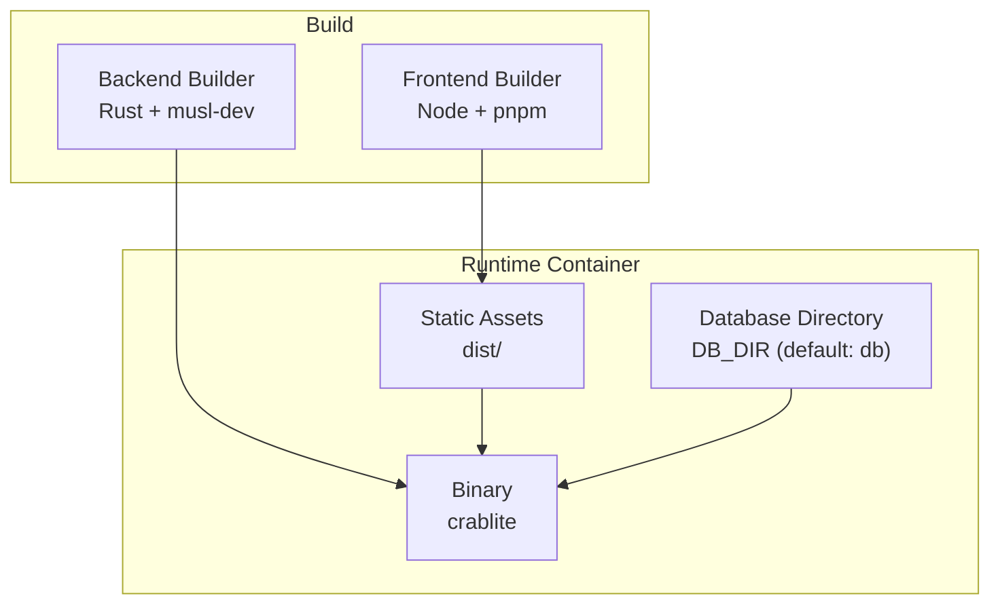
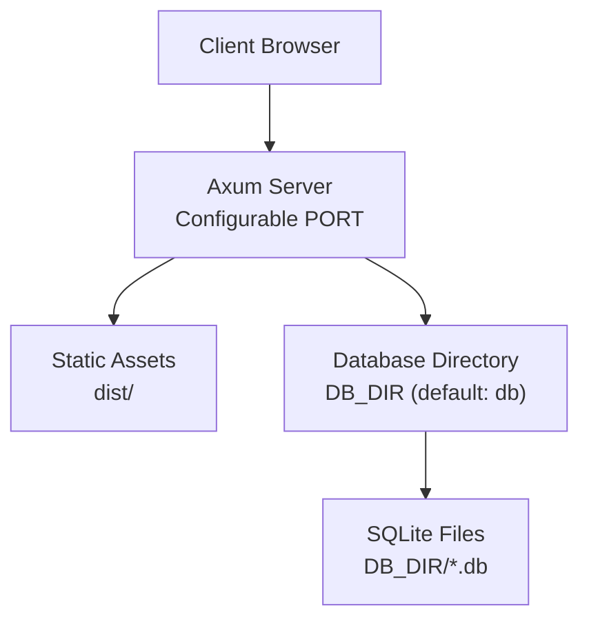
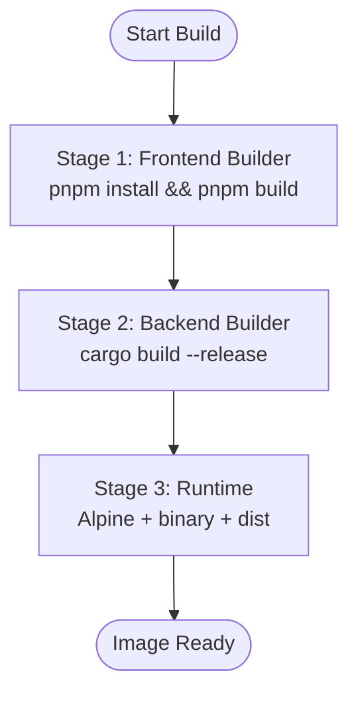
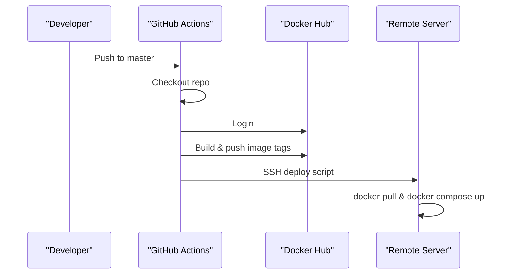
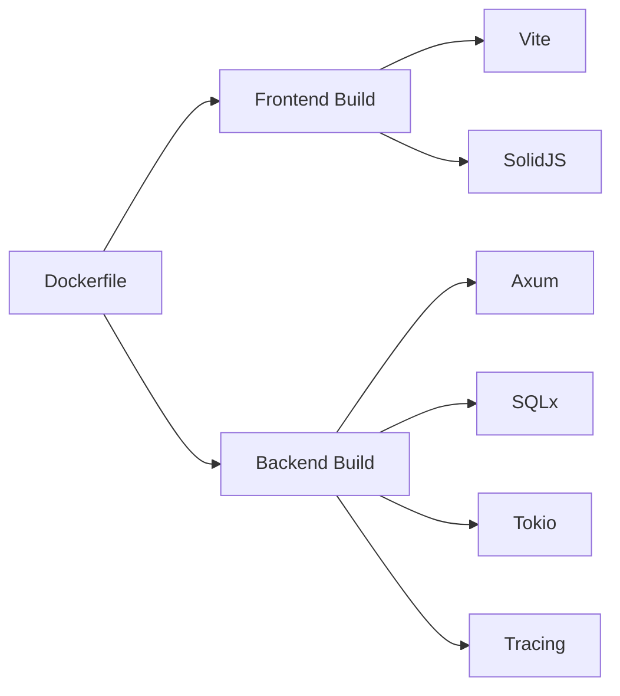

# Deployment & Operations

<cite>
**Referenced Files in This Document**
- [Dockerfile](file://Dockerfile)
- [backend/Cargo.toml](file://backend/Cargo.toml)
- [backend/src/main.rs](file://backend/src/main.rs)
- [backend/src/handlers/connection.rs](file://backend/src/handlers/connection.rs)
- [backend/src/state.rs](file://backend/src/state.rs)
- [frontend/package.json](file://frontend/package.json)
- [frontend/vite.config.ts](file://frontend/vite.config.ts)
- [.github/workflows/docker-publish.yml](file://.github/workflows/docker-publish.yml)
- [README.md](file://README.md)
</cite>

## Update Summary
**Changes Made**
- Updated container configuration section to document configurable DB_DIR and PORT environment variables
- Enhanced Docker volume mounting examples with DB_DIR customization
- Added comprehensive port mapping examples for different deployment scenarios
- Updated environment variables table with new configurable options
- Expanded production deployment examples with DB_DIR and PORT usage

## Table of Contents
1. [Introduction](#introduction)
2. [Project Structure](#project-structure)
3. [Core Components](#core-components)
4. [Architecture Overview](#architecture-overview)
5. [Detailed Component Analysis](#detailed-component-analysis)
6. [Dependency Analysis](#dependency-analysis)
7. [Performance Considerations](#performance-considerations)
8. [Troubleshooting Guide](#troubleshooting-guide)
9. [Conclusion](#conclusion)
10. [Appendices](#appendices)

## Introduction
This document provides comprehensive deployment and operations guidance for CrabLite (rust-sqlite-webui). It covers the multi-stage Docker build, container configuration, volume mounting for SQLite databases, production deployment options (Docker Compose, Kubernetes, bare metal), environment variables including configurable DB_DIR and PORT, monitoring/logging with RUST_LOG, performance tuning, release process, troubleshooting, security best practices, maintenance procedures, scaling considerations, and backup strategies.

## Project Structure
CrabLite is a two-part application:
- Backend: Rust service using Axum, SQLx, Tokio, and Tracing. Serves API endpoints and static frontend assets.
- Frontend: Solid.js app built with Vite and TailwindCSS/DaisyUI.



**Diagram sources**
- [Dockerfile:1-56](file://Dockerfile#L1-L56)

**Section sources**
- [Dockerfile:1-56](file://Dockerfile#L1-L56)
- [backend/Cargo.toml:1-24](file://backend/Cargo.toml#L1-L24)
- [frontend/package.json:1-23](file://frontend/package.json#L1-L23)

## Core Components
- Multi-stage Dockerfile builds frontend assets and backend binary separately, then assembles a minimal runtime image.
- Backend binds to configurable PORT (default: 3000), serves API under /api, and serves static files from dist/.
- Authentication is enforced via an x-api-key header matching the API_KEY environment variable.
- Database directory is configurable via DB_DIR environment variable (default: db).
- Logging uses tracing with EnvFilter controlled by RUST_LOG.

Key responsibilities:
- Dockerfile: orchestrates builds and defines runtime image.
- main.rs: initializes logging, routes, middleware, server, and handles DB_DIR/PORT configuration.
- Cargo.toml: declares dependencies and release profile optimizations.
- frontend package.json and vite.config.ts: define frontend build tooling and dev proxy.

**Section sources**
- [Dockerfile:1-56](file://Dockerfile#L1-L56)
- [backend/src/main.rs:36-83](file://backend/src/main.rs#L36-L83)
- [backend/Cargo.toml:1-24](file://backend/Cargo.toml#L1-L24)
- [frontend/package.json:1-23](file://frontend/package.json#L1-L23)
- [frontend/vite.config.ts:1-19](file://frontend/vite.config.ts#L1-L19)

## Architecture Overview
The runtime architecture consists of a single-process HTTP server that:
- Serves REST API endpoints under /api.
- Serves prebuilt frontend assets from dist/.
- Persists data as SQLite database files under configurable DB_DIR (default: /app/db).



**Diagram sources**
- [backend/src/main.rs:48-83](file://backend/src/main.rs#L48-L83)
- [Dockerfile:49-55](file://Dockerfile#L49-L55)

## Detailed Component Analysis

### Multi-Stage Docker Build Process
Stages:
1. Frontend builder: installs pnpm, installs dependencies, copies source, runs build to produce dist/.
2. Backend builder: installs musl-dev, creates dummy project to cache dependencies, compiles release binary.
3. Runtime: minimal Alpine image, installs ca-certificates and tzdata, copies binary and dist/, sets default ENV, exposes port 3000, runs binary.



**Diagram sources**
- [Dockerfile:1-56](file://Dockerfile#L1-L56)

**Section sources**
- [Dockerfile:1-56](file://Dockerfile#L1-L56)

### Container Configuration and Volume Mounting

**Updated** Enhanced with configurable DB_DIR and PORT environment variables for flexible deployment.

- Default environment variables:
  - RUST_LOG=info
  - PORT=3000 (configurable)
  - DB_DIR=db (configurable, defaults to /app/db in Docker)
- Exposed port: 3000 (configurable via PORT)
- Working directory: /app
- Binary: ./crablite
- Database files: scanned recursively under DB_DIR; mount host directories or files to this path.

Recommended volume mounts with DB_DIR customization:
- Single file with default directory: -v sqlite.db:/app/db/sqlite.db
- Custom database directory: -e DB_DIR=/data -v ./data:/data
- Nested subdirectories: -e DB_DIR=/app/db/rust -v ./rust/data:/app/db/rust

Port mapping examples:
- Default port: docker run -p 3000:3000 ...
- Custom port: docker run -e PORT=8080 -p 8080:8080 ...

Security note: The API requires x-api-key header matching API_KEY. Ensure API_KEY is set in production.

**Section sources**
- [Dockerfile:49-55](file://Dockerfile#L49-L55)
- [backend/src/main.rs:48-83](file://backend/src/main.rs#L48-L83)
- [backend/src/handlers/connection.rs:20-60](file://backend/src/handlers/connection.rs#L20-L60)
- [README.md:70-86](file://README.md#L70-L86)

### Production Deployment Options

#### Docker Run

**Updated** Examples now include DB_DIR and PORT configuration options.

- Map port and mount database volumes with configurable settings.
- Set API_KEY, DB_DIR, PORT, and other environment variables as needed.

Example patterns:
- Basic setup with default settings:
  ```bash
  docker run -d -p 3000:3000 -v sqlite.db:/app/db/sqlite.db -e API_KEY=... wangyucode/crablite
  ```

- Custom database directory:
  ```bash
  docker run -d -p 3000:3000 -e DB_DIR=/data -v ./data:/data -e API_KEY=... wangyucode/crablite
  ```

- Custom port and database directory:
  ```bash
  docker run -d -p 8080:8080 -e PORT=8080 -e DB_DIR=/data -v ./data:/data -e API_KEY=... wangyucode/crablite
  ```

**Section sources**
- [README.md:31-40](file://README.md#L31-L40)
- [README.md:70-86](file://README.md#L70-L86)

#### Docker Compose

**Updated** Enhanced with DB_DIR and PORT configuration examples.

- Define a service exposing configurable port, mounting volumes, and setting environment variables.

Example patterns:
- Basic setup:
  ```yaml
  services:
    crablite:
      image: wangyucode/crablite
      ports:
        - "3000:3000"
      volumes:
        - sqlite.db:/app/db/sqlite.db
      environment:
        - API_KEY=your_secret_key
  ```

- Custom database directory:
  ```yaml
  services:
    crablite:
      image: wangyucode/crablite
      ports:
        - "3000:3000"
      volumes:
        - ./data:/data
      environment:
        - API_KEY=your_secret_key
        - DB_DIR=/data
  ```

- Custom port and database directory:
  ```yaml
  services:
    crablite:
      image: wangyucode/crablite
      ports:
        - "8080:8080"
      volumes:
        - ./data:/data
      environment:
        - API_KEY=your_secret_key
        - DB_DIR=/data
        - PORT=8080
  ```

**Section sources**
- [README.md:42-55](file://README.md#L42-L55)
- [README.md:70-86](file://README.md#L70-L86)

#### Kubernetes

Use a Deployment with a PersistentVolumeClaim mounted at the configured DB_DIR, ConfigMap/Secret for environment variables, Service to expose the configured PORT, and optionally Ingress.

- Pod spec:
  - container image: wangyucode/crablite
  - ports: containerPort matching PORT env var (default: 3000)
  - envFrom: Secret/ConfigMap containing API_KEY, DB_DIR, PORT, RUST_LOG, OPENAI_*
  - volumeMounts: mount PVC at DB_DIR path
- Service: type ClusterIP or NodePort exposing PORT
- Ingress: route external traffic to Service

[No sources needed since this section provides conceptual guidance]

#### Bare Metal Installation

**Updated** Examples now include DB_DIR and PORT configuration options.

- Download prebuilt archive from GitHub Releases.
- Extract archive; keep dist/ alongside the binary.
- Set API_KEY, DB_DIR, PORT, and run the binary.

Example patterns:
- Basic setup:
  ```bash
  tar -xzf rust-crablite-v<VERSION>-<TARGET>.tar.gz
  cd rust-crablite-v<VERSION>-<TARGET>
  API_KEY=... ./crablite
  ```

- Custom database directory:
  ```bash
  API_KEY=... DB_DIR=/custom/path ./crablite
  ```

- Custom port and database directory:
  ```bash
  API_KEY=... DB_DIR=/custom/path PORT=8080 ./crablite
  ```

**Section sources**
- [README.md:57-68](file://README.md#L57-L68)
- [README.md:70-86](file://README.md#L70-L86)

### Environment Variables and Configuration

**Updated** Enhanced with DB_DIR and PORT configuration details.

- API_KEY: Required for authentication via x-api-key header.
- DB_DIR: Configurable database directory (default: db, /app/db in Docker). Supports nested subdirectories for organized database management.
- PORT: Configurable listening port (default: 3000). Must be a valid u16 port number.
- RUST_LOG: Controls tracing log levels.
- OPENAI_API_KEY, OPENAI_BASE_URL, OPENAI_MODEL: Optional AI assistant settings.

Defaults and behavior:
- If API_KEY is not provided, a default value is used.
- DB_DIR defaults to "db" directory, automatically created if it doesn't exist.
- PORT defaults to 3000, validated as a valid port number.
- RUST_LOG defaults to debug for both application and tower_http if not set.

**Section sources**
- [backend/src/main.rs:48-83](file://backend/src/main.rs#L48-L83)
- [backend/src/handlers/connection.rs:20-60](file://backend/src/handlers/connection.rs#L20-L60)
- [README.md:70-86](file://README.md#L70-L86)

### Monitoring and Logging
- Logging framework: tracing with EnvFilter.
- Configure verbosity via RUST_LOG.
- HTTP request tracing enabled via TraceLayer.

Recommendations:
- Use structured logs and forward to centralized logging (e.g., Loki, CloudWatch).
- For health checks, use GET /api/health.

**Section sources**
- [backend/src/main.rs:40-46](file://backend/src/main.rs#L40-L46)
- [backend/src/main.rs:66-71](file://backend/src/main.rs#L66-L71)

### Performance Tuning Parameters
- Release profile optimizations:
  - strip = true
  - lto = true
  - codegen-units = 1
- These reduce binary size and improve runtime performance.

Frontend build target:
- esnext target for modern browsers.

**Section sources**
- [backend/Cargo.toml:20-24](file://backend/Cargo.toml#L20-L24)
- [frontend/vite.config.ts:15-17](file://frontend/vite.config.ts#L15-L17)

### Release Process
Manual steps:
1. Update version in backend/Cargo.toml.
2. Build frontend: pnpm install --frozen-lockfile && pnpm build.
3. Build backend: cargo build --release.
4. Package binary with dist/ into a tarball per platform/architecture.
5. Publish to GitHub Releases using gh CLI.

Automated Docker publishing:
- Workflow triggers on push to master or manual dispatch.
- Builds and pushes images tagged with latest and version extracted from Cargo.toml.
- Deploys to a remote server via SSH using docker compose.



**Diagram sources**
- [.github/workflows/docker-publish.yml:1-59](file://.github/workflows/docker-publish.yml#L1-L59)

**Section sources**
- [README.md:131-147](file://README.md#L131-L147)
- [.github/workflows/docker-publish.yml:1-59](file://.github/workflows/docker-publish.yml#L1-L59)

## Dependency Analysis
High-level dependency relationships:
- Dockerfile depends on Node/pnpm for frontend and Rust toolchain for backend.
- Backend depends on Axum, SQLx, Tokio, Tower, Tracing, Clap, Reqwest.
- Frontend depends on Vite, SolidJS, TailwindCSS, DaisyUI.



**Diagram sources**
- [Dockerfile:1-56](file://Dockerfile#L1-L56)
- [backend/Cargo.toml:6-18](file://backend/Cargo.toml#L6-L18)
- [frontend/package.json:10-20](file://frontend/package.json#L10-L20)

**Section sources**
- [backend/Cargo.toml:6-18](file://backend/Cargo.toml#L6-L18)
- [frontend/package.json:10-20](file://frontend/package.json#L10-L20)
- [Dockerfile:1-56](file://Dockerfile#L1-L56)

## Performance Considerations
- Use release builds with LTO and stripping enabled.
- Keep the runtime image minimal (Alpine).
- Serve static assets from dist/ within the same process to avoid extra reverse proxy overhead.
- Tune RUST_LOG to appropriate levels in production (e.g., info or warn) to reduce log volume.
- Consider enabling compression at the reverse proxy layer if placing behind Nginx/Traefik.
- Optimize DB_DIR placement on high-performance storage for better database access speeds.

[No sources needed since this section provides general guidance]

## Troubleshooting Guide
Common issues and resolutions:
- Unauthorized access (401):
  - Ensure x-api-key header matches API_KEY.
  - Verify API_KEY is set correctly in the environment.
- Port conflicts:
  - The server binds to configurable PORT (default: 3000); ensure no other process occupies it.
  - Check PORT environment variable configuration.
- Missing frontend assets:
  - Ensure dist/ exists and is copied into the runtime image or mounted appropriately.
- Database not found:
  - Confirm DB_DIR is set correctly and volume mounts point to the configured path.
  - Verify database files exist in the DB_DIR location.
- Database directory permissions:
  - Ensure the application has write permissions to DB_DIR.
  - Check that DB_DIR is properly mounted in containerized environments.
- Logging too verbose:
  - Adjust RUST_LOG to lower verbosity in production.

Operational tips:
- Health check endpoint: GET /api/health.
- Use docker compose ps and logs to inspect running containers.
- For Kubernetes, check pod logs and events.
- Monitor DB_DIR disk usage and permissions regularly.

**Section sources**
- [backend/src/main.rs:48-83](file://backend/src/main.rs#L48-L83)
- [backend/src/handlers/connection.rs:20-77](file://backend/src/handlers/connection.rs#L20-L77)
- [README.md:70-86](file://README.md#L70-L86)

## Conclusion
CrabLite provides a lightweight, high-performance SQLite Web UI suitable for containerized and bare-metal deployments. With the enhanced configurability of DB_DIR and PORT environment variables, you can flexibly customize database locations and network binding. By following the recommended configurations, environment variables, and operational practices outlined here, you can deploy securely, monitor effectively, and maintain reliability in production environments.

[No sources needed since this section summarizes without analyzing specific files]

## Appendices

### Security Best Practices
- Always set API_KEY and never commit secrets to version control.
- Restrict network exposure using firewalls or private networks.
- Use HTTPS termination at a reverse proxy or ingress controller.
- Rotate API keys periodically.
- Limit database file permissions to the application user.
- Secure DB_DIR with appropriate filesystem permissions.
- Validate PORT configuration to avoid privileged ports.

[No sources needed since this section provides general guidance]

### Maintenance Procedures
- Regularly update base images and dependencies.
- Monitor disk usage for SQLite files in DB_DIR and rotate logs.
- Back up database files regularly (see Backup Strategies below).
- Test upgrades in staging before applying to production.
- Monitor DB_DIR space usage and clean up unused database files.
- Validate PORT availability during deployment updates.

[No sources needed since this section provides general guidance]

### Scaling Considerations
- Horizontal scaling is limited due to shared SQLite files in DB_DIR; prefer read replicas or sharding strategies if needed.
- For higher concurrency, consider moving to a client/server database and adapting the backend accordingly.
- Use load balancers to distribute traffic across multiple instances only if data consistency is managed externally.
- Consider distributed storage solutions for DB_DIR in multi-instance deployments.

[No sources needed since this section provides general guidance]

### Backup Strategies for SQLite Databases
- Stop writes during backup or use consistent snapshots (e.g., filesystem snapshots) of DB_DIR.
- Copy .db files from DB_DIR to a secure backup location.
- Automate backups via cron jobs or CI/CD pipelines targeting DB_DIR.
- Validate backups by restoring to a test environment.
- Implement incremental backups for large database directories.
- Consider database-specific backup tools for WAL mode optimization.

[No sources needed since this section provides general guidance]