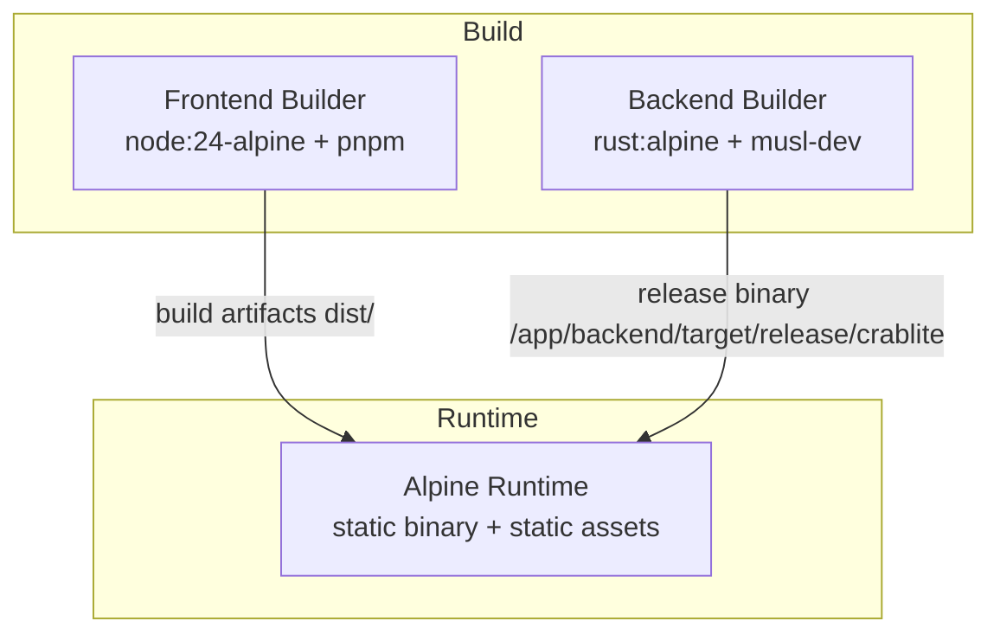
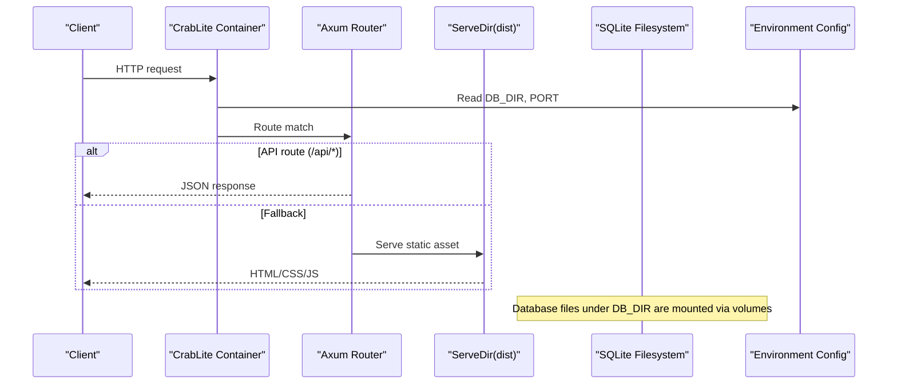
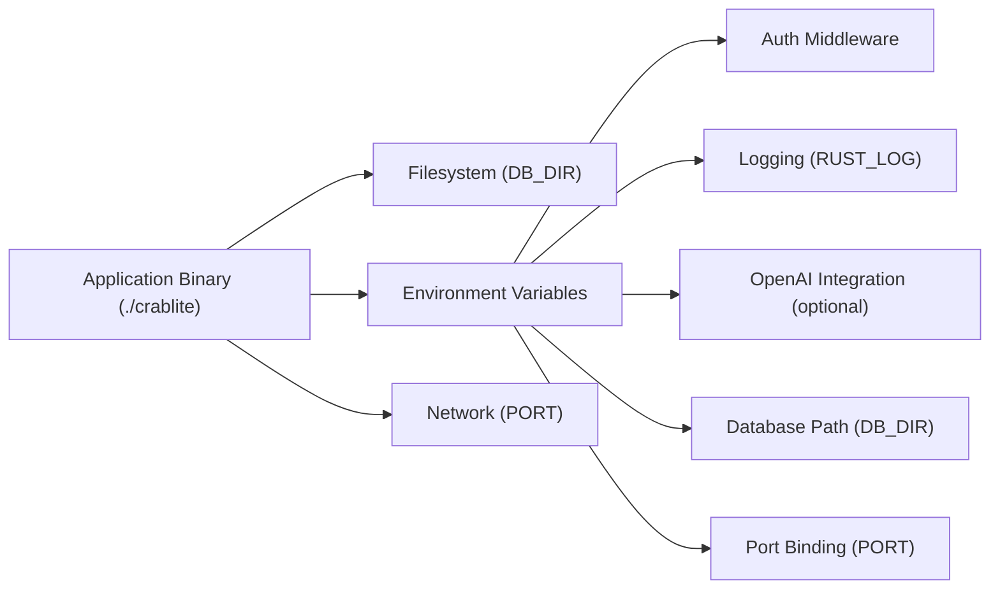

# Docker Deployment

<cite>
**Referenced Files in This Document**
- [Dockerfile](file://Dockerfile)
- [.github/workflows/docker-publish.yml](file://.github/workflows/docker-publish.yml)
- [README.md](file://README.md)
- [backend/Cargo.toml](file://backend/Cargo.toml)
- [backend/src/main.rs](file://backend/src/main.rs)
- [backend/src/state.rs](file://backend/src/state.rs)
- [backend/src/handlers/connection.rs](file://backend/src/handlers/connection.rs)
</cite>

## Update Summary
**Changes Made**
- Updated Docker image naming conventions to reflect 'wangyucode/crablite' standard
- Enhanced binary path documentation for multi-stage build process
- Updated GitHub Actions workflow references to match current deployment pipeline
- Refined container execution details with proper binary paths and CMD instructions

## Table of Contents
1. [Introduction](#introduction)
2. [Project Structure](#project-structure)
3. [Core Components](#core-components)
4. [Architecture Overview](#architecture-overview)
5. [Detailed Component Analysis](#detailed-component-analysis)
6. [Dependency Analysis](#dependency-analysis)
7. [Performance Considerations](#performance-considerations)
8. [Troubleshooting Guide](#troubleshooting-guide)
9. [Conclusion](#conclusion)

## Introduction
This document provides comprehensive Docker deployment guidance for CrabLite (rust-sqlite-webui). It explains the multi-stage build process, container configuration, environment variables including the enhanced DB_DIR and PORT configuration, volume mounting strategies, port exposure, and security considerations. It also includes guidance for Docker Compose usage, troubleshooting common issues, performance optimization tips, and best practices for production deployments using the official `wangyucode/crablite` Docker images.

## Project Structure
The repository contains:
- A frontend built with Node.js and pnpm
- A backend written in Rust using Axum
- A multi-stage Dockerfile that builds both parts and packages them into a minimal Alpine runtime image
- GitHub Actions workflow to build and publish images to `wangyucode/crablite` on Docker Hub



**Diagram sources**
- [Dockerfile:1-55](file://Dockerfile#L1-L55)

**Section sources**
- [Dockerfile:1-55](file://Dockerfile#L1-L55)
- [README.md:22-26](file://README.md#L22-L26)

## Core Components
- Multi-stage Dockerfile:
  - Frontend builder stage uses node:24-alpine and pnpm to install dependencies and build static assets.
  - Backend builder stage uses rust:alpine with musl-dev to compile a statically linked release binary at `/app/backend/target/release/crablite`.
  - Runtime stage uses alpine:latest, installs minimal runtime dependencies, copies the compiled binary from `/app/backend/target/release/crablite` to `./crablite`, sets environment variables, exposes port 3000, and runs the binary via `CMD ["./crablite"]`.
- Environment variables:
  - RUST_LOG controls logging verbosity.
  - PORT is set in the Dockerfile; the application binds to port 3000 by default but can be overridden.
  - DB_DIR allows custom database directory configuration for flexible storage layouts.
  - API_KEY is used for authentication via an HTTP header.
- Volume strategy:
  - SQLite database files are scanned recursively under the configured DB_DIR path.
  - Supports subdirectory organization and flexible volume mounting patterns.

**Section sources**
- [Dockerfile:1-55](file://Dockerfile#L1-L55)
- [backend/src/main.rs:48-55](file://backend/src/main.rs#L48-L55)
- [backend/src/main.rs:74-78](file://backend/src/main.rs#L74-L78)
- [backend/src/state.rs:6-10](file://backend/src/state.rs#L6-L10)

## Architecture Overview
The containerized application serves a static frontend and a REST API backend from a single process. The frontend assets are served as fallback content when no API route matches. Database operations are performed against SQLite files located in the configured DB_DIR.



**Diagram sources**
- [backend/src/main.rs:48-55](file://backend/src/main.rs#L48-L55)
- [backend/src/main.rs:74-78](file://backend/src/main.rs#L74-L78)
- [Dockerfile:49-55](file://Dockerfile#L49-L55)

## Detailed Component Analysis

### Multi-Stage Build Process

#### Frontend Builder Stage
- Base image: node:24-alpine
- Installs pnpm globally
- Copies package manifests and lockfile, then installs dependencies with frozen lockfile
- Copies source code and builds the frontend into dist/

Key behaviors:
- Dependency caching leverages pnpm-lock.yaml
- Build output is placed in /app/dist inside the builder stage

**Section sources**
- [Dockerfile:1-14](file://Dockerfile#L1-L14)

#### Backend Builder Stage
- Base image: rust:alpine
- Installs musl-dev for static linking
- Creates a dummy Cargo project to cache dependency resolution
- Compiles dependencies only first, then copies actual source and compiles the release binary
- Uses APP_VERSION build arg during compilation
- **Updated** Binary output location: `/app/backend/target/release/crablite`

Key behaviors:
- Static linking produces a portable binary
- Release profile enables LTO, stripping, and optimized codegen
- Binary is built with version information embedded via APP_VERSION

**Section sources**
- [Dockerfile:16-35](file://Dockerfile#L16-L35)
- [backend/Cargo.toml:20-23](file://backend/Cargo.toml#L20-L23)

#### Runtime Stage
- Base image: alpine:latest
- Installs ca-certificates and tzdata
- **Updated** Copies the release binary from `/app/backend/target/release/crablite` to `./crablite`
- Copies frontend dist/
- Sets RUST_LOG and PORT environment variables
- Exposes port 3000 and runs the binary via `CMD ["./crablite"]`

Key behaviors:
- Minimal footprint due to static binary and Alpine base
- Timezone and CA certificates included for reliable operation
- Binary execution uses relative path `./crablite`

**Section sources**
- [Dockerfile:37-55](file://Dockerfile#L37-L55)

### Container Configuration

#### Environment Variables
Enhanced environment variable support for flexible deployment:

- **RUST_LOG**: Controls tracing log levels. Default is set in the Dockerfile; the app also reads it at startup.
- **PORT**: Declared in the Dockerfile as 3000; the app binds to this port by default but can be overridden at runtime.
- **DB_DIR**: Allows custom database directory configuration. Defaults to "db" relative path, which becomes "/app/db" in Docker containers.
- **API_KEY**: Used by the auth middleware to validate requests via the x-api-key header.

Configuration examples:
```bash
# Custom database directory
docker run -e DB_DIR=/custom/path -v ./data:/custom/path wangyucode/crablite

# Custom port
docker run -e PORT=8080 -p 8080:8080 wangyucode/crablite

# Combined configuration
docker run -e DB_DIR=/data/dbs -e PORT=8080 \
  -v ./data:/data/dbs -p 8080:8080 wangyucode/crablite
```

**Updated** Enhanced with DB_DIR and PORT environment variable support for flexible container configuration using the official `wangyucode/crablite` image.

**Section sources**
- [Dockerfile:49-53](file://Dockerfile#L49-L53)
- [backend/src/main.rs:48-55](file://backend/src/main.rs#L48-L55)
- [backend/src/main.rs:74-78](file://backend/src/main.rs#L74-L78)
- [README.md:74-85](file://README.md#L74-L85)

#### Port Exposure
- The container exposes port 3000 by default.
- The application binds to 0.0.0.0:PORT where PORT defaults to 3000 but can be configured via environment variable.

Port configuration examples:
```bash
# Use default port 3000
docker run -p 3000:3000 wangyucode/crablite

# Use custom port 8080
docker run -e PORT=8080 -p 8080:8080 wangyucode/crablite
```

**Updated** Now supports dynamic port configuration via PORT environment variable using the official `wangyucode/crablite` image.

**Section sources**
- [Dockerfile:53](file://Dockerfile#L53)
- [backend/src/main.rs:74-78](file://backend/src/main.rs#L74-L78)

#### Volume Mounting Strategy
Enhanced volume mounting with DB_DIR support:

- Database files are scanned recursively under the configured DB_DIR path.
- Supports subdirectory organization within the database directory.
- Flexible volume mounting patterns for different use cases.

Volume mounting examples:
```bash
# Single file with default DB_DIR
docker run -v sqlite.db:/app/db/sqlite.db wangyucode/crablite

# Directory with custom DB_DIR
docker run -e DB_DIR=/data -v ./data:/data wangyucode/crablite

# Subdirectory organization
docker run -e DB_DIR=/app/db/rust -v ./rust/data:/app/db/rust wangyucode/crablite

# Multiple database directories
docker run -e DB_DIR=/data/dbs -v ./production:/data/dbs wangyucode/crablite
```

**Updated** Enhanced with DB_DIR environment variable support for flexible database directory configuration and subdirectory organization using the official `wangyucode/crablite` image.

**Section sources**
- [backend/src/main.rs:48-55](file://backend/src/main.rs#L48-L55)
- [backend/src/handlers/connection.rs:20-59](file://backend/src/handlers/connection.rs#L20-L59)
- [README.md:72](file://README.md#L72)

#### Security Considerations
- Authentication: Requests to API routes must include the x-api-key header matching the API_KEY environment variable.
- Network exposure: Only the configured PORT is exposed; ensure reverse proxy or firewall rules restrict access as needed.
- Secrets management: Use secrets managers or environment files to supply API_KEY and OpenAI keys securely.
- Image hardening: The runtime image is minimal; keep it updated and avoid adding unnecessary packages.
- Volume security: Ensure proper file permissions on mounted database directories to prevent unauthorized access.

**Section sources**
- [backend/src/main.rs:23-34](file://backend/src/main.rs#L23-L34)
- [Dockerfile:37-55](file://Dockerfile#L37-L55)

### Docker Compose Guidance

#### Development Configuration
```yaml
version: '3'
services:
  crablite:
    image: wangyucode/crablite
    ports:
      - "3000:3000"
    volumes:
      - ./data:/app/db
    environment:
      - API_KEY=your-development-key
      - DB_DIR=/app/db
      - PORT=3000
      - RUST_LOG=debug
    restart: unless-stopped
```

#### Production Configuration
```yaml
version: '3'
services:
  crablite:
    image: wangyucode/crablite:latest
    ports:
      - "8080:8080"
    volumes:
      - db-data:/data/dbs
    environment:
      - API_KEY=${API_KEY}
      - DB_DIR=/data/dbs
      - PORT=8080
      - RUST_LOG=info
    restart: always
    networks:
      - crablite-network
    healthcheck:
      test: ["CMD", "curl", "-f", "http://localhost:8080/api/health"]
      interval: 30s
      timeout: 10s
      retries: 3

volumes:
  db-data:
    driver: local

networks:
  crablite-network:
    driver: bridge
```

#### Advanced Configuration with Subdirectories
```yaml
version: '3'
services:
  crablite:
    image: wangyucode/crablite
    ports:
      - "3000:3000"
    volumes:
      - ./databases/rust:/app/db/rust
      - ./databases/python:/app/db/python
    environment:
      - API_KEY=${API_KEY}
      - DB_DIR=/app/db
      - PORT=3000
    restart: unless-stopped
```

**Updated** All Docker Compose configurations now use the official `wangyucode/crablite` image naming convention.

### CI/CD and Image Publishing
GitHub Actions builds and pushes images to Docker Hub under the `wangyucode/crablite` namespace, tagging with latest and the version extracted from Cargo.toml. It also deploys to a server using docker compose.

Highlights:
- Uses Docker Buildx for efficient builds
- Caches layers via GitHub Actions cache
- Extracts version from backend/Cargo.toml and passes it as APP_VERSION
- **Updated** Image naming follows `wangyucode/crablite:latest,wangyucode/crablite:${VERSION}` pattern
- Deploys via SSH and docker compose up with force-recreate

**Section sources**
- [.github/workflows/docker-publish.yml:1-59](file://.github/workflows/docker-publish.yml#L1-L59)

## Dependency Analysis
The runtime depends on:
- A statically linked Rust binary (`./crablite`)
- Static frontend assets served by the same process
- Optional OpenAI integration via environment variables
- Configurable database directory via DB_DIR environment variable
- Dynamic port binding via PORT environment variable



**Diagram sources**
- [backend/src/main.rs:48-55](file://backend/src/main.rs#L48-L55)
- [backend/src/main.rs:74-78](file://backend/src/main.rs#L74-L78)
- [backend/src/state.rs:6-10](file://backend/src/state.rs#L6-L10)

**Section sources**
- [backend/Cargo.toml:6-19](file://backend/Cargo.toml#L6-L19)
- [backend/src/main.rs:48-78](file://backend/src/main.rs#L48-L78)

## Performance Considerations
- Use the prebuilt release binary with LTO and symbol stripping enabled for smaller size and faster startup.
- Keep the runtime image minimal; avoid installing extra packages.
- Persist SQLite databases on fast storage (e.g., local SSD or cloud block storage).
- Tune RUST_LOG to reduce overhead in production (e.g., info or warn).
- Place the container behind a reverse proxy for TLS termination and connection pooling.
- Scale horizontally by running multiple instances behind a load balancer if needed; share the same SQLite volume carefully or switch to a shared filesystem with appropriate locking.
- Optimize DB_DIR placement for optimal I/O performance based on your storage infrastructure.
- **Updated** Use the official `wangyucode/crablite` images for optimized builds with proper binary paths and dependencies.

## Troubleshooting Guide

### Environment Variable Issues
- **DB_DIR not working**:
  - Verify the DB_DIR environment variable is set correctly
  - Ensure the volume is mounted to the same path as DB_DIR
  - Check that the directory exists and has proper permissions
  - Example: `-e DB_DIR=/data -v ./data:/data wangyucode/crablite`

- **PORT conflicts**:
  - Ensure host port matches the container PORT setting
  - Check for port conflicts on the host machine
  - Example: `-e PORT=8080 -p 8080:8080 wangyucode/crablite`

### Volume Mounting Issues
- **Database files not found**:
  - Confirm the volume is mounted to the correct DB_DIR path
  - Verify SQLite files exist and are readable/writable by the container user
  - Check permissions on the host path
  - For subdirectories: ensure the full path structure is maintained

- **Permission errors**:
  - Set proper ownership and permissions on the host directory
  - Use `chmod 755` and `chown` commands on the host
  - Consider using named volumes instead of bind mounts

### Application Issues
- **Container starts but UI does not load**:
  - Ensure the frontend build artifacts exist in /app/dist
  - Verify the binary is executable and the dist directory is copied correctly
  - **Updated** Check that the binary path is correct: `./crablite` should be executable

- **Cannot connect to database**:
  - Confirm the volume is mounted to DB_DIR and the SQLite file exists
  - Check database file permissions and ownership
  - Verify WAL mode compatibility

- **Unauthorized errors**:
  - Provide the correct API_KEY and send the x-api-key header with requests

- **Logging too verbose**:
  - Adjust RUST_LOG to a less verbose level

- **OpenAI features not working**:
  - Set OPENAI_API_KEY and related variables as required

- **Image pull issues**:
  - **Updated** Ensure you're using the correct image name: `wangyucode/crablite`
  - Check Docker Hub connectivity and authentication if using private repositories

**Updated** Added specific troubleshooting sections for DB_DIR and PORT configuration issues, plus image naming troubleshooting.

**Section sources**
- [backend/src/main.rs:48-55](file://backend/src/main.rs#L48-L55)
- [backend/src/main.rs:74-78](file://backend/src/main.rs#L74-L78)
- [backend/src/handlers/connection.rs:20-59](file://backend/src/handlers/connection.rs#L20-L59)
- [README.md:72-85](file://README.md#L72-L85)

## Conclusion
CrabLite's Docker setup delivers a highly efficient, minimal runtime image that bundles a static Rust backend and a Vite-built frontend. The enhanced configuration system now supports flexible database directory management through DB_DIR and dynamic port binding via PORT environment variables. By leveraging multi-stage builds, static linking, and Alpine-based runtime, the image remains small and secure. The improved volume mounting strategy supports complex database organization patterns while maintaining simplicity. 

**Updated** The deployment pipeline now consistently uses the `wangyucode/crablite` image naming convention across all environments, from development to production. The binary path structure (`/app/backend/target/release/crablite` → `./crablite`) ensures proper execution within the container. Follow the environment variable and volume guidelines to configure authentication, logging, database storage, and network binding. Use the provided Docker Compose configurations as templates for different deployment scenarios, and apply the performance and security recommendations for robust production operations with the official `wangyucode/crablite` images.