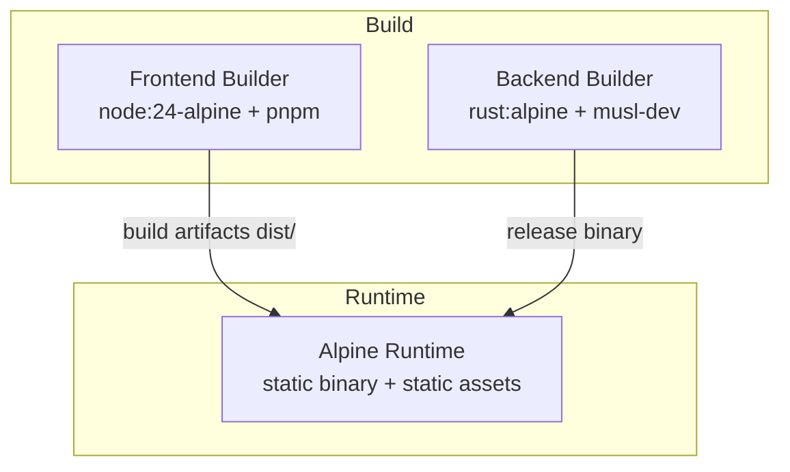
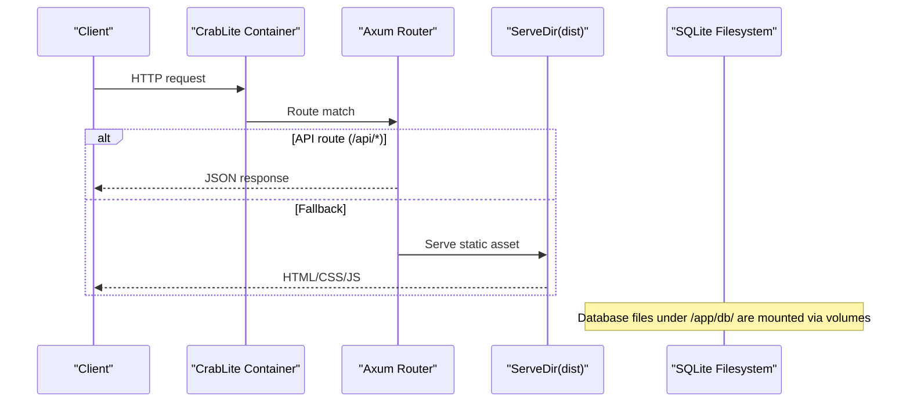
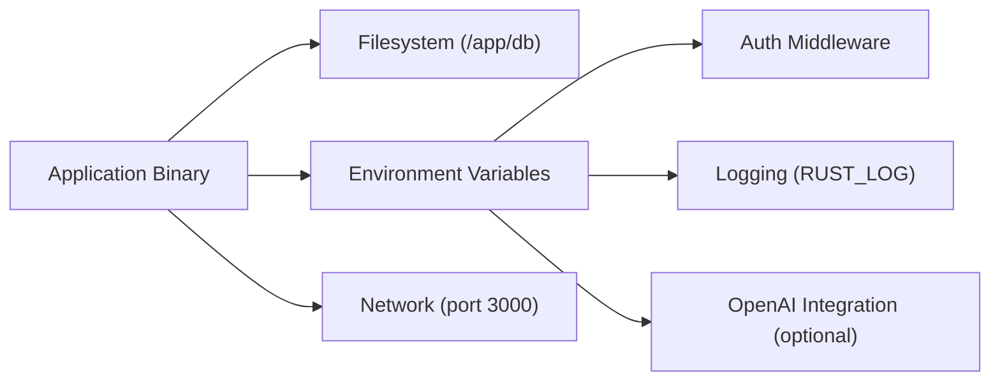

# Docker Deployment

<cite>
**Referenced Files in This Document**
- [Dockerfile](file://Dockerfile)
- [README.md](file://README.md)
- [backend/Cargo.toml](file://backend/Cargo.toml)
- [backend/src/main.rs](file://backend/src/main.rs)
- [.github/workflows/docker-publish.yml](file://.github/workflows/docker-publish.yml)
</cite>

## Table of Contents
1. [Introduction](#introduction)
2. [Project Structure](#project-structure)
3. [Core Components](#core-components)
4. [Architecture Overview](#architecture-overview)
5. [Detailed Component Analysis](#detailed-component-analysis)
6. [Dependency Analysis](#dependency-analysis)
7. [Performance Considerations](#performance-considerations)
8. [Troubleshooting Guide](#troubleshooting-guide)
9. [Conclusion](#conclusion)

## Introduction
This document provides comprehensive Docker deployment guidance for CrabLite (rust-sqlite-webui). It explains the multi-stage build process, container configuration, environment variables, volume mounting strategies, port exposure, and security considerations. It also includes guidance for Docker Compose usage, troubleshooting common issues, performance optimization tips, and best practices for production deployments.

## Project Structure
The repository contains:
- A frontend built with Node.js and pnpm
- A backend written in Rust using Axum
- A multi-stage Dockerfile that builds both parts and packages them into a minimal Alpine runtime image
- GitHub Actions workflow to build and publish images

**Diagram sources**
- [Dockerfile:1-55](file://Dockerfile#L1-L55)

**Section sources**
- [Dockerfile:1-55](file://Dockerfile#L1-L55)
- [README.md:22-26](file://README.md#L22-L26)

## Core Components
- Multi-stage Dockerfile:
  - Frontend builder stage uses node:24-alpine and pnpm to install dependencies and build static assets.
  - Backend builder stage uses rust:alpine with musl-dev to compile a statically linked release binary.
  - Runtime stage uses alpine:latest, installs minimal runtime dependencies, copies the compiled binary and frontend assets, sets environment variables, exposes port 3000, and runs the binary.
- Environment variables:
  - RUST_LOG controls logging verbosity.
  - PORT is set in the Dockerfile; the application binds to port 3000 by default.
  - API_KEY is used for authentication via an HTTP header.
- Volume strategy:
  - SQLite database files are scanned recursively under /app/db/. Mount your host directory or file to this path to persist data across container restarts.

**Section sources**
- [Dockerfile:1-55](file://Dockerfile#L1-L55)
- [backend/src/main.rs:22-33](file://backend/src/main.rs#L22-L33)
- [backend/src/main.rs:39-45](file://backend/src/main.rs#L39-L45)
- [backend/src/main.rs:67-72](file://backend/src/main.rs#L67-L72)
- [README.md:70-83](file://README.md#L70-L83)

## Architecture Overview
The containerized application serves a static frontend and a REST API backend from a single process. The frontend assets are served as fallback content when no API route matches.

**Diagram sources**
- [backend/src/main.rs:51-65](file://backend/src/main.rs#L51-L65)
- [Dockerfile:43-47](file://Dockerfile#L43-L47)

## Detailed Component Analysis

### Multi-Stage Build Process

#### Frontend Builder Stage
- Base image: node:24-alpine
- Installs pnpm globally
- Copies package manifests and lockfile, then installs dependencies with frozen lockfile
- Copies source code and builds the frontend into dist/

Key behaviors:
- Dependency caching leverages pnpm-lock.yaml
- Build output is placed in /app/dist inside the builder stage

**Section sources**
- [Dockerfile:1-14](file://Dockerfile#L1-L14)

#### Backend Builder Stage
- Base image: rust:alpine
- Installs musl-dev for static linking
- Creates a dummy Cargo project to cache dependency resolution
- Compiles dependencies only first, then copies actual source and compiles the release binary
- Uses APP_VERSION build arg during compilation

Key behaviors:
- Static linking produces a portable binary
- Release profile enables LTO, stripping, and optimized codegen

**Section sources**
- [Dockerfile:16-35](file://Dockerfile#L16-L35)
- [backend/Cargo.toml:20-23](file://backend/Cargo.toml#L20-L23)

#### Runtime Stage
- Base image: alpine:latest
- Installs ca-certificates and tzdata
- Copies the release binary and frontend dist/
- Sets RUST_LOG and PORT environment variables
- Exposes port 3000 and runs the binary

Key behaviors:
- Minimal footprint due to static binary and Alpine base
- Timezone and CA certificates included for reliable operation

**Section sources**
- [Dockerfile:37-55](file://Dockerfile#L37-L55)

### Container Configuration

#### Environment Variables
- RUST_LOG: Controls tracing log levels. Default is set in the Dockerfile; the app also reads it at startup.
- PORT: Declared in the Dockerfile; the app binds to port 3000 by default.
- API_KEY: Used by the auth middleware to validate requests via the x-api-key header.

Notes:
- If API_KEY is not provided, the app falls back to a default value.
- OPENAI_* variables are supported for AI features but are optional.

**Section sources**
- [Dockerfile:49-51](file://Dockerfile#L49-L51)
- [backend/src/main.rs:22-33](file://backend/src/main.rs#L22-L33)
- [backend/src/main.rs:39-45](file://backend/src/main.rs#L39-L45)
- [README.md:74-83](file://README.md#L74-L83)

#### Port Exposure
- The container exposes port 3000.
- The application binds to 0.0.0.0:3000 by default.

**Section sources**
- [Dockerfile:53](file://Dockerfile#L53)
- [backend/src/main.rs:67-72](file://backend/src/main.rs#L67-L72)

#### Volume Mounting Strategy
- Database files are scanned recursively under /app/db/.
- Recommended to mount a host directory or file to /app/db/ to persist SQLite databases across container restarts.

Examples:
- Single file: -v sqlite.db:/app/db/sqlite.db
- Directory: -v ./data:/app/db

**Section sources**
- [README.md:70-73](file://README.md#L70-L73)

#### Security Considerations
- Authentication: Requests to API routes must include the x-api-key header matching the API_KEY environment variable.
- Network exposure: Only port 3000 is exposed; ensure reverse proxy or firewall rules restrict access as needed.
- Secrets management: Use secrets managers or environment files to supply API_KEY and OpenAI keys securely.
- Image hardening: The runtime image is minimal; keep it updated and avoid adding unnecessary packages.

**Section sources**
- [backend/src/main.rs:22-33](file://backend/src/main.rs#L22-L33)
- [Dockerfile:37-55](file://Dockerfile#L37-L55)

### Docker Compose Guidance
While no compose file exists in the repository, you can use the following patterns based on the documented usage:

- Development:
  - Map port 3000
  - Mount a local directory to /app/db for persistent SQLite storage
  - Set API_KEY and other environment variables as needed

- Production:
  - Use named volumes for databases
  - Restrict network access via reverse proxy
  - Pin image tags to specific versions

Example references:
- The README documents docker run and docker-compose examples showing port mapping and volume mounts.

**Section sources**
- [README.md:31-55](file://README.md#L31-L55)

### CI/CD and Image Publishing
GitHub Actions builds and pushes images to Docker Hub, tagging with latest and the version extracted from Cargo.toml. It also deploys to a server using docker compose.

Highlights:
- Uses Docker Buildx for efficient builds
- Caches layers via GitHub Actions cache
- Extracts version from backend/Cargo.toml and passes it as APP_VERSION
- Deploys via SSH and docker compose up with force-recreate

**Section sources**
- [.github/workflows/docker-publish.yml:1-59](file://.github/workflows/docker-publish.yml#L1-L59)

## Dependency Analysis
The runtime depends on:
- A statically linked Rust binary
- Static frontend assets served by the same process
- Optional OpenAI integration via environment variables

**Diagram sources**
- [backend/src/main.rs:22-33](file://backend/src/main.rs#L22-L33)
- [backend/src/main.rs:39-45](file://backend/src/main.rs#L39-L45)
- [backend/src/main.rs:67-72](file://backend/src/main.rs#L67-L72)

**Section sources**
- [backend/Cargo.toml:6-19](file://backend/Cargo.toml#L6-L19)
- [backend/src/main.rs:22-72](file://backend/src/main.rs#L22-L72)

## Performance Considerations
- Use the prebuilt release binary with LTO and symbol stripping enabled for smaller size and faster startup.
- Keep the runtime image minimal; avoid installing extra packages.
- Persist SQLite databases on fast storage (e.g., local SSD or cloud block storage).
- Tune RUST_LOG to reduce overhead in production (e.g., info or warn).
- Place the container behind a reverse proxy for TLS termination and connection pooling.
- Scale horizontally by running multiple instances behind a load balancer if needed; share the same SQLite volume carefully or switch to a shared filesystem with appropriate locking.

[No sources needed since this section provides general guidance]

## Troubleshooting Guide
- Container starts but UI does not load:
  - Ensure the frontend build artifacts exist in /app/dist.
  - Verify the binary is executable and the dist directory is copied correctly.

- Cannot connect to database:
  - Confirm the volume is mounted to /app/db and the SQLite file exists and is readable/writable by the container user.
  - Check permissions on the host path.

- Unauthorized errors:
  - Provide the correct API_KEY and send the x-api-key header with requests.

- Logging too verbose:
  - Adjust RUST_LOG to a less verbose level.

- Port conflicts:
  - Ensure host port 3000 is free or map to a different host port.

- OpenAI features not working:
  - Set OPENAI_API_KEY and related variables as required.

**Section sources**
- [README.md:70-83](file://README.md#L70-L83)
- [backend/src/main.rs:22-33](file://backend/src/main.rs#L22-L33)
- [backend/src/main.rs:39-45](file://backend/src/main.rs#L39-L45)

## Conclusion
CrabLite’s Docker setup delivers a highly efficient, minimal runtime image that bundles a static Rust backend and a Vite-built frontend. By leveraging multi-stage builds, static linking, and Alpine-based runtime, the image remains small and secure. Follow the environment variable and volume guidelines to configure authentication, logging, and persistence. Use the provided CI/CD workflow as a reference for automated builds and deployments, and apply the performance and security recommendations for robust production operations.