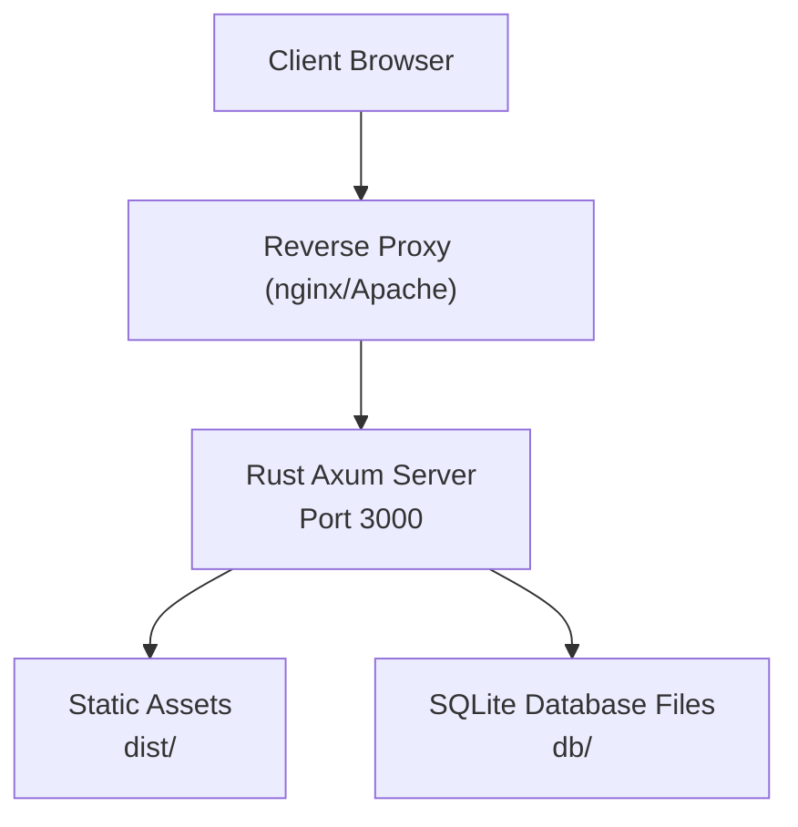
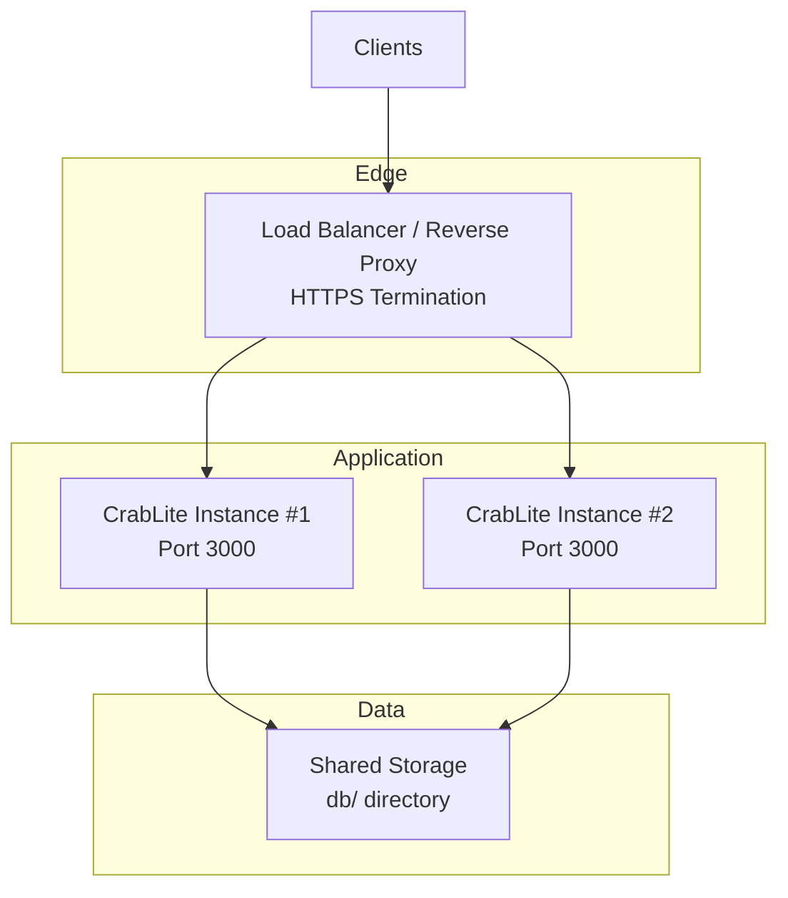
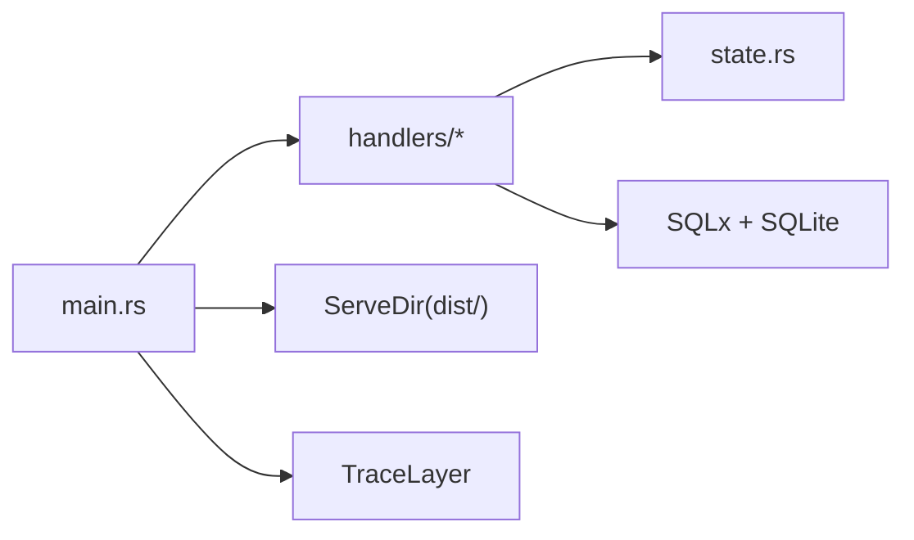

# Production Deployment

<cite>
**Referenced Files in This Document**
- [README.md](file://README.md)
- [Dockerfile](file://Dockerfile)
- [backend/Cargo.toml](file://backend/Cargo.toml)
- [backend/src/main.rs](file://backend/src/main.rs)
- [backend/src/state.rs](file://backend/src/state.rs)
- [backend/src/handlers/mod.rs](file://backend/src/handlers/mod.rs)
- [backend/src/handlers/health.rs](file://backend/src/handlers/health.rs)
- [backend/src/handlers/connection.rs](file://backend/src/handlers/connection.rs)
- [backend/src/handlers/query.rs](file://backend/src/handlers/query.rs)
- [backend/src/handlers/ai.rs](file://backend/src/handlers/ai.rs)
- [doc/design.md](file://doc/design.md)
</cite>

## Table of Contents
1. [Introduction](#introduction)
2. [Project Structure](#project-structure)
3. [Core Components](#core-components)
4. [Architecture Overview](#architecture-overview)
5. [Detailed Component Analysis](#detailed-component-analysis)
6. [Dependency Analysis](#dependency-analysis)
7. [Performance Considerations](#performance-considerations)
8. [Troubleshooting Guide](#troubleshooting-guide)
9. [Conclusion](#conclusion)
10. [Appendices](#appendices)

## Introduction
This document provides production-grade deployment guidance for CrabLite (SQLite WebUI). It covers bare metal installation, binary distribution options, system requirements, environment configuration, reverse proxy setup, monitoring and observability, security hardening, scaling considerations, backup strategies, and disaster recovery procedures. The application is a lightweight Rust + Axum backend serving a Solid.js frontend as static assets, with SQLite as the data store.

Key characteristics:
- Single-binary backend serves both API and embedded frontend assets.
- Authentication via an API key header.
- SQLite database files are scanned under a configured directory.
- Optional AI-assisted SQL correction using OpenAI-compatible APIs.

**Section sources**
- [README.md:10-25](file://README.md#L10-L25)
- [doc/design.md:14-30](file://doc/design.md#L14-L30)

## Project Structure
At runtime, the backend serves:
- REST API endpoints under /api
- Health endpoint at /api/health
- Frontend static assets from dist

**Diagram sources**
- [backend/src/main.rs:52-65](file://backend/src/main.rs#L52-L65)
- [backend/src/handlers/connection.rs:20-60](file://backend/src/handlers/connection.rs#L20-L60)

**Section sources**
- [backend/src/main.rs:52-65](file://backend/src/main.rs#L52-L65)
- [backend/src/handlers/connection.rs:20-60](file://backend/src/handlers/connection.rs#L20-L60)

## Core Components
- Application entrypoint binds to port 3000, initializes logging, configures routes, and serves static assets.
- Middleware enforces API key authentication on all API routes except health.
- Handlers implement connection management, table listing, query execution, and AI-assisted SQL correction.
- State holds a shared SQLite pool protected by a read-write lock.

Key responsibilities:
- main.rs: routing, middleware, server startup, tracing initialization.
- handlers/health.rs: health check returning status and version.
- handlers/connection.rs: list databases, connect to SQLite with WAL mode, list tables.
- handlers/query.rs: execute queries and return structured results.
- handlers/ai.rs: call OpenAI-compatible API to correct or generate SQL.
- state.rs: global app state containing the SQLite pool.

**Section sources**
- [backend/src/main.rs:22-73](file://backend/src/main.rs#L22-L73)
- [backend/src/handlers/health.rs:1-6](file://backend/src/handlers/health.rs#L1-L6)
- [backend/src/handlers/connection.rs:20-145](file://backend/src/handlers/connection.rs#L20-L145)
- [backend/src/handlers/query.rs:101-200](file://backend/src/handlers/query.rs#L101-L200)
- [backend/src/handlers/ai.rs:24-148](file://backend/src/handlers/ai.rs#L24-L148)
- [backend/src/state.rs:1-9](file://backend/src/state.rs#L1-L9)

## Architecture Overview
The production architecture uses a reverse proxy for TLS termination and load balancing, forwarding traffic to one or more CrabLite instances behind it. The backend serves both API and static assets.

Notes:
- Use a shared filesystem (e.g., NFS/EFS) for db/ if running multiple instances.
- Ensure SQLite WAL mode is enabled and busy_timeout is set to avoid contention.
- Configure the reverse proxy to forward headers including x-api-key.

**Diagram sources**
- [backend/src/main.rs:67-72](file://backend/src/main.rs#L67-L72)
- [backend/src/handlers/connection.rs:85-90](file://backend/src/handlers/connection.rs#L85-L90)

## Detailed Component Analysis

### Bare Metal Installation
- Obtain the prebuilt binary archive for your platform from releases.
- Extract the archive; ensure the dist/ directory remains alongside the binary.
- Create a db/ directory for database files.
- Run the binary with required environment variables.

System requirements:
- OS: Linux or macOS (per release targets).
- CPU/Arch: Match the target triple (e.g., x86_64-unknown-linux-gnu, aarch64-apple-darwin).
- Disk: Space for SQLite files and logs.
- Network: Port 3000 open internally (expose only via reverse proxy).

Operational notes:
- The application expects dist/ to be present for serving the frontend.
- Database files are scanned recursively under db/.

**Section sources**
- [README.md:57-68](file://README.md#L57-L68)
- [backend/src/handlers/connection.rs:20-60](file://backend/src/handlers/connection.rs#L20-L60)

### Binary Distribution Options
- Prebuilt binaries: Download from GitHub Releases for supported platforms.
- Docker image: Official image available; run with volume mounts for db/ and environment variables.
- Build from source:
  - Frontend: Node.js v18+ and pnpm.
  - Backend: Rust toolchain and cargo.

Build outputs:
- Frontend artifacts: frontend/dist.
- Backend binary: backend/target/release/rust-sqlite-webui.

Release packaging combines the binary and frontend assets into a single archive.

**Section sources**
- [README.md:85-125](file://README.md#L85-L125)
- [README.md:127-169](file://README.md#L127-L169)
- [Dockerfile:1-56](file://Dockerfile#L1-L56)

### System Requirements
- Runtime dependencies:
  - For Docker: Alpine base with ca-certificates and tzdata installed.
  - For bare metal: No additional runtime libraries beyond OS defaults.
- Ports:
  - Internal service listens on 0.0.0.0:3000.
- Filesystem:
  - db/ directory must exist and be writable.
  - dist/ directory must exist and contain built frontend assets.

**Section sources**
- [Dockerfile:37-55](file://Dockerfile#L37-L55)
- [backend/src/main.rs:67-72](file://backend/src/main.rs#L67-L72)
- [backend/src/handlers/connection.rs:20-28](file://backend/src/handlers/connection.rs#L20-L28)

### Environment Variables Configuration
Configure these variables in your process manager, container runtime, or systemd unit:

- API_KEY: Required. API key used for authenticating requests via the x-api-key header. Default fallback exists but should always be set in production.
- RUST_LOG: Logging configuration. Defaults to debug levels for application and HTTP tracing. Adjust per environment.
- OPENAI_API_KEY: Optional. Required to enable AI-assisted SQL correction.
- OPENAI_BASE_URL: Optional. Base URL for OpenAI-compatible API. Default points to OpenAI.
- OPENAI_MODEL: Optional. Model name for AI assistant.

Additional notes:
- .env file support is available during development.
- In containers, pass environment variables via runtime configuration.

Security recommendation:
- Never commit secrets. Use secret managers or secure env injection.
- Restrict access to the process environment and logs.

**Section sources**
- [backend/src/main.rs:22-33](file://backend/src/main.rs#L22-L33)
- [backend/src/main.rs:39-45](file://backend/src/main.rs#L39-L45)
- [backend/src/handlers/ai.rs:28-31](file://backend/src/handlers/ai.rs#L28-L31)
- [README.md:70-83](file://README.md#L70-L83)

### Reverse Proxy Setup (nginx and Apache)
Use a reverse proxy to terminate HTTPS, enforce TLS, and optionally load balance across multiple CrabLite instances.

General requirements:
- Forward Host and Authorization-like headers.
- Pass x-api-key header to the backend.
- Serve static assets through the backend (no need to duplicate frontend).
- Set appropriate timeouts and buffer sizes for large query responses.

nginx example concepts:
- Listen on 443 with TLS certificates.
- Proxy_pass to http://127.0.0.1:3000.
- Include headers: Host, X-Forwarded-Proto, X-Real-IP, X-Forwarded-For, X-Forwarded-Host, and x-api-key.
- Enable gzip/brotli compression for JSON and static assets.
- Add rate limiting and request size limits.

Apache example concepts:
- Use mod_proxy_http and SSL modules.
- ProxyPass and ProxyPassReverse to http://127.0.0.1:3000.
- Set RequestHeader to forward x-api-key.
- Configure SSLCertificateFile and SSLCertificateKeyFile.

Access control:
- Enforce x-api-key at the proxy layer as an additional defense-in-depth measure.
- Restrict admin access by IP ranges where possible.

**Section sources**
- [backend/src/main.rs:52-65](file://backend/src/main.rs#L52-L65)
- [doc/design.md:95-100](file://doc/design.md#L95-L100)

### Monitoring and Observability
Logging:
- Structured logging via tracing-subscriber controlled by RUST_LOG.
- Recommended production level: info or warn for reduced noise.
- Example patterns:
  - rust_sqlite_webui=info,tower_http=info
  - rust_sqlite_webui=debug,tower_http=debug (for troubleshooting)

Health checks:
- Endpoint: GET /api/health returns status and version.
- Use this for liveness and readiness probes in orchestrators.

Metrics:
- The application does not expose metrics endpoints by default.
- To collect metrics:
  - Integrate a metrics library (e.g., Prometheus client) and expose a /metrics endpoint.
  - Or use sidecar collectors that scrape system-level metrics (CPU, memory, disk I/O).
  - Alternatively, parse structured logs with a log shipper (e.g., Fluent Bit, Vector) to extract timing and error rates.

Tracing:
- HTTP request tracing is enabled via TraceLayer.
- Correlate requests using unique IDs forwarded via headers.

**Section sources**
- [backend/src/main.rs:39-45](file://backend/src/main.rs#L39-L45)
- [backend/src/handlers/health.rs:1-6](file://backend/src/handlers/health.rs#L1-L6)
- [backend/src/main.rs:60-65](file://backend/src/main.rs#L60-L65)

### Security Hardening Guidelines
Authentication:
- Require API_KEY and validate x-api-key header on all API routes.
- Prefer enforcing x-api-key at the reverse proxy for defense-in-depth.

Transport security:
- Terminate TLS at the reverse proxy.
- Do not expose port 3000 directly to the internet.

Input validation and path safety:
- Directory traversal is blocked for database paths.
- Only .db files are listed; WAL/SHM files are excluded.
- Database files are scoped to db/ directory.

Least privilege:
- Run the process under a dedicated non-root user.
- Restrict filesystem permissions to db/ and dist/.
- Limit network exposure to localhost or internal networks.

Secrets management:
- Store API_KEY and OPENAI_API_KEY securely (secret managers, encrypted env files).
- Rotate keys regularly.

Audit and compliance:
- Enable audit logging at the OS and proxy layers.
- Retain logs securely and restrict access.

**Section sources**
- [backend/src/main.rs:22-33](file://backend/src/main.rs#L22-L33)
- [backend/src/handlers/connection.rs:66-83](file://backend/src/handlers/connection.rs#L66-L83)
- [backend/src/handlers/connection.rs:32-58](file://backend/src/handlers/connection.rs#L32-L58)
- [doc/design.md:95-100](file://doc/design.md#L95-L100)

### Firewall Configuration
- Allow inbound HTTPS (443) on the reverse proxy host.
- Block direct access to port 3000 from untrusted networks.
- If running locally, allow loopback access only.
- Restrict outbound access to OpenAI-compatible API endpoints if AI features are used.

Example rules (conceptual):
- iptables/nftables:
  - ACCEPT tcp/443 from trusted networks to proxy.
  - DROP tcp/3000 from external networks.
- Cloud firewalls/security groups:
  - Inbound: 443 from specific CIDRs.
  - Outbound: HTTPS to OpenAI base URL.

**Section sources**
- [backend/src/main.rs:67-72](file://backend/src/main.rs#L67-L72)
- [backend/src/handlers/ai.rs:28-31](file://backend/src/handlers/ai.rs#L28-L31)

### Scaling Considerations
Horizontal scaling:
- Run multiple CrabLite instances behind a load balancer.
- Share the db/ directory over a distributed filesystem (NFS/EFS) with proper locking.
- Ensure SQLite WAL mode and busy_timeout are configured to handle concurrent access.

Vertical scaling:
- Increase CPU/memory resources based on workload.
- Tune RUST_LOG to reduce overhead in high-throughput environments.

Database concurrency:
- SQLite supports concurrent reads; writes are serialized.
- Avoid long-running transactions and heavy write workloads.
- Monitor disk I/O and consider SSD-backed storage.

Stateless design:
- The application is stateless between requests; share no local state besides db/ and dist/.

**Section sources**
- [backend/src/handlers/connection.rs:85-90](file://backend/src/handlers/connection.rs#L85-L90)
- [backend/src/state.rs:1-9](file://backend/src/state.rs#L1-L9)

### Backup Strategies for SQLite Databases
Recommended approaches:
- Offline consistent backups:
  - Stop the service or acquire a read-only snapshot if possible.
  - Copy the .db file and associated .db-wal and .db-shm files.
- Online backups:
  - Use SQLite’s online backup API via a maintenance script or sidecar.
  - Schedule periodic backups to object storage (S3/GCS) or a backup server.
- Incremental backups:
  - Back up WAL files incrementally if using WAL mode.

Operational tips:
- Verify integrity after restore using PRAGMA integrity_check.
- Test restore procedures regularly.
- Encrypt backups at rest and in transit.

**Section sources**
- [backend/src/handlers/connection.rs:85-90](file://backend/src/handlers/connection.rs#L85-L90)
- [doc/design.md:102-104](file://doc/design.md#L102-L104)

### Disaster Recovery Procedures
Recovery steps:
- Identify the latest valid backup (.db and WAL/SHM files).
- Stop all CrabLite instances accessing the shared db/ directory.
- Replace the current db/ contents with the backup.
- Start services and verify connectivity and data integrity.
- Validate application functionality via health endpoint and sample queries.

Failover:
- If using multiple instances, switch traffic to healthy nodes.
- Rebuild failed nodes from clean images and reattach shared storage.

Runbooks:
- Document RTO/RPO targets.
- Automate restoration scripts and notifications.
- Perform periodic drills to validate procedures.

**Section sources**
- [backend/src/handlers/health.rs:1-6](file://backend/src/handlers/health.rs#L1-L6)

## Dependency Analysis
Runtime dependencies and build-time optimizations:
- Axum, Tokio, SQLx, Tower, Tracing, Serde, Reqwest.
- Release profile enables stripping symbols, LTO, and optimized codegen.

**Diagram sources**
- [backend/src/main.rs:52-65](file://backend/src/main.rs#L52-L65)
- [backend/src/handlers/mod.rs:1-10](file://backend/src/handlers/mod.rs#L1-L10)
- [backend/src/state.rs:1-9](file://backend/src/state.rs#L1-L9)

**Section sources**
- [backend/Cargo.toml:6-24](file://backend/Cargo.toml#L6-L24)
- [backend/src/main.rs:52-65](file://backend/src/main.rs#L52-L65)

## Performance Considerations
- Use release builds with LTO and symbol stripping for smaller binaries and better performance.
- Tune RUST_LOG to reduce log volume in production.
- Keep SQLite on fast storage (SSD/NVMe).
- Avoid excessive concurrent writes; batch operations where possible.
- Use connection pooling (already configured via SQLx pool).
- Monitor query execution times and optimize slow queries.

**Section sources**
- [backend/Cargo.toml:20-24](file://backend/Cargo.toml#L20-L24)
- [backend/src/handlers/query.rs:122-129](file://backend/src/handlers/query.rs#L122-L129)

## Troubleshooting Guide
Common issues and resolutions:
- Unauthorized errors:
  - Ensure x-api-key header matches API_KEY.
  - Verify reverse proxy forwards x-api-key.
- Database not found:
  - Confirm db/ directory exists and contains .db files.
  - Check path restrictions and absence of directory traversal attempts.
- WAL mode verification warnings:
  - Ensure journal_mode is set to WAL and busy_timeout is configured.
- AI feature failures:
  - Validate OPENAI_API_KEY and OPENAI_BASE_URL settings.
  - Check network egress to the AI provider.

Observability:
- Inspect logs via RUST_LOG patterns.
- Use /api/health to verify service status.
- Review HTTP traces for request latency and errors.

**Section sources**
- [backend/src/main.rs:22-33](file://backend/src/main.rs#L22-L33)
- [backend/src/handlers/connection.rs:66-83](file://backend/src/handlers/connection.rs#L66-L83)
- [backend/src/handlers/connection.rs:94-107](file://backend/src/handlers/connection.rs#L94-L107)
- [backend/src/handlers/ai.rs:28-37](file://backend/src/handlers/ai.rs#L28-L37)

## Conclusion
CrabLite is designed for simplicity and performance, suitable for production deployments behind a reverse proxy. By following the guidelines in this document—secure configuration, robust logging, careful scaling, and disciplined backup and recovery—you can operate CrabLite reliably and securely.

## Appendices

### API Endpoints Summary
- GET /api/health: Health check returning status and version.
- POST /api/connect: Connect to a SQLite file with optional creation.
- GET /api/db-files: List available database files under db/.
- GET /api/tables: List tables in the connected database.
- POST /api/query: Execute SQL and return structured results.
- POST /api/correct: AI-assisted SQL correction (requires OPENAI_API_KEY).

Authentication:
- All API endpoints except /api/health require x-api-key header matching API_KEY.

**Section sources**
- [backend/src/main.rs:52-65](file://backend/src/main.rs#L52-L65)
- [backend/src/handlers/health.rs:1-6](file://backend/src/handlers/health.rs#L1-L6)
- [backend/src/handlers/connection.rs:20-145](file://backend/src/handlers/connection.rs#L20-L145)
- [backend/src/handlers/query.rs:101-200](file://backend/src/handlers/query.rs#L101-L200)
- [backend/src/handlers/ai.rs:24-148](file://backend/src/handlers/ai.rs#L24-L148)