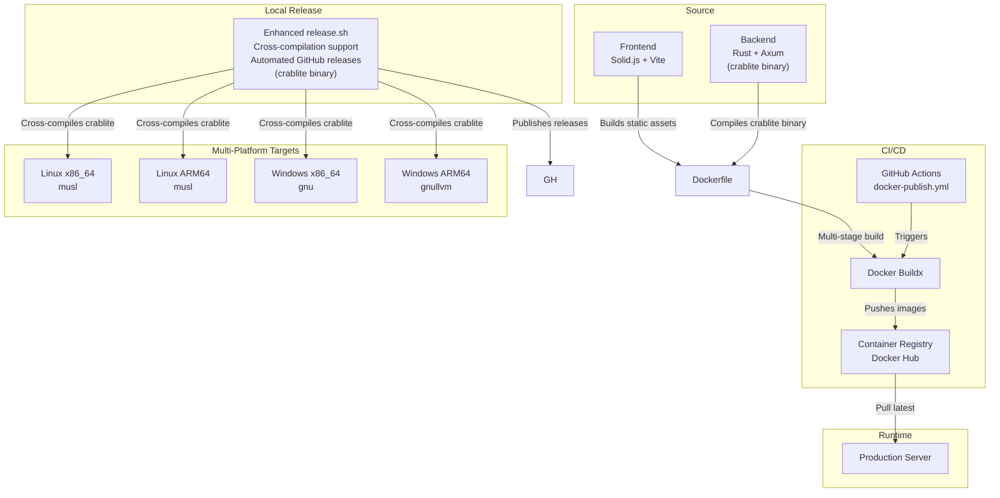
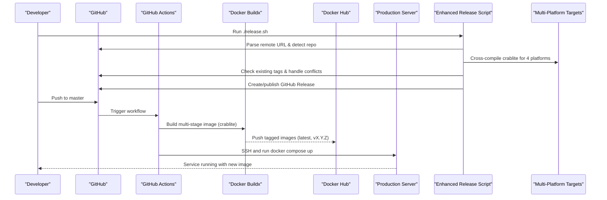
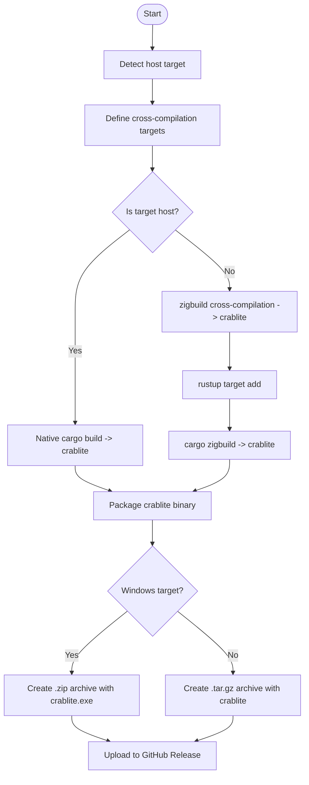
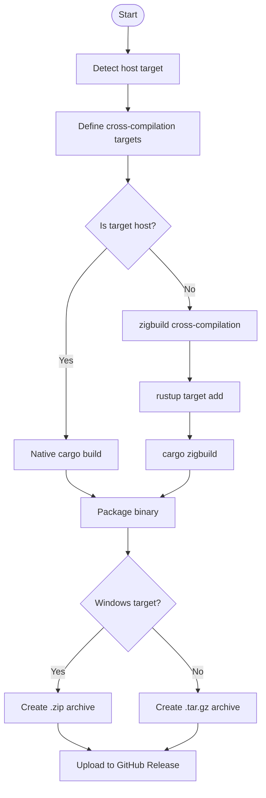
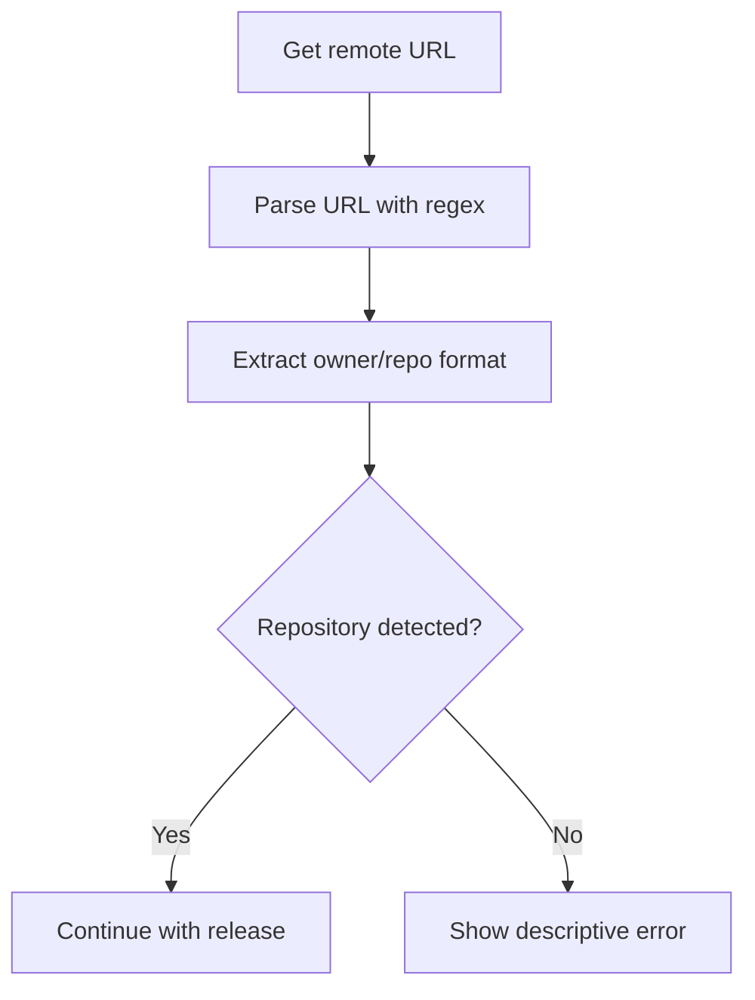
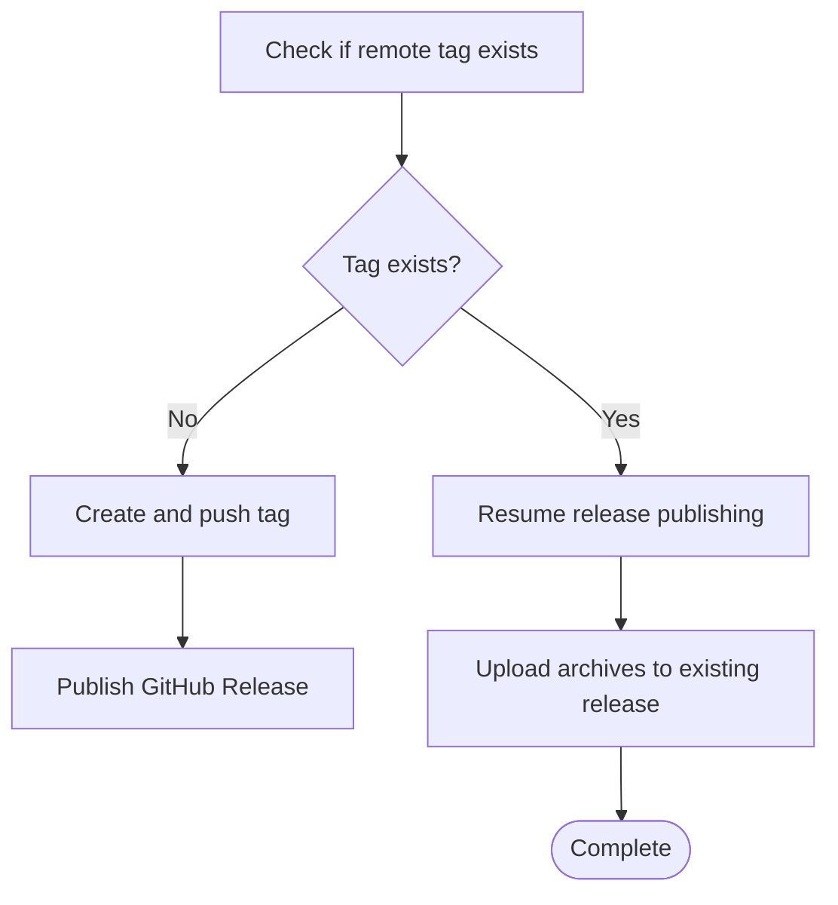
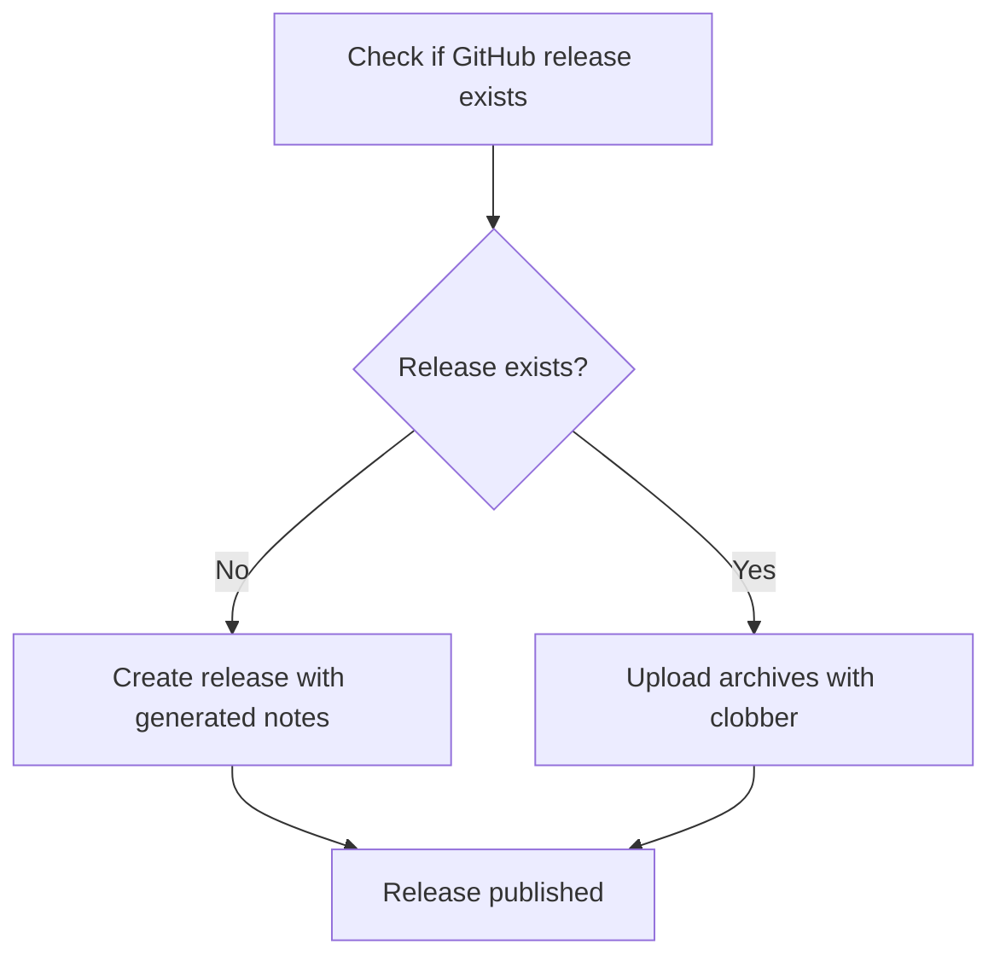
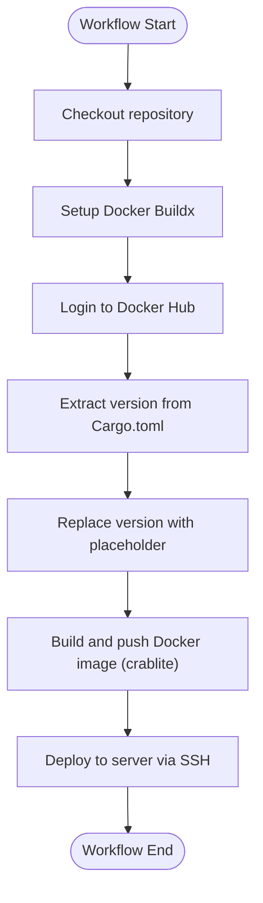
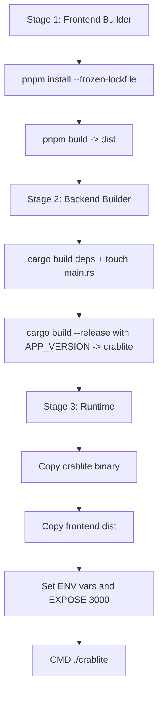
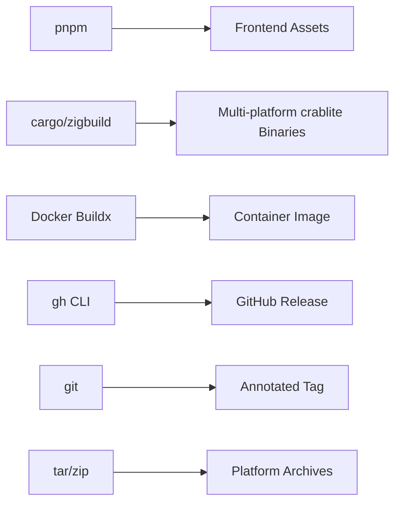

# Release Process

<cite>
**Referenced Files in This Document**
- [release.sh](file://release.sh)
- [docker-publish.yml](file://.github/workflows/docker-publish.yml)
- [Dockerfile](file://Dockerfile)
- [Cargo.toml](file://backend/Cargo.toml)
- [package.json](file://frontend/package.json)
- [README.md](file://README.md)
</cite>

## Update Summary
**Changes Made**
- Updated binary naming convention from 'rust-sqlite-webui' to 'crablite' throughout release process documentation
- Enhanced cross-compilation section to document comprehensive multi-platform support (x86_64-unknown-linux-musl, aarch64-unknown-linux-musl, x86_64-pc-windows-gnu, aarch64-pc-windows-gnullvm)
- Enhanced release automation documentation with new automated GitHub release handling
- Added detailed cross-compilation workflow and target platform specifications
- Updated artifact management section to reflect multi-platform archive generation with consistent 'crablite' binary naming
- Enhanced troubleshooting guide with cross-compilation specific issues and binary naming references

## Table of Contents
1. [Introduction](#introduction)
2. [Project Structure](#project-structure)
3. [Core Components](#core-components)
4. [Architecture Overview](#architecture-overview)
5. [Detailed Component Analysis](#detailed-component-analysis)
6. [Dependency Analysis](#dependency-analysis)
7. [Performance Considerations](#performance-considerations)
8. [Troubleshooting Guide](#troubleshooting-guide)
9. [Conclusion](#conclusion)
10. [Appendices](#appendices)

## Introduction
This document defines the release process for CrabLite, covering automated CI/CD workflows, version management, artifact creation and distribution, testing and security checks, deployment approvals, manual emergency procedures, rollback strategies, and post-release monitoring. It is intended for maintainers and operators who publish releases and deploy images to production. The process now includes comprehensive cross-compilation support for multiple platforms and automated GitHub release handling, with consistent 'crablite' binary naming across all artifacts.

## Project Structure
CrabLite consists of:
- A Rust backend (Axum-based server) that serves a SQLite WebUI and API endpoints, producing a 'crablite' binary.
- A Solid.js frontend built with Vite and TailwindCSS/DaisyUI.
- A multi-stage Dockerfile that builds both frontend assets and the Rust binary into a small Alpine runtime image.
- GitHub Actions workflow for building and publishing Docker images on push to master or via manual dispatch.
- An enhanced local release script with comprehensive cross-compilation support for multiple platforms and automated GitHub release handling, consistently using the 'crablite' binary name.

**Diagram sources**
- [docker-publish.yml:1-59](file://.github/workflows/docker-publish.yml#L1-L59)
- [Dockerfile:1-56](file://Dockerfile#L1-L56)
- [release.sh:49-55](file://release.sh#L49-L55)

**Section sources**
- [README.md:22-26](file://README.md#L22-L26)
- [README.md:27-68](file://README.md#L27-L68)

## Core Components
- Automated CI/CD pipeline: Builds and pushes Docker images to Docker Hub when code is pushed to master or when manually dispatched.
- Multi-stage Docker build: Compiles frontend assets with pnpm/Vite and compiles the Rust binary with cargo, then assembles a minimal runtime image containing the 'crablite' binary.
- Versioning: The application version is defined in the Rust package manifest and used by CI and release scripts.
- Enhanced local release automation: A bash script with comprehensive cross-compilation support for multiple platforms (Linux x86_64/aarch64, Windows x86_64/aarch64), automated GitHub repository detection, improved pre-existing remote tag handling, descriptive error messages, and automated GitHub release publishing validates prerequisites, builds artifacts with consistent 'crablite' binary naming, creates annotated git tags, and publishes GitHub Releases with auto-generated notes.

Key responsibilities:
- Frontend build: pnpm install --frozen-lockfile and vite build produce static assets under frontend/dist.
- Backend build: cargo build --release produces a stripped, optimized 'crablite' binary.
- Cross-compilation: Supports native and cross-compilation targets using zig and cargo-zigbuild, consistently producing 'crablite' binaries.
- Image tagging: CI extracts the version from the Rust manifest and tags images with both semantic version and latest.
- Deployment: CI pulls the latest image and recreates the service using docker compose on the target server.
- Repository detection: Enhanced parsing of GitHub remote URLs to automatically determine the repository path.
- Tag conflict resolution: Improved handling of pre-existing remote tags with resumption capabilities.
- Multi-platform packaging: Generates platform-specific archives (.tar.gz for Unix-like systems, .zip for Windows) containing the 'crablite' binary.

**Section sources**
- [docker-publish.yml:24-43](file://.github/workflows/docker-publish.yml#L24-L43)
- [Dockerfile:1-56](file://Dockerfile#L1-L56)
- [Cargo.toml:1-24](file://backend/Cargo.toml#L1-L24)
- [release.sh:26-32](file://release.sh#L26-L32)
- [release.sh:49-55](file://release.sh#L49-L55)
- [release.sh:108-116](file://release.sh#L108-L116)

## Architecture Overview
The release architecture integrates source control, containerization, registry, and deployment with enhanced local automation supporting multiple platforms and consistent 'crablite' binary naming:

**Diagram sources**
- [docker-publish.yml:1-59](file://.github/workflows/docker-publish.yml#L1-L59)
- [release.sh:26-32](file://release.sh#L26-L32)
- [release.sh:49-55](file://release.sh#L49-L55)
- [release.sh:108-116](file://release.sh#L108-L116)

## Detailed Component Analysis

### Enhanced Local Release Script with Cross-Compilation Support
The release script has been comprehensively overhauled to support cross-compilation for multiple platforms and automated GitHub release handling, with consistent 'crablite' binary naming:

#### Binary Naming Convention
The script now uses 'crablite' as the consistent binary name across all platforms:

**Diagram sources**
- [release.sh:49-55](file://release.sh#L49-L55)
- [release.sh:60-99](file://release.sh#L60-L99)

#### Cross-Compilation Target Support
The script now supports four target platforms with automatic platform detection and appropriate toolchain selection, consistently producing 'crablite' binaries:

**Diagram sources**
- [release.sh:49-55](file://release.sh#L49-L55)
- [release.sh:60-99](file://release.sh#L60-L99)

#### Supported Target Platforms
- **x86_64-unknown-linux-musl**: Static Linux binary for x86_64 systems (crablite)
- **aarch64-unknown-linux-musl**: Static Linux binary for ARM64 systems (crablite)  
- **x86_64-pc-windows-gnu**: Windows binary for x86_64 systems (crablite.exe)
- **aarch64-pc-windows-gnullvm**: Windows binary for ARM64 systems (crablite.exe)

#### GitHub Repository Detection
The script uses sophisticated remote URL parsing to automatically detect the GitHub repository:

**Diagram sources**
- [release.sh:26-32](file://release.sh#L26-L32)

#### Pre-existing Remote Tag Handling
Enhanced logic for handling pre-existing remote tags with resumption capabilities:

**Diagram sources**
- [release.sh:34-38](file://release.sh#L34-L38)
- [release.sh:108-116](file://release.sh#L108-L116)

#### Automated GitHub Release Handling
The script now automatically handles GitHub Release creation and archive uploads:

**Diagram sources**
- [release.sh:118-127](file://release.sh#L118-L127)

#### Descriptive Error Messages
All error conditions now provide clear, actionable feedback:
- Missing required commands with specific tool names including cross-compilation tools (zig, cargo-zigbuild)
- Dirty working tree with explicit cleanup instructions
- Version extraction failures with file path references
- GitHub repository detection failures with remote URL context
- Authentication status verification before proceeding
- Cross-compilation target validation

**Updated** Comprehensive cross-compilation support, automated GitHub release handling, enhanced repository detection, tag handling, error messaging, and consistent 'crablite' binary naming

**Section sources**
- [release.sh:8-13](file://release.sh#L8-L13)
- [release.sh:15-18](file://release.sh#L15-L18)
- [release.sh:20-24](file://release.sh#L20-L24)
- [release.sh:26-32](file://release.sh#L26-L32)
- [release.sh:34-38](file://release.sh#L34-L38)
- [release.sh:49-55](file://release.sh#L49-L55)
- [release.sh:60-99](file://release.sh#L60-L99)
- [release.sh:108-116](file://release.sh#L108-L116)
- [release.sh:118-127](file://release.sh#L118-L127)

### Automated CI/CD Pipeline (GitHub Actions)
The workflow triggers on push to master and manual dispatch. It performs:
- Checkout
- Setup Docker Buildx
- Login to Docker Hub
- Extract version from Cargo.toml and temporarily replace it with a placeholder to avoid embedding mutable metadata in images
- Build and push Docker images with tags based on the extracted version and latest
- Deploy to the production server via SSH using docker compose

**Diagram sources**
- [docker-publish.yml:1-59](file://.github/workflows/docker-publish.yml#L1-L59)

Operational details:
- Triggers: push to master branch and workflow_dispatch.
- Authentication: Docker Hub credentials are provided via secrets.
- Version handling: The workflow reads the version from the Rust manifest and uses it for image tags.
- Deployment: Uses an SSH action to pull the latest image and recreate the service with docker compose.

**Section sources**
- [docker-publish.yml:1-59](file://.github/workflows/docker-publish.yml#L1-L59)

### Multi-stage Docker Build
The Dockerfile orchestrates three stages:
- Frontend builder: Installs pnpm globally, installs dependencies with frozen lockfile, copies frontend source, and runs the build to produce static assets.
- Backend builder: Installs musl-dev for static linking, creates a dummy cargo project to cache dependencies, builds dependencies, copies actual source, touches main.rs to force rebuild, and builds the release binary with APP_VERSION injected via build arg, producing the 'crablite' binary.
- Runtime: Minimal Alpine image installing only runtime dependencies, copying the compiled 'crablite' binary and frontend assets, exposing port 3000, and setting environment variables.

**Diagram sources**
- [Dockerfile:1-56](file://Dockerfile#L1-L56)

**Section sources**
- [Dockerfile:1-56](file://Dockerfile#L1-L56)

### Version Management and Semantic Versioning
- Source of truth: The application version is declared in the Rust package manifest.
- CI usage: The workflow extracts this version to tag Docker images and injects it as a build argument.
- Local release: The enhanced release script reads the same version field to create tags and archives.

Semantic versioning practices:
- Use MAJOR.MINOR.PATCH format aligned with breaking changes, features, and fixes respectively.
- Keep the version synchronized across manifests; ensure lockfiles are updated before releasing.
- Avoid committing mutable metadata into images; CI replaces the version with a placeholder during build.

Version-related files:
- Application version definition: [Cargo.toml:1-24](file://backend/Cargo.toml#L1-L24)
- CI extraction and tagging: [docker-publish.yml:24-43](file://.github/workflows/docker-publish.yml#L24-L43)
- Local script version readout: [release.sh:20-24](file://release.sh#L20-L24)

**Section sources**
- [Cargo.toml:1-24](file://backend/Cargo.toml#L1-L24)
- [docker-publish.yml:24-43](file://.github/workflows/docker-publish.yml#L24-L43)
- [release.sh:20-24](file://release.sh#L20-L24)

### Changelog Maintenance
- GitHub Releases notes are auto-generated by the enhanced release script when creating a release.
- For detailed design documentation, refer to the design docs in the repository.

Changelog-related references:
- Auto-generating release notes: [release.sh:122-127](file://release.sh#L122-L127)
- Design documentation location: [README.md:145-148](file://README.md#L145-L148)

**Section sources**
- [release.sh:122-127](file://release.sh#L122-L127)
- [README.md:145-148](file://README.md#L145-L148)

### Enhanced Release Checklist
Before initiating a release, ensure the following:
- Prerequisites installed: cargo, cargo-zigbuild, gh CLI, git, pnpm, rustc, rustup, tar, zip, zig.
- Working tree clean: No uncommitted or stashed changes.
- Version bumped: Update the version in the Rust manifest and update lockfiles accordingly.
- Tests pass: Run frontend build and backend compilation locally to validate.
- Security scanning: Integrate dependency vulnerability scans (e.g., cargo audit, npm/pnpm audits) and container image scanning prior to pushing images.
- Artifact validation: Verify generated archives contain the correct 'crablite' binaries and frontend assets for all target platforms.
- Tagging: Ensure no local or remote tag conflicts exist; script handles pre-existing tags gracefully.
- Publishing: Enhanced script automatically detects GitHub repository and manages tag lifecycle.
- Deployment approval: Confirm deployment to production is approved per team policy.

Enhanced checklist mapping to implementation:
- Prerequisite checks: [release.sh:8-13](file://release.sh#L8-L13)
- Clean working tree check: [release.sh:15-18](file://release.sh#L15-L18)
- Version extraction and tag validation: [release.sh:20-24](file://release.sh#L20-L24)
- GitHub repository detection: [release.sh:26-32](file://release.sh#L26-L32)
- Pre-existing tag handling: [release.sh:34-38](file://release.sh#L34-L38)
- Auth status verification: [release.sh:40](file://release.sh#L40)
- Frontend build: [release.sh:42-47](file://release.sh#L42-L47)
- Cross-compilation setup: [release.sh:49-55](file://release.sh#L49-L55)
- Backend build: [release.sh:60-99](file://release.sh#L60-L99)
- Packaging: [release.sh:85-99](file://release.sh#L85-L99)
- Tag creation and push: [release.sh:108-116](file://release.sh#L108-L116)
- GitHub Release creation: [release.sh:118-127](file://release.sh#L118-L127)

**Section sources**
- [release.sh:8-127](file://release.sh#L8-L127)

### Testing Requirements
- Frontend: Validate that pnpm build completes successfully and produces assets under frontend/dist.
- Backend: Validate that cargo build --release completes without errors and produces the expected 'crablite' binary.
- Cross-compilation: Test builds for all target platforms to ensure compatibility and consistent 'crablite' binary naming.
- Integration: Optionally run smoke tests against a local instance serving the built frontend and backend.

References:
- Frontend build script: [package.json:6-9](file://frontend/package.json#L6-L9)
- Backend build profile: [Cargo.toml:20-24](file://backend/Cargo.toml#L20-L24)

**Section sources**
- [package.json:6-9](file://frontend/package.json#L6-L9)
- [Cargo.toml:20-24](file://backend/Cargo.toml#L20-L24)

### Security Scanning
Recommended additions to the release process:
- Dependency scanning:
  - Rust: cargo audit
  - JavaScript: pnpm audit
- Container scanning:
  - Scan images produced by CI before pushing to registries
- Secret management:
  - Store Docker Hub credentials and server SSH keys in repository secrets
  - Avoid hardcoding sensitive values in workflows or scripts

Current integration points:
- Docker Hub authentication via secrets: [docker-publish.yml:18-22](file://.github/workflows/docker-publish.yml#L18-L22)
- Server deployment via SSH secrets: [docker-publish.yml:45-58](file://.github/workflows/docker-publish.yml#L45-L58)

**Section sources**
- [docker-publish.yml:18-22](file://.github/workflows/docker-publish.yml#L18-L22)
- [docker-publish.yml:45-58](file://.github/workflows/docker-publish.yml#L45-L58)

### Artifact Validation
- Archive contents: Ensure each archive includes the compiled 'crablite' binary and the frontend dist directory for its target platform.
- Binary properties: Verify 'crablite' binaries are stripped and optimized according to the release profile.
- Asset integrity: Validate that frontend assets are present and correctly served by the runtime image.
- Platform compatibility: Verify 'crablite' binaries work on their intended target platforms.

Validation references:
- Archive packaging: [release.sh:85-99](file://release.sh#L85-L99)
- Release profile optimizations: [Cargo.toml:20-24](file://backend/Cargo.toml#L20-L24)
- Runtime asset inclusion: [Dockerfile:43-47](file://Dockerfile#L43-L47)

**Section sources**
- [release.sh:85-99](file://release.sh#L85-L99)
- [Cargo.toml:20-24](file://backend/Cargo.toml#L20-L24)
- [Dockerfile:43-47](file://Dockerfile#L43-L47)

### Deployment Approval Processes
- Automated deployment occurs on push to master and manual workflow dispatch.
- To enforce approvals:
  - Require branch protection rules and required reviews for master.
  - Add environment protection rules in GitHub Actions requiring manual approval before deploying to production.
  - Gate deployment steps behind approval gates in the workflow.

Current deployment behavior:
- Workflow triggers and deployment steps: [docker-publish.yml:1-59](file://.github/workflows/docker-publish.yml#L1-L59)

**Section sources**
- [docker-publish.yml:1-59](file://.github/workflows/docker-publish.yml#L1-L59)

### Manual Release Procedures
To perform a manual release with the enhanced script:
- Install required tools: cargo, cargo-zigbuild, gh CLI, git, pnpm, rustc, rustup, tar, zip, zig.
- Ensure the working tree is clean.
- Update the version in the Rust manifest and update lockfiles.
- Run the enhanced release script to build, cross-compile for multiple platforms, tag, and publish with improved error handling and consistent 'crablite' binary naming.

Enhanced script behavior:
- Validates commands and clean state with descriptive error messages
- Reads version and ensures tag uniqueness with resumption support
- Automatically detects GitHub repository from remote URL
- Authenticates with GitHub
- Builds frontend and backend for multiple targets (native + cross-compilation) producing 'crablite' binaries
- Packages archives with proper naming conventions for each platform
- Creates and pushes annotated tag with conflict resolution
- Publishes GitHub Release with auto-generated notes

Reference:
- [release.sh:1-128](file://release.sh#L1-L128)

**Section sources**
- [release.sh:1-128](file://release.sh#L1-L128)

### Emergency Fixes
For urgent hotfixes:
- Create a dedicated hotfix branch from the last stable tag.
- Apply minimal changes and bump the patch version.
- Run the enhanced release script to publish the fix quickly with improved error handling and cross-compilation support, ensuring consistent 'crablite' binary naming.
- Ensure CI deploys the fix immediately after merging to master or via manual workflow dispatch.

Considerations:
- Maintain clear commit messages and link issues to the hotfix.
- Communicate the incident and resolution timeline to stakeholders.
- Leverage enhanced script's resumption capabilities for interrupted releases.

[No sources needed since this section provides general guidance]

### Rollback Strategies
- Revert to previous image:
  - Identify the last known-good version tag.
  - Update docker compose configuration to pin the specific image tag.
  - Redeploy using docker compose up with the pinned tag.
- If necessary, roll back database migrations separately if applicable.

Current deployment mechanism:
- Production server uses docker compose to manage services: [docker-publish.yml:51-58](file://.github/workflows/docker-publish.yml#L51-L58)

**Section sources**
- [docker-publish.yml:51-58](file://.github/workflows/docker-publish.yml#L51-L58)

### Post-Release Monitoring
- Health checks:
  - Verify the service responds on port 3000.
  - Inspect logs via RUST_LOG and application logs.
- Metrics and alerts:
  - Monitor CPU, memory, and request latency.
  - Set alerts for error rates and downtime.
- User feedback:
  - Track user reports and feature requests related to the release.

Environment variables relevant to logging:
- [Dockerfile:50-51](file://Dockerfile#L50-L51)

**Section sources**
- [Dockerfile:50-51](file://Dockerfile#L50-L51)

### Release Artifacts Management
- Native binaries:
  - Archives include the compiled 'crablite' binary and frontend assets for each target platform.
  - Naming convention: crablite-v<VERSION>-<TARGET>.tar.gz (or .zip for Windows targets).
  - Multi-platform support: Linux x86_64/aarch64, Windows x86_64/aarch64.
  - Automatic platform detection determines archive format (.tar.gz vs .zip).
  - Consistent 'crablite' binary naming across all platforms.
- Distribution channels:
  - GitHub Releases for native archives across all supported platforms.
  - Docker Hub for container images.
- Update mechanisms for end users:
  - Pull the latest Docker image or download the appropriate archive for their platform.

Enhanced references:
- Archive naming and packaging: [release.sh:60-99](file://release.sh#L60-L99)
- Docker image tags: [docker-publish.yml:34-43](file://.github/workflows/docker-publish.yml#L34-L43)
- Usage instructions for Docker and prebuilt binaries: [README.md:27-68](file://README.md#L27-L68)

**Section sources**
- [release.sh:60-99](file://release.sh#L60-L99)
- [docker-publish.yml:34-43](file://.github/workflows/docker-publish.yml#L34-L43)
- [README.md:27-68](file://README.md#L27-L68)

## Dependency Analysis
The release process depends on:
- Frontend toolchain: Node.js and pnpm for building static assets.
- Backend toolchain: Rust, cargo, and cross-compilation tools (zig, cargo-zigbuild) for compiling 'crablite' binaries.
- Container toolchain: Docker and Buildx for building and pushing images.
- Git and GitHub CLI for tagging and publishing releases.
- Archive tools: tar and zip for creating platform-specific archives.

**Diagram sources**
- [package.json:6-9](file://frontend/package.json#L6-L9)
- [Cargo.toml:1-24](file://backend/Cargo.toml#L1-L24)
- [docker-publish.yml:1-59](file://.github/workflows/docker-publish.yml#L1-L59)
- [release.sh:8-13](file://release.sh#L8-L13)
- [release.sh:60-99](file://release.sh#L60-L99)

**Section sources**
- [package.json:6-9](file://frontend/package.json#L6-L9)
- [Cargo.toml:1-24](file://backend/Cargo.toml#L1-L24)
- [docker-publish.yml:1-59](file://.github/workflows/docker-publish.yml#L1-L59)
- [release.sh:8-13](file://release.sh#L8-L13)
- [release.sh:60-99](file://release.sh#L60-L99)

## Performance Considerations
- Frontend build caching: Use pnpm's lockfile and CI caching to speed up builds.
- Backend optimization: The release profile enables stripping symbols, LTO, and single codegen unit for smaller and faster 'crablite' binaries.
- Image size: Multi-stage builds and minimal Alpine runtime keep images small.
- Cross-compilation: Efficient multi-platform builds using zig for faster compilation times.
- Parallel builds: Native and cross-compilation builds are executed sequentially but efficiently.

Optimization references:
- Frontend build command: [package.json:6-9](file://frontend/package.json#L6-L9)
- Backend release profile: [Cargo.toml:20-24](file://backend/Cargo.toml#L20-L24)
- Runtime minimization: [Dockerfile:37-56](file://Dockerfile#L37-L56)
- Cross-compilation setup: [release.sh:49-55](file://release.sh#L49-L55)

**Section sources**
- [package.json:6-9](file://frontend/package.json#L6-L9)
- [Cargo.toml:20-24](file://backend/Cargo.toml#L20-L24)
- [Dockerfile:37-56](file://Dockerfile#L37-L56)
- [release.sh:49-55](file://release.sh#L49-L55)

## Troubleshooting Guide
Common issues and resolutions with enhanced error handling and cross-compilation support:
- Missing tools: Ensure cargo, cargo-zigbuild, gh, git, pnpm, rustc, rustup, tar, zip, and zig are installed.
- Dirty working tree: Commit or stash changes before running the release script.
- Version not found: Verify the version field exists in the Rust manifest.
- GitHub repository detection failed: Check remote URL format and ensure it points to GitHub.
- Tag conflicts: Enhanced script handles pre-existing tags gracefully with resumption support.
- GitHub auth failures: Authenticate gh CLI before running the release script.
- Frontend build failures: Check pnpm install and build outputs.
- Backend build failures: Validate cargo build --release output and dependencies.
- Cross-compilation failures: Ensure zig and cargo-zigbuild are properly configured for target platforms.
- Docker login failures: Verify Docker Hub token secret is configured.
- Deployment failures: Check SSH credentials and docker compose configuration on the server.
- Platform-specific issues: Verify target platform compatibility and toolchain availability.
- Binary naming issues: Ensure 'crablite' binary name is consistent across all platforms and artifacts.

Enhanced validation checks:
- Tool presence validation: [release.sh:8-13](file://release.sh#L8-L13)
- Clean state validation: [release.sh:15-18](file://release.sh#L15-L18)
- Version extraction: [release.sh:20-24](file://release.sh#L20-L24)
- GitHub repository detection: [release.sh:26-32](file://release.sh#L26-L32)
- Pre-existing tag handling: [release.sh:34-38](file://release.sh#L34-L38)
- GitHub auth status: [release.sh:40](file://release.sh#L40)
- Frontend build: [release.sh:42-47](file://release.sh#L42-L47)
- Cross-compilation setup: [release.sh:49-55](file://release.sh#L49-L55)
- Backend build: [release.sh:60-99](file://release.sh#L60-L99)
- Archive creation: [release.sh:85-99](file://release.sh#L85-L99)
- Tag management: [release.sh:108-116](file://release.sh#L108-L116)
- Release publishing: [release.sh:118-127](file://release.sh#L118-L127)
- Docker Hub login: [docker-publish.yml:18-22](file://.github/workflows/docker-publish.yml#L18-L22)
- Server deployment: [docker-publish.yml:45-58](file://.github/workflows/docker-publish.yml#L45-L58)

**Section sources**
- [release.sh:8-127](file://release.sh#L8-L127)
- [docker-publish.yml:18-58](file://.github/workflows/docker-publish.yml#L18-L58)

## Conclusion
CrabLite's release process combines automated CI/CD with robust enhanced local scripting to ensure consistent, secure, and efficient delivery of updates. The comprehensive cross-compilation support for multiple platforms, improved repository detection, better error handling, enhanced tag conflict resolution, and consistent 'crablite' binary naming make the release process more reliable and user-friendly. By adhering to the outlined checklist, versioning practices, and operational guidelines, maintainers can confidently publish releases, manage multi-platform artifacts, and deploy to production while maintaining high reliability and performance.

[No sources needed since this section summarizes without analyzing specific files]

## Appendices

### Environment Variables and Configuration
- Logging level: RUST_LOG
- Port: PORT
- Authentication key: API_KEY
- OpenAI settings: OPENAI_API_KEY, OPENAI_BASE_URL, OPENAI_MODEL

Configuration references:
- [README.md:70-83](file://README.md#L70-L83)
- [Dockerfile:50-51](file://Dockerfile#L50-L51)

**Section sources**
- [README.md:70-83](file://README.md#L70-L83)
- [Dockerfile:50-51](file://Dockerfile#L50-L51)

### Enhanced Release Script Features
The enhanced release script provides several improvements over the original implementation:

#### Binary Naming Consistency
- Consistent 'crablite' binary name across all platforms and artifacts
- Automatic handling of .exe extension for Windows targets
- Proper binary path resolution for both native and cross-compilation builds

#### Cross-Compilation Support
- Automatic detection of host target platform
- Support for four target platforms: Linux x86_64/aarch64, Windows x86_64/aarch64
- Intelligent toolchain selection (native cargo vs zigbuild)
- Platform-specific archive formats (.tar.gz vs .zip)
- Consistent naming conventions across platforms

#### Repository Detection
- Automatic parsing of GitHub remote URLs
- Support for various GitHub URL formats (HTTPS, SSH)
- Clear error messages when repository cannot be determined

#### Tag Management
- Graceful handling of pre-existing remote tags
- Resumption capability for interrupted releases
- Conflict resolution without manual intervention

#### Automated GitHub Release Handling
- Automatic detection of existing GitHub releases
- Clobber upload for existing releases
- Auto-generated release notes
- Seamless archive upload workflow

#### Error Handling
- Descriptive error messages for all failure scenarios
- Specific tool requirements with installation guidance
- Comprehensive validation of prerequisites

**Section sources**
- [release.sh:26-32](file://release.sh#L26-L32)
- [release.sh:34-38](file://release.sh#L34-L38)
- [release.sh:49-55](file://release.sh#L49-L55)
- [release.sh:60-99](file://release.sh#L60-L99)
- [release.sh:118-127](file://release.sh#L118-L127)