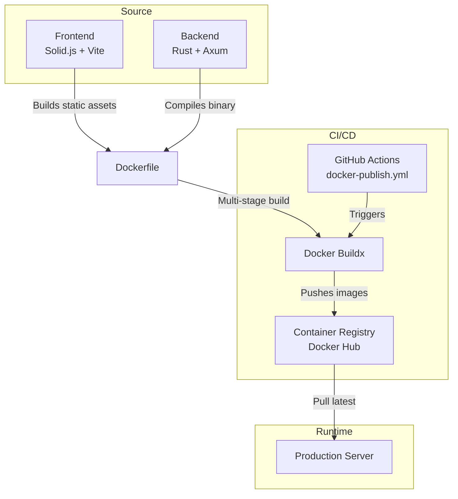
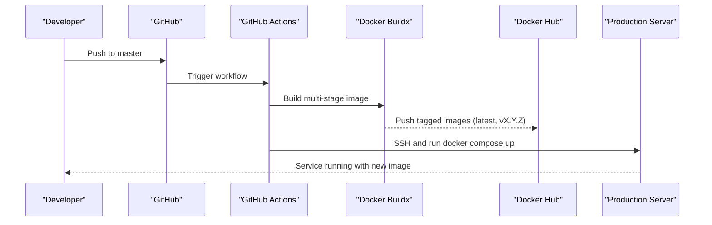
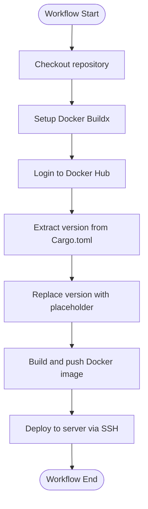
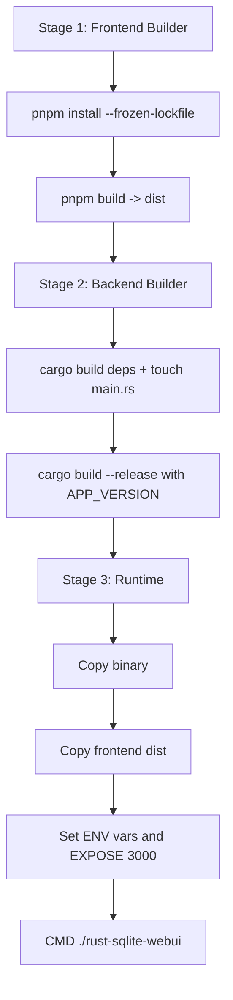
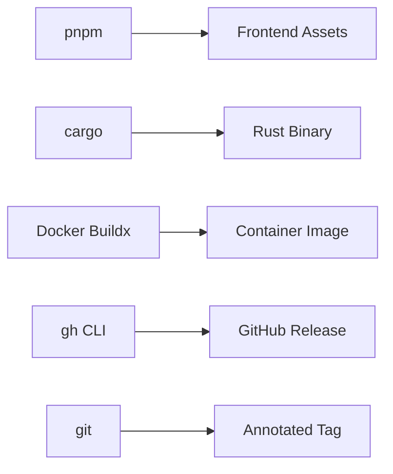

# Release Process

<cite>
**Referenced Files in This Document**
- [docker-publish.yml](file://.github/workflows/docker-publish.yml)
- [Dockerfile](file://Dockerfile)
- [Cargo.toml](file://backend/Cargo.toml)
- [package.json](file://frontend/package.json)
- [release.sh](file://release.sh)
- [README.md](file://README.md)
</cite>

## Table of Contents
1. [Introduction](#introduction)
2. [Project Structure](#project-structure)
3. [Core Components](#core-components)
4. [Architecture Overview](#architecture-overview)
5. [Detailed Component Analysis](#detailed-component-analysis)
6. [Dependency Analysis](#dependency-analysis)
7. [Performance Considerations](#performance-considerations)
8. [Troubleshooting Guide](#troubleshooting-guide)
9. [Conclusion](#conclusion)
10. [Appendices](#appendices)

## Introduction
This document defines the release process for CrabLite, covering automated CI/CD workflows, version management, artifact creation and distribution, testing and security checks, deployment approvals, manual emergency procedures, rollback strategies, and post-release monitoring. It is intended for maintainers and operators who publish releases and deploy images to production.

## Project Structure
CrabLite consists of:
- A Rust backend (Axum-based server) that serves a SQLite WebUI and API endpoints.
- A Solid.js frontend built with Vite and TailwindCSS/DaisyUI.
- A multi-stage Dockerfile that builds both frontend assets and the Rust binary into a small Alpine runtime image.
- GitHub Actions workflow for building and publishing Docker images on push to master or via manual dispatch.
- A local release script that builds artifacts, tags versions, and publishes GitHub Releases.

**Diagram sources**
- [docker-publish.yml:1-59](file://.github/workflows/docker-publish.yml#L1-L59)
- [Dockerfile:1-56](file://Dockerfile#L1-L56)

**Section sources**
- [README.md:22-26](file://README.md#L22-L26)
- [README.md:27-68](file://README.md#L27-L68)

## Core Components
- Automated CI/CD pipeline: Builds and pushes Docker images to Docker Hub when code is pushed to master or when manually dispatched.
- Multi-stage Docker build: Compiles frontend assets with pnpm/Vite and compiles the Rust binary with cargo, then assembles a minimal runtime image.
- Versioning: The application version is defined in the Rust package manifest and used by CI and release scripts.
- Local release automation: A bash script validates prerequisites, builds artifacts, creates annotated git tags, and publishes GitHub Releases with auto-generated notes.

Key responsibilities:
- Frontend build: pnpm install --frozen-lockfile and vite build produce static assets under frontend/dist.
- Backend build: cargo build --release produces a stripped, optimized binary.
- Image tagging: CI extracts the version from the Rust manifest and tags images with both semantic version and latest.
- Deployment: CI pulls the latest image and recreates the service using docker compose on the target server.

**Section sources**
- [docker-publish.yml:24-43](file://.github/workflows/docker-publish.yml#L24-L43)
- [Dockerfile:1-56](file://Dockerfile#L1-L56)
- [Cargo.toml:1-24](file://backend/Cargo.toml#L1-L24)
- [release.sh:1-69](file://release.sh#L1-L69)

## Architecture Overview
The release architecture integrates source control, containerization, registry, and deployment:

**Diagram sources**
- [docker-publish.yml:1-59](file://.github/workflows/docker-publish.yml#L1-L59)

## Detailed Component Analysis

### Automated CI/CD Pipeline (GitHub Actions)
The workflow triggers on push to master and manual dispatch. It performs:
- Checkout
- Setup Docker Buildx
- Login to Docker Hub
- Extract version from Cargo.toml and temporarily replace it with a placeholder to avoid embedding mutable metadata in images
- Build and push Docker images with tags based on the extracted version and latest
- Deploy to the production server via SSH using docker compose

**Diagram sources**
- [docker-publish.yml:1-59](file://.github/workflows/docker-publish.yml#L1-L59)

Operational details:
- Triggers: push to master branch and workflow_dispatch.
- Authentication: Docker Hub credentials are provided via secrets.
- Version handling: The workflow reads the version from the Rust manifest and uses it for image tags.
- Deployment: Uses an SSH action to pull the latest image and recreate the service with docker compose.

**Section sources**
- [docker-publish.yml:1-59](file://.github/workflows/docker-publish.yml#L1-L59)

### Multi-stage Docker Build
The Dockerfile orchestrates three stages:
- Frontend builder: Installs pnpm globally, installs dependencies with frozen lockfile, copies frontend source, and runs the build to produce static assets.
- Backend builder: Installs musl-dev for static linking, creates a dummy cargo project to cache dependencies, builds dependencies, copies actual source, touches main.rs to force rebuild, and builds the release binary with APP_VERSION injected via build arg.
- Runtime: Minimal Alpine image installing only runtime dependencies, copying the compiled binary and frontend assets, exposing port 3000, and setting environment variables.

**Diagram sources**
- [Dockerfile:1-56](file://Dockerfile#L1-L56)

**Section sources**
- [Dockerfile:1-56](file://Dockerfile#L1-L56)

### Version Management and Semantic Versioning
- Source of truth: The application version is declared in the Rust package manifest.
- CI usage: The workflow extracts this version to tag Docker images and injects it as a build argument.
- Local release: The release script reads the same version field to create tags and archives.

Semantic versioning practices:
- Use MAJOR.MINOR.PATCH format aligned with breaking changes, features, and fixes respectively.
- Keep the version synchronized across manifests; ensure lockfiles are updated before releasing.
- Avoid committing mutable metadata into images; CI replaces the version with a placeholder during build.

Version-related files:
- Application version definition: [Cargo.toml:1-24](file://backend/Cargo.toml#L1-L24)
- CI extraction and tagging: [docker-publish.yml:24-43](file://.github/workflows/docker-publish.yml#L24-L43)
- Local script version readout: [release.sh:20-26](file://release.sh#L20-L26)

**Section sources**
- [Cargo.toml:1-24](file://backend/Cargo.toml#L1-L24)
- [docker-publish.yml:24-43](file://.github/workflows/docker-publish.yml#L24-L43)
- [release.sh:20-26](file://release.sh#L20-L26)

### Changelog Maintenance
- GitHub Releases notes are auto-generated by the release script when creating a release.
- For detailed design documentation, refer to the design docs in the repository.

Changelog-related references:
- Auto-generating release notes: [release.sh:65-68](file://release.sh#L65-L68)
- Design documentation location: [README.md:145-148](file://README.md#L145-L148)

**Section sources**
- [release.sh:65-68](file://release.sh#L65-L68)
- [README.md:145-148](file://README.md#L145-L148)

### Release Checklist
Before initiating a release, ensure the following:
- Prerequisites installed: cargo, gh CLI, git, pnpm, rustc, tar.
- Working tree clean: No uncommitted or stashed changes.
- Version bumped: Update the version in the Rust manifest and update lockfiles accordingly.
- Tests pass: Run frontend build and backend compilation locally to validate.
- Security scanning: Integrate dependency vulnerability scans (e.g., cargo audit, npm/pnpm audits) and container image scanning prior to pushing images.
- Artifact validation: Verify generated archive contains the correct binary and frontend assets.
- Tagging: Ensure no local or remote tag conflicts exist.
- Publishing: Create annotated tag and publish GitHub Release with generated notes.
- Deployment approval: Confirm deployment to production is approved per team policy.

Checklist mapping to implementation:
- Prerequisite checks: [release.sh:8-13](file://release.sh#L8-L13)
- Clean working tree check: [release.sh:15-18](file://release.sh#L15-L18)
- Version extraction and tag validation: [release.sh:20-34](file://release.sh#L20-L34)
- Auth status verification: [release.sh:36](file://release.sh#L36)
- Frontend build: [release.sh:38-43](file://release.sh#L38-L43)
- Backend build: [release.sh:45-46](file://release.sh#L45-L46)
- Packaging: [release.sh:48-59](file://release.sh#L48-L59)
- Tag creation and push: [release.sh:61-63](file://release.sh#L61-L63)
- GitHub Release creation: [release.sh:65-68](file://release.sh#L65-L68)

**Section sources**
- [release.sh:8-68](file://release.sh#L8-L68)

### Testing Requirements
- Frontend: Validate that pnpm build completes successfully and produces assets under frontend/dist.
- Backend: Validate that cargo build --release completes without errors and produces the expected binary.
- Integration: Optionally run smoke tests against a local instance serving the built frontend and backend.

References:
- Frontend build script: [package.json:6-9](file://frontend/package.json#L6-L9)
- Backend build profile: [Cargo.toml:20-24](file://backend/Cargo.toml#L20-L24)

**Section sources**
- [package.json:6-9](file://frontend/package.json#L6-L9)
- [Cargo.toml:20-24](file://backend/Cargo.toml#L20-L24)

### Security Scanning
Recommended additions to the release process:
- Dependency scanning:
  - Rust: cargo audit
  - JavaScript: pnpm audit
- Container scanning:
  - Scan images produced by CI before pushing to registries
- Secret management:
  - Store Docker Hub credentials and server SSH keys in repository secrets
  - Avoid hardcoding sensitive values in workflows or scripts

Current integration points:
- Docker Hub authentication via secrets: [docker-publish.yml:18-22](file://.github/workflows/docker-publish.yml#L18-L22)
- Server deployment via SSH secrets: [docker-publish.yml:45-58](file://.github/workflows/docker-publish.yml#L45-L58)

**Section sources**
- [docker-publish.yml:18-22](file://.github/workflows/docker-publish.yml#L18-L22)
- [docker-publish.yml:45-58](file://.github/workflows/docker-publish.yml#L45-L58)

### Artifact Validation
- Archive contents: Ensure the tar.gz includes the compiled binary and the frontend dist directory.
- Binary properties: Verify the binary is stripped and optimized according to the release profile.
- Asset integrity: Validate that frontend assets are present and correctly served by the runtime image.

Validation references:
- Archive packaging: [release.sh:48-59](file://release.sh#L48-L59)
- Release profile optimizations: [Cargo.toml:20-24](file://backend/Cargo.toml#L20-L24)
- Runtime asset inclusion: [Dockerfile:43-47](file://Dockerfile#L43-L47)

**Section sources**
- [release.sh:48-59](file://release.sh#L48-L59)
- [Cargo.toml:20-24](file://backend/Cargo.toml#L20-L24)
- [Dockerfile:43-47](file://Dockerfile#L43-L47)

### Deployment Approval Processes
- Automated deployment occurs on push to master and manual workflow dispatch.
- To enforce approvals:
  - Require branch protection rules and required reviews for master.
  - Add environment protection rules in GitHub Actions requiring manual approval before deploying to production.
  - Gate deployment steps behind approval gates in the workflow.

Current deployment behavior:
- Workflow triggers and deployment steps: [docker-publish.yml:1-59](file://.github/workflows/docker-publish.yml#L1-L59)

**Section sources**
- [docker-publish.yml:1-59](file://.github/workflows/docker-publish.yml#L1-L59)

### Manual Release Procedures
To perform a manual release:
- Install required tools: cargo, gh CLI, git, pnpm, rustc, tar.
- Ensure the working tree is clean.
- Update the version in the Rust manifest and update lockfiles.
- Run the release script to build, tag, and publish.

Script behavior:
- Validates commands and clean state
- Reads version and ensures tag uniqueness
- Authenticates with GitHub
- Builds frontend and backend
- Packages archive
- Creates and pushes annotated tag
- Publishes GitHub Release with auto-generated notes

Reference:
- [release.sh:1-69](file://release.sh#L1-L69)

**Section sources**
- [release.sh:1-69](file://release.sh#L1-L69)

### Emergency Fixes
For urgent hotfixes:
- Create a dedicated hotfix branch from the last stable tag.
- Apply minimal changes and bump the patch version.
- Run the release script to publish the fix quickly.
- Ensure CI deploys the fix immediately after merging to master or via manual workflow dispatch.

Considerations:
- Maintain clear commit messages and link issues to the hotfix.
- Communicate the incident and resolution timeline to stakeholders.

[No sources needed since this section provides general guidance]

### Rollback Strategies
- Revert to previous image:
  - Identify the last known-good version tag.
  - Update docker compose configuration to pin the specific image tag.
  - Redeploy using docker compose up with the pinned tag.
- If necessary, roll back database migrations separately if applicable.

Current deployment mechanism:
- Production server uses docker compose to manage services: [docker-publish.yml:51-58](file://.github/workflows/docker-publish.yml#L51-L58)

**Section sources**
- [docker-publish.yml:51-58](file://.github/workflows/docker-publish.yml#L51-L58)

### Post-Release Monitoring
- Health checks:
  - Verify the service responds on port 3000.
  - Inspect logs via RUST_LOG and application logs.
- Metrics and alerts:
  - Monitor CPU, memory, and request latency.
  - Set alerts for error rates and downtime.
- User feedback:
  - Track user reports and feature requests related to the release.

Environment variables relevant to logging:
- [Dockerfile:50-51](file://Dockerfile#L50-L51)

**Section sources**
- [Dockerfile:50-51](file://Dockerfile#L50-L51)

### Release Artifacts Management
- Native binaries:
  - Archives include the compiled binary and frontend assets.
  - Naming convention: rust-sqlite-webui-v<VERSION>-<TARGET>.tar.gz
- Distribution channels:
  - GitHub Releases for native archives.
  - Docker Hub for container images.
- Update mechanisms for end users:
  - Pull the latest Docker image or download the appropriate archive for their platform.

References:
- Archive naming and packaging: [release.sh:48-59](file://release.sh#L48-L59)
- Docker image tags: [docker-publish.yml:34-43](file://.github/workflows/docker-publish.yml#L34-L43)
- Usage instructions for Docker and prebuilt binaries: [README.md:27-68](file://README.md#L27-L68)

**Section sources**
- [release.sh:48-59](file://release.sh#L48-L59)
- [docker-publish.yml:34-43](file://.github/workflows/docker-publish.yml#L34-L43)
- [README.md:27-68](file://README.md#L27-L68)

## Dependency Analysis
The release process depends on:
- Frontend toolchain: Node.js and pnpm for building static assets.
- Backend toolchain: Rust and cargo for compiling the binary.
- Container toolchain: Docker and Buildx for building and pushing images.
- Git and GitHub CLI for tagging and publishing releases.

**Diagram sources**
- [package.json:6-9](file://frontend/package.json#L6-L9)
- [Cargo.toml:1-24](file://backend/Cargo.toml#L1-L24)
- [docker-publish.yml:1-59](file://.github/workflows/docker-publish.yml#L1-L59)
- [release.sh:1-69](file://release.sh#L1-L69)

**Section sources**
- [package.json:6-9](file://frontend/package.json#L6-L9)
- [Cargo.toml:1-24](file://backend/Cargo.toml#L1-L24)
- [docker-publish.yml:1-59](file://.github/workflows/docker-publish.yml#L1-L59)
- [release.sh:1-69](file://release.sh#L1-L69)

## Performance Considerations
- Frontend build caching: Use pnpm’s lockfile and CI caching to speed up builds.
- Backend optimization: The release profile enables stripping symbols, LTO, and single codegen unit for smaller and faster binaries.
- Image size: Multi-stage builds and minimal Alpine runtime keep images small.

Optimization references:
- Frontend build command: [package.json:6-9](file://frontend/package.json#L6-L9)
- Backend release profile: [Cargo.toml:20-24](file://backend/Cargo.toml#L20-L24)
- Runtime minimization: [Dockerfile:37-56](file://Dockerfile#L37-L56)

**Section sources**
- [package.json:6-9](file://frontend/package.json#L6-L9)
- [Cargo.toml:20-24](file://backend/Cargo.toml#L20-L24)
- [Dockerfile:37-56](file://Dockerfile#L37-L56)

## Troubleshooting Guide
Common issues and resolutions:
- Missing tools: Ensure cargo, gh, git, pnpm, rustc, and tar are installed.
- Dirty working tree: Commit or stash changes before running the release script.
- Version not found: Verify the version field exists in the Rust manifest.
- Tag conflicts: Ensure no local or remote tag exists for the target version.
- GitHub auth failures: Authenticate gh CLI before running the release script.
- Frontend build failures: Check pnpm install and build outputs.
- Backend build failures: Validate cargo build --release output and dependencies.
- Docker login failures: Verify Docker Hub token secret is configured.
- Deployment failures: Check SSH credentials and docker compose configuration on the server.

Relevant checks:
- Tool presence validation: [release.sh:8-13](file://release.sh#L8-L13)
- Clean state validation: [release.sh:15-18](file://release.sh#L15-L18)
- Version extraction: [release.sh:20-24](file://release.sh#L20-L24)
- Tag conflict checks: [release.sh:26-34](file://release.sh#L26-L34)
- GitHub auth status: [release.sh:36](file://release.sh#L36)
- Frontend build: [release.sh:38-43](file://release.sh#L38-L43)
- Backend build: [release.sh:45-46](file://release.sh#L45-L46)
- Docker Hub login: [docker-publish.yml:18-22](file://.github/workflows/docker-publish.yml#L18-L22)
- Server deployment: [docker-publish.yml:45-58](file://.github/workflows/docker-publish.yml#L45-L58)

**Section sources**
- [release.sh:8-46](file://release.sh#L8-L46)
- [docker-publish.yml:18-58](file://.github/workflows/docker-publish.yml#L18-L58)

## Conclusion
CrabLite’s release process combines automated CI/CD with robust local scripting to ensure consistent, secure, and efficient delivery of updates. By adhering to the outlined checklist, versioning practices, and operational guidelines, maintainers can confidently publish releases, manage artifacts, and deploy to production while maintaining high reliability and performance.

[No sources needed since this section summarizes without analyzing specific files]

## Appendices

### Environment Variables and Configuration
- Logging level: RUST_LOG
- Port: PORT
- Authentication key: API_KEY
- OpenAI settings: OPENAI_API_KEY, OPENAI_BASE_URL, OPENAI_MODEL

Configuration references:
- [README.md:70-83](file://README.md#L70-L83)
- [Dockerfile:50-51](file://Dockerfile#L50-L51)

**Section sources**
- [README.md:70-83](file://README.md#L70-L83)
- [Dockerfile:50-51](file://Dockerfile#L50-L51)