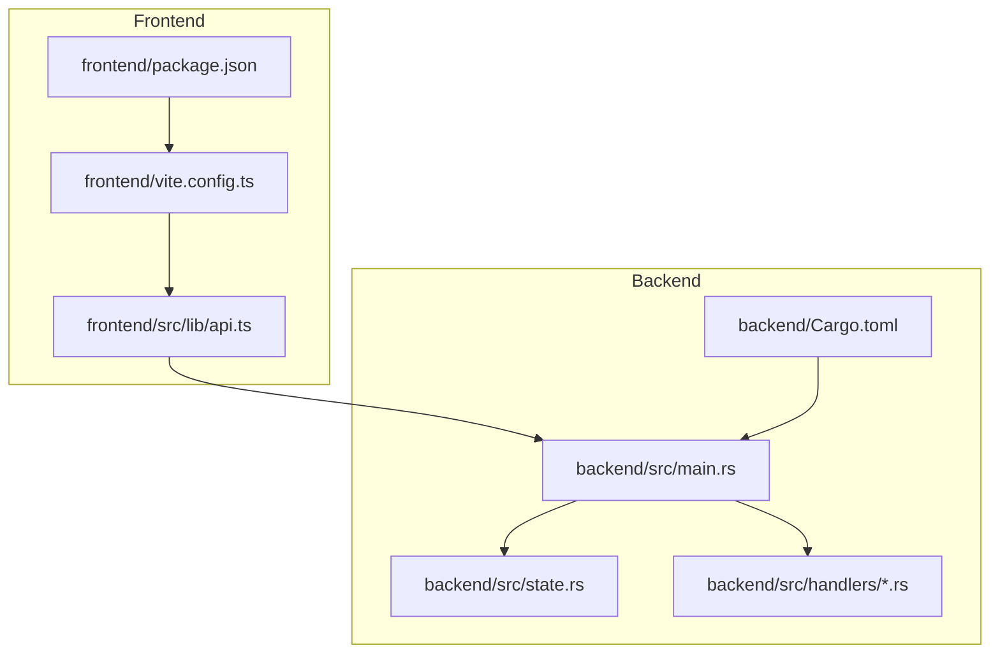
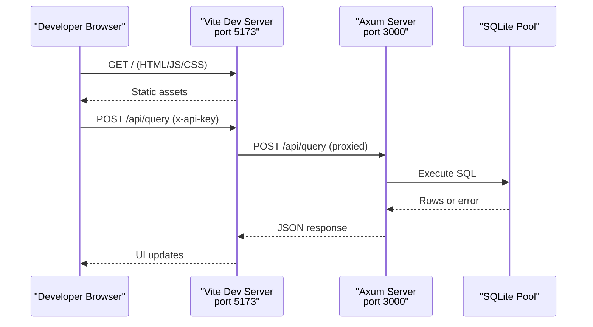
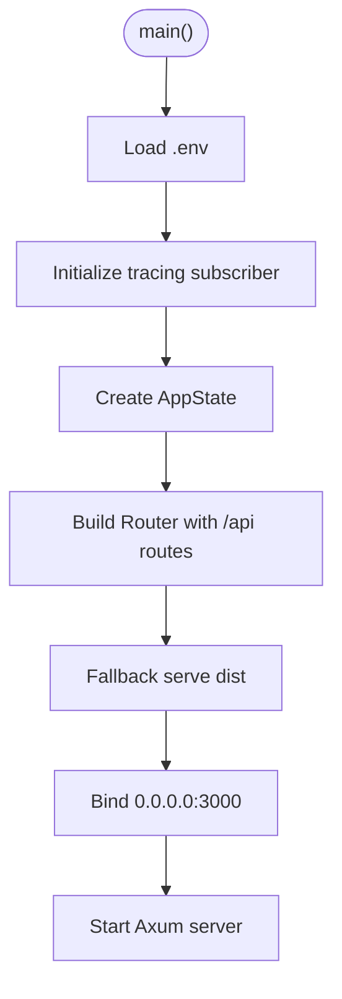
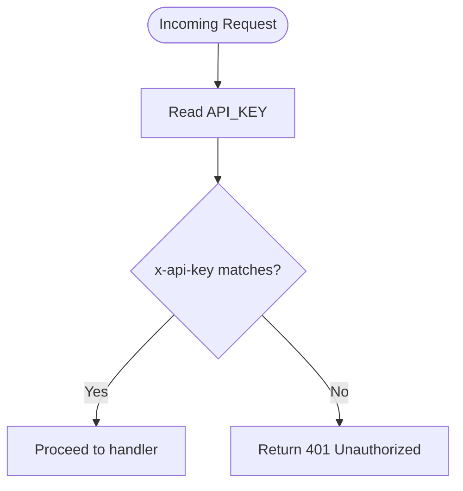
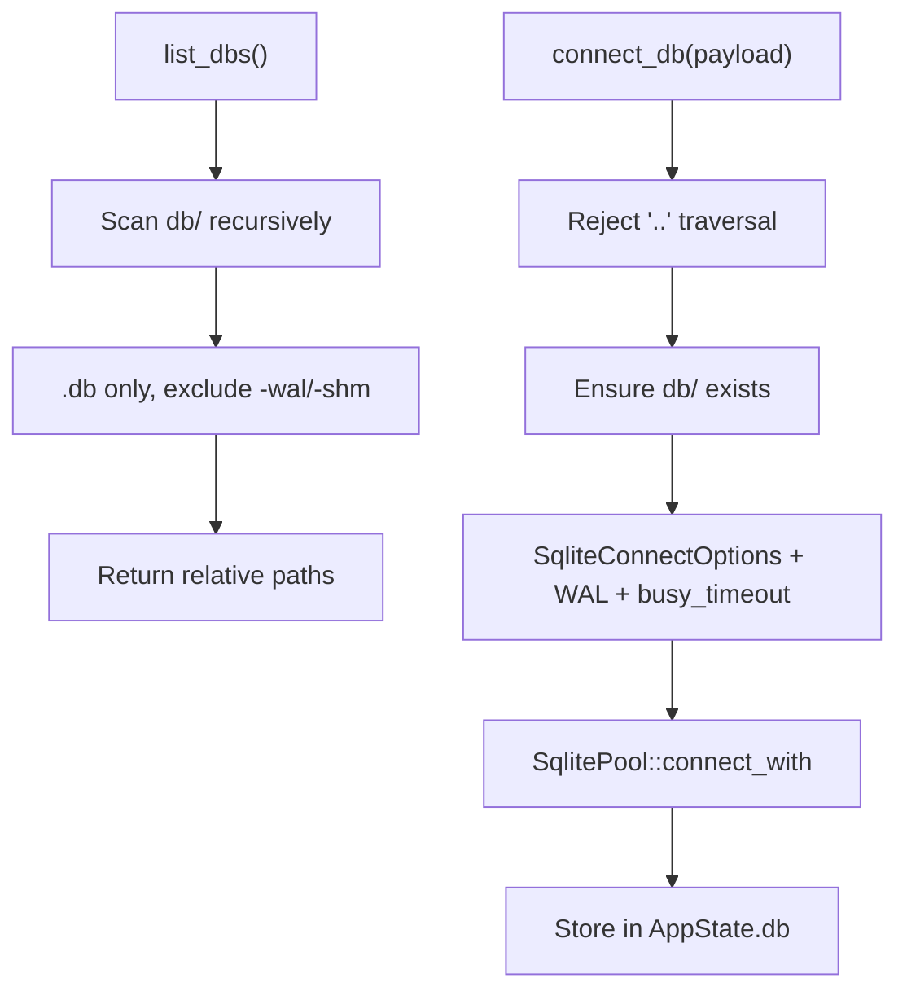
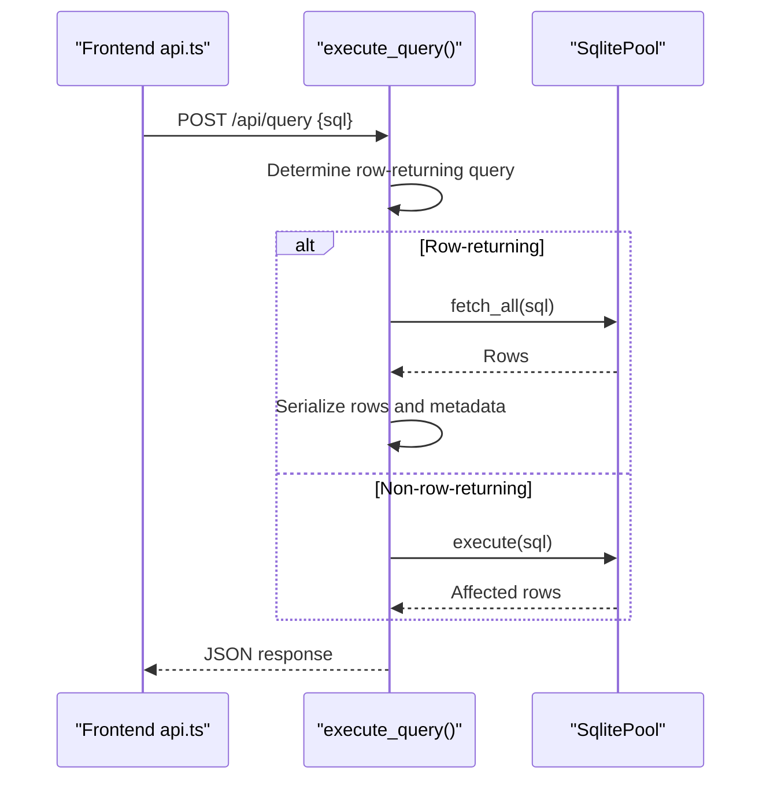
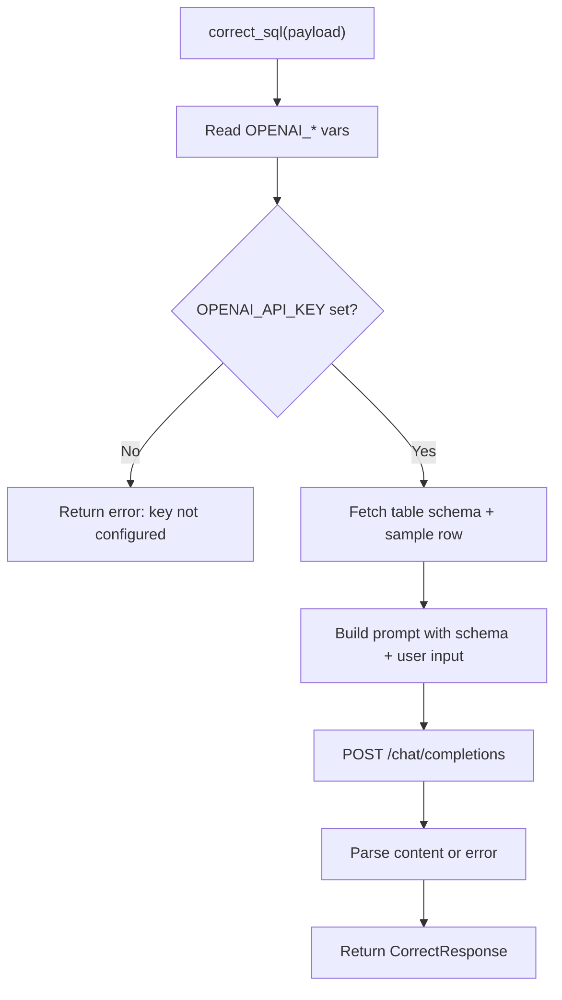
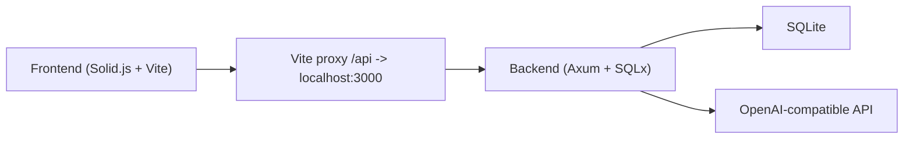

# Development Workflow

<cite>
**Referenced Files in This Document**
- [README.md](file://README.md)
- [backend/Cargo.toml](file://backend/Cargo.toml)
- [frontend/package.json](file://frontend/package.json)
- [frontend/vite.config.ts](file://frontend/vite.config.ts)
- [backend/src/main.rs](file://backend/src/main.rs)
- [backend/src/state.rs](file://backend/src/state.rs)
- [backend/src/handlers/mod.rs](file://backend/src/handlers/mod.rs)
- [backend/src/handlers/connection.rs](file://backend/src/handlers/connection.rs)
- [backend/src/handlers/query.rs](file://backend/src/handlers/query.rs)
- [backend/src/handlers/ai.rs](file://backend/src/handlers/ai.rs)
- [backend/src/handlers/health.rs](file://backend/src/handlers/health.rs)
- [frontend/src/lib/api.ts](file://frontend/src/lib/api.ts)
</cite>

## Table of Contents
1. [Introduction](#introduction)
2. [Project Structure](#project-structure)
3. [Core Components](#core-components)
4. [Architecture Overview](#architecture-overview)
5. [Detailed Component Analysis](#detailed-component-analysis)
6. [Dependency Analysis](#dependency-analysis)
7. [Performance Considerations](#performance-considerations)
8. [Troubleshooting Guide](#troubleshooting-guide)
9. [Conclusion](#conclusion)
10. [Appendices](#appendices)

## Introduction
This document provides a comprehensive development workflow for contributing to CrabLite, an extreme lightweight SQLite Web administration tool built with Rust (Axum) and Solid.js. It covers local environment setup, starting the frontend and backend servers, building for development and production, debugging techniques, testing approaches, code quality practices, coding standards, contribution guidelines, environment configuration (.env), and integration between frontend and backend during development.

## Project Structure
CrabLite is organized into two main subprojects:
- Frontend: Solid.js application served by Vite, with TailwindCSS and DaisyUI.
- Backend: Rust service using Axum, SQLx, Tokio, and Tower HTTP.

**Diagram sources**
- [frontend/package.json:1-23](file://frontend/package.json#L1-L23)
- [frontend/vite.config.ts:1-19](file://frontend/vite.config.ts#L1-L19)
- [frontend/src/lib/api.ts:1-116](file://frontend/src/lib/api.ts#L1-L116)
- [backend/src/main.rs:1-74](file://backend/src/main.rs#L1-L74)
- [backend/src/state.rs:1-9](file://backend/src/state.rs#L1-L9)
- [backend/src/handlers/mod.rs:1-10](file://backend/src/handlers/mod.rs#L1-L10)
- [backend/Cargo.toml:1-24](file://backend/Cargo.toml#L1-L24)

**Section sources**
- [README.md:22-26](file://README.md#L22-L26)
- [frontend/package.json:1-23](file://frontend/package.json#L1-L23)
- [backend/Cargo.toml:1-24](file://backend/Cargo.toml#L1-L24)

## Core Components
- Frontend development server:
  - Toolchain: Node.js v18+ and pnpm.
  - Command: pnpm start.
  - Default port: 5173.
  - Proxy: /api requests are proxied to http://localhost:3000.
- Backend development server:
  - Toolchain: Rust (cargo).
  - Command: cargo run.
  - Default port: 3000.
  - Serves static assets from dist when running in production mode.

Environment variables:
- API_KEY: Authentication key for accessing the WebUI.
- RUST_LOG: Logging level configuration.
- OPENAI_API_KEY, OPENAI_BASE_URL, OPENAI_MODEL: AI assistant configuration.

Build outputs:
- Frontend build artifacts: frontend/dist.
- Backend release binary: backend/target/release.

**Section sources**
- [README.md:85-126](file://README.md#L85-L126)
- [frontend/vite.config.ts:10-14](file://frontend/vite.config.ts#L10-L14)
- [backend/src/main.rs:35-72](file://backend/src/main.rs#L35-L72)

## Architecture Overview
The frontend runs on port 5173 during development and proxies API calls to the backend on port 3000. The backend exposes REST endpoints under /api and serves static assets from dist in production. Authentication is enforced via x-api-key header matching API_KEY.

**Diagram sources**
- [frontend/vite.config.ts:10-14](file://frontend/vite.config.ts#L10-L14)
- [backend/src/main.rs:52-65](file://backend/src/main.rs#L52-L65)
- [backend/src/handlers/query.rs:101-200](file://backend/src/handlers/query.rs#L101-L200)

## Detailed Component Analysis

### Environment Setup and Toolchains
- Node.js v18+ required for frontend development.
- pnpm used as package manager; scripts defined in package.json.
- Rust toolchain required for backend; Cargo.toml defines dependencies and release profile optimizations.

Key points:
- Frontend scripts: start (dev server), build (production build).
- Backend dependencies include Axum, SQLx, Tokio, Tower HTTP, tracing, reqwest, dotenv, clap.
- Release profile enables strip, LTO, and single codegen unit for optimized binaries.

**Section sources**
- [README.md:87-108](file://README.md#L87-L108)
- [frontend/package.json:6-9](file://frontend/package.json#L6-L9)
- [backend/Cargo.toml:6-24](file://backend/Cargo.toml#L6-L24)

### Backend Server Startup and Routing
- Application initializes logging via tracing-subscriber with env filter.
- Loads .env file via dotenv.
- Creates shared AppState containing a RwLock<Option<SqlitePool>>.
- Defines API routes under /api with authentication middleware.
- Serves static files from dist via fallback_service.
- Binds to 0.0.0.0:3000.

**Diagram sources**
- [backend/src/main.rs:35-72](file://backend/src/main.rs#L35-L72)

**Section sources**
- [backend/src/main.rs:1-74](file://backend/src/main.rs#L1-L74)
- [backend/src/state.rs:1-9](file://backend/src/state.rs#L1-L9)

### Authentication Middleware
- Reads API_KEY from environment; defaults to a placeholder if not set.
- Requires x-api-key header to match API_KEY.
- Returns 401 Unauthorized if mismatched.

**Diagram sources**
- [backend/src/main.rs:22-33](file://backend/src/main.rs#L22-L33)

**Section sources**
- [backend/src/main.rs:22-33](file://backend/src/main.rs#L22-L33)

### Database Connection and Discovery
- list_dbs scans db directory recursively for .db files, excluding WAL/SHM files.
- connect_db validates path, creates db directory if missing, constructs SqliteConnectOptions with WAL mode and busy_timeout.
- Stores pool in AppState for subsequent queries.
- list_tables queries sqlite_master for table names.

**Diagram sources**
- [backend/src/handlers/connection.rs:20-109](file://backend/src/handlers/connection.rs#L20-L109)

**Section sources**
- [backend/src/handlers/connection.rs:1-145](file://backend/src/handlers/connection.rs#L1-L145)

### Query Execution Flow
- execute_query reads SQL, determines whether to fetch rows or execute non-select statements.
- For SELECT-like statements, returns columns, column types, and serialized rows.
- For other statements, returns affected_rows and execution_time.
- Handles errors gracefully and logs execution details.

**Diagram sources**
- [frontend/src/lib/api.ts:36-59](file://frontend/src/lib/api.ts#L36-L59)
- [backend/src/handlers/query.rs:101-200](file://backend/src/handlers/query.rs#L101-L200)

**Section sources**
- [backend/src/handlers/query.rs:1-201](file://backend/src/handlers/query.rs#L1-L201)

### AI Assistant Integration
- correct_sql reads OPENAI_* environment variables.
- Fetches schema and sample row for the target table.
- Builds prompt and calls OpenAI-compatible chat completions endpoint.
- Returns corrected SQL or error message.

**Diagram sources**
- [backend/src/handlers/ai.rs:24-148](file://backend/src/handlers/ai.rs#L24-L148)

**Section sources**
- [backend/src/handlers/ai.rs:1-149](file://backend/src/handlers/ai.rs#L1-L149)

### Health Endpoint
- health_check returns status and version (from APP_VERSION or CARGO_PKG_VERSION).

**Section sources**
- [backend/src/handlers/health.rs:1-6](file://backend/src/handlers/health.rs#L1-L6)

### Frontend API Client
- Provides typed functions for tables, query execution, AI correction, database files, health check, and connection.
- Attaches x-api-key header and handles 401 Unauthorized responses.

**Section sources**
- [frontend/src/lib/api.ts:1-116](file://frontend/src/lib/api.ts#L1-L116)

## Dependency Analysis
- Frontend depends on Vite, Solid.js, TailwindCSS, DaisyUI, and TypeScript.
- Backend depends on Axum, SQLx (SQLite), Tokio, Tower HTTP, tracing, reqwest, dotenv, clap.
- Frontend proxies /api to backend during development.

**Diagram sources**
- [frontend/package.json:10-20](file://frontend/package.json#L10-L20)
- [frontend/vite.config.ts:10-14](file://frontend/vite.config.ts#L10-L14)
- [backend/Cargo.toml:6-18](file://backend/Cargo.toml#L6-L18)

**Section sources**
- [frontend/package.json:1-23](file://frontend/package.json#L1-L23)
- [backend/Cargo.toml:1-24](file://backend/Cargo.toml#L1-L24)

## Performance Considerations
- Backend release profile uses strip, LTO, and single codegen unit to optimize binary size and performance.
- SQLite WAL mode improves concurrency and reduces lock contention.
- Busy timeout prevents multi-process competition that could corrupt the database.
- Frontend build targets esnext for modern browser compatibility.

**Section sources**
- [backend/Cargo.toml:20-24](file://backend/Cargo.toml#L20-L24)
- [backend/src/handlers/connection.rs:85-90](file://backend/src/handlers/connection.rs#L85-L90)
- [frontend/vite.config.ts:15-17](file://frontend/vite.config.ts#L15-L17)

## Troubleshooting Guide
Common issues and resolutions:
- Port conflicts:
  - Frontend default port 5173; backend default port 3000. Ensure no other services occupy these ports.
- Authentication failures:
  - Ensure API_KEY is set and x-api-key header matches.
- Database connectivity:
  - Verify db directory exists and contains valid .db files.
  - Check WAL mode and busy_timeout settings.
- AI assistant not working:
  - Set OPENAI_API_KEY and optionally OPENAI_BASE_URL and OPENAI_MODEL.
- Logging verbosity:
  - Adjust RUST_LOG to control tracing levels.

Environment configuration:
- Create a .env file in backend/ for development variables:
  - API_KEY
  - RUST_LOG
  - OPENAI_API_KEY
  - OPENAI_BASE_URL
  - OPENAI_MODEL

Integration tips:
- During development, frontend proxies /api to backend automatically via Vite config.
- In production, backend serves static assets from dist; ensure frontend build artifacts are present.

**Section sources**
- [README.md:70-84](file://README.md#L70-L84)
- [backend/src/main.rs:22-33](file://backend/src/main.rs#L22-L33)
- [backend/src/handlers/connection.rs:20-109](file://backend/src/handlers/connection.rs#L20-L109)
- [backend/src/handlers/ai.rs:24-37](file://backend/src/handlers/ai.rs#L24-L37)
- [frontend/vite.config.ts:10-14](file://frontend/vite.config.ts#L10-L14)

## Conclusion
This guide outlines the complete development workflow for CrabLite, including environment setup, server startup, builds, debugging, testing, code quality, coding standards, contribution process, environment configuration, and frontend-backend integration. Following these practices will help contributors efficiently develop, test, and ship high-quality changes to the project.

## Appendices

### Development Workflow Checklist
- Install Node.js v18+ and pnpm.
- Install Rust toolchain and cargo.
- Configure .env in backend/.
- Start frontend: cd frontend && pnpm start.
- Start backend: cd backend && cargo run.
- Verify frontend at http://localhost:5173 and backend at http://localhost:3000.
- Build frontend: cd frontend && pnpm build.
- Build backend: cd backend && cargo build --release.

**Section sources**
- [README.md:85-126](file://README.md#L85-L126)

### Coding Standards and Contribution Guidelines
- Use consistent naming conventions across frontend and backend.
- Keep API contracts stable; update frontend types when backend responses change.
- Add logging for new features and errors using tracing.
- Write tests for critical logic where applicable.
- Follow security best practices: validate inputs, avoid directory traversal, enforce authentication.

[No sources needed since this section provides general guidance]