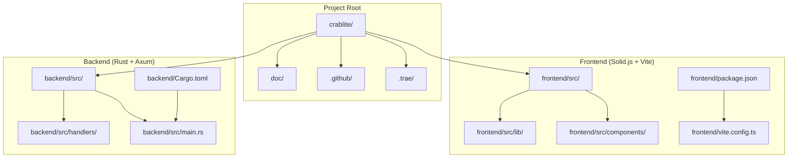
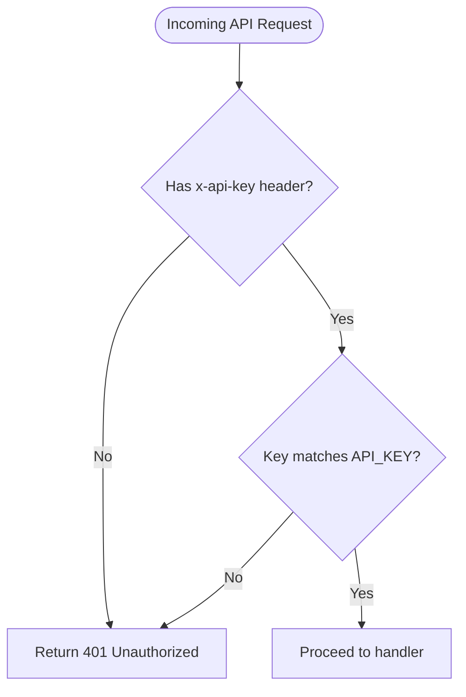
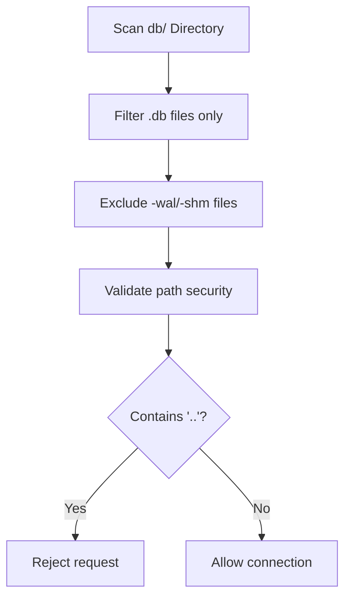

# Development Workflow

<cite>
**Referenced Files in This Document**
- [README.md](file://README.md)
- [backend/Cargo.toml](file://backend/Cargo.toml)
- [frontend/package.json](file://frontend/package.json)
- [frontend/vite.config.ts](file://frontend/vite.config.ts)
- [backend/src/main.rs](file://backend/src/main.rs)
- [backend/src/state.rs](file://backend/src/state.rs)
- [backend/src/handlers/mod.rs](file://backend/src/handlers/mod.rs)
- [backend/src/handlers/connection.rs](file://backend/src/handlers/connection.rs)
- [backend/src/handlers/query.rs](file://backend/src/handlers/query.rs)
- [backend/src/handlers/ai.rs](file://backend/src/handlers/ai.rs)
- [backend/src/handlers/health.rs](file://backend/src/handlers/health.rs)
- [frontend/src/lib/api.ts](file://frontend/src/lib/api.ts)
- [doc/design.md](file://doc/design.md)
</cite>

## Update Summary
**Changes Made**
- Enhanced toolchain requirements with specific version details
- Added comprehensive project structure navigation guide
- Expanded server startup procedures with detailed troubleshooting
- Updated environment variable configuration with complete reference table
- Enhanced authentication middleware setup documentation
- Improved API proxy configuration details
- Expanded database discovery processes with security considerations
- Added comprehensive troubleshooting tips section
- Included performance tuning recommendations
- Updated coding standards and contribution guidelines

## Table of Contents
1. [Introduction](#introduction)
2. [Toolchain Requirements](#toolchain-requirements)
3. [Project Structure Navigation](#project-structure-navigation)
4. [Development Environment Setup](#development-environment-setup)
5. [Server Startup Procedures](#server-startup-procedures)
6. [Environment Variable Configuration](#environment-variable-configuration)
7. [Authentication Middleware Setup](#authentication-middleware-setup)
8. [API Proxy Configuration](#api-proxy-configuration)
9. [Database Discovery Processes](#database-discovery-processes)
10. [Build Processes](#build-processes)
11. [Debugging and Testing](#debugging-and-testing)
12. [Performance Tuning Recommendations](#performance-tuning-recommendations)
13. [Troubleshooting Guide](#troubleshooting-guide)
14. [Coding Standards and Contribution Guidelines](#coding-standards-and-contribution-guidelines)
15. [Integration Between Frontend and Backend](#integration-between-frontend-and-backend)
16. [Conclusion](#conclusion)

## Introduction
This document provides a comprehensive development workflow for contributing to CrabLite, an extreme lightweight SQLite Web administration tool built with Rust (Axum) and Solid.js. It covers local environment setup, starting the frontend and backend servers, building for development and production, debugging techniques, testing approaches, code quality practices, coding standards, contribution guidelines, environment configuration (.env), and integration between frontend and backend during development.

## Toolchain Requirements

### Frontend Development
- **Node.js**: Version 18 or higher required
- **pnpm**: Package manager (v10.32.1+ recommended)
- **TypeScript**: v6.0.3+ (managed via pnpm)

### Backend Development
- **Rust**: Latest stable toolchain
- **Cargo**: Rust package manager and build system
- **SQLite**: Required for SQLx driver compilation

### System Requirements
- **Operating System**: Linux, macOS, or Windows
- **Memory**: Minimum 2GB RAM recommended for development
- **Disk Space**: At least 1GB free space for toolchains and dependencies

**Section sources**
- [README.md:87-108](file://README.md#L87-L108)
- [frontend/package.json:10-21](file://frontend/package.json#L10-L21)
- [backend/Cargo.toml:1-24](file://backend/Cargo.toml#L1-L24)

## Project Structure Navigation

CrabLite follows a clear two-tier architecture with separate frontend and backend components:



**Key Directories:**
- `frontend/`: Solid.js application with Vite build system
- `backend/`: Rust service with Axum web framework
- `doc/`: Design documentation and specifications
- `.github/workflows/`: CI/CD pipeline configurations
- `.trae/rules/`: Project-specific development rules

**Section sources**
- [doc/design.md:39-60](file://doc/design.md#L39-L60)

## Development Environment Setup

### Step 1: Install Frontend Dependencies
```bash
cd frontend
pnpm install
```

### Step 2: Install Backend Dependencies
```bash
cd backend
cargo fetch
```

### Step 3: Create Environment Configuration
Create a `.env` file in the `backend/` directory for development variables:
```env
API_KEY=your-development-key
RUST_LOG=rust_sqlite_webui=debug,tower_http=debug
OPENAI_API_KEY=your-openai-api-key
OPENAI_BASE_URL=https://api.openai.com/v1
OPENAI_MODEL=gpt-5.4-mini
```

**Section sources**
- [README.md:83-108](file://README.md#L83-L108)

## Server Startup Procedures

### Starting the Frontend Development Server
The frontend runs on port 5173 by default and automatically proxies API requests to the backend:

```bash
cd frontend
pnpm start
```

**Expected Output:**
```
VITE v7.3.0 ready in 150ms

➜  Local:   http://localhost:5173/
➜  Network: use --host to expose
```

### Starting the Backend API Service
The backend runs on port 3000 and serves both API endpoints and static assets:

```bash
cd backend
cargo run
```

**Expected Output:**
```
[INFO] listening on 0.0.0.0:3000
```

### Verification Steps
1. **Frontend**: Navigate to `http://localhost:5173` - should display the UI
2. **Backend Health Check**: Visit `http://localhost:3000/api/health` - should return JSON status
3. **API Proxy Test**: The frontend should automatically proxy `/api/*` requests to the backend

**Section sources**
- [README.md:87-108](file://README.md#L87-L108)

## Environment Variable Configuration

### Core Environment Variables

| Variable | Default Value | Description | Required |
|----------|---------------|-------------|----------|
| `API_KEY` | `your-super-secure-key` | Authentication key for accessing the WebUI APIs | Yes |
| `RUST_LOG` | `rust_sqlite_webui=debug,tower_http=debug` | Logging level configuration using tracing-subscriber format | No |
| `OPENAI_API_KEY` | None | OpenAI API key for AI assistant functionality | Optional |
| `OPENAI_BASE_URL` | `https://api.openai.com/v1` | OpenAI-compatible API base URL | Optional |
| `OPENAI_MODEL` | `gpt-5.4-mini` | OpenAI model name for SQL correction | Optional |

### Environment File Location
- **Development**: `backend/.env`
- **Production**: Set via Docker environment variables or system environment

### Security Considerations
- Never commit `.env` files to version control
- Use different API keys for development and production
- Rotate API keys regularly
- Use environment-specific configuration management

**Section sources**
- [README.md:74-83](file://README.md#L74-L83)

## Authentication Middleware Setup

The authentication middleware protects all API endpoints except the health check:

### How It Works
1. **Header Validation**: Checks for `x-api-key` header in incoming requests
2. **Key Comparison**: Compares the provided key against the configured `API_KEY`
3. **Access Control**: Returns 401 Unauthorized if authentication fails

### Implementation Details


### Testing Authentication
```bash
# Without API key (should fail)
curl http://localhost:3000/api/tables

# With correct API key (should succeed)
curl -H "x-api-key: your-development-key" http://localhost:3000/api/tables
```

**Section sources**
- [backend/src/main.rs:22-33](file://backend/src/main.rs#L22-L33)

## API Proxy Configuration

### Development Proxy Setup
The Vite development server automatically proxies API requests to the backend:

```typescript
// frontend/vite.config.ts
server: {
  proxy: {
    "/api": "http://localhost:3000",
  },
},
```

### Production Behavior
In production mode, the backend serves both API endpoints and static frontend assets from the same server.

### API Endpoints Overview
| Endpoint | Method | Description | Authentication |
|----------|--------|-------------|----------------|
| `/api/health` | GET | Health check endpoint | No |
| `/api/connect` | POST | Connect to SQLite database | Yes |
| `/api/db-files` | GET | List available database files | Yes |
| `/api/tables` | GET | Get table names | Yes |
| `/api/query` | POST | Execute SQL query | Yes |
| `/api/correct` | POST | AI-powered SQL correction | Yes |

**Section sources**
- [frontend/vite.config.ts:10-14](file://frontend/vite.config.ts#L10-L14)
- [backend/src/main.rs:52-65](file://backend/src/main.rs#L52-L65)

## Database Discovery Processes

### Automatic Database Scanning
The system recursively scans the `db/` directory for SQLite database files:

#### Features
- **Recursive Scanning**: Supports nested directory structures
- **File Filtering**: Only processes `.db` files, excludes WAL/SHM files
- **Path Validation**: Prevents directory traversal attacks
- **Relative Path Support**: Returns paths relative to `db/` directory

#### Security Measures


### Database Connection Process
1. **Path Validation**: Ensures no directory traversal attempts
2. **Directory Creation**: Creates `db/` directory if missing
3. **Connection Pool**: Establishes connection with WAL mode enabled
4. **Security Verification**: Verifies WAL mode for concurrent access safety

**Section sources**
- [backend/src/handlers/connection.rs:20-109](file://backend/src/handlers/connection.rs#L20-L109)

## Build Processes

### Frontend Build Process
```bash
cd frontend
pnpm build
```

**Output**: `frontend/dist/` containing optimized static assets

### Backend Build Process
```bash
cd backend
cargo build --release
```

**Output**: `backend/target/release/rust-sqlite-webui` binary

### Release Build Optimizations
- **Binary Stripping**: Removes debug symbols to reduce size
- **Link Time Optimization (LTO)**: Optimizes across crate boundaries
- **Single Codegen Unit**: Improves optimization at cost of build time

**Section sources**
- [backend/Cargo.toml:20-24](file://backend/Cargo.toml#L20-L24)

## Debugging and Testing

### Backend Debugging
```bash
# Enable detailed logging
RUST_LOG=debug cargo run

# Specific module logging
RUST_LOG=rust_sqlite_webui=debug,cargo::lib=info cargo run
```

### Frontend Debugging
- **Solid DevTools**: Built into development server
- **Browser DevTools**: Full Chrome/Firefox developer tools support
- **Network Monitoring**: Inspect API calls in browser network tab

### Testing Approaches
- **Unit Tests**: Use `cargo test` for Rust modules
- **Integration Tests**: Manual testing through the web interface
- **API Testing**: Use curl or Postman for endpoint testing

**Section sources**
- [frontend/package.json:14](file://frontend/package.json#L14)

## Performance Tuning Recommendations

### Backend Optimizations
- **WAL Mode**: Enabled for better concurrency and reduced locking
- **Busy Timeout**: Set to 30 seconds to prevent database corruption
- **Connection Pooling**: Uses SQLx connection pool for efficient resource management

### Frontend Optimizations
- **Modern Target**: Builds for esnext for optimal browser compatibility
- **Tree Shaking**: Vite removes unused code automatically
- **Asset Optimization**: Compressed CSS and JavaScript bundles

### Production Deployment Tips
- Use Docker for consistent deployment
- Mount database volumes for data persistence
- Configure proper memory limits and resource constraints

**Section sources**
- [backend/src/handlers/connection.rs:85-90](file://backend/src/handlers/connection.rs#L85-L90)
- [frontend/vite.config.ts:15-17](file://frontend/vite.config.ts#L15-L17)

## Troubleshooting Guide

### Common Issues and Solutions

#### Port Conflicts
**Problem**: Services fail to start due to port conflicts
**Solution**: 
- Frontend uses port 5173 by default
- Backend uses port 3000 by default
- Change ports in respective config files if needed

#### Authentication Failures
**Problem**: API requests return 401 Unauthorized
**Solution**:
- Verify `API_KEY` is set correctly in environment
- Ensure `x-api-key` header matches exactly
- Check case sensitivity of API key

#### Database Connection Issues
**Problem**: Cannot connect to database files
**Solution**:
- Verify `db/` directory exists and has proper permissions
- Check that database files have `.db` extension
- Ensure no directory traversal attempts are blocked

#### AI Assistant Not Working
**Problem**: SQL correction feature returns errors
**Solution**:
- Set `OPENAI_API_KEY` environment variable
- Verify API key is valid and has sufficient quota
- Check `OPENAI_BASE_URL` for custom implementations

#### Logging and Debugging
**Problem**: Need more detailed logs for troubleshooting
**Solution**:
- Adjust `RUST_LOG` environment variable
- Use `RUST_LOG=trace` for maximum verbosity
- Check application logs for specific error messages

### Environment-Specific Issues

#### Docker Deployment
- Ensure volume mounts are properly configured
- Verify file permissions for database directories
- Check container networking for port exposure

#### Development vs Production
- Development uses hot reload and verbose logging
- Production optimizes for performance and security
- Different environment variables may be required

**Section sources**
- [README.md:70-84](file://README.md#L70-L84)

## Coding Standards and Contribution Guidelines

### Code Style Guidelines
- **Rust**: Follow standard Rust formatting (`cargo fmt`)
- **TypeScript**: Use TypeScript strict mode and ESLint rules
- **Documentation**: Comment complex logic and maintain README updates

### Git Workflow
- **Branch Naming**: `feature/`, `bugfix/`, `improvement/` prefixes
- **Commit Messages**: Use conventional commits format
- **Pull Requests**: Include description and testing notes

### Security Best Practices
- **Input Validation**: Always validate user inputs
- **Authentication**: Enforce API key validation
- **Path Sanitization**: Prevent directory traversal attacks
- **Error Handling**: Don't expose sensitive information in errors

### Testing Requirements
- **Unit Tests**: Write tests for new functionality
- **Integration Tests**: Test API endpoints thoroughly
- **Edge Cases**: Handle error conditions gracefully

### Performance Considerations
- **Database Queries**: Optimize SQL queries and use indexes
- **Memory Usage**: Monitor and optimize memory consumption
- **Concurrent Access**: Use WAL mode and proper locking

**Section sources**
- [backend/Cargo.toml:20-24](file://backend/Cargo.toml#L20-L24)

## Integration Between Frontend and Backend

### Development Integration
During development, the frontend and backend run as separate services:
- **Frontend**: Vite dev server on port 5173
- **Backend**: Axum server on port 3000
- **Proxy**: Automatic forwarding of `/api/*` requests

### Production Integration
In production, everything runs in a single process:
- **Static Assets**: Served from `dist/` directory
- **API Endpoints**: Available under `/api/*` routes
- **Health Check**: Available at `/api/health`

### API Contract
The frontend expects specific response formats:
```typescript
interface QueryResult {
    columns: string[];
    columnTypes?: string[];
    rows: any[][];
    executionTime?: number;
    affectedRows?: number;
    error?: string;
}
```

### Error Handling
Both frontend and backend implement comprehensive error handling:
- **HTTP Status Codes**: Proper 4xx/5xx responses
- **User-Friendly Messages**: Clear error communication
- **Logging**: Detailed error tracking for debugging

**Section sources**
- [frontend/src/lib/api.ts:1-116](file://frontend/src/lib/api.ts#L1-L116)

## Conclusion
This comprehensive development workflow guide provides everything needed to effectively contribute to CrabLite development. By following these guidelines for environment setup, server management, authentication, database operations, and coding standards, contributors can efficiently develop, test, and deploy changes to this lightweight SQLite administration tool. The separation of concerns between frontend and backend, combined with robust security measures and performance optimizations, ensures a solid foundation for continued development and maintenance.