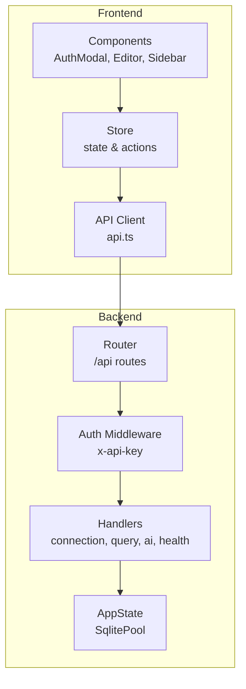
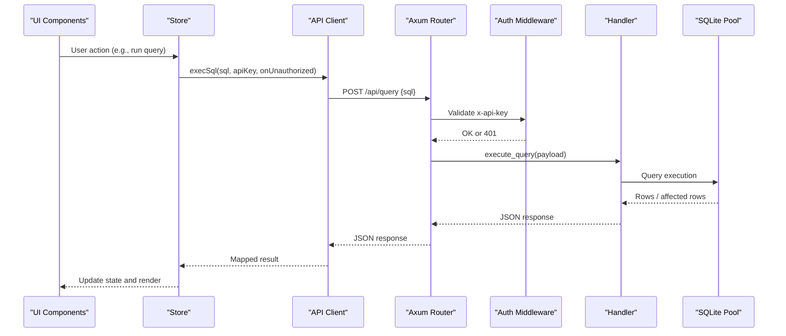
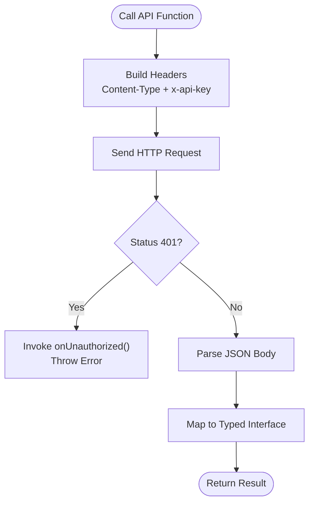
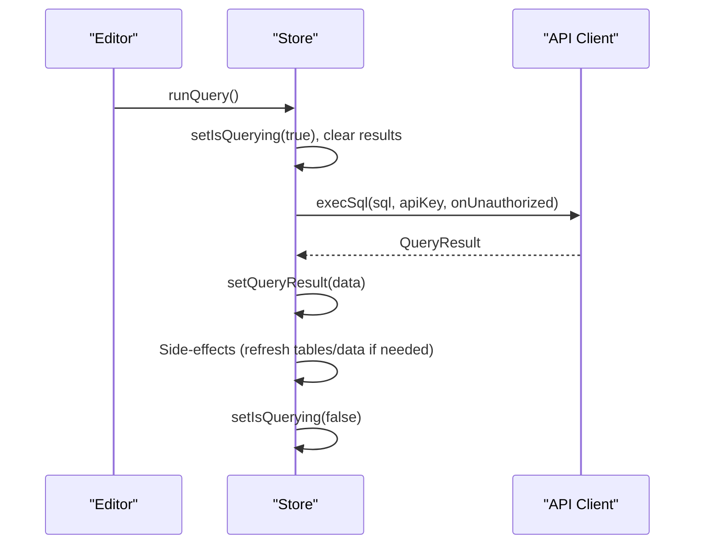
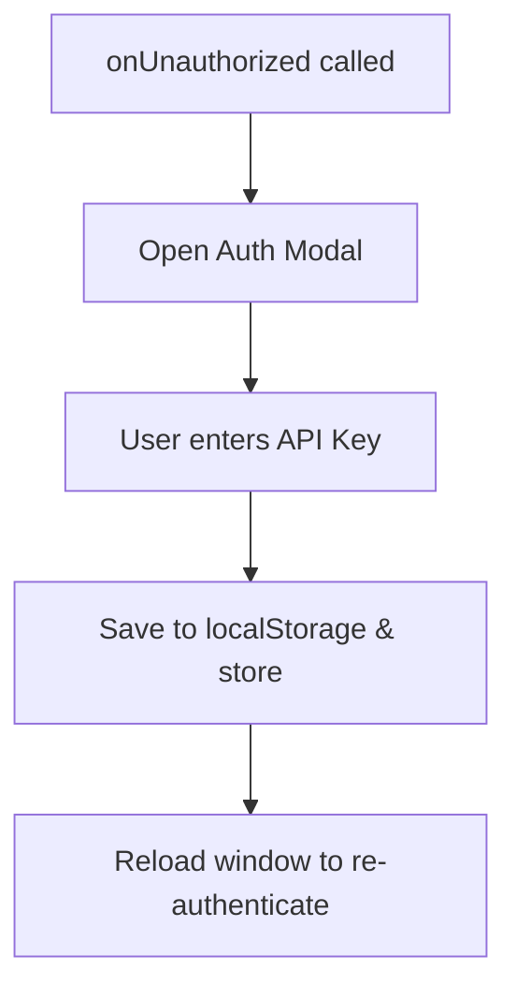
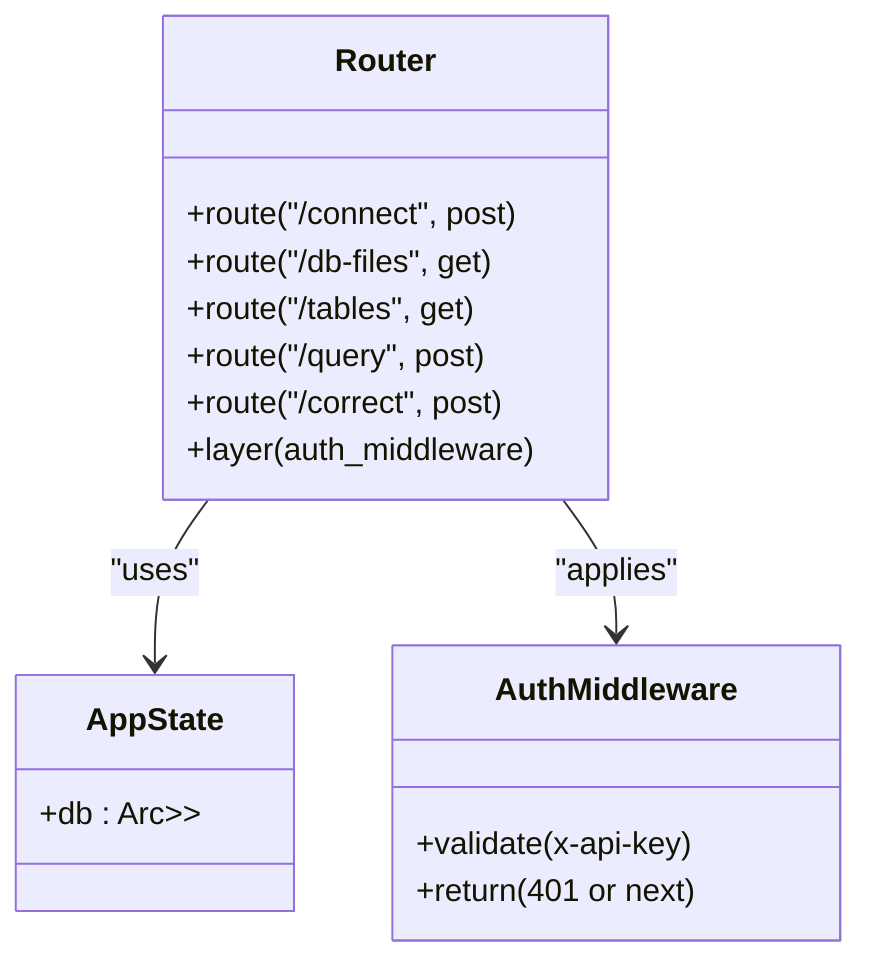
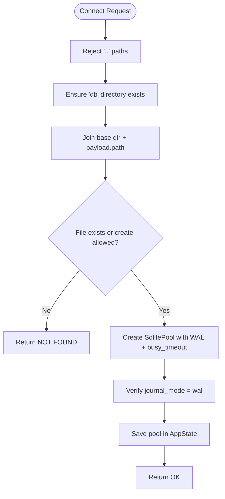
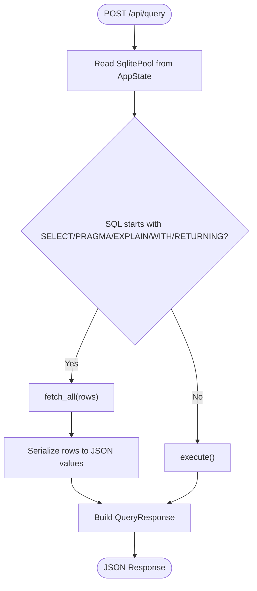
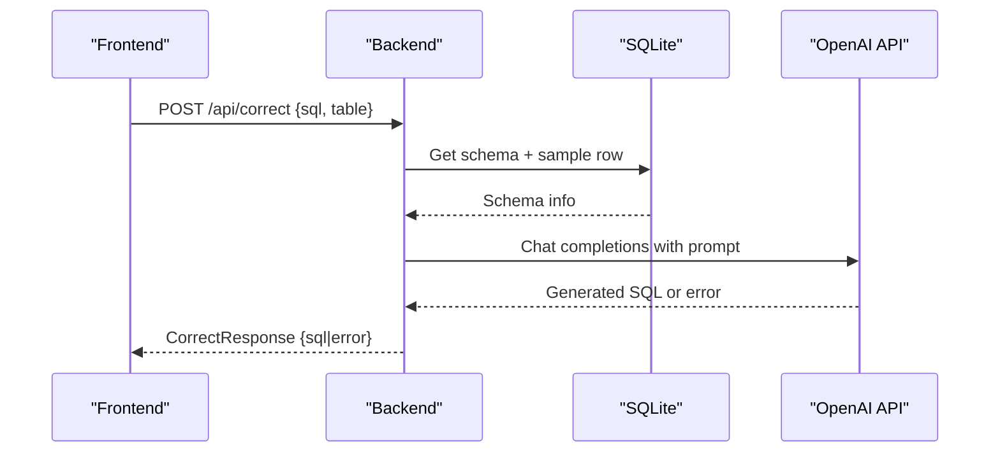
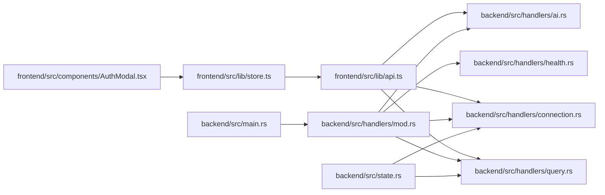

# API Integration

<cite>
**Referenced Files in This Document**
- [api.ts](file://frontend/src/lib/api.ts)
- [store.ts](file://frontend/src/lib/store.ts)
- [AuthModal.tsx](file://frontend/src/components/AuthModal.tsx)
- [main.rs](file://backend/src/main.rs)
- [handlers/mod.rs](file://backend/src/handlers/mod.rs)
- [connection.rs](file://backend/src/handlers/connection.rs)
- [query.rs](file://backend/src/handlers/query.rs)
- [ai.rs](file://backend/src/handlers/ai.rs)
- [health.rs](file://backend/src/handlers/health.rs)
- [state.rs](file://backend/src/state.rs)
</cite>

## Table of Contents
1. [Introduction](#introduction)
2. [Project Structure](#project-structure)
3. [Core Components](#core-components)
4. [Architecture Overview](#architecture-overview)
5. [Detailed Component Analysis](#detailed-component-analysis)
6. [Dependency Analysis](#dependency-analysis)
7. [Performance Considerations](#performance-considerations)
8. [Troubleshooting Guide](#troubleshooting-guide)
9. [Conclusion](#conclusion)

## Introduction
This document explains the API integration between the frontend and the Rust backend. It covers HTTP client setup, request/response handling, error management, authentication flow, and how the frontend abstracts backend endpoints for connection management, query execution, and AI-assisted SQL correction. It also provides examples of making API calls, handling different response types, implementing retry logic, and managing errors gracefully.

## Project Structure
The project is a full-stack application:
- Frontend (SolidJS + TypeScript) exposes an API client module that encapsulates all HTTP calls to the backend.
- Backend (Axum + Tokio) implements REST endpoints under /api with middleware-based authentication and stateful database connections.

**Diagram sources**
- [main.rs:52-65](file://backend/src/main.rs#L52-L65)
- [api.ts:12-115](file://frontend/src/lib/api.ts#L12-L115)
- [store.ts:1-116](file://frontend/src/lib/store.ts#L1-L116)

**Section sources**
- [main.rs:1-74](file://backend/src/main.rs#L1-L74)
- [api.ts:1-116](file://frontend/src/lib/api.ts#L1-L116)
- [store.ts:1-116](file://frontend/src/lib/store.ts#L1-L116)

## Core Components
- Frontend API client: Centralizes HTTP requests, headers, and response mapping.
- Frontend store: Holds application state and orchestrates API calls with error handling and UI feedback.
- Authentication modal: Collects and persists the API key when unauthorized responses occur.
- Backend router: Defines endpoints and applies authentication middleware.
- Handlers: Implement business logic for database operations, queries, and AI assistance.
- Application state: Holds a shared SQLite pool across requests.

Key responsibilities:
- api.ts: Define typed interfaces, build headers, handle 401, map backend responses to frontend models.
- store.ts: Manage signals, trigger API calls, update UI state, refresh data after mutations.
- main.rs: Register routes, attach auth middleware, serve static assets, bind server.
- handlers/*: Implement endpoint logic, interact with SQLite, call external AI APIs.
- state.rs: Provide shared state container for the database pool.

**Section sources**
- [api.ts:1-116](file://frontend/src/lib/api.ts#L1-L116)
- [store.ts:1-116](file://frontend/src/lib/store.ts#L1-L116)
- [AuthModal.tsx:1-44](file://frontend/src/components/AuthModal.tsx#L1-L44)
- [main.rs:22-65](file://backend/src/main.rs#L22-L65)
- [handlers/mod.rs:1-10](file://backend/src/handlers/mod.rs#L1-L10)
- [state.rs:1-9](file://backend/src/state.rs#L1-L9)

## Architecture Overview
The API integration follows a layered approach:
- The frontend’s API client abstracts all network calls behind typed functions.
- The store composes these functions to implement user workflows.
- The backend enforces authentication via an x-api-key header.
- Handlers coordinate database access and optional AI assistance.

**Diagram sources**
- [api.ts:36-59](file://frontend/src/lib/api.ts#L36-L59)
- [store.ts:49-92](file://frontend/src/lib/store.ts#L49-L92)
- [main.rs:52-65](file://backend/src/main.rs#L52-L65)
- [query.rs:101-200](file://backend/src/handlers/query.rs#L101-L200)

## Detailed Component Analysis

### Frontend API Client (api.ts)
Responsibilities:
- Define typed interfaces for responses: QueryResult, CorrectResult, HealthResult.
- Build standardized headers including Content-Type and x-api-key.
- Centralize 401 handling via a callback to open the authentication modal.
- Map backend payloads to frontend models.

Endpoints exposed:
- GET /api/tables: List tables from the connected database.
- POST /api/query: Execute SQL and return structured results.
- POST /api/correct: Request AI-assisted SQL correction.
- GET /api/db-files: List available database files.
- GET /api/health: Health check without authentication.
- POST /api/connect: Connect to a specific database file.

Error handling:
- 401 Unauthorized triggers onUnauthorized callback and throws an error.
- Non-ok responses throw descriptive errors; some endpoints return mapped error fields.

Retry strategy:
- Not implemented by default. See Troubleshooting Guide for recommended patterns.

Examples of usage:
- Fetching tables: Call fetchTables with apiKey and optional onUnauthorized handler.
- Executing SQL: Call execSql with sql and apiKey; handle QueryResult columns, rows, executionTime, affectedRows, and error.
- AI correction: Call correctSql with sql, table, apiKey; handle CorrectResult.sql or error.
- Connecting to DB: Call connectDb with path, create flag, apiKey; handle success/status.

**Diagram sources**
- [api.ts:12-23](file://frontend/src/lib/api.ts#L12-L23)
- [api.ts:25-115](file://frontend/src/lib/api.ts#L25-L115)

**Section sources**
- [api.ts:1-116](file://frontend/src/lib/api.ts#L1-L116)

### Frontend Store (store.ts)
Responsibilities:
- Maintain reactive state using Solid signals: apiKey, tables, currentTable, sqlContent, queryResult, flags for querying/correcting.
- Orchestrate API calls: fetchTables, execSql, runQuery, correctSql.
- Handle side effects: Refresh tables after DDL, re-fetch data after DML, preserve execution stats.
- Centralize unauthorized handling: Open auth modal when required.

Key flows:
- On app start, load apiKey from localStorage and fetch tables.
- When running a query, set isQuerying, clear previous results, execute, then update queryResult and related UI state.
- For AI correction, set isCorrecting, call API, update sqlContent or show error.

**Diagram sources**
- [store.ts:30-92](file://frontend/src/lib/store.ts#L30-L92)
- [api.ts:36-59](file://frontend/src/lib/api.ts#L36-L59)

**Section sources**
- [store.ts:1-116](file://frontend/src/lib/store.ts#L1-L116)

### Authentication Modal (AuthModal.tsx)
Responsibilities:
- Prompt user for API key when unauthorized.
- Persist apiKey to localStorage and update global store.
- Reload page to reinitialize with new credentials.

Integration points:
- Triggered by onUnauthorized callback passed to API client functions.

**Diagram sources**
- [AuthModal.tsx:7-16](file://frontend/src/components/AuthModal.tsx#L7-L16)
- [store.ts:20-20](file://frontend/src/lib/store.ts#L20-L20)

**Section sources**
- [AuthModal.tsx:1-44](file://frontend/src/components/AuthModal.tsx#L1-L44)
- [store.ts:1-20](file://frontend/src/lib/store.ts#L1-L20)

### Backend Router and Middleware (main.rs)
Responsibilities:
- Initialize tracing/logging.
- Create AppState with a shared SqlitePool wrapped in Arc<RwLock<Option<...>>>.
- Register API routes under /api with auth middleware.
- Serve static frontend assets from dist.

Authentication:
- Validates x-api-key header against environment variable API_KEY.
- Returns 401 Unauthorized if missing or invalid.

**Diagram sources**
- [main.rs:47-65](file://backend/src/main.rs#L47-L65)
- [state.rs:5-8](file://backend/src/state.rs#L5-L8)

**Section sources**
- [main.rs:1-74](file://backend/src/main.rs#L1-L74)
- [state.rs:1-9](file://backend/src/state.rs#L1-L9)

### Connection Handler (connection.rs)
Responsibilities:
- List available .db files recursively under db/.
- Connect to a specified database file with WAL mode and busy timeout.
- Verify WAL mode after connection.
- List tables from the connected database.

Security considerations:
- Rejects directory traversal attempts.
- Ensures db directory exists before scanning/connecting.

**Diagram sources**
- [connection.rs:62-109](file://backend/src/handlers/connection.rs#L62-L109)
- [connection.rs:131-144](file://backend/src/handlers/connection.rs#L131-L144)

**Section sources**
- [connection.rs:1-145](file://backend/src/handlers/connection.rs#L1-L145)

### Query Handler (query.rs)
Responsibilities:
- Execute SQL and return structured results.
- Detect read vs write queries based on SQL prefix.
- Serialize rows into JSON-compatible values with type-aware mapping.
- Include execution time and affected rows where applicable.

Data mapping:
- Columns and column types extracted from first row metadata.
- Row serialization handles NULL, integers, floats, booleans, blobs, and fallback string conversion.

**Diagram sources**
- [query.rs:101-200](file://backend/src/handlers/query.rs#L101-L200)

**Section sources**
- [query.rs:1-201](file://backend/src/handlers/query.rs#L1-L201)

### AI Handler (ai.rs)
Responsibilities:
- Accept user input and target table name.
- Retrieve schema and sample row from SQLite.
- Construct prompt and call OpenAI-compatible chat completions API.
- Return corrected SQL or error message.

Environment configuration:
- OPENAI_API_KEY, OPENAI_BASE_URL, OPENAI_MODEL.

**Diagram sources**
- [ai.rs:24-148](file://backend/src/handlers/ai.rs#L24-L148)

**Section sources**
- [ai.rs:1-149](file://backend/src/handlers/ai.rs#L1-L149)

### Health Handler (health.rs)
Responsibilities:
- Return status and version information without authentication.

**Section sources**
- [health.rs:1-6](file://backend/src/handlers/health.rs#L1-L6)

## Dependency Analysis
The frontend depends on the backend’s REST endpoints and expects consistent JSON structures. The backend depends on SQLite for persistence and optionally on an external AI provider.

**Diagram sources**
- [api.ts:1-116](file://frontend/src/lib/api.ts#L1-L116)
- [store.ts:1-116](file://frontend/src/lib/store.ts#L1-L116)
- [AuthModal.tsx:1-44](file://frontend/src/components/AuthModal.tsx#L1-L44)
- [main.rs:52-65](file://backend/src/main.rs#L52-L65)
- [handlers/mod.rs:1-10](file://backend/src/handlers/mod.rs#L1-L10)
- [state.rs:1-9](file://backend/src/state.rs#L1-L9)

**Section sources**
- [api.ts:1-116](file://frontend/src/lib/api.ts#L1-L116)
- [store.ts:1-116](file://frontend/src/lib/store.ts#L1-L116)
- [AuthModal.tsx:1-44](file://frontend/src/components/AuthModal.tsx#L1-L44)
- [main.rs:52-65](file://backend/src/main.rs#L52-L65)
- [handlers/mod.rs:1-10](file://backend/src/handlers/mod.rs#L1-L10)
- [state.rs:1-9](file://backend/src/state.rs#L1-L9)

## Performance Considerations
- Database pooling: The backend uses SqlitePool with WAL mode and busy_timeout to improve concurrency and reduce contention.
- Query classification: The backend distinguishes read vs write queries to optimize execution paths and avoid unnecessary row fetching for DML statements.
- Serialization overhead: Row serialization maps various SQLite types to JSON-safe values; consider batching large result sets or pagination in future enhancements.
- Network latency: The frontend does not implement retries or timeouts by default; add exponential backoff and cancellation for long-running queries.

[No sources needed since this section provides general guidance]

## Troubleshooting Guide
Common issues and resolutions:
- 401 Unauthorized:
  - Cause: Missing or incorrect x-api-key header.
  - Resolution: Enter the correct API key via the authentication modal; ensure it matches the backend’s API_KEY environment variable.
- Database not connected:
  - Cause: No active SqlitePool in AppState.
  - Resolution: Call connectDb with a valid path; verify the db directory exists and the file is accessible.
- Query errors:
  - Cause: Invalid SQL or schema mismatch.
  - Resolution: Inspect the error field in QueryResult; use AI correction to generate valid SQL.
- AI API failures:
  - Cause: Missing OPENAI_API_KEY or network errors.
  - Resolution: Configure environment variables correctly; check OPENAI_BASE_URL and model settings.

Recommended patterns:
- Retry logic:
  - Wrap API calls with a retry utility that supports exponential backoff and jitter.
  - Limit maximum retries and mark transient errors (network timeouts, 5xx).
- Timeouts and cancellation:
  - Use AbortController to cancel long-running requests.
  - Set reasonable fetch timeouts to prevent hanging UI.
- Error normalization:
  - Normalize backend errors into user-friendly messages.
  - Surface detailed diagnostics in development logs only.

**Section sources**
- [api.ts:17-23](file://frontend/src/lib/api.ts#L17-L23)
- [query.rs:101-200](file://backend/src/handlers/query.rs#L101-L200)
- [ai.rs:24-148](file://backend/src/handlers/ai.rs#L24-L148)

## Conclusion
The API integration cleanly separates concerns:
- The frontend API client abstracts HTTP details and normalizes responses.
- The store manages state and user workflows while handling unauthorized states.
- The backend enforces authentication, manages database connections, executes queries efficiently, and optionally leverages AI to assist users.

Adopting the suggested retry strategies, timeouts, and error normalization will further improve robustness and user experience.

[No sources needed since this section summarizes without analyzing specific files]