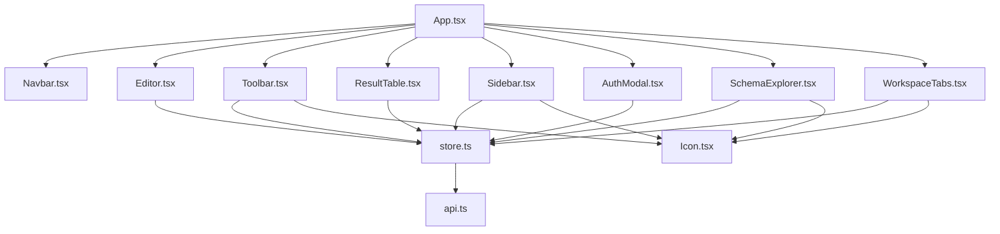
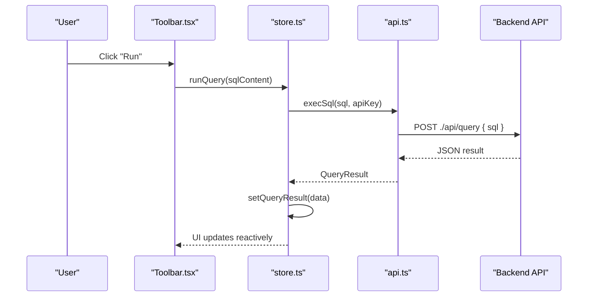
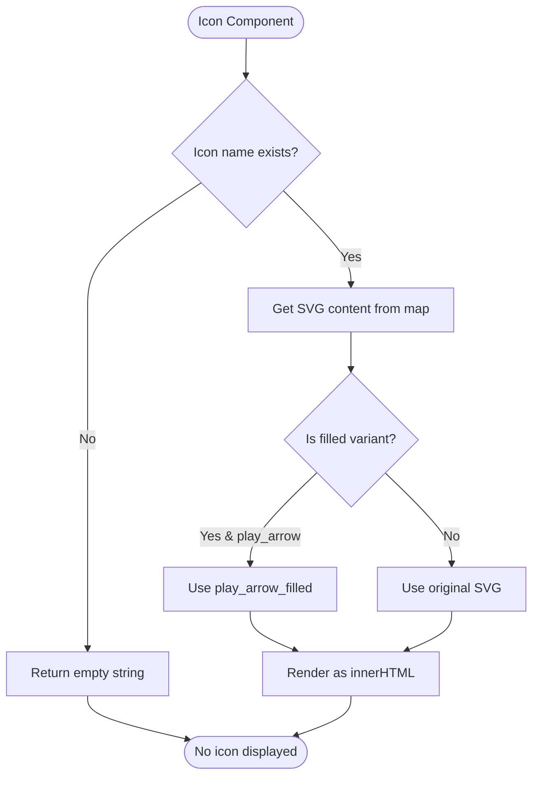
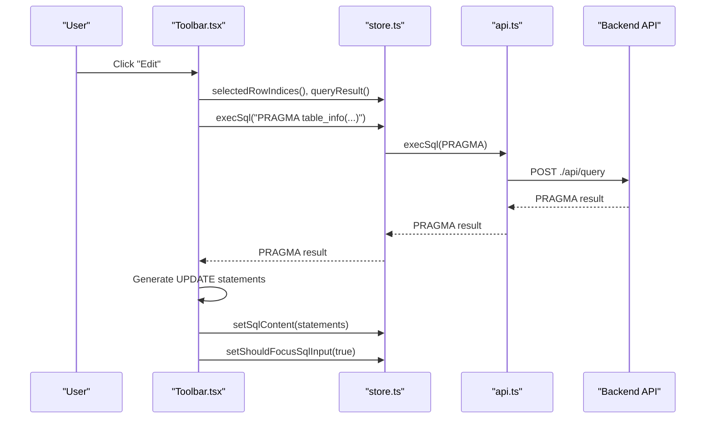
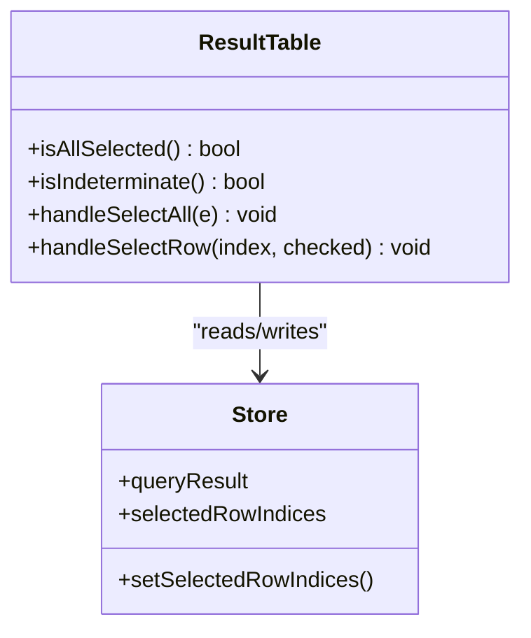
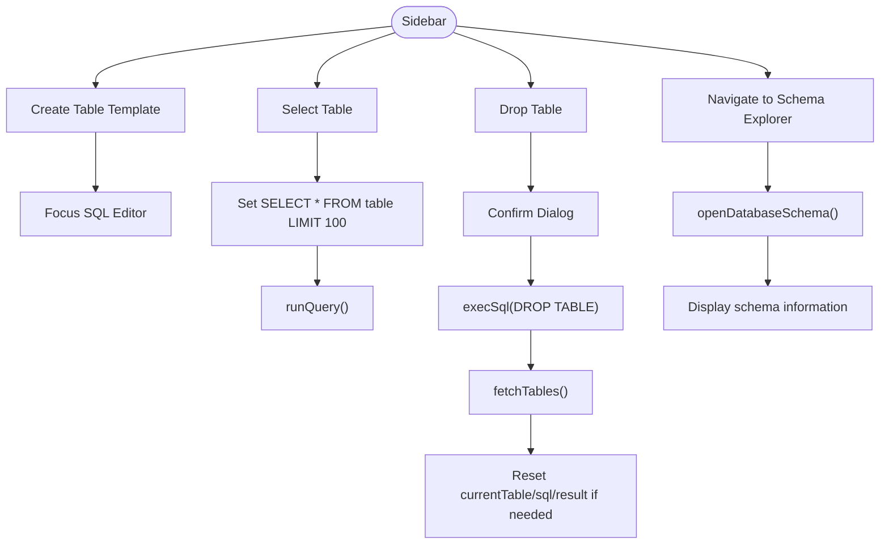
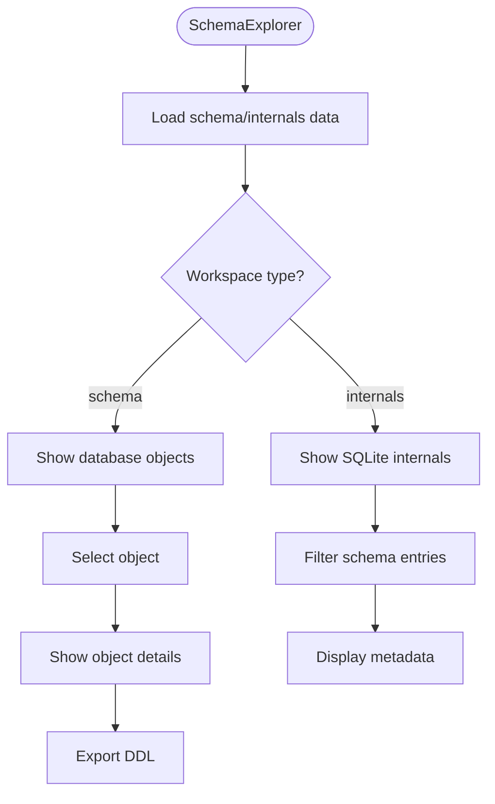
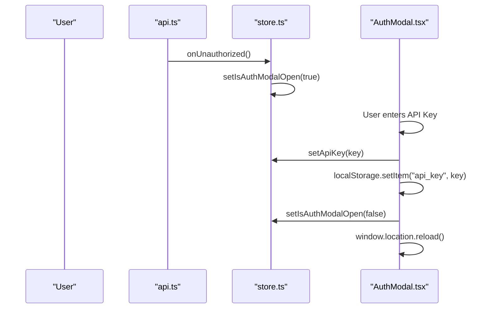
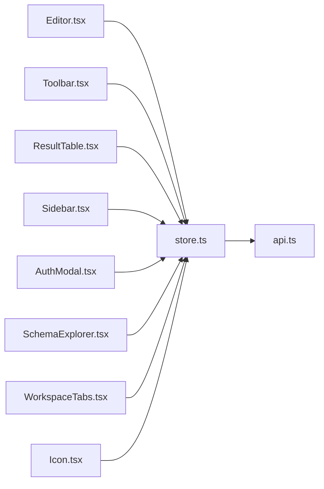

# Core Components

<cite>
**Referenced Files in This Document**
- [App.tsx](file://frontend/src/App.tsx)
- [Editor.tsx](file://frontend/src/components/Editor.tsx)
- [Toolbar.tsx](file://frontend/src/components/Toolbar.tsx)
- [ResultTable.tsx](file://frontend/src/components/ResultTable.tsx)
- [Sidebar.tsx](file://frontend/src/components/Sidebar.tsx)
- [AuthModal.tsx](file://frontend/src/components/AuthModal.tsx)
- [Icon.tsx](file://frontend/src/components/Icon.tsx)
- [SchemaExplorer.tsx](file://frontend/src/components/SchemaExplorer.tsx)
- [WorkspaceTabs.tsx](file://frontend/src/components/WorkspaceTabs.tsx)
- [store.ts](file://frontend/src/lib/store.ts)
- [api.ts](file://frontend/src/lib/api.ts)
</cite>

## Update Summary
**Changes Made**
- Added new Icon.tsx component for Material Design icons
- Enhanced Sidebar.tsx with schema explorer navigation and workspace integration
- Improved Toolbar.tsx with workspace-aware functionality
- Added SchemaExplorer.tsx component for database structure exploration
- Added WorkspaceTabs.tsx component for workspace switching
- Updated store.ts with workspace management state and functions

## Table of Contents
1. [Introduction](#introduction)
2. [Project Structure](#project-structure)
3. [Core Components](#core-components)
4. [Architecture Overview](#architecture-overview)
5. [Detailed Component Analysis](#detailed-component-analysis)
6. [Dependency Analysis](#dependency-analysis)
7. [Performance Considerations](#performance-considerations)
8. [Troubleshooting Guide](#troubleshooting-guide)
9. [Conclusion](#conclusion)

## Introduction
This document provides comprehensive documentation for the core UI components of the Solid.js frontend: Editor, Toolbar, ResultTable, Sidebar, AuthModal, Icon, SchemaExplorer, and WorkspaceTabs. It explains props, events, state management, styling patterns, and integration with parent components. It also includes usage examples, customization options, and best practices for extending functionality.

The application is a SQLite WebUI that allows users to write SQL queries, execute them against a backend API, view results, manage database tables, explore database schemas, and authenticate via an API key. The UI is built with Solid.js and styled using utility-first CSS classes (DaisyUI/Tailwind).

## Project Structure
At a high level, the App component composes the main layout and mounts the core components. State and API calls are centralized in store.ts and api.ts. The application now supports multiple workspaces: Query, Database Schema, and SQLite Internals.



**Diagram sources**
- [App.tsx:1-34](file://frontend/src/App.tsx#L1-L34)
- [Editor.tsx:1-49](file://frontend/src/components/Editor.tsx#L1-L49)
- [Toolbar.tsx:1-106](file://frontend/src/components/Toolbar.tsx#L1-L106)
- [ResultTable.tsx:1-120](file://frontend/src/components/ResultTable.tsx#L1-L120)
- [Sidebar.tsx:1-142](file://frontend/src/components/Sidebar.tsx#L1-L142)
- [AuthModal.tsx:1-44](file://frontend/src/components/AuthModal.tsx#L1-L44)
- [Icon.tsx:1-72](file://frontend/src/components/Icon.tsx#L1-L72)
- [SchemaExplorer.tsx:1-308](file://frontend/src/components/SchemaExplorer.tsx#L1-L308)
- [WorkspaceTabs.tsx:1-36](file://frontend/src/components/WorkspaceTabs.tsx#L1-L36)
- [store.ts:1-199](file://frontend/src/lib/store.ts#L1-L199)
- [api.ts:1-116](file://frontend/src/lib/api.ts#L1-L116)

**Section sources**
- [App.tsx:1-34](file://frontend/src/App.tsx#L1-L34)

## Core Components
This section summarizes each core component's purpose, props, events, state interactions, styling approach, and how it integrates with the rest of the app.

- **Editor**: A textarea-based SQL input with an AI-assisted "AI Fix" button. It reads/writes shared state and can focus itself programmatically.
- **Toolbar**: Provides Run, Insert, Edit, Delete, and Refresh actions. It generates SQL statements based on selected rows and current table metadata, then updates the editor and executes queries. Now uses the Icon component for consistent iconography.
- **ResultTable**: Displays query results as a table with column headers, row selection, and execution stats. It manages selected row indices in shared state.
- **Sidebar**: Lists available tables, supports creating a new table template, selecting a table to query, dropping a table with confirmation, and navigating to schema explorer views. Now integrated with workspace management.
- **AuthModal**: Prompts for an API key when authentication is required, persists the key, and reloads the page to reinitialize connections.
- **Icon**: Centralized Material Design icon component providing consistent SVG icons throughout the application.
- **SchemaExplorer**: Comprehensive database schema visualization showing tables, views, indexes, triggers, and foreign keys with DDL export capabilities.
- **WorkspaceTabs**: Tab-based navigation between Query, Database Schema, and SQLite Internals workspaces.

Styling is primarily done with utility classes (e.g., Tailwind/DaisyUI), keeping components lightweight and theme-aware.

**Section sources**
- [Editor.tsx:1-49](file://frontend/src/components/Editor.tsx#L1-L49)
- [Toolbar.tsx:1-106](file://frontend/src/components/Toolbar.tsx#L1-L106)
- [ResultTable.tsx:1-120](file://frontend/src/components/ResultTable.tsx#L1-L120)
- [Sidebar.tsx:1-142](file://frontend/src/components/Sidebar.tsx#L1-L142)
- [AuthModal.tsx:1-44](file://frontend/src/components/AuthModal.tsx#L1-L44)
- [Icon.tsx:1-72](file://frontend/src/components/Icon.tsx#L1-L72)
- [SchemaExplorer.tsx:1-308](file://frontend/src/components/SchemaExplorer.tsx#L1-L308)
- [WorkspaceTabs.tsx:1-36](file://frontend/src/components/WorkspaceTabs.tsx#L1-L36)

## Architecture Overview
The components interact through a central store that exposes signals for shared state and functions for data operations. The store delegates HTTP requests to the API module, which communicates with the backend endpoints. The application now supports multiple workspaces managed through the workspaceView signal.



**Diagram sources**
- [Toolbar.tsx:11-17](file://frontend/src/components/Toolbar.tsx#L11-L17)
- [store.ts:135-175](file://frontend/src/lib/store.ts#L135-L175)
- [api.ts:36-59](file://frontend/src/lib/api.ts#L36-L59)

## Detailed Component Analysis

### Icon Component
**Purpose:**
- Provide centralized Material Design icons throughout the application
- Ensure consistent iconography and styling across all components
- Support both outlined and filled variants where applicable

**Props:**
- `name`: string - The name of the icon to display (e.g., "table", "database", "schema")
- `class`: string - Additional CSS classes for styling
- `filled`: boolean - Whether to use filled variant (only supported for specific icons like play_arrow)

**State Management:**
- No local state; purely presentational component
- Uses imported SVG strings from @material-symbols package

**Styling:**
- Uses material-symbol class for proper icon rendering
- Supports dynamic sizing through class prop
- Handles filled vs outlined variants automatically

**Integration:**
- Used by Toolbar, Sidebar, SchemaExplorer, and WorkspaceTabs
- Centralizes all icon imports and management

**Usage Example:**
```jsx
<Icon name="table" class="size-4" />
<Icon name="play_arrow" filled />
```

**Customization Options:**
- Add new icons by importing additional SVG files and adding to the icons map
- Extend supported icon names and their corresponding SVG content

**Best Practices:**
- Use descriptive icon names that match Material Design conventions
- Always provide appropriate aria-hidden attributes for accessibility
- Keep icon sizes consistent across the application

**Code Snippet Paths:**
- [Icon.tsx:29-55](file://frontend/src/components/Icon.tsx#L29-L55)
- [Icon.tsx:57-69](file://frontend/src/components/Icon.tsx#L57-L69)



**Diagram sources**
- [Icon.tsx:63-68](file://frontend/src/components/Icon.tsx#L63-L68)

**Section sources**
- [Icon.tsx:1-72](file://frontend/src/components/Icon.tsx#L1-L72)

### Toolbar Component
**Purpose:**
- Execute queries, generate INSERT/UPDATE/DELETE statements based on selected rows and table metadata, refresh current table data.
- Now uses the centralized Icon component for consistent visual design.

**Props:**
- None (uses shared store state).

**Events:**
- handleRefresh: Re-runs SELECT * FROM currentTable LIMIT 100.
- handleInsert: Generates INSERT statement using PRAGMA table_info.
- generateSelectedStatements: Generates UPDATE or DELETE statements for selected rows using PK columns.

**State Management:**
- Reads: isQuerying, currentTable, sqlContent, selectedRowIndices, queryResult.
- Writes: setSqlContent, setShouldFocusSqlInput, setSelectedRowIndices (via ResultTable), setQueryResult (via store.runQuery).

**Styling:**
- Uses DaisyUI buttons and the Icon component for consistent iconography; disabled states reflect availability.

**Integration:**
- Parent App.tsx renders Toolbar below Editor.
- Relies on ResultTable's selectedRowIndices for multi-row operations.

**Usage Example:**
- Place <Toolbar /> under <Editor /> in App.tsx.

**Customization Options:**
- Add new action buttons by implementing handlers that call execSql or update sqlContent.
- Customize generated SQL templates for insert/update/delete.

**Best Practices:**
- Always validate currentTable and selectedRowIndices before generating statements.
- Use try/catch around execSql and log errors.

**Code Snippet Paths:**
- [Toolbar.tsx:10-78](file://frontend/src/components/Toolbar.tsx#L10-L78)
- [Toolbar.tsx:80-102](file://frontend/src/components/Toolbar.tsx#L80-L102)
- [store.ts:135-175](file://frontend/src/lib/store.ts#L135-L175)



**Diagram sources**
- [Toolbar.tsx:37-78](file://frontend/src/components/Toolbar.tsx#L37-L78)
- [store.ts:135-175](file://frontend/src/lib/store.ts#L135-L175)

**Section sources**
- [Toolbar.tsx:1-106](file://frontend/src/components/Toolbar.tsx#L1-L106)
- [store.ts:135-175](file://frontend/src/lib/store.ts#L135-L175)

### ResultTable Component
**Purpose:**
- Display query results with column headers, row selection, and execution statistics.
- Manage selected row indices for batch operations.

**Props:**
- None (uses shared store state).

**Events:**
- handleSelectAll: Selects/deselects all rows.
- handleSelectRow: Toggles individual row selection.

**State Management:**
- Reads: queryResult, selectedRowIndices.
- Writes: setSelectedRowIndices.

**Styling:**
- Uses DaisyUI table classes; conditional rendering for empty/error states.

**Integration:**
- Parent App.tsx renders ResultTable at the bottom of the main content.
- Toolbar uses selectedRowIndices to generate UPDATE/DELETE statements.

**Usage Example:**
- Place <ResultTable /> under <Toolbar /> in App.tsx.

**Customization Options:**
- Add column metadata display (e.g., types) by reading queryResult.columnTypes.
- Implement pagination by slicing rows and controlling visible indices.

**Best Practices:**
- Avoid mutating selectedRowIndices directly; use setSelectedRowIndices.
- Handle null values gracefully in cell rendering.

**Code Snippet Paths:**
- [ResultTable.tsx:4-38](file://frontend/src/components/ResultTable.tsx#L4-L38)
- [ResultTable.tsx:40-114](file://frontend/src/components/ResultTable.tsx#L40-L114)



**Diagram sources**
- [ResultTable.tsx:4-38](file://frontend/src/components/ResultTable.tsx#L4-L38)
- [store.ts:15-17](file://frontend/src/lib/store.ts#L15-L17)

**Section sources**
- [ResultTable.tsx:1-120](file://frontend/src/components/ResultTable.tsx#L1-L120)
- [store.ts:15-17](file://frontend/src/lib/store.ts#L15-L17)

### Sidebar Component
**Purpose:**
- List available tables, allow creating a new table template, select a table to query, and drop a table with confirmation.
- Navigate to schema explorer views (Database Schema and SQLite Internals).
- Mobile-responsive interface with dropdown table selection.

**Props:**
- None (uses shared store state).

**Events:**
- handleAddTable: Inserts a CREATE TABLE template into the editor and focuses it.
- handleTableClick: Sets currentTable, writes a SELECT query, and runs it.
- handleDropClick: Opens a confirmation dialog to drop a table.
- confirmDrop: Executes DROP TABLE, refreshes tables, and resets related state if necessary.

**State Management:**
- Local signals: showDropDialog, tableToDrop.
- Shared store: tables, currentTable, sqlContent, queryResult, workspaceView.

**Styling:**
- Uses DaisyUI menu and modal components; responsive design for mobile and desktop.

**Integration:**
- Parent App.tsx renders Sidebar on the left side.
- Interacts with store.fetchTables, store.execSql, and workspace navigation functions.

**Usage Example:**
- Place <Sidebar /> next to the main content in App.tsx.

**Customization Options:**
- Add file navigation by integrating getDbFiles/connectDb flows similar to Navbar.
- Enhance table creation wizard with more schema options.

**Best Practices:**
- Confirm destructive actions (drop table) before executing.
- Reset UI state when the active table changes.

**Code Snippet Paths:**
- [Sidebar.tsx:9-47](file://frontend/src/components/Sidebar.tsx#L9-L47)
- [Sidebar.tsx:49-137](file://frontend/src/components/Sidebar.tsx#L49-L137)



**Diagram sources**
- [Sidebar.tsx:13-47](file://frontend/src/components/Sidebar.tsx#L13-L47)
- [store.ts:92-121](file://frontend/src/lib/store.ts#L92-L121)

**Section sources**
- [Sidebar.tsx:1-142](file://frontend/src/components/Sidebar.tsx#L1-L142)
- [store.ts:92-121](file://frontend/src/lib/store.ts#L92-L121)

### SchemaExplorer Component
**Purpose:**
- Provide comprehensive database schema visualization and exploration capabilities.
- Display tables, views, indexes, triggers, and foreign keys with detailed metadata.
- Support DDL export and SQLite internals inspection.

**Props:**
- None (uses shared store state).

**Events:**
- copyDdl: Copies combined database DDL to clipboard.
- refreshMetadata: Reloads schema information from backend.
- selectSchemaObject: Selects a specific schema object for detailed view.

**State Management:**
- Local signals: showDdl, internalOnly, copyStatus.
- Shared store: databaseSchema, tableSchema, sqliteInternals, selectedSchemaObject, workspaceView.

**Styling:**
- Uses DaisyUI components with custom schema-specific styling.
- Responsive layout with collapsible sections for different schema elements.

**Integration:**
- Parent App.tsx renders SchemaExplorer when workspaceView is not "query".
- Integrates with store functions for schema loading and manipulation.

**Usage Example:**
- Automatically rendered when workspaceView !== "query" in App.tsx.

**Customization Options:**
- Add new schema object types and their corresponding display logic.
- Extend metadata fields shown for different object types.

**Best Practices:**
- Handle loading states and error conditions gracefully.
- Optimize large schema displays with virtualization if needed.

**Code Snippet Paths:**
- [SchemaExplorer.tsx:24-51](file://frontend/src/components/SchemaExplorer.tsx#L24-L51)
- [SchemaExplorer.tsx:53-303](file://frontend/src/components/SchemaExplorer.tsx#L53-L303)



**Diagram sources**
- [SchemaExplorer.tsx:24-51](file://frontend/src/components/SchemaExplorer.tsx#L24-L51)
- [store.ts:70-121](file://frontend/src/lib/store.ts#L70-L121)

**Section sources**
- [SchemaExplorer.tsx:1-308](file://frontend/src/components/SchemaExplorer.tsx#L1-L308)
- [store.ts:70-121](file://frontend/src/lib/store.ts#L70-L121)

### WorkspaceTabs Component
**Purpose:**
- Provide tab-based navigation between different workspaces (Query, Database Schema, SQLite Internals).
- Switch workspace views and trigger appropriate data loading.

**Props:**
- None (uses shared store state).

**Events:**
- Tab click handlers that call setWorkspaceView or openDatabaseSchema/openSqliteInternals.

**State Management:**
- Reads: workspaceView.
- Writes: setWorkspaceView (for direct workspace switching).

**Styling:**
- Uses DaisyUI components with custom workspace-tab classes.
- Active tab highlighting based on current workspaceView.

**Integration:**
- Parent App.tsx renders WorkspaceTabs in the main content area.
- Works in conjunction with SchemaExplorer and query workspace components.

**Usage Example:**
- Place <WorkspaceTabs /> in App.tsx's main content area.

**Customization Options:**
- Add new workspace tabs by extending the tabs array.
- Customize tab appearance and behavior.

**Best Practices:**
- Ensure each workspace has appropriate initialization logic.
- Handle workspace transitions smoothly without losing user context.

**Code Snippet Paths:**
- [WorkspaceTabs.tsx:11-15](file://frontend/src/components/WorkspaceTabs.tsx#L11-L15)
- [WorkspaceTabs.tsx:17-32](file://frontend/src/components/WorkspaceTabs.tsx#L17-L32)

**Section sources**
- [WorkspaceTabs.tsx:1-36](file://frontend/src/components/WorkspaceTabs.tsx#L1-L36)

### AuthModal Component
**Purpose:**
- Prompt for API key when unauthorized access occurs.
- Persist API key locally and reload the app to reinitialize connections.

**Props:**
- None (uses shared store state).

**Events:**
- handleSave: Validates input, sets apiKey, stores in localStorage, closes modal, and reloads window.

**State Management:**
- Local signal: inputKey.
- Shared store: isAuthModalOpen, setApiKey, setIsAuthModalOpen.

**Styling:**
- Uses DaisyUI modal and input components.

**Integration:**
- Rendered at the top of App.tsx.
- Triggered by store.onUnauthorized callback when API returns 401.

**Usage Example:**
- Place <AuthModal /> at the root of App.tsx.

**Customization Options:**
- Add validation rules for API key format.
- Replace reload with a reconnection flow to avoid full page refresh.

**Best Practices:**
- Clear sensitive data from memory after saving.
- Provide user feedback on success/failure.

**Code Snippet Paths:**
- [AuthModal.tsx:4-16](file://frontend/src/components/AuthModal.tsx#L4-L16)
- [AuthModal.tsx:18-40](file://frontend/src/components/AuthModal.tsx#L18-L40)
- [store.ts:8-9](file://frontend/src/lib/store.ts#L8-L9)



**Diagram sources**
- [api.ts:17-23](file://frontend/src/lib/api.ts#L17-L23)
- [store.ts:8-9](file://frontend/src/lib/store.ts#L8-L9)
- [AuthModal.tsx:4-16](file://frontend/src/components/AuthModal.tsx#L4-L16)

**Section sources**
- [AuthModal.tsx:1-44](file://frontend/src/components/AuthModal.tsx#L1-L44)
- [store.ts:8-9](file://frontend/src/lib/store.ts#L8-L9)

## Dependency Analysis
Components depend on shared state and API functions. The following diagram maps these relationships.



**Diagram sources**
- [Editor.tsx:1-49](file://frontend/src/components/Editor.tsx#L1-L49)
- [Toolbar.tsx:1-106](file://frontend/src/components/Toolbar.tsx#L1-L106)
- [ResultTable.tsx:1-120](file://frontend/src/components/ResultTable.tsx#L1-L120)
- [Sidebar.tsx:1-142](file://frontend/src/components/Sidebar.tsx#L1-L142)
- [AuthModal.tsx:1-44](file://frontend/src/components/AuthModal.tsx#L1-L44)
- [SchemaExplorer.tsx:1-308](file://frontend/src/components/SchemaExplorer.tsx#L1-L308)
- [WorkspaceTabs.tsx:1-36](file://frontend/src/components/WorkspaceTabs.tsx#L1-L36)
- [Icon.tsx:1-72](file://frontend/src/components/Icon.tsx#L1-L72)
- [store.ts:1-199](file://frontend/src/lib/store.ts#L1-L199)
- [api.ts:1-116](file://frontend/src/lib/api.ts#L1-L116)

**Section sources**
- [store.ts:1-199](file://frontend/src/lib/store.ts#L1-L199)
- [api.ts:1-116](file://frontend/src/lib/api.ts#L1-L116)

## Performance Considerations
- Reactive Updates: Solid.js signals ensure minimal re-renders; prefer updating signals rather than DOM directly.
- Query Execution Timing: runQuery measures execution time; avoid redundant queries by debouncing inputs if needed.
- Large Result Sets: ResultTable currently renders all rows; consider virtualization or pagination for large datasets.
- Network Requests: Batch operations (like generating multiple UPDATE/DELETE statements) should be reviewed for efficiency; consider server-side bulk operations.
- Schema Loading: SchemaExplorer loads comprehensive metadata; consider lazy loading for large databases.
- Icon Rendering: Icon component uses pre-imported SVG strings for optimal performance.

## Troubleshooting Guide
Common issues and resolutions:
- Unauthorized Access: If the backend returns 401, the AuthModal will open. Ensure the API key is valid and persisted.
- Empty Results: When no rows are returned, ResultTable shows a message; verify the query and table selection.
- Error Display: Errors from execSql are captured and displayed in ResultTable; check network responses and backend logs.
- Focus Issues: After generating SQL from Toolbar/Sidebar, ensure shouldFocusSqlInput is set to true to focus the editor.
- Schema Loading Errors: SchemaExplorer shows error messages when metadata loading fails; check backend connectivity and permissions.
- Workspace Navigation: If workspace switching doesn't work properly, verify workspaceView signal is being updated correctly.

**Code Snippet Paths:**
- [store.ts:165-174](file://frontend/src/lib/store.ts#L165-L174)
- [api.ts:17-23](file://frontend/src/lib/api.ts#L17-L23)
- [ResultTable.tsx:54-59](file://frontend/src/components/ResultTable.tsx#L54-L59)

**Section sources**
- [store.ts:165-174](file://frontend/src/lib/store.ts#L165-L174)
- [api.ts:17-23](file://frontend/src/lib/api.ts#L17-L23)
- [ResultTable.tsx:54-59](file://frontend/src/components/ResultTable.tsx#L54-L59)

## Conclusion
The core UI components form a cohesive system for interacting with a SQLite backend via a REST API. The Editor and Toolbar enable SQL authoring and execution, ResultTable visualizes outcomes, Sidebar manages database objects and navigation, SchemaExplorer provides comprehensive schema analysis, and AuthModal handles authentication. The new Icon component centralizes iconography, while WorkspaceTabs enables seamless navigation between different workspaces. Centralized state in store.ts and API abstraction in api.ts provide clear separation of concerns, making the codebase maintainable and extensible.