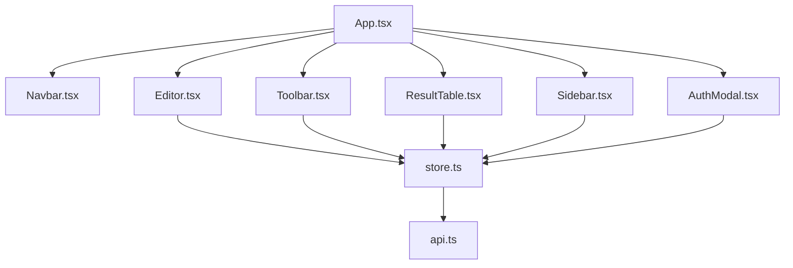
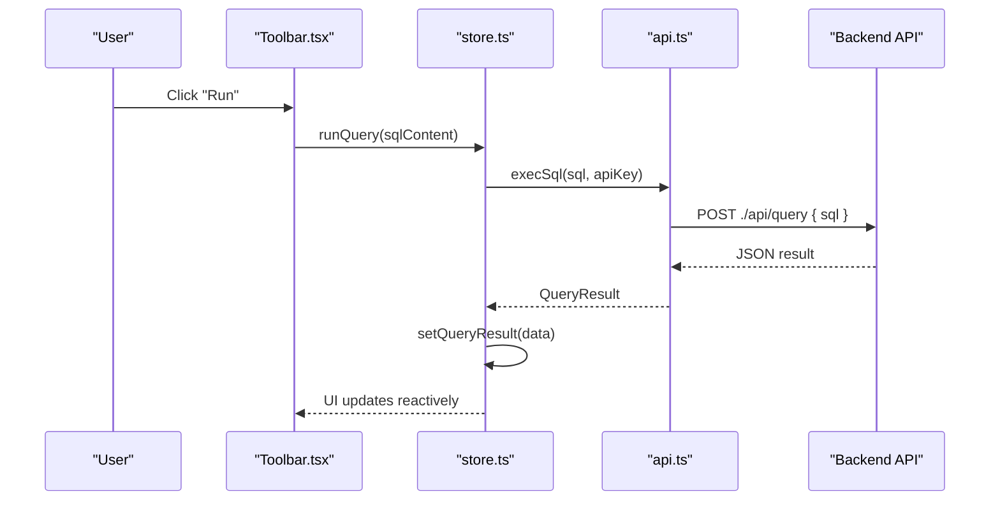
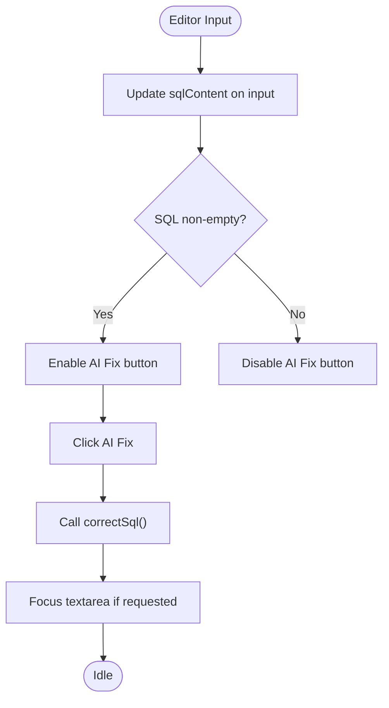
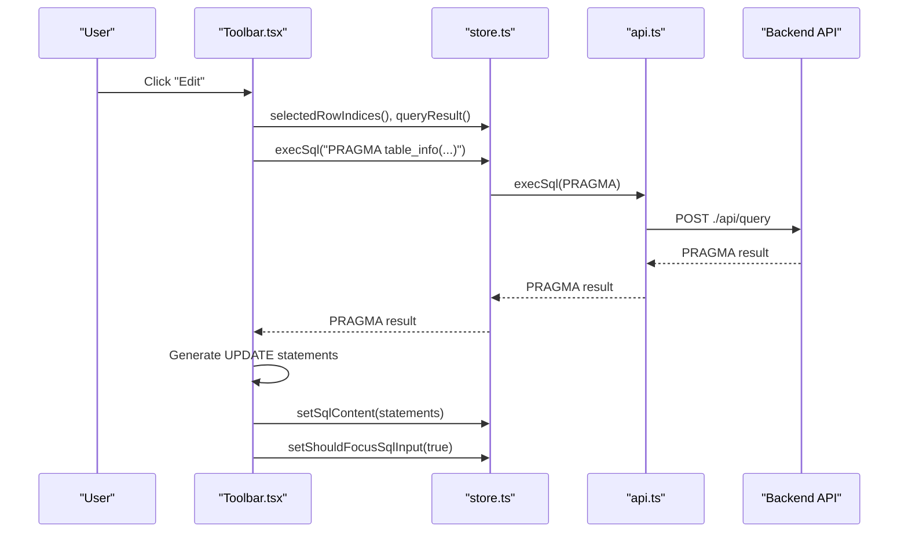
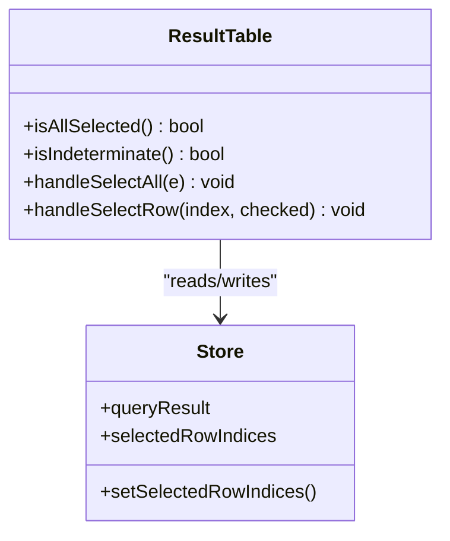
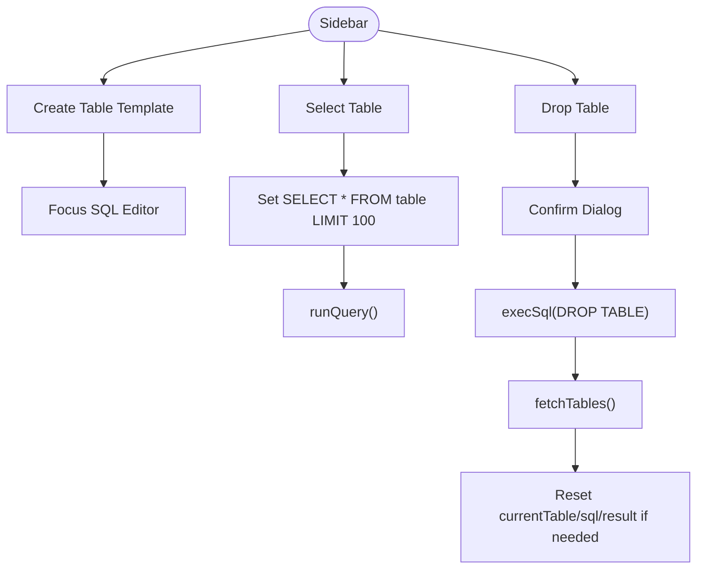
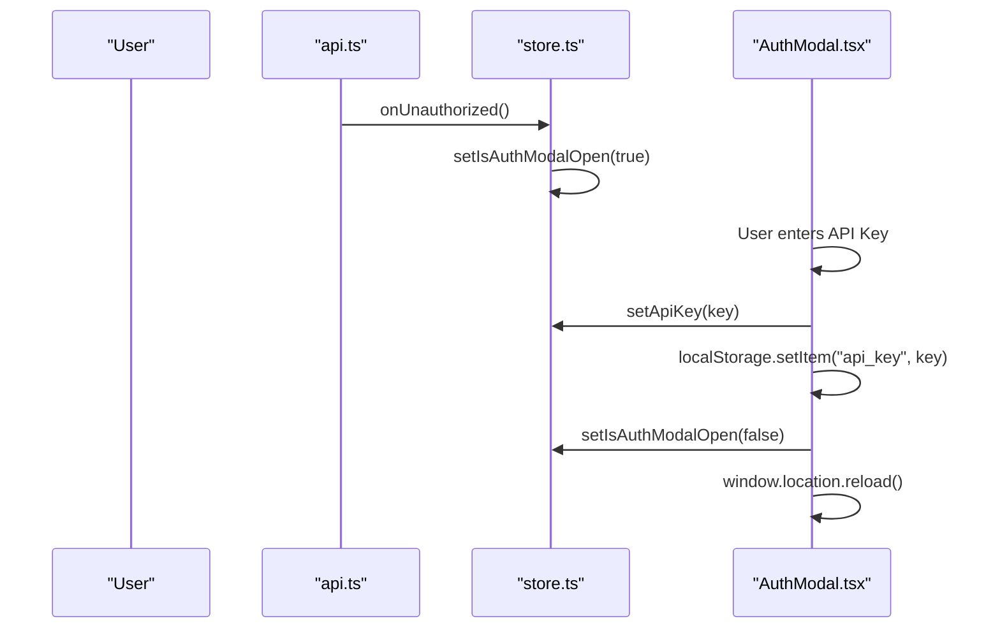
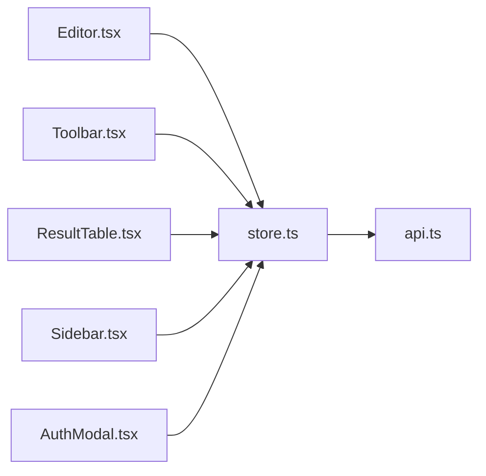

# Core Components

<cite>
**Referenced Files in This Document**
- [App.tsx](file://frontend/src/App.tsx)
- [Editor.tsx](file://frontend/src/components/Editor.tsx)
- [Toolbar.tsx](file://frontend/src/components/Toolbar.tsx)
- [ResultTable.tsx](file://frontend/src/components/ResultTable.tsx)
- [Sidebar.tsx](file://frontend/src/components/Sidebar.tsx)
- [AuthModal.tsx](file://frontend/src/components/AuthModal.tsx)
- [store.ts](file://frontend/src/lib/store.ts)
- [api.ts](file://frontend/src/lib/api.ts)
</cite>

## Table of Contents
1. [Introduction](#introduction)
2. [Project Structure](#project-structure)
3. [Core Components](#core-components)
4. [Architecture Overview](#architecture-overview)
5. [Detailed Component Analysis](#detailed-component-analysis)
6. [Dependency Analysis](#dependency-analysis)
7. [Performance Considerations](#performance-considerations)
8. [Troubleshooting Guide](#troubleshooting-guide)
9. [Conclusion](#conclusion)

## Introduction
This document provides comprehensive documentation for the core UI components of the Solid.js frontend: Editor, Toolbar, ResultTable, Sidebar, and AuthModal. It explains props, events, state management, styling patterns, and integration with parent components. It also includes usage examples, customization options, and best practices for extending functionality.

The application is a SQLite WebUI that allows users to write SQL queries, execute them against a backend API, view results, manage database tables, and authenticate via an API key. The UI is built with Solid.js and styled using utility-first CSS classes (DaisyUI/Tailwind).

## Project Structure
At a high level, the App component composes the main layout and mounts the core components. State and API calls are centralized in store.ts and api.ts.

**Diagram sources**
- [App.tsx:1-29](file://frontend/src/App.tsx#L1-L29)
- [Editor.tsx:1-49](file://frontend/src/components/Editor.tsx#L1-L49)
- [Toolbar.tsx:1-228](file://frontend/src/components/Toolbar.tsx#L1-L228)
- [ResultTable.tsx:1-120](file://frontend/src/components/ResultTable.tsx#L1-L120)
- [Sidebar.tsx:1-108](file://frontend/src/components/Sidebar.tsx#L1-L108)
- [AuthModal.tsx:1-44](file://frontend/src/components/AuthModal.tsx#L1-L44)
- [store.ts:1-116](file://frontend/src/lib/store.ts#L1-L116)
- [api.ts:1-116](file://frontend/src/lib/api.ts#L1-L116)

**Section sources**
- [App.tsx:1-29](file://frontend/src/App.tsx#L1-L29)

## Core Components
This section summarizes each core component’s purpose, props, events, state interactions, styling approach, and how it integrates with the rest of the app.

- Editor: A textarea-based SQL input with an AI-assisted “AI Fix” button. It reads/writes shared state and can focus itself programmatically.
- Toolbar: Provides Run, Insert, Edit, Delete, and Refresh actions. It generates SQL statements based on selected rows and current table metadata, then updates the editor and executes queries.
- ResultTable: Displays query results as a table with column headers, row selection, and execution stats. It manages selected row indices in shared state.
- Sidebar: Lists available tables, supports creating a new table template, selecting a table to query, and dropping a table with confirmation.
- AuthModal: Prompts for an API key when authentication is required, persists the key, and reloads the page to reinitialize connections.

Styling is primarily done with utility classes (e.g., Tailwind/DaisyUI), keeping components lightweight and theme-aware.

**Section sources**
- [Editor.tsx:1-49](file://frontend/src/components/Editor.tsx#L1-L49)
- [Toolbar.tsx:1-228](file://frontend/src/components/Toolbar.tsx#L1-L228)
- [ResultTable.tsx:1-120](file://frontend/src/components/ResultTable.tsx#L1-L120)
- [Sidebar.tsx:1-108](file://frontend/src/components/Sidebar.tsx#L1-L108)
- [AuthModal.tsx:1-44](file://frontend/src/components/AuthModal.tsx#L1-L44)

## Architecture Overview
The components interact through a central store that exposes signals for shared state and functions for data operations. The store delegates HTTP requests to the API module, which communicates with the backend endpoints.

**Diagram sources**
- [Toolbar.tsx:13-15](file://frontend/src/components/Toolbar.tsx#L13-L15)
- [store.ts:53-92](file://frontend/src/lib/store.ts#L53-L92)
- [api.ts:36-59](file://frontend/src/lib/api.ts#L36-L59)

## Detailed Component Analysis

### Editor Component
Purpose:
- Provide a SQL input area.
- Integrate with AI correction (“AI Fix”).
- Support programmatic focus after actions like generating SQL from toolbar or sidebar.

Props:
- None (uses shared store state).

Events:
- onInput: Updates shared sqlContent signal.
- onClick (AI Fix): Calls correctSql from store; shows loading spinner while correcting.

State Management:
- Reads: sqlContent, shouldFocusSqlInput, isCorrecting.
- Writes: setSqlContent, setShouldFocusSqlInput (to false after focusing).

Styling:
- Uses utility classes for layout and DaisyUI components (textarea, buttons, loading spinner).

Integration:
- Parent App.tsx renders Editor within the main content area.
- Toolbar and Sidebar trigger focus by setting shouldFocusSqlInput(true).

Usage Example:
- Place <Editor /> inside App.tsx’s main content container. No additional props needed.

Customization Options:
- Adjust placeholder text and height via class attributes.
- Extend AI Fix behavior by wrapping correctSql or adding custom validation before calling it.

Best Practices:
- Keep SQL editing logic in the component; keep side effects (API calls) in store.ts.
- Use createEffect to handle focus transitions cleanly.

Code Snippet Paths:
- [Editor.tsx:11-46](file://frontend/src/components/Editor.tsx#L11-L46)
- [store.ts:94-115](file://frontend/src/lib/store.ts#L94-L115)

**Diagram sources**
- [Editor.tsx:21-43](file://frontend/src/components/Editor.tsx#L21-L43)
- [store.ts:94-115](file://frontend/src/lib/store.ts#L94-L115)

**Section sources**
- [Editor.tsx:1-49](file://frontend/src/components/Editor.tsx#L1-L49)
- [store.ts:94-115](file://frontend/src/lib/store.ts#L94-L115)

### Toolbar Component
Purpose:
- Execute queries, generate INSERT/UPDATE/DELETE statements based on selected rows and table metadata, refresh current table data.

Props:
- None (uses shared store state).

Events:
- handleRun: Executes current SQL via runQuery.
- handleInsert: Generates INSERT statement using PRAGMA table_info.
- handleEdit: Generates UPDATE statements for selected rows using PK columns.
- handleDelete: Generates DELETE statements for selected rows using PK columns.
- handleRefresh: Re-runs SELECT * FROM currentTable LIMIT 100.

State Management:
- Reads: isQuerying, currentTable, sqlContent, selectedRowIndices, queryResult.
- Writes: setSqlContent, setShouldFocusSqlInput, setSelectedRowIndices (via ResultTable), setQueryResult (via store.runQuery).

Styling:
- Uses DaisyUI buttons and SVG icons; disabled states reflect availability.

Integration:
- Parent App.tsx renders Toolbar below Editor.
- Relies on ResultTable’s selectedRowIndices for multi-row operations.

Usage Example:
- Place <Toolbar /> under <Editor /> in App.tsx.

Customization Options:
- Add new action buttons by implementing handlers that call execSql or update sqlContent.
- Customize generated SQL templates for insert/update/delete.

Best Practices:
- Always validate currentTable and selectedRowIndices before generating statements.
- Use try/catch around execSql and log errors.

Code Snippet Paths:
- [Toolbar.tsx:5-167](file://frontend/src/components/Toolbar.tsx#L5-L167)
- [store.ts:49-92](file://frontend/src/lib/store.ts#L49-L92)

**Diagram sources**
- [Toolbar.tsx:42-105](file://frontend/src/components/Toolbar.tsx#L42-L105)
- [store.ts:49-92](file://frontend/src/lib/store.ts#L49-L92)

**Section sources**
- [Toolbar.tsx:1-228](file://frontend/src/components/Toolbar.tsx#L1-L228)
- [store.ts:49-92](file://frontend/src/lib/store.ts#L49-L92)

### ResultTable Component
Purpose:
- Display query results with column headers, row selection, and execution statistics.
- Manage selected row indices for batch operations.

Props:
- None (uses shared store state).

Events:
- handleSelectAll: Selects/deselects all rows.
- handleSelectRow: Toggles individual row selection.

State Management:
- Reads: queryResult, selectedRowIndices.
- Writes: setSelectedRowIndices.

Styling:
- Uses DaisyUI table classes; conditional rendering for empty/error states.

Integration:
- Parent App.tsx renders ResultTable at the bottom of the main content.
- Toolbar uses selectedRowIndices to generate UPDATE/DELETE statements.

Usage Example:
- Place <ResultTable /> under <Toolbar /> in App.tsx.

Customization Options:
- Add column metadata display (e.g., types) by reading queryResult.columnTypes.
- Implement pagination by slicing rows and controlling visible indices.

Best Practices:
- Avoid mutating selectedRowIndices directly; use setSelectedRowIndices.
- Handle null values gracefully in cell rendering.

Code Snippet Paths:
- [ResultTable.tsx:4-38](file://frontend/src/components/ResultTable.tsx#L4-L38)
- [ResultTable.tsx:40-114](file://frontend/src/components/ResultTable.tsx#L40-L114)

**Diagram sources**
- [ResultTable.tsx:4-38](file://frontend/src/components/ResultTable.tsx#L4-L38)
- [store.ts:10-18](file://frontend/src/lib/store.ts#L10-L18)

**Section sources**
- [ResultTable.tsx:1-120](file://frontend/src/components/ResultTable.tsx#L1-L120)
- [store.ts:10-18](file://frontend/src/lib/store.ts#L10-L18)

### Sidebar Component
Purpose:
- List available tables, allow creating a new table template, select a table to query, and drop a table with confirmation.

Props:
- None (uses shared store state).

Events:
- handleAddTable: Inserts a CREATE TABLE template into the editor and focuses it.
- handleTableClick: Sets currentTable, writes a SELECT query, and runs it.
- handleDropClick: Opens a confirmation dialog to drop a table.
- confirmDrop: Executes DROP TABLE, refreshes tables, and resets related state if necessary.

State Management:
- Local signals: showDropDialog, tableToDrop.
- Shared store: tables, currentTable, sqlContent, queryResult.

Styling:
- Uses DaisyUI menu and modal components.

Integration:
- Parent App.tsx renders Sidebar on the left side.
- Interacts with store.fetchTables and store.execSql.

Usage Example:
- Place <Sidebar /> next to the main content in App.tsx.

Customization Options:
- Add file navigation by integrating getDbFiles/connectDb flows similar to Navbar.
- Enhance table creation wizard with more schema options.

Best Practices:
- Confirm destructive actions (drop table) before executing.
- Reset UI state when the active table changes.

Code Snippet Paths:
- [Sidebar.tsx:4-44](file://frontend/src/components/Sidebar.tsx#L4-L44)
- [Sidebar.tsx:46-103](file://frontend/src/components/Sidebar.tsx#L46-L103)

**Diagram sources**
- [Sidebar.tsx:8-44](file://frontend/src/components/Sidebar.tsx#L8-L44)
- [store.ts:30-47](file://frontend/src/lib/store.ts#L30-L47)

**Section sources**
- [Sidebar.tsx:1-108](file://frontend/src/components/Sidebar.tsx#L1-L108)
- [store.ts:30-47](file://frontend/src/lib/store.ts#L30-L47)

### AuthModal Component
Purpose:
- Prompt for API key when unauthorized access occurs.
- Persist API key locally and reload the app to reinitialize connections.

Props:
- None (uses shared store state).

Events:
- handleSave: Validates input, sets apiKey, stores in localStorage, closes modal, and reloads window.

State Management:
- Local signal: inputKey.
- Shared store: isAuthModalOpen, setApiKey, setIsAuthModalOpen.

Styling:
- Uses DaisyUI modal and input components.

Integration:
- Rendered at the top of App.tsx.
- Triggered by store.onUnauthorized callback when API returns 401.

Usage Example:
- Place <AuthModal /> at the root of App.tsx.

Customization Options:
- Add validation rules for API key format.
- Replace reload with a reconnection flow to avoid full page refresh.

Best Practices:
- Clear sensitive data from memory after saving.
- Provide user feedback on success/failure.

Code Snippet Paths:
- [AuthModal.tsx:4-16](file://frontend/src/components/AuthModal.tsx#L4-L16)
- [AuthModal.tsx:18-40](file://frontend/src/components/AuthModal.tsx#L18-L40)
- [store.ts:7-8](file://frontend/src/lib/store.ts#L7-L8)

**Diagram sources**
- [api.ts:17-23](file://frontend/src/lib/api.ts#L17-L23)
- [store.ts:7-8](file://frontend/src/lib/store.ts#L7-L8)
- [AuthModal.tsx:4-16](file://frontend/src/components/AuthModal.tsx#L4-L16)

**Section sources**
- [AuthModal.tsx:1-44](file://frontend/src/components/AuthModal.tsx#L1-L44)
- [store.ts:7-8](file://frontend/src/lib/store.ts#L7-L8)

## Dependency Analysis
Components depend on shared state and API functions. The following diagram maps these relationships.

**Diagram sources**
- [Editor.tsx:1-49](file://frontend/src/components/Editor.tsx#L1-L49)
- [Toolbar.tsx:1-228](file://frontend/src/components/Toolbar.tsx#L1-L228)
- [ResultTable.tsx:1-120](file://frontend/src/components/ResultTable.tsx#L1-L120)
- [Sidebar.tsx:1-108](file://frontend/src/components/Sidebar.tsx#L1-L108)
- [AuthModal.tsx:1-44](file://frontend/src/components/AuthModal.tsx#L1-L44)
- [store.ts:1-116](file://frontend/src/lib/store.ts#L1-L116)
- [api.ts:1-116](file://frontend/src/lib/api.ts#L1-L116)

**Section sources**
- [store.ts:1-116](file://frontend/src/lib/store.ts#L1-L116)
- [api.ts:1-116](file://frontend/src/lib/api.ts#L1-L116)

## Performance Considerations
- Reactive Updates: Solid.js signals ensure minimal re-renders; prefer updating signals rather than DOM directly.
- Query Execution Timing: runQuery measures execution time; avoid redundant queries by debouncing inputs if needed.
- Large Result Sets: ResultTable currently renders all rows; consider virtualization or pagination for large datasets.
- Network Requests: Batch operations (like generating multiple UPDATE/DELETE statements) should be reviewed for efficiency; consider server-side bulk operations.

[No sources needed since this section provides general guidance]

## Troubleshooting Guide
Common issues and resolutions:
- Unauthorized Access: If the backend returns 401, the AuthModal will open. Ensure the API key is valid and persisted.
- Empty Results: When no rows are returned, ResultTable shows a message; verify the query and table selection.
- Error Display: Errors from execSql are captured and displayed in ResultTable; check network responses and backend logs.
- Focus Issues: After generating SQL from Toolbar/Sidebar, ensure shouldFocusSqlInput is set to true to focus the editor.

Code Snippet Paths:
- [store.ts:82-91](file://frontend/src/lib/store.ts#L82-L91)
- [api.ts:17-23](file://frontend/src/lib/api.ts#L17-L23)
- [ResultTable.tsx:54-59](file://frontend/src/components/ResultTable.tsx#L54-L59)

**Section sources**
- [store.ts:82-91](file://frontend/src/lib/store.ts#L82-L91)
- [api.ts:17-23](file://frontend/src/lib/api.ts#L17-L23)
- [ResultTable.tsx:54-59](file://frontend/src/components/ResultTable.tsx#L54-L59)

## Conclusion
The core UI components form a cohesive system for interacting with a SQLite backend via a REST API. The Editor and Toolbar enable SQL authoring and execution, ResultTable visualizes outcomes, Sidebar manages database objects, and AuthModal handles authentication. Centralized state in store.ts and API abstraction in api.ts provide clear separation of concerns, making the codebase maintainable and extensible.

[No sources needed since this section summarizes without analyzing specific files]