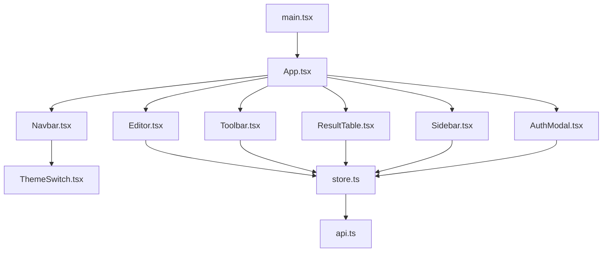
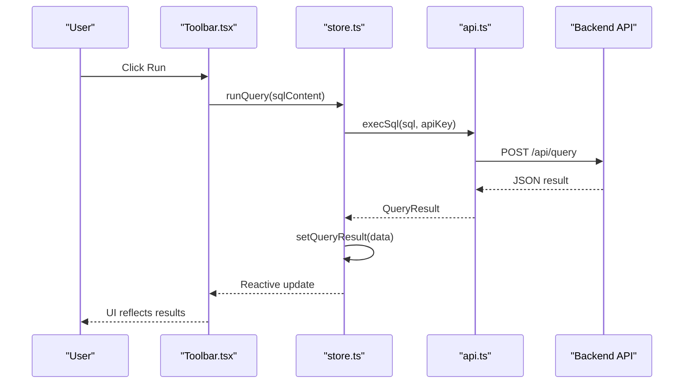
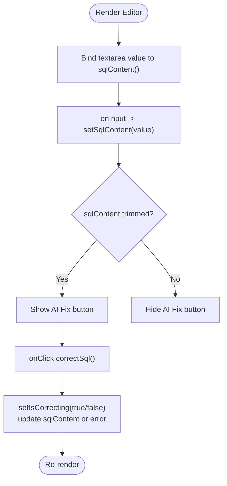
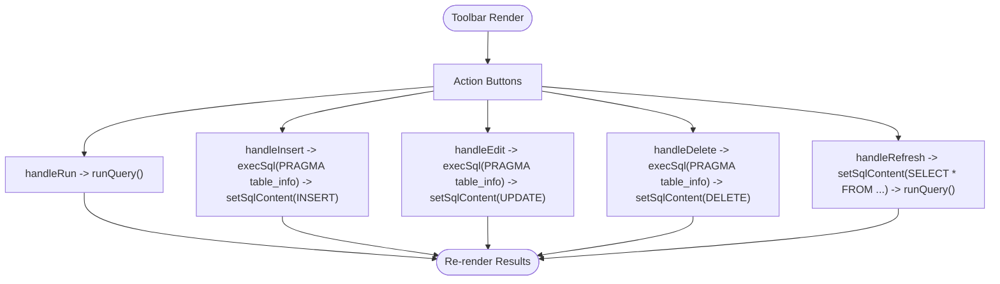
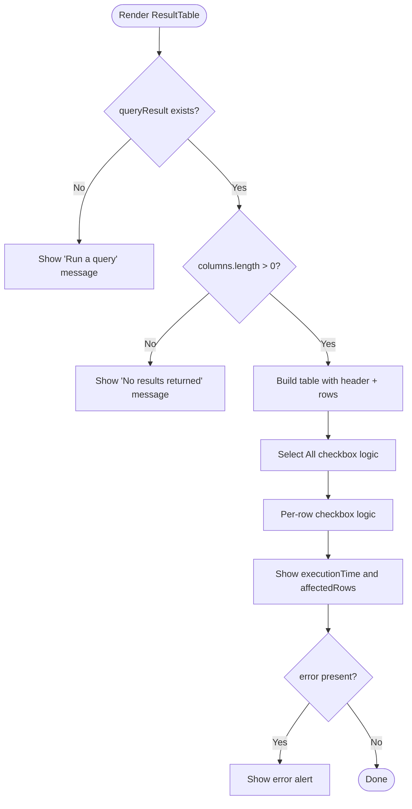
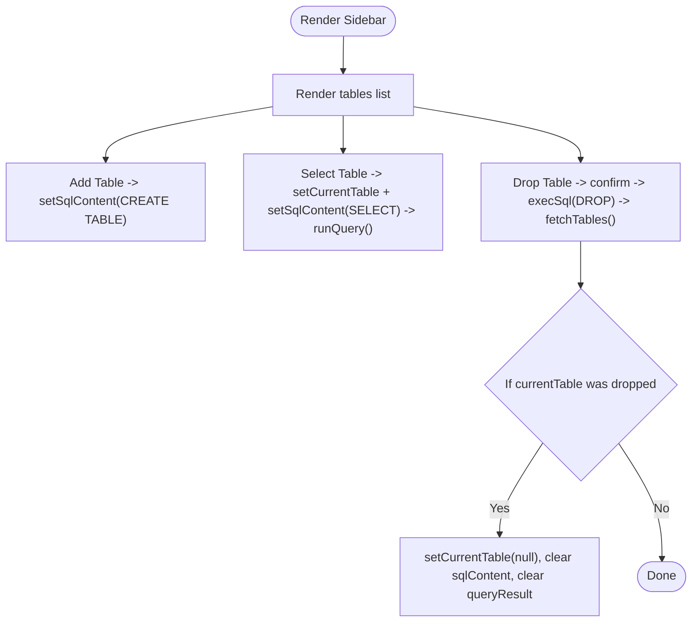
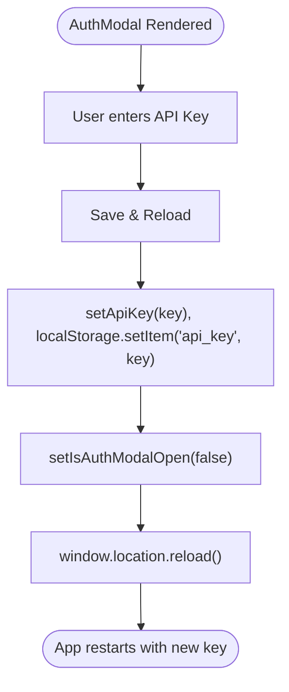
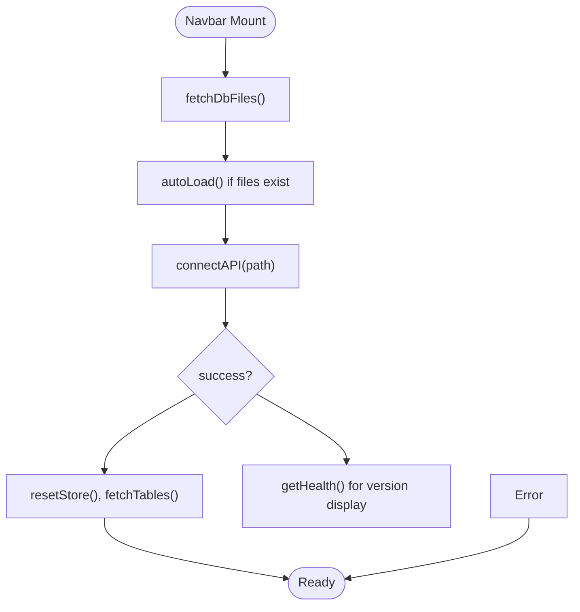
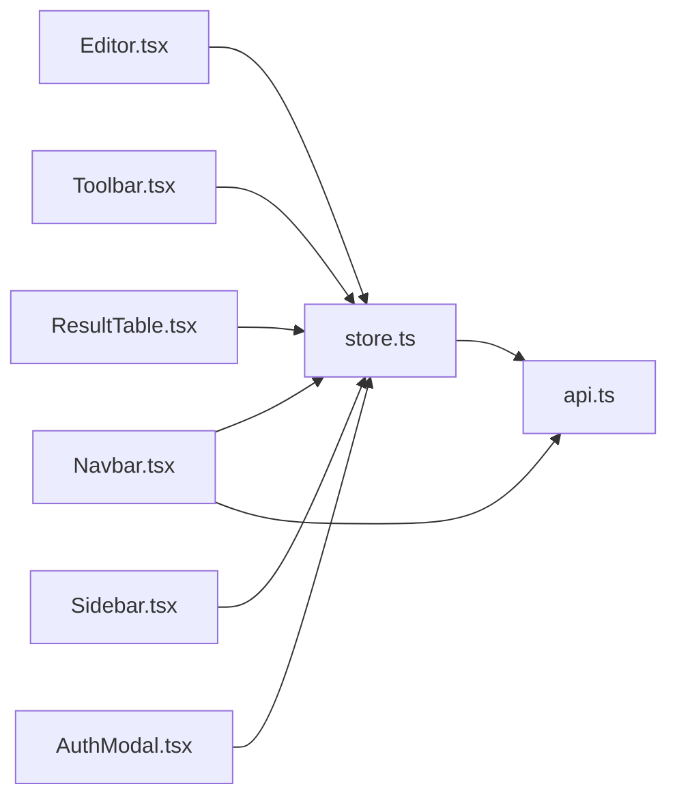

# Frontend Development

<cite>
**Referenced Files in This Document**
- [App.tsx](file://frontend/src/App.tsx)
- [main.tsx](file://frontend/src/main.tsx)
- [package.json](file://frontend/package.json)
- [vite.config.ts](file://frontend/vite.config.ts)
- [store.ts](file://frontend/src/lib/store.ts)
- [api.ts](file://frontend/src/lib/api.ts)
- [Editor.tsx](file://frontend/src/components/Editor.tsx)
- [Toolbar.tsx](file://frontend/src/components/Toolbar.tsx)
- [ResultTable.tsx](file://frontend/src/components/ResultTable.tsx)
- [Sidebar.tsx](file://frontend/src/components/Sidebar.tsx)
- [AuthModal.tsx](file://frontend/src/components/AuthModal.tsx)
- [Navbar.tsx](file://frontend/src/components/Navbar.tsx)
- [ThemeSwitch.tsx](file://frontend/src/components/ThemeSwitch.tsx)
- [index.html](file://frontend/index.html)
</cite>

## Update Summary
**Changes Made**
- Updated package configuration references to reflect 'crablite-frontend' package name
- Updated page title and navbar branding documentation to show 'crablite' branding
- Enhanced navbar branding section with version display functionality
- Updated HTML document structure references

## Table of Contents
1. [Introduction](#introduction)
2. [Project Structure](#project-structure)
3. [Core Components](#core-components)
4. [Architecture Overview](#architecture-overview)
5. [Detailed Component Analysis](#detailed-component-analysis)
6. [Dependency Analysis](#dependency-analysis)
7. [Performance Considerations](#performance-considerations)
8. [Troubleshooting Guide](#troubleshooting-guide)
9. [Conclusion](#conclusion)
10. [Appendices](#appendices)

## Introduction
This document provides comprehensive frontend development documentation for the Solid.js web interface. It covers component architecture (Editor, Toolbar, ResultTable, Sidebar, AuthModal), state management with Solid.js signals and stores, API client implementation, UI props/events/customization, responsive design patterns, theme switching, accessibility considerations, build configuration with Vite, styling with TailwindCSS/DaisyUI, and the development workflow including hot reload.

The application is packaged as 'crablite-frontend' and features 'crablite' branding throughout the user interface, including dynamic version display in the navbar.

## Project Structure
The frontend is a Solid.js application bootstrapped with Vite and styled using TailwindCSS and DaisyUI. The entry point renders the root App component, which composes the main layout and child components. State is centralized in a store module that exposes signals and functions to read/write shared state and orchestrate API calls.

**Diagram sources**
- [main.tsx:1-11](file://frontend/src/main.tsx#L1-L11)
- [App.tsx:1-29](file://frontend/src/App.tsx#L1-L29)
- [store.ts:1-116](file://frontend/src/lib/store.ts#L1-L116)
- [api.ts:1-116](file://frontend/src/lib/api.ts#L1-L116)

**Section sources**
- [main.tsx:1-11](file://frontend/src/main.tsx#L1-L11)
- [App.tsx:1-29](file://frontend/src/App.tsx#L1-L29)
- [package.json:1-23](file://frontend/package.json#L1-L23)
- [vite.config.ts:1-19](file://frontend/vite.config.ts#L1-L19)

## Core Components
- Editor: SQL input area with an AI fix button; integrates with store to update and focus the textarea.
- Toolbar: Actions to run queries, insert/edit/delete rows, and refresh current table view; generates SQL statements based on selected rows and schema introspection.
- ResultTable: Displays query results with row selection, select-all behavior, execution stats, and error alerts.
- Sidebar: Lists tables, allows creating a new table template, selecting a table to query, and dropping a table with confirmation.
- AuthModal: Prompts for API key when unauthorized; persists key to localStorage and reloads the app.
- Navbar: Manages database file discovery, connection, creation, version display, and includes ThemeSwitch. Features 'crablite' branding with logo and dynamic version display.
- ThemeSwitch: Toggles light/dark themes via data-theme attribute and persists preference.

Key responsibilities and interactions are implemented through Solid.js signals and effects, with API calls routed through the api module.

**Section sources**
- [Editor.tsx:1-49](file://frontend/src/components/Editor.tsx#L1-L49)
- [Toolbar.tsx:1-228](file://frontend/src/components/Toolbar.tsx#L1-L228)
- [ResultTable.tsx:1-120](file://frontend/src/components/ResultTable.tsx#L1-L120)
- [Sidebar.tsx:1-108](file://frontend/src/components/Sidebar.tsx#L1-L108)
- [AuthModal.tsx:1-44](file://frontend/src/components/AuthModal.tsx#L1-L44)
- [Navbar.tsx:1-239](file://frontend/src/components/Navbar.tsx#L1-L239)
- [ThemeSwitch.tsx:1-68](file://frontend/src/components/ThemeSwitch.tsx#L1-L68)

## Architecture Overview
The frontend follows a unidirectional data flow:
- Components subscribe to signals from store.ts.
- User actions trigger store functions that call api.ts endpoints.
- Responses update signals, causing reactive re-renders.

**Diagram sources**
- [Toolbar.tsx:1-228](file://frontend/src/components/Toolbar.tsx#L1-L228)
- [store.ts:49-92](file://frontend/src/lib/store.ts#L49-L92)
- [api.ts:36-59](file://frontend/src/lib/api.ts#L36-L59)

## Detailed Component Analysis

### Editor
Purpose:
- Provides a textarea for SQL input.
- Binds value to sqlContent signal.
- Focuses the textarea when requested by other components.
- Offers an AI Fix button that triggers SQL correction via store.

Props/Events:
- No explicit props; uses global store signals.
- Events:
  - onInput updates sqlContent.
  - onClick on AI Fix triggers correctSql.

Customization:
- Styling via Tailwind/DaisyUI classes.
- Placeholder text can be customized.

State Integration:
- Reads/writes sqlContent, shouldFocusSqlInput, isCorrecting.
- Calls correctSql from store.

**Diagram sources**
- [Editor.tsx:11-46](file://frontend/src/components/Editor.tsx#L11-L46)
- [store.ts:94-115](file://frontend/src/lib/store.ts#L94-L115)

**Section sources**
- [Editor.tsx:1-49](file://frontend/src/components/Editor.tsx#L1-L49)
- [store.ts:94-115](file://frontend/src/lib/store.ts#L94-L115)

### Toolbar
Purpose:
- Execute queries, generate INSERT/UPDATE/DELETE statements, refresh current table view.
- Uses PRAGMA table_info to introspect schema for safe statement generation.

Key Behaviors:
- handleRun: executes current sqlContent.
- handleInsert: builds INSERT statement with placeholder values.
- handleEdit: builds UPDATE statements for selected rows, handling nulls, numbers, strings, and BLOB types.
- handleDelete: builds DELETE statements for selected rows.
- handleRefresh: resets to SELECT * FROM <table> LIMIT 100 and runs it.

State Integration:
- Reads/writes currentTable, sqlContent, selectedRowIndices, queryResult, isQuerying.
- Calls execSql and runQuery from store.

Accessibility:
- Buttons include title attributes for screen readers.
- Disabled states reflect availability.

**Diagram sources**
- [Toolbar.tsx:5-167](file://frontend/src/components/Toolbar.tsx#L5-L167)
- [store.ts:49-92](file://frontend/src/lib/store.ts#L49-L92)

**Section sources**
- [Toolbar.tsx:1-228](file://frontend/src/components/Toolbar.tsx#L1-L228)
- [store.ts:49-92](file://frontend/src/lib/store.ts#L49-L92)

### ResultTable
Purpose:
- Display columns and rows from query results.
- Support row selection and select-all with indeterminate state.
- Show execution time and affected rows.
- Display errors in an alert region.

State Integration:
- Reads queryResult, selectedRowIndices.
- Updates selectedRowIndices via setSelectedRowIndices.

Accessibility:
- Uses role="alert" for error messages.
- Checkbox inputs for selection.

**Diagram sources**
- [ResultTable.tsx:4-116](file://frontend/src/components/ResultTable.tsx#L4-L116)

**Section sources**
- [ResultTable.tsx:1-120](file://frontend/src/components/ResultTable.tsx#L1-L120)

### Sidebar
Purpose:
- List available tables.
- Provide quick CREATE TABLE template.
- Allow selecting a table to query.
- Confirm and execute DROP TABLE.

State Integration:
- Reads/writes tables, currentTable, sqlContent, queryResult.
- Calls fetchTables, execSql, runQuery.

UX:
- Local dialog for drop confirmation.
- Active state highlighting for current table.

**Diagram sources**
- [Sidebar.tsx:4-44](file://frontend/src/components/Sidebar.tsx#L4-L44)
- [store.ts:30-47](file://frontend/src/lib/store.ts#L30-L47)

**Section sources**
- [Sidebar.tsx:1-108](file://frontend/src/components/Sidebar.tsx#L1-L108)
- [store.ts:30-47](file://frontend/src/lib/store.ts#L30-L47)

### AuthModal
Purpose:
- Prompt for API key when backend returns 401 Unauthorized.
- Persist key to localStorage and reload page to apply.

State Integration:
- Reads/writes isAuthModalOpen, apiKey.

Flow:
- When opened, user enters key and saves; app reloads to reinitialize with new key.

**Diagram sources**
- [AuthModal.tsx:4-16](file://frontend/src/components/AuthModal.tsx#L4-L16)
- [store.ts:7-8](file://frontend/src/lib/store.ts#L7-L8)

**Section sources**
- [AuthModal.tsx:1-44](file://frontend/src/components/AuthModal.tsx#L1-L44)
- [store.ts:7-8](file://frontend/src/lib/store.ts#L7-L8)

### Navbar
Purpose:
- Discover available database files.
- Connect to a selected database or create a new one.
- Display app version from health endpoint.
- Integrate ThemeSwitch.
- Feature 'crablite' branding with logo and dynamic version display.

Updated Branding Features:
- Displays 'crablite' as the application name with proper branding.
- Shows version information fetched from the backend health endpoint.
- Includes logo image integration for visual branding.
- Responsive design with mobile-friendly navigation.

State Integration:
- Local signals for dbFiles, currentPath, inputPath, isLoading, errorMsg, showCreateDialog.
- Calls getDbFiles, connectDb, getHealth, resetStore, fetchTables.

Responsiveness:
- Uses Tailwind utility classes for layout and spacing.
- Mobile-responsive design with hidden text on small screens.

**Diagram sources**
- [Navbar.tsx:16-82](file://frontend/src/components/Navbar.tsx#L16-L82)
- [api.ts:77-96](file://frontend/src/lib/api.ts#L77-L96)

**Section sources**
- [Navbar.tsx:1-239](file://frontend/src/components/Navbar.tsx#L1-L239)
- [api.ts:77-96](file://frontend/src/lib/api.ts#L77-L96)

### ThemeSwitch
Purpose:
- Toggle between light and dark themes.
- Persist theme preference in localStorage.
- Apply theme via data-theme attribute on documentElement.

Behavior:
- On mount, reads stored theme and applies it.
- On toggle, updates state and DOM attribute.

**Section sources**
- [ThemeSwitch.tsx:1-68](file://frontend/src/components/ThemeSwitch.tsx#L1-L68)

## Dependency Analysis
Components depend on store.ts for shared state and side effects. store.ts depends on api.ts for HTTP communication. Navbar also directly imports api.ts for DB file operations and health checks.

**Diagram sources**
- [Editor.tsx:1-49](file://frontend/src/components/Editor.tsx#L1-L49)
- [Toolbar.tsx:1-228](file://frontend/src/components/Toolbar.tsx#L1-L228)
- [ResultTable.tsx:1-120](file://frontend/src/components/ResultTable.tsx#L1-L120)
- [Sidebar.tsx:1-108](file://frontend/src/components/Sidebar.tsx#L1-L108)
- [AuthModal.tsx:1-44](file://frontend/src/components/AuthModal.tsx#L1-L44)
- [Navbar.tsx:1-239](file://frontend/src/components/Navbar.tsx#L1-L239)
- [store.ts:1-116](file://frontend/src/lib/store.ts#L1-L116)
- [api.ts:1-116](file://frontend/src/lib/api.ts#L1-L116)

**Section sources**
- [store.ts:1-116](file://frontend/src/lib/store.ts#L1-L116)
- [api.ts:1-116](file://frontend/src/lib/api.ts#L1-L116)

## Performance Considerations
- Reactive updates: Use Solid's fine-grained reactivity to minimize re-renders. Only update necessary signals.
- Query performance: Avoid running large DDL/DML without confirmation; consider pagination for large result sets.
- Network requests: Debounce rapid actions like typing in the editor before triggering AI correction.
- Memory usage: Clear query results when navigating away or switching databases to free memory.
- Rendering: Virtualize large tables if needed to improve scroll performance.

[No sources needed since this section provides general guidance]

## Troubleshooting Guide
Common issues and resolutions:
- Unauthorized access: Ensure API key is set; check x-api-key header in api.ts. If 401 occurs, AuthModal will open.
- Connection failures: Verify backend is reachable at localhost:3000; check Vite proxy configuration.
- Schema introspection errors: PRAGMA table_info may fail if table does not exist; ensure currentTable is valid before generating statements.
- Theme persistence: If theme does not persist, verify localStorage permissions and browser settings.
- Hot reload not working: Ensure devtools plugin is enabled in vite.config.ts and that the dev server is running.
- Package naming issues: Ensure package name is correctly set to 'crablite-frontend' in package.json.
- Branding display: Verify logo.png exists and navbar displays 'crablite' branding correctly.

**Section sources**
- [api.ts:17-23](file://frontend/src/lib/api.ts#L17-L23)
- [vite.config.ts:10-14](file://frontend/vite.config.ts#L10-L14)
- [AuthModal.tsx:7-16](file://frontend/src/components/AuthModal.tsx#L7-L16)
- [package.json:1-23](file://frontend/package.json#L1-L23)

## Conclusion
The frontend is a well-structured Solid.js application leveraging signals for state management, a clear separation of concerns between components and store/API layers, and modern tooling with Vite, TailwindCSS, and DaisyUI. The architecture supports extensibility, responsive design, and theme switching while maintaining accessibility best practices. The application is properly branded as 'crablite' with professional packaging as 'crablite-frontend'.

[No sources needed since this section summarizes without analyzing specific files]

## Appendices

### Adding a New Component
Steps:
1. Create a new TSX file under src/components/.
2. Define a Solid Component function returning JSX.
3. Import and use signals/functions from store.ts as needed.
4. Compose the component within App.tsx or another parent component.
5. Style using Tailwind/DaisyUI classes.

Example reference paths:
- Component definition pattern: [Editor.tsx:11-46](file://frontend/src/components/Editor.tsx#L11-L46)
- Composition in App: [App.tsx:9-26](file://frontend/src/App.tsx#L9-L26)

**Section sources**
- [Editor.tsx:11-46](file://frontend/src/components/Editor.tsx#L11-L46)
- [App.tsx:9-26](file://frontend/src/App.tsx#L9-L26)

### Extending the Editor Functionality
Options:
- Add syntax highlighting by integrating a code editor library and binding its state to sqlContent.
- Add keyboard shortcuts for running queries or correcting SQL.
- Implement auto-completion based on currentTable and schema info.

Reference patterns:
- Binding input to store: [Editor.tsx:25-31](file://frontend/src/components/Editor.tsx#L25-L31)
- Triggering store actions: [Editor.tsx:32-42](file://frontend/src/components/Editor.tsx#L32-L42)

**Section sources**
- [Editor.tsx:25-42](file://frontend/src/components/Editor.tsx#L25-L42)

### Integrating with the Backend API
Guidelines:
- Use api.ts functions for all HTTP calls.
- Handle 401 responses by invoking onUnauthorized callback to open AuthModal.
- Map backend response fields to QueryResult structure.

Reference patterns:
- Executing queries: [api.ts:36-59](file://frontend/src/lib/api.ts#L36-L59)
- Handling unauthorized: [api.ts:17-23](file://frontend/src/lib/api.ts#L17-L23)

**Section sources**
- [api.ts:17-59](file://frontend/src/lib/api.ts#L17-L59)

### Build Configuration with Vite
Key points:
- Plugins: solidPlugin, tailwindcss, solid-devtools.
- Proxy: /api routes forwarded to http://localhost:3000.
- Base path: './'.
- Build target: esnext.

Reference:
- [vite.config.ts:1-19](file://frontend/vite.config.ts#L1-L19)

**Section sources**
- [vite.config.ts:1-19](file://frontend/vite.config.ts#L1-L19)

### Styling with TailwindCSS/DaisyUI
- Utility-first CSS via Tailwind.
- DaisyUI components for buttons, modals, alerts, and theme toggles.
- Responsive classes used throughout components.

References:
- Tailwind/DaisyUI dependencies: [package.json:10-20](file://frontend/package.json#L10-L20)
- Usage examples: [Toolbar.tsx:169-223](file://frontend/src/components/Toolbar.tsx#L169-L223), [ResultTable.tsx:40-114](file://frontend/src/components/ResultTable.tsx#L40-L114)

**Section sources**
- [package.json:10-20](file://frontend/package.json#L10-L20)
- [Toolbar.tsx:169-223](file://frontend/src/components/Toolbar.tsx#L169-L223)
- [ResultTable.tsx:40-114](file://frontend/src/components/ResultTable.tsx#L40-L114)

### Development Workflow with Hot Reload
- Start dev server: pnpm start.
- Hot reload enabled by default with Vite and Solid.
- Devtools plugin included for debugging.

References:
- Scripts: [package.json:6-9](file://frontend/package.json#L6-L9)
- Devtools plugin: [vite.config.ts:4-8](file://frontend/vite.config.ts#L4-L8)

**Section sources**
- [package.json:6-9](file://frontend/package.json#L6-L9)
- [vite.config.ts:4-8](file://frontend/vite.config.ts#L4-L8)

### Application Branding and Packaging
The application is professionally branded and packaged:

- **Package Name**: 'crablite-frontend' for npm/pnpm registry
- **Page Title**: 'crablite' displayed in browser tab
- **Navbar Branding**: Professional 'crablite' branding with logo and version display
- **Logo Integration**: Custom logo.png for visual identity

Key branding elements:
- HTML title tag: `<title>crablite</title>`
- Navbar displays 'crablite' with version suffix
- Logo image integration in navbar
- Consistent branding across all UI elements

**Section sources**
- [package.json:1-23](file://frontend/package.json#L1-L23)
- [index.html:1-16](file://frontend/index.html#L1-L16)
- [Navbar.tsx:147-157](file://frontend/src/components/Navbar.tsx#L147-L157)