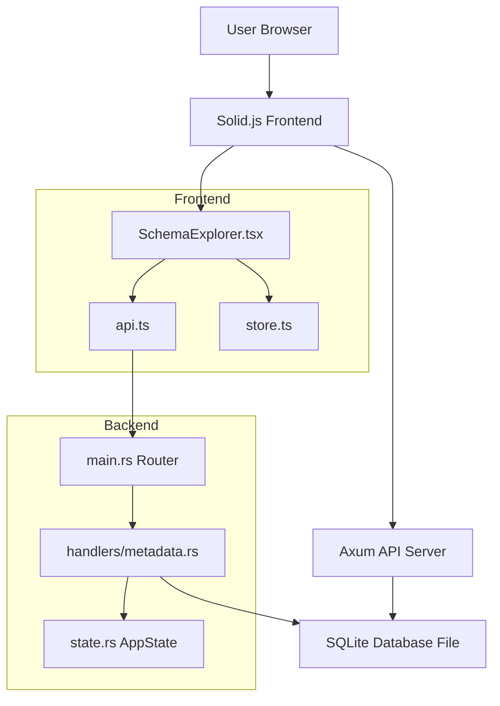
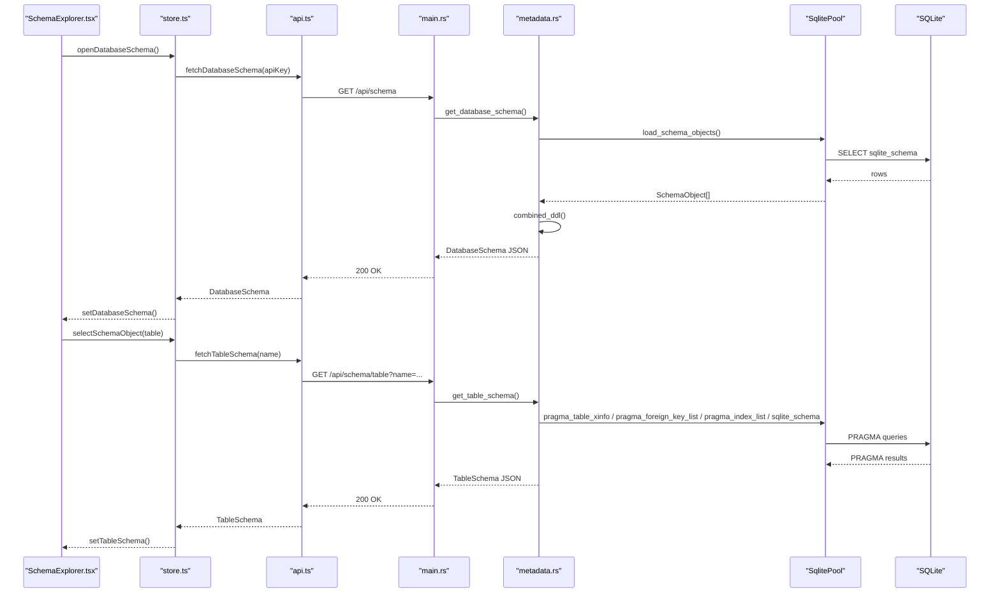
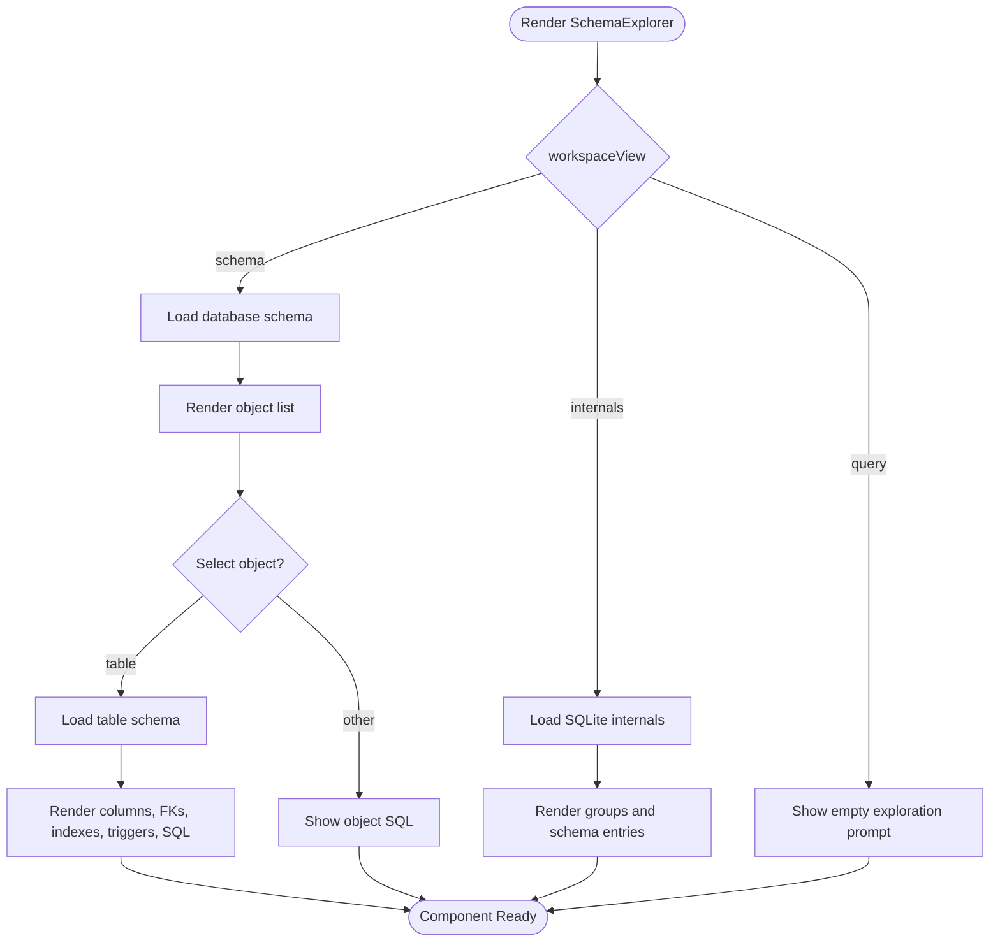
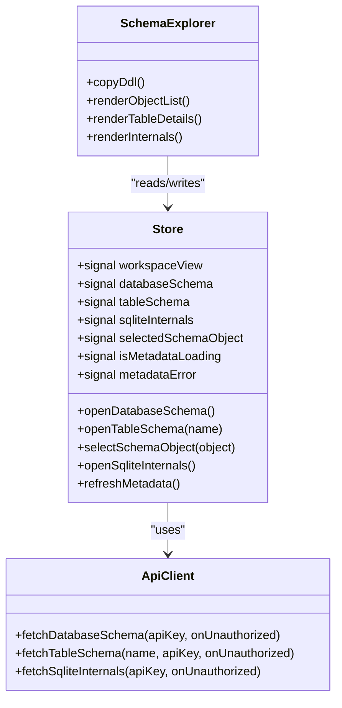
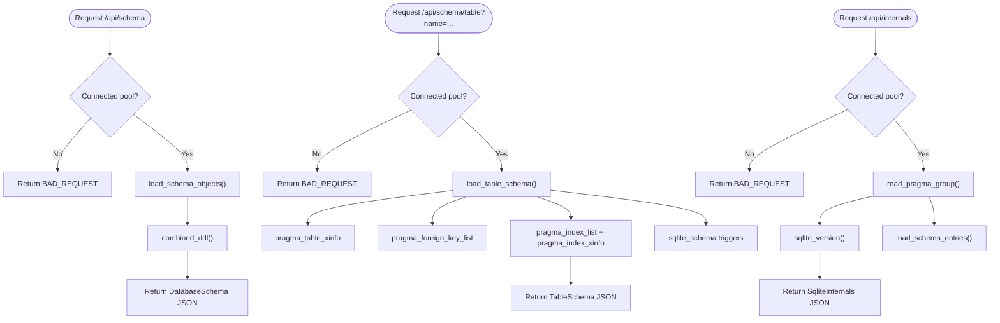
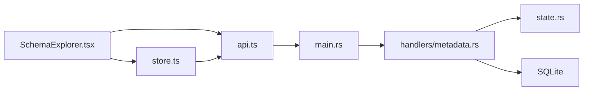

# Schema Explorer

<cite>
**Referenced Files in This Document**
- [README.md](file://README.md)
- [design.md](file://doc/design.md)
- [main.rs](file://backend/src/main.rs)
- [state.rs](file://backend/src/state.rs)
- [metadata.rs](file://backend/src/handlers/metadata.rs)
- [SchemaExplorer.tsx](file://frontend/src/components/SchemaExplorer.tsx)
- [api.ts](file://frontend/src/lib/api.ts)
- [store.ts](file://frontend/src/lib/store.ts)
</cite>

## Table of Contents
1. [Introduction](#introduction)
2. [Project Structure](#project-structure)
3. [Core Components](#core-components)
4. [Architecture Overview](#architecture-overview)
5. [Detailed Component Analysis](#detailed-component-analysis)
6. [Dependency Analysis](#dependency-analysis)
7. [Performance Considerations](#performance-considerations)
8. [Troubleshooting Guide](#troubleshooting-guide)
9. [Conclusion](#conclusion)

## Introduction
This document explains the Schema Explorer feature of crablite, a lightweight SQLite Web administration tool built with Rust and Solid.js. The Schema Explorer provides three read-only views:

- Database schema overview with combined DDL export.
- Detailed table inspection including columns, foreign keys, indexes, triggers, and original SQL.
- SQLite internals showing curated database, connection, and engine metadata plus all `sqlite_schema` entries.

The feature is implemented as a frontend component backed by backend handlers that query SQLite through SQLx and expose structured JSON responses.

**Section sources**
- [README.md:10-26](file://README.md#L10-L26)
- [design.md:73-89](file://doc/design.md#L73-L89)

## Project Structure
The Schema Explorer spans both frontend and backend layers:

- Frontend:
  - `frontend/src/components/SchemaExplorer.tsx`: UI for browsing objects, inspecting tables, copying DDL, and viewing SQLite internals.
  - `frontend/src/lib/api.ts`: TypeScript interfaces and HTTP client functions for metadata endpoints.
  - `frontend/src/lib/store.ts`: Reactive state management for workspace view, selected object, loading/error states, and refresh behavior.

- Backend:
  - `backend/src/main.rs`: Axum router, authentication middleware, and API route registration.
  - `backend/src/state.rs`: Global application state holding the SQLite pool and database directory.
  - `backend/src/handlers/metadata.rs`: Handlers for `/api/schema`, `/api/schema/table`, and `/api/internals`.

**Diagram sources**
- [SchemaExplorer.tsx:1-308](file://frontend/src/components/SchemaExplorer.tsx#L1-L308)
- [api.ts:1-212](file://frontend/src/lib/api.ts#L1-L212)
- [store.ts:1-199](file://frontend/src/lib/store.ts#L1-L199)
- [main.rs:61-77](file://backend/src/main.rs#L61-L77)
- [metadata.rs:10-102](file://backend/src/handlers/metadata.rs#L10-L102)
- [state.rs:6-10](file://backend/src/state.rs#L6-L10)

**Section sources**
- [main.rs:61-77](file://backend/src/main.rs#L61-L77)
- [design.md:39-60](file://doc/design.md#L39-L60)

## Core Components
The Schema Explorer is composed of coordinated frontend and backend pieces:

- Frontend component:
  - Renders object list, table details, combined DDL, and SQLite internals.
  - Uses icons mapped to object types and supports filtering internal schema entries.
  - Provides copy-to-clipboard for combined DDL and a refresh button.

- Frontend store:
  - Holds workspace view, selected schema object, database schema, table schema, SQLite internals, loading state, and error state.
  - Loads schema data, selects objects, opens internals, and refreshes based on current view.

- Frontend API client:
  - Defines TypeScript interfaces matching backend response structures.
  - Wraps fetch calls with API key headers and unauthorized handling.

- Backend handlers:
  - Expose `/api/schema`, `/api/schema/table?name=...`, and `/api/internals`.
  - Query user-defined objects, PRAGMA metadata, and `sqlite_schema`.
  - Build typed response models and combine DDL.

- Backend routing and state:
  - Registers metadata routes under `/api`.
  - Applies authentication middleware requiring `x-api-key`.
  - Shares `AppState` containing the SQLite pool and database directory.

**Section sources**
- [SchemaExplorer.tsx:17-32](file://frontend/src/components/SchemaExplorer.tsx#L17-L32)
- [SchemaExplorer.tsx:53-83](file://frontend/src/components/SchemaExplorer.tsx#L53-L83)
- [SchemaExplorer.tsx:100-253](file://frontend/src/components/SchemaExplorer.tsx#L100-L253)
- [SchemaExplorer.tsx:255-302](file://frontend/src/components/SchemaExplorer.tsx#L255-L302)
- [store.ts:21-27](file://frontend/src/lib/store.ts#L21-L27)
- [store.ts:70-129](file://frontend/src/lib/store.ts#L70-L129)
- [api.ts:11-79](file://frontend/src/lib/api.ts#L11-L79)
- [api.ts:118-130](file://frontend/src/lib/api.ts#L118-L130)
- [metadata.rs:12-102](file://backend/src/handlers/metadata.rs#L12-L102)
- [metadata.rs:334-437](file://backend/src/handlers/metadata.rs#L334-L437)
- [main.rs:26-37](file://backend/src/main.rs#L26-L37)
- [main.rs:61-77](file://backend/src/main.rs#L61-L77)
- [state.rs:6-10](file://backend/src/state.rs#L6-L10)

## Architecture Overview
The Schema Explorer follows a request-response flow from the browser to SQLite:

**Diagram sources**
- [SchemaExplorer.tsx:109-123](file://frontend/src/components/SchemaExplorer.tsx#L109-L123)
- [store.ts:92-108](file://frontend/src/lib/store.ts#L92-L108)
- [api.ts:118-127](file://frontend/src/lib/api.ts#L118-L127)
- [main.rs:65-66](file://backend/src/main.rs#L65-L66)
- [metadata.rs:109-146](file://backend/src/handlers/metadata.rs#L109-L146)
- [metadata.rs:148-268](file://backend/src/handlers/metadata.rs#L148-L268)

## Detailed Component Analysis

### Frontend Schema Explorer Component
The `SchemaExplorer` component renders:

- A header with title, description, DDL copy button, and refresh button.
- An object sidebar listing tables, views, indexes, and triggers with type-specific icons.
- A detail area showing:
  - Columns with constraints, defaults, and visibility labels.
  - Foreign keys with reference targets and actions.
  - Indexes with uniqueness, origin, partial status, and column definitions.
  - Triggers with stored SQL.
  - Original `CREATE TABLE` SQL.
- Fallbacks for no selection, no schema loaded, or errors.
- An SQLite internals view grouping database, connection, and engine metadata and listing `sqlite_schema` entries with an internal-only filter.

**Diagram sources**
- [SchemaExplorer.tsx:53-83](file://frontend/src/components/SchemaExplorer.tsx#L53-L83)
- [SchemaExplorer.tsx:99-253](file://frontend/src/components/SchemaExplorer.tsx#L99-L253)
- [SchemaExplorer.tsx:255-302](file://frontend/src/components/SchemaExplorer.tsx#L255-L302)

**Section sources**
- [SchemaExplorer.tsx:17-32](file://frontend/src/components/SchemaExplorer.tsx#L17-L32)
- [SchemaExplorer.tsx:53-83](file://frontend/src/components/SchemaExplorer.tsx#L53-L83)
- [SchemaExplorer.tsx:100-253](file://frontend/src/components/SchemaExplorer.tsx#L100-L253)
- [SchemaExplorer.tsx:255-302](file://frontend/src/components/SchemaExplorer.tsx#L255-L302)

### Frontend Store and API Client
The store manages reactive signals for:

- Workspace view switching between query, schema, and internals.
- Loading and error states for metadata operations.
- Selected schema object and currently inspected table schema.
- Refresh logic that reloads schema or internals depending on active view.

The API client defines shared TypeScript interfaces and wraps fetch calls with:

- API key header injection.
- Unauthorized error handling callback.
- Typed responses for schema, table schema, internals, query execution, and health checks.

**Diagram sources**
- [store.ts:21-27](file://frontend/src/lib/store.ts#L21-L27)
- [store.ts:70-129](file://frontend/src/lib/store.ts#L70-L129)
- [api.ts:11-79](file://frontend/src/lib/api.ts#L11-L79)
- [api.ts:118-130](file://frontend/src/lib/api.ts#L118-L130)
- [SchemaExplorer.tsx:24-44](file://frontend/src/components/SchemaExplorer.tsx#L24-L44)

**Section sources**
- [store.ts:21-27](file://frontend/src/lib/store.ts#L21-L27)
- [store.ts:70-129](file://frontend/src/lib/store.ts#L70-L129)
- [api.ts:82-130](file://frontend/src/lib/api.ts#L82-L130)

### Backend Metadata Handlers
The backend exposes three primary metadata endpoints:

- `/api/schema`: Returns user-defined objects and combined DDL.
- `/api/schema/table?name=...`: Returns detailed table schema including columns, foreign keys, indexes, and triggers.
- `/api/internals`: Returns curated database, connection, and engine metadata plus all `sqlite_schema` entries.

Key implementation details:

- Objects are loaded from `sqlite_schema` excluding internal names starting with `sqlite_%`.
- Combined DDL concatenates available SQL statements and ensures statement delimiters.
- Table schema uses PRAGMA functions:
  - `pragma_table_xinfo` for columns, including hidden/generated columns.
  - `pragma_foreign_key_list` for foreign key relationships.
  - `pragma_index_list` and `pragma_index_xinfo` for index metadata.
  - `sqlite_schema` for trigger definitions.
- Internals group PRAGMA values into database, connection, and engine categories and include `sqlite_version()` and compile options.

**Diagram sources**
- [metadata.rs:109-146](file://backend/src/handlers/metadata.rs#L109-L146)
- [metadata.rs:148-268](file://backend/src/handlers/metadata.rs#L148-L268)
- [metadata.rs:291-332](file://backend/src/handlers/metadata.rs#L291-L332)
- [metadata.rs:334-437](file://backend/src/handlers/metadata.rs#L334-L437)

**Section sources**
- [metadata.rs:12-102](file://backend/src/handlers/metadata.rs#L12-L102)
- [metadata.rs:109-146](file://backend/src/handlers/metadata.rs#L109-L146)
- [metadata.rs:148-268](file://backend/src/handlers/metadata.rs#L148-L268)
- [metadata.rs:291-332](file://backend/src/handlers/metadata.rs#L291-L332)
- [metadata.rs:334-437](file://backend/src/handlers/metadata.rs#L334-L437)

### Routing and Authentication
The Axum router registers metadata endpoints under `/api` and applies authentication middleware:

- Routes:
  - `GET /api/schema`
  - `GET /api/schema/table`
  - `GET /api/internals`
- Middleware:
  - Requires `x-api-key` header matching the `API_KEY` environment variable.
  - Returns `401 Unauthorized` if missing or incorrect.

**Section sources**
- [main.rs:26-37](file://backend/src/main.rs#L26-L37)
- [main.rs:61-77](file://backend/src/main.rs#L61-L77)

## Dependency Analysis
The Schema Explorer depends on several modules across frontend and backend:

**Diagram sources**
- [SchemaExplorer.tsx:1-15](file://frontend/src/components/SchemaExplorer.tsx#L1-L15)
- [store.ts:1-2](file://frontend/src/lib/store.ts#L1-L2)
- [api.ts:1-2](file://frontend/src/lib/api.ts#L1-L2)
- [main.rs:17-24](file://backend/src/main.rs#L17-L24)
- [metadata.rs:1-10](file://backend/src/handlers/metadata.rs#L1-L10)
- [state.rs:1-10](file://backend/src/state.rs#L1-L10)

**Section sources**
- [SchemaExplorer.tsx:1-15](file://frontend/src/components/SchemaExplorer.tsx#L1-L15)
- [store.ts:1-2](file://frontend/src/lib/store.ts#L1-L2)
- [api.ts:1-2](file://frontend/src/lib/api.ts#L1-L2)
- [main.rs:17-24](file://backend/src/main.rs#L17-L24)
- [metadata.rs:1-10](file://backend/src/handlers/metadata.rs#L1-L10)
- [state.rs:1-10](file://backend/src/state.rs#L1-L10)

## Performance Considerations
- The Schema Explorer loads metadata on demand rather than eagerly, reducing initial payload size.
- Combined DDL is generated server-side and cached in frontend state until refreshed.
- Table schema queries use bound parameters for identifiers, avoiding string interpolation overhead and improving safety.
- Internals metadata groups multiple PRAGMA queries into a single handler call, minimizing round trips.
- Frontend refresh logic avoids unnecessary re-fetches by preserving selected objects when possible.

[No sources needed since this section provides general guidance]

## Troubleshooting Guide
Common issues and resolutions:

- No database connected:
  - Backend returns `BAD_REQUEST` when no SQLite pool is available.
  - Ensure a database file is connected via `/api/connect` before opening schema views.

- Unauthorized access:
  - Missing or incorrect `x-api-key` header returns `401 Unauthorized`.
  - Configure `API_KEY` environment variable and pass the same value in the frontend API client.

- Table not found:
  - `/api/schema/table` returns `404` when the requested table does not exist.
  - Verify the table name and refresh metadata after schema changes.

- Metadata loading errors:
  - Frontend displays `metadataError` when API calls fail.
  - Check network connectivity, API key, and backend logs.

- Internal objects not visible:
  - The SQLite internals view filters to internal-only entries by default.
  - Toggle the internal-only filter to show all `sqlite_schema` entries.

**Section sources**
- [metadata.rs:334-353](file://backend/src/handlers/metadata.rs#L334-L353)
- [metadata.rs:356-377](file://backend/src/handlers/metadata.rs#L356-L377)
- [metadata.rs:379-437](file://backend/src/handlers/metadata.rs#L379-L437)
- [SchemaExplorer.tsx:85-97](file://frontend/src/components/SchemaExplorer.tsx#L85-L97)
- [SchemaExplorer.tsx:281-299](file://frontend/src/components/SchemaExplorer.tsx#L281-L299)

## Conclusion
The Schema Explorer provides a focused, read-only interface for understanding SQLite database structure. It combines a reactive Solid.js frontend with efficient Rust handlers that leverage SQLx and SQLite PRAGMA functions. The design emphasizes clarity, performance, and safety through bound parameters, explicit error handling, and minimal state updates. Users can explore objects, inspect table definitions, copy combined DDL, and review SQLite internals without modifying data.

[No sources needed since this section summarizes without analyzing specific files]