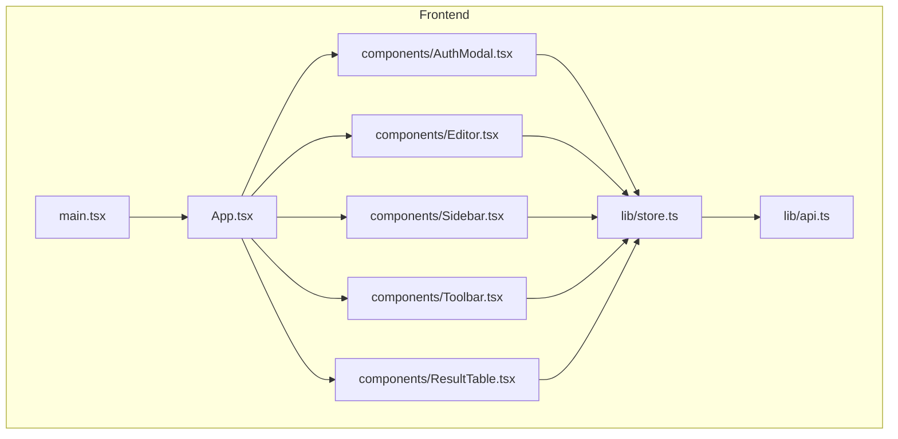
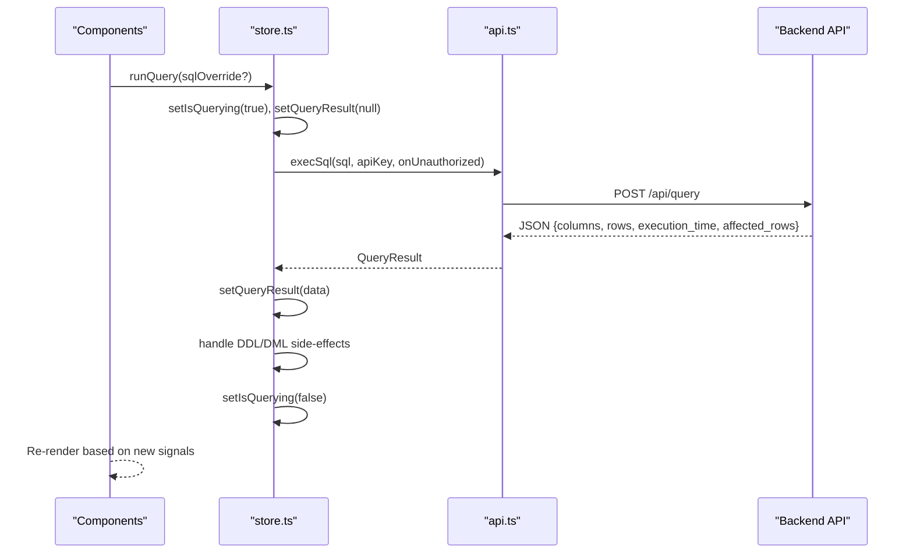
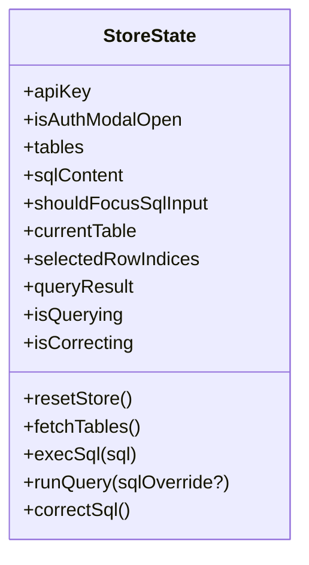
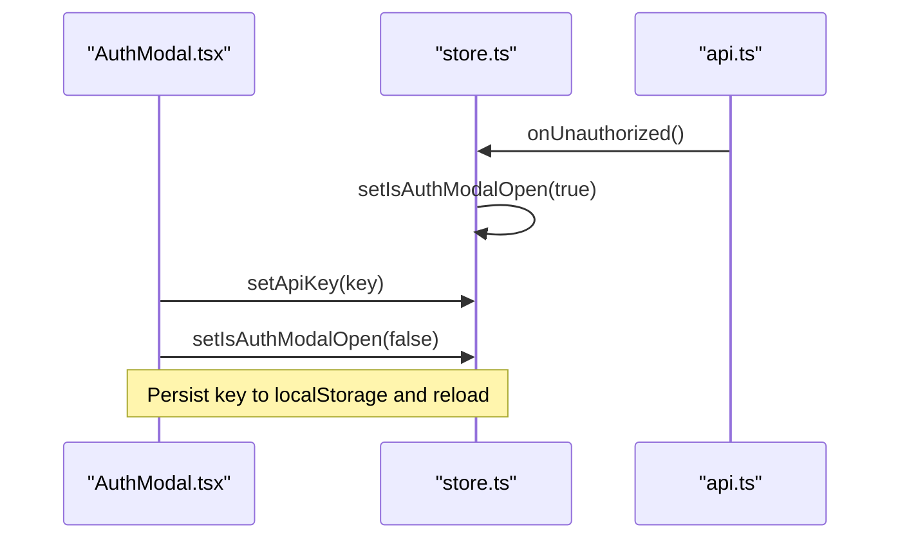
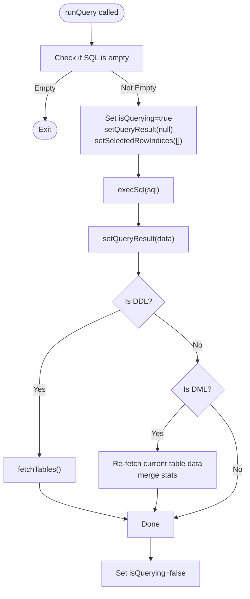
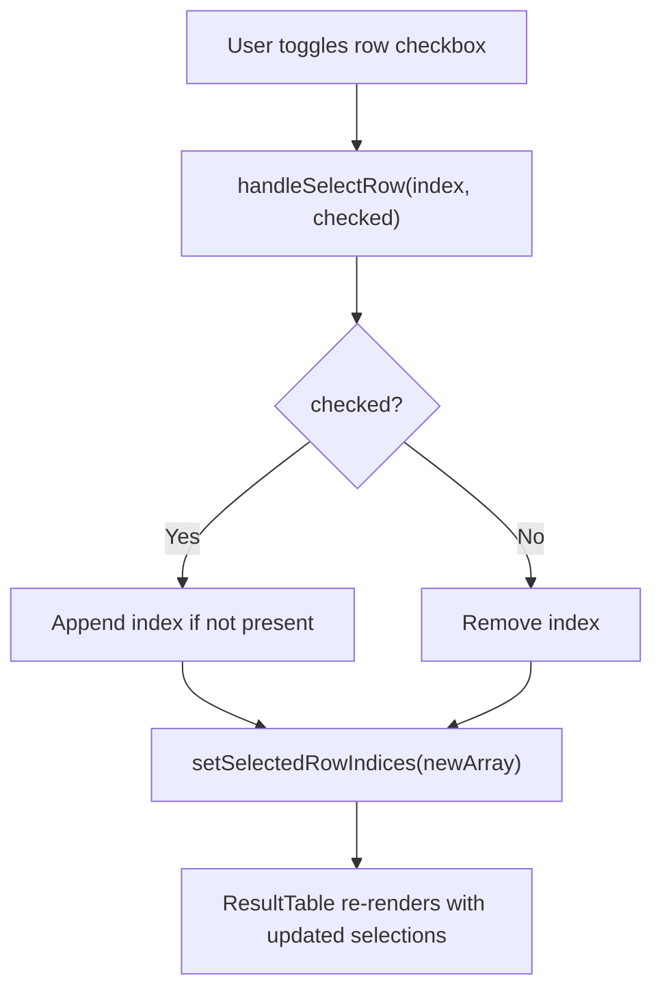
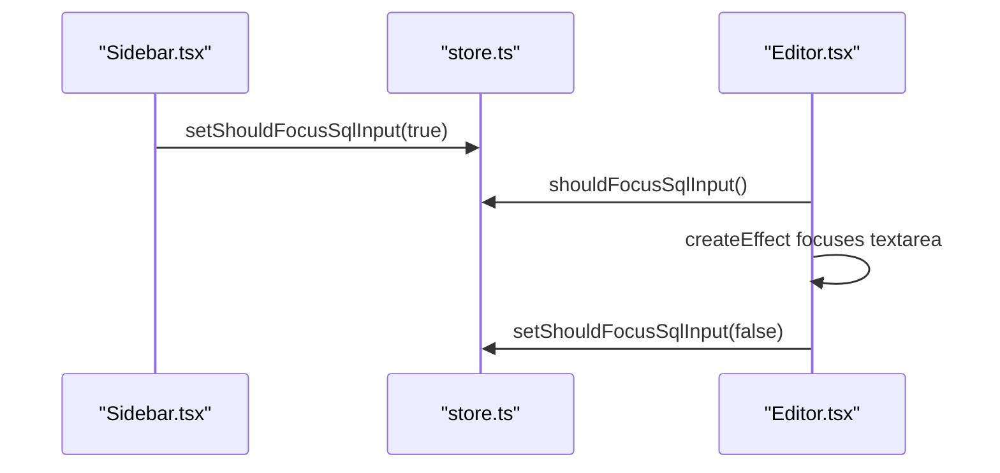
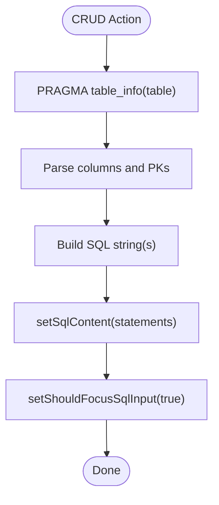
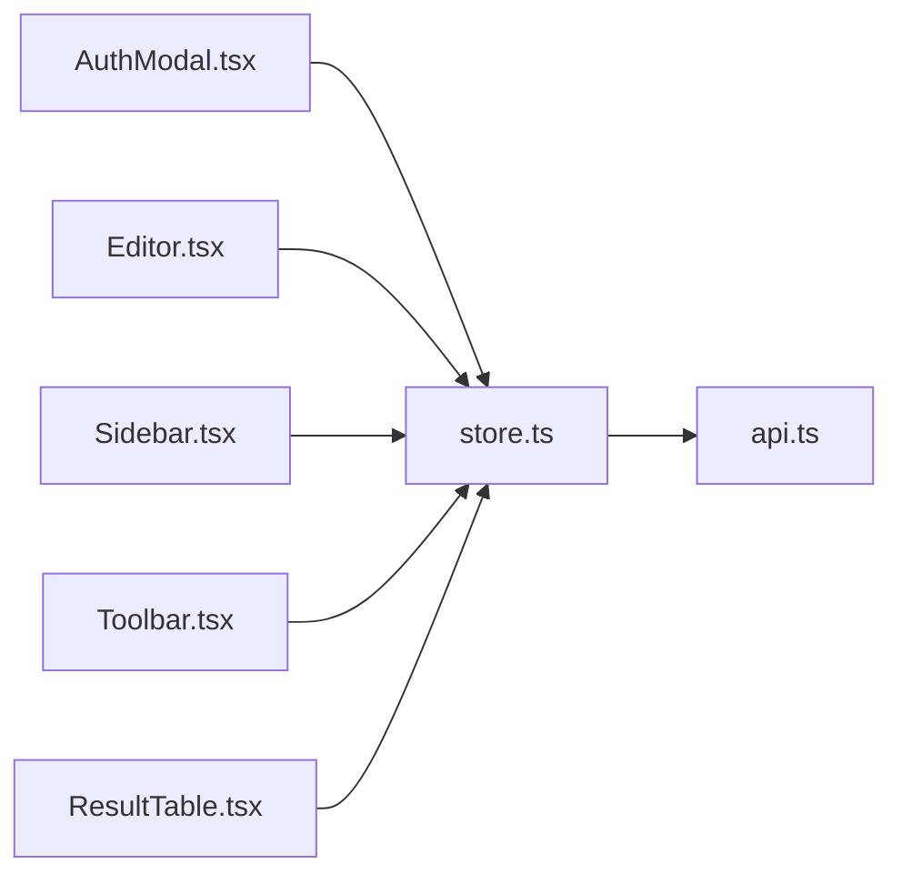

# State Management

<cite>
**Referenced Files in This Document**
- [store.ts](file://frontend/src/lib/store.ts)
- [api.ts](file://frontend/src/lib/api.ts)
- [App.tsx](file://frontend/src/App.tsx)
- [main.tsx](file://frontend/src/main.tsx)
- [AuthModal.tsx](file://frontend/src/components/AuthModal.tsx)
- [Editor.tsx](file://frontend/src/components/Editor.tsx)
- [Sidebar.tsx](file://frontend/src/components/Sidebar.tsx)
- [Toolbar.tsx](file://frontend/src/components/Toolbar.tsx)
- [ResultTable.tsx](file://frontend/src/components/ResultTable.tsx)
</cite>

## Table of Contents
1. [Introduction](#introduction)
2. [Project Structure](#project-structure)
3. [Core Components](#core-components)
4. [Architecture Overview](#architecture-overview)
5. [Detailed Component Analysis](#detailed-component-analysis)
6. [Dependency Analysis](#dependency-analysis)
7. [Performance Considerations](#performance-considerations)
8. [Troubleshooting Guide](#troubleshooting-guide)
9. [Conclusion](#conclusion)

## Introduction
This document explains the Solid.js state management implementation using fine-grained reactive signals. It covers the store architecture, reactive state patterns, how components subscribe to state changes, and the global state structure including authentication status, connection state, query results, and UI preferences. It also provides guidance for creating custom stores, updating state reactively, optimizing performance with fine-grained reactivity, managing complex interactions between components, and handling asynchronous operations.

## Project Structure
The frontend is a Solid.js application that uses a single source of truth for global state via signals exported from a dedicated store module. Components import these signals and their setters to read and update state reactively. The API layer encapsulates HTTP calls and error handling, while the store coordinates business logic and side effects.

**Diagram sources**
- [main.tsx:1-11](file://frontend/src/main.tsx#L1-L11)
- [App.tsx:1-29](file://frontend/src/App.tsx#L1-L29)
- [store.ts:1-116](file://frontend/src/lib/store.ts#L1-L116)
- [api.ts:1-116](file://frontend/src/lib/api.ts#L1-L116)
- [AuthModal.tsx:1-44](file://frontend/src/components/AuthModal.tsx#L1-L44)
- [Editor.tsx:1-49](file://frontend/src/components/Editor.tsx#L1-L49)
- [Sidebar.tsx:1-108](file://frontend/src/components/Sidebar.tsx#L1-L108)
- [Toolbar.tsx:1-228](file://frontend/src/components/Toolbar.tsx#L1-L228)
- [ResultTable.tsx:1-120](file://frontend/src/components/ResultTable.tsx#L1-L120)

**Section sources**
- [main.tsx:1-11](file://frontend/src/main.tsx#L1-L11)
- [App.tsx:1-29](file://frontend/src/App.tsx#L1-L29)

## Core Components
- Store (global state): Centralizes all reactive state using Solid’s createSignal. It exposes both getters (signals) and setters (functions), plus async actions like fetchTables, runQuery, correctSql, and execSql.
- API layer: Encapsulates HTTP requests, headers, and response normalization into QueryResult objects.
- UI components: Subscribe to store signals and trigger updates through setter functions or action methods.

Key responsibilities:
- Authentication: apiKey signal, modal visibility, persistence to localStorage.
- Connection state: tables list, currentTable selection.
- Query state: sqlContent, queryResult, isQuerying, isCorrecting, selectedRowIndices.
- UI preferences: shouldFocusSqlInput to control focus behavior.

**Section sources**
- [store.ts:1-116](file://frontend/src/lib/store.ts#L1-L116)
- [api.ts:1-116](file://frontend/src/lib/api.ts#L1-L116)

## Architecture Overview
The application follows a unidirectional data flow:
- Components read state via signals and render accordingly.
- User interactions call store actions which may update multiple signals.
- Async operations are handled within store actions; errors are normalized and surfaced to the UI.

**Diagram sources**
- [store.ts:53-92](file://frontend/src/lib/store.ts#L53-L92)
- [api.ts:36-59](file://frontend/src/lib/api.ts#L36-L59)

## Detailed Component Analysis

### Global State Model
The store defines the following global state primitives:
- Authentication: apiKey, isAuthModalOpen
- Connection: tables, currentTable
- Editor: sqlContent, shouldFocusSqlInput
- Query: queryResult, isQuerying, isCorrecting
- Selection: selectedRowIndices

These are implemented as Solid signals, providing fine-grained reactivity. Setters are exposed to update state. Actions coordinate multi-step workflows and side effects.

**Diagram sources**
- [store.ts:1-116](file://frontend/src/lib/store.ts#L1-L116)

**Section sources**
- [store.ts:1-116](file://frontend/src/lib/store.ts#L1-L116)

### Authentication Flow
- AuthModal reads isAuthModalOpen and writes apiKey and persists it to localStorage.
- On unauthorized responses, the API triggers onUnauthorized, which sets isAuthModalOpen to true.

**Diagram sources**
- [AuthModal.tsx:1-44](file://frontend/src/components/AuthModal.tsx#L1-L44)
- [store.ts:7-8](file://frontend/src/lib/store.ts#L7-L8)
- [api.ts:17-23](file://frontend/src/lib/api.ts#L17-L23)

**Section sources**
- [AuthModal.tsx:1-44](file://frontend/src/components/AuthModal.tsx#L1-L44)
- [store.ts:7-8](file://frontend/src/lib/store.ts#L7-L8)
- [api.ts:17-23](file://frontend/src/lib/api.ts#L17-L23)

### SQL Execution Flow
- Toolbar and Sidebar trigger runQuery.
- Store sets querying flags, clears previous results, executes SQL via API, normalizes response, and handles DDL/DML side effects.

**Diagram sources**
- [store.ts:53-92](file://frontend/src/lib/store.ts#L53-L92)

**Section sources**
- [store.ts:53-92](file://frontend/src/lib/store.ts#L53-L92)
- [Toolbar.tsx:13-15](file://frontend/src/components/Toolbar.tsx#L13-L15)
- [Sidebar.tsx:16-20](file://frontend/src/components/Sidebar.tsx#L16-L20)

### Result Table Selection Logic
- ResultTable subscribes to queryResult and selectedRowIndices.
- It computes derived state (isAllSelected, isIndeterminate) and updates selectedRowIndices reactively.

**Diagram sources**
- [ResultTable.tsx:29-38](file://frontend/src/components/ResultTable.tsx#L29-L38)

**Section sources**
- [ResultTable.tsx:1-120](file://frontend/src/components/ResultTable.tsx#L1-L120)

### Editor Focus Behavior
- Editor uses a signal shouldFocusSqlInput to programmatically focus the textarea after certain actions (e.g., adding a table).
- A createEffect reacts to the signal and focuses the element, then resets the flag.

**Diagram sources**
- [Sidebar.tsx:8-14](file://frontend/src/components/Sidebar.tsx#L8-L14)
- [Editor.tsx:14-19](file://frontend/src/components/Editor.tsx#L14-L19)

**Section sources**
- [Editor.tsx:1-49](file://frontend/src/components/Editor.tsx#L1-L49)
- [Sidebar.tsx:8-14](file://frontend/src/components/Sidebar.tsx#L8-L14)

### CRUD Operations Generation
- Toolbar generates INSERT, UPDATE, DELETE statements based on current table schema and selected rows.
- It uses PRAGMA table_info to discover columns and primary keys, then constructs SQL strings and updates sqlContent.

**Diagram sources**
- [Toolbar.tsx:17-40](file://frontend/src/components/Toolbar.tsx#L17-L40)
- [Toolbar.tsx:42-105](file://frontend/src/components/Toolbar.tsx#L42-L105)
- [Toolbar.tsx:107-167](file://frontend/src/components/Toolbar.tsx#L107-L167)

**Section sources**
- [Toolbar.tsx:17-40](file://frontend/src/components/Toolbar.tsx#L17-L40)
- [Toolbar.tsx:42-105](file://frontend/src/components/Toolbar.tsx#L42-L105)
- [Toolbar.tsx:107-167](file://frontend/src/components/Toolbar.tsx#L107-L167)

## Dependency Analysis
- Components depend on store signals for reading state and setters/actions for writing state.
- Store depends on api for network operations and error handling.
- There are no circular dependencies between modules; the dependency graph is acyclic.

**Diagram sources**
- [AuthModal.tsx:1-44](file://frontend/src/components/AuthModal.tsx#L1-L44)
- [Editor.tsx:1-49](file://frontend/src/components/Editor.tsx#L1-L49)
- [Sidebar.tsx:1-108](file://frontend/src/components/Sidebar.tsx#L1-L108)
- [Toolbar.tsx:1-228](file://frontend/src/components/Toolbar.tsx#L1-L228)
- [ResultTable.tsx:1-120](file://frontend/src/components/ResultTable.tsx#L1-L120)
- [store.ts:1-116](file://frontend/src/lib/store.ts#L1-L116)
- [api.ts:1-116](file://frontend/src/lib/api.ts#L1-L116)

**Section sources**
- [store.ts:1-116](file://frontend/src/lib/store.ts#L1-L116)
- [api.ts:1-116](file://frontend/src/lib/api.ts#L1-L116)

## Performance Considerations
- Fine-grained reactivity: Each signal creates minimal updates only in components that access it. Prefer accessing specific signals rather than large objects to avoid unnecessary re-renders.
- Avoid heavy computations inside render: Use derived values computed lazily where possible. For example, compute selection states inline but keep them simple.
- Debounce/throttle user input: If you add auto-save or live preview features, debounce updates to reduce signal churn.
- Batch updates: When multiple signals must change together, group related updates in a single action to minimize intermediate renders.
- Memoization: For expensive derived data (e.g., filtered/sorted result views), consider memoized computations to prevent recomputation on unrelated changes.
- Minimize DOM thrashing: Keep For loops efficient and avoid deeply nested reactive expressions.

[No sources needed since this section provides general guidance]

## Troubleshooting Guide
Common issues and resolutions:
- Unauthorized errors: The API handler triggers onUnauthorized when receiving 401. Ensure the modal opens and the user can set a valid apiKey. Verify localStorage persistence and page reload behavior.
- Empty query results: After DDL/DML operations, the store refreshes data. Confirm that the correct SELECT statement is generated and executed.
- Focus not applied: Ensure shouldFocusSqlInput is set to true before focusing and reset afterward.
- Incorrect CRUD generation: Validate PRAGMA table_info parsing and ensure column names and types are correctly mapped to SQL strings.

**Section sources**
- [api.ts:17-23](file://frontend/src/lib/api.ts#L17-L23)
- [store.ts:82-91](file://frontend/src/lib/store.ts#L82-L91)
- [Editor.tsx:14-19](file://frontend/src/components/Editor.tsx#L14-L19)
- [Toolbar.tsx:17-40](file://frontend/src/components/Toolbar.tsx#L17-L40)

## Conclusion
The Solid.js state management in this project leverages fine-grained reactive signals to provide a clear, maintainable, and performant architecture. The store centralizes global state and orchestrates asynchronous flows, while components remain lightweight and declarative. By adhering to reactive patterns, minimizing unnecessary updates, and organizing responsibilities cleanly, the application scales well and remains easy to extend with additional features.

[No sources needed since this section summarizes without analyzing specific files]