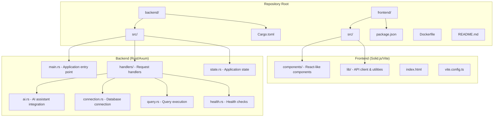
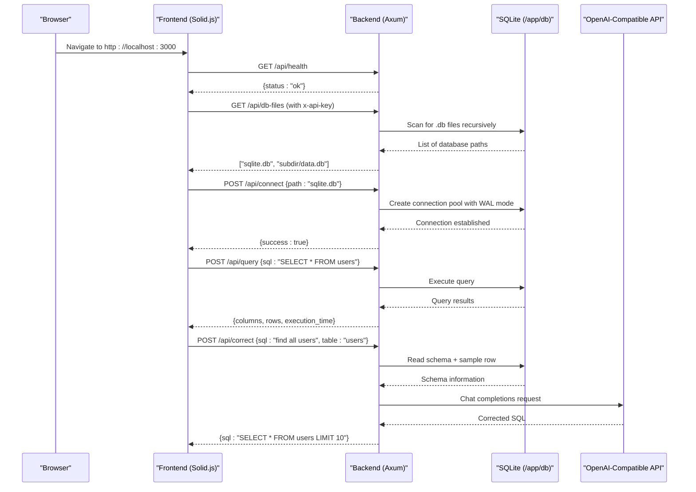

# Getting Started

<cite>
**Referenced Files in This Document**
- [README.md](file://README.md)
- [Dockerfile](file://Dockerfile)
- [main.rs](file://backend/src/main.rs)
- [ai.rs](file://backend/src/handlers/ai.rs)
- [connection.rs](file://backend/src/handlers/connection.rs)
- [query.rs](file://backend/src/handlers/query.rs)
- [api.ts](file://frontend/src/lib/api.ts)
- [state.rs](file://backend/src/state.rs)
</cite>

## Update Summary
**Changes Made**
- Enhanced introduction with clearer purpose statement and core features overview
- Updated project structure explanation with detailed component breakdown
- Added comprehensive environment variables reference with practical examples
- Improved deployment scenarios with step-by-step instructions
- Enhanced troubleshooting guide with specific error scenarios
- Added performance considerations and best practices
- Updated architecture diagrams to reflect actual implementation

## Table of Contents
1. [Introduction](#introduction)
2. [Project Structure](#project-structure)
3. [Core Components](#core-components)
4. [Architecture Overview](#architecture-overview)
5. [Installation and Deployment](#installation-and-deployment)
6. [Environment Variables Configuration](#environment-variables-configuration)
7. [Practical Deployment Scenarios](#practical-deployment-scenarios)
8. [Initial Setup and First-Time Configuration](#initial-setup-and-first-time-configuration)
9. [Performance Considerations](#performance-considerations)
10. [Troubleshooting Guide](#troubleshooting-guide)
11. [Conclusion](#conclusion)

## Introduction
CrabLite is an extremely lightweight SQLite Web administration tool built with Rust (Axum) and Solid.js. It provides a minimal Docker image (~10MB), fast runtime memory usage (~1MB), and an optional AI assistant that can correct or translate natural language into SQL queries.

**Key Features:**
- **Extreme Lightweight**: Optimized container image size and minimal memory footprint
- **High Performance**: Built with Rust for optimal speed and resource efficiency  
- **AI Assistant Integration**: Optional OpenAI-compatible API support for SQL correction and translation
- **Simple Authentication**: API key-based security for protecting database access
- **Automatic Database Discovery**: Recursive scanning of SQLite files with subdirectory support
- **Modern Web Interface**: Clean UI built with Solid.js for intuitive database management

## Project Structure
The repository follows a clean separation between backend and frontend components:



**Main Components:**
- **Backend Rust Application**: Axum-based HTTP server handling API requests, database operations, and static file serving
- **Frontend Web Interface**: Solid.js application providing the user interface for database management
- **Docker Image Structure**: Multi-stage build process optimizing for production deployment
- **Environment Configuration**: Flexible configuration through environment variables
- **Automatic Database Discovery**: Recursive scanning of SQLite files under `/app/db`
- **AI Assistant Integration**: Optional OpenAI-compatible API for SQL assistance

**Section sources**
- [README.md:10-26](file://README.md#L10-L26)
- [Dockerfile:1-56](file://Dockerfile#L1-L56)
- [main.rs:1-74](file://backend/src/main.rs#L1-L74)

## Core Components

### Backend Architecture
The backend is built with Rust's Axum framework and provides RESTful APIs for database management:

- **Authentication Middleware**: Enforces API key validation via `x-api-key` header
- **Database Connection Manager**: Handles SQLite pool management with WAL mode for concurrent access
- **Query Execution Engine**: Processes SQL statements with proper type serialization
- **AI Assistant Handler**: Integrates with OpenAI-compatible APIs for SQL correction
- **Static File Server**: Serves the compiled frontend assets from the `dist` directory

### Frontend Architecture
The frontend uses Solid.js with Vite for development and modern web standards:

- **Component-Based UI**: Modular components for different UI sections (sidebar, editor, results table)
- **API Client**: TypeScript client for communicating with backend endpoints
- **State Management**: Local state handling for UI interactions and data persistence
- **Responsive Design**: Mobile-friendly interface using TailwindCSS and DaisyUI

### Containerization Strategy
Multi-stage Docker build process ensures optimal production images:

1. **Frontend Build Stage**: Node.js environment for compiling Solid.js assets
2. **Backend Build Stage**: Rust compilation with musl for static linking
3. **Runtime Stage**: Minimal Alpine Linux with only necessary dependencies

**Section sources**
- [main.rs:22-33](file://backend/src/main.rs#L22-L33)
- [connection.rs:62-109](file://backend/src/handlers/connection.rs#L62-L109)
- [query.rs:101-201](file://backend/src/handlers/query.rs#L101-L201)
- [ai.rs:24-149](file://backend/src/handlers/ai.rs#L24-L149)
- [Dockerfile:1-56](file://Dockerfile#L1-L56)

## Architecture Overview
The application follows a single-process architecture where both the API and static frontend are served by the same Axum server:



**Diagram sources**
- [main.rs:51-65](file://backend/src/main.rs#L51-L65)
- [connection.rs:20-60](file://backend/src/handlers/connection.rs#L20-L60)
- [query.rs:101-201](file://backend/src/handlers/query.rs#L101-L201)
- [ai.rs:24-149](file://backend/src/handlers/ai.rs#L24-L149)
- [api.ts:25-116](file://frontend/src/lib/api.ts#L25-L116)

## Installation and Deployment

### Recommended: Docker Run
The easiest way to deploy CrabLite is using Docker. This method provides automatic dependency management and consistent environments.

**Basic Setup:**
```bash
docker run -d \
  -p 3000:3000 \
  -v sqlite.db:/app/db/sqlite.db \
  -e API_KEY=your_secret_key \
  --name sqlite-webui \
  wangyucode/rust-sqlite-webui
```

**What this does:**
- Runs the official CrabLite image in detached mode
- Maps host port 3000 to container port 3000
- Mounts local `sqlite.db` file to `/app/db/sqlite.db` inside the container
- Sets API key for authentication
- Names the container for easy management

**Access the interface:** Open `http://localhost:3000` in your browser.

**Section sources**
- [README.md:31-40](file://README.md#L31-L40)
- [Dockerfile:49-55](file://Dockerfile#L49-L55)

### Docker Compose Setup
For more complex deployments, use Docker Compose to define your service configuration:

**compose.yml:**
```yaml
version: '3'
services:
  sqlite-webui:
    image: wangyucode/rust-sqlite-webui
    ports:
      - "3000:3000"
    volumes:
      - sqlite.db:/app/db/sqlite.db
    environment:
      - API_KEY=your_secret_key
      - RUST_LOG=info
    restart: unless-stopped
```

**Advanced Compose Example:**
```yaml
version: '3'
services:
  sqlite-webui:
    image: wangyucode/rust-sqlite-webui
    ports:
      - "3000:3000"
    volumes:
      - ./data:/app/db
      - ./logs:/var/log
    environment:
      - API_KEY=${API_KEY}
      - OPENAI_API_KEY=${OPENAI_API_KEY}
      - OPENAI_BASE_URL=https://api.openai.com/v1
      - OPENAI_MODEL=gpt-5.4-mini
    restart: unless-stopped
    healthcheck:
      test: ["CMD", "curl", "-f", "http://localhost:3000/api/health"]
      interval: 30s
      timeout: 10s
      retries: 3
```

**Section sources**
- [README.md:42-55](file://README.md#L42-L55)

### Prebuilt Binary (Linux/macOS)
If you prefer not to use containers, download prebuilt binaries:

**Step-by-step installation:**
1. Download the archive for your OS and architecture from [GitHub Releases](https://github.com/sutanto1010/crablite/releases)
2. Extract the archive:
   ```bash
   tar -xzf rust-sqlite-webui-v<VERSION>-<TARGET>.tar.gz
   cd rust-sqlite-webui-v<VERSION>-<TARGET>
   ```
3. Keep the `dist/` directory intact (contains WebUI assets)
4. Run the application:
   ```bash
   API_KEY=your_secret_key ./rust-sqlite-webui
   ```
5. Access the interface at `http://localhost:3000`

**Supported target triples:**
- `x86_64-unknown-linux-gnu` (Linux x86_64)
- `aarch64-apple-darwin` (macOS ARM64)
- `x86_64-apple-darwin` (macOS Intel)

**Section sources**
- [README.md:57-68](file://README.md#L57-L68)

## Environment Variables Configuration

### Required Variables
| Variable | Default | Description | Example |
|----------|---------|-------------|---------|
| `API_KEY` | `your-super-secure-key` | Authentication key for accessing the WebUI. All API requests must include `x-api-key` header matching this value. | `my-secret-key-123` |

### Optional Variables
| Variable | Default | Description | Example |
|----------|---------|-------------|---------|
| `RUST_LOG` | `rust_sqlite_webui=debug,tower_http=debug` | Logging level configuration. Controls verbosity of application logs. | `info`, `warn`, `error` |
| `OPENAI_API_KEY` | None | OpenAI API key required for AI assistant functionality. Leave empty to disable AI features. | `sk-proj-...` |
| `OPENAI_BASE_URL` | `https://api.openai.com/v1` | Base URL for OpenAI-compatible chat completions endpoint. Use for custom providers. | `https://custom-api.example.com/v1` |
| `OPENAI_MODEL` | `gpt-5.4-mini` | Model name used for AI-assisted SQL correction and translation. | `gpt-4`, `claude-3-opus` |

### Development Configuration
For local development, create a `.env` file in the `backend/` directory:

```env
API_KEY=development-key
RUST_LOG=debug
OPENAI_API_KEY=your-openai-key-here
OPENAI_BASE_URL=https://api.openai.com/v1
OPENAI_MODEL=gpt-5.4-mini
```

**Security Note:** Never commit `.env` files to version control. Use secrets management in production environments.

**Section sources**
- [README.md:70-83](file://README.md#L70-L83)
- [main.rs:22-33](file://backend/src/main.rs#L22-L33)
- [main.rs:39-45](file://backend/src/main.rs#L39-L45)
- [ai.rs:28-30](file://backend/src/handlers/ai.rs#L28-L30)

## Practical Deployment Scenarios

### Scenario 1: Single Database File
Mount a single SQLite database file for simple use cases:

```bash
docker run -d \
  -p 3000:3000 \
  -v $(pwd)/database.sqlite:/app/db/database.sqlite \
  -e API_KEY=production-key \
  --name crablite-single \
  wangyucode/rust-sqlite-webui
```

**Verification:** After starting, navigate to the UI and verify the database appears in the file selector.

### Scenario 2: Multiple Database Files with Subdirectories
Organize multiple databases in subdirectories for better organization:

```bash
docker run -d \
  -p 3000:3000 \
  -v $(pwd)/data:/app/db \
  -e API_KEY=production-key \
  --name crablite-multi \
  wangyucode/rust-sqlite-webui
```

**Directory structure:**
```
data/
├── production/
│   ├── users.db
│   └── orders.db
├── staging/
│   └── analytics.db
└── development.db
```

The application automatically scans all subdirectories and presents available databases in the UI.

### Scenario 3: Production with AI Assistant
Deploy with AI assistant capabilities for SQL correction and natural language queries:

```yaml
version: '3'
services:
  crablite:
    image: wangyucode/rust-sqlite-webui
    ports:
      - "3000:3000"
    volumes:
      - ./data:/app/db
    environment:
      - API_KEY=${API_KEY}
      - OPENAI_API_KEY=${OPENAI_API_KEY}
      - OPENAI_BASE_URL=https://api.openai.com/v1
      - OPENAI_MODEL=gpt-5.4-mini
      - RUST_LOG=info
    restart: unless-stopped
    healthcheck:
      test: ["CMD", "curl", "-f", "http://localhost:3000/api/health"]
      interval: 30s
      timeout: 10s
      retries: 3
```

**AI Assistant Features:**
- SQL syntax correction and optimization
- Natural language to SQL conversion
- Schema-aware suggestions based on table structure
- Sample data context for better query generation

### Scenario 4: Reverse Proxy Configuration
Configure behind nginx or other reverse proxies:

```nginx
server {
    listen 80;
    server_name db.example.com;
    
    location / {
        proxy_pass http://localhost:3000;
        proxy_set_header Host $host;
        proxy_set_header X-Real-IP $remote_addr;
        proxy_set_header X-Forwarded-For $proxy_add_x_forwarded_for;
        proxy_set_header X-Forwarded-Proto $scheme;
        
        # Increase upload limit for large SQL files
        client_max_body_size 10M;
    }
}
```

**Section sources**
- [README.md:70-72](file://README.md#L70-L72)
- [connection.rs:20-60](file://backend/src/handlers/connection.rs#L20-L60)

## Initial Setup and First-Time Configuration

### Step 1: Prepare Your Environment
1. **Install prerequisites:**
   - Docker Desktop (recommended) or Docker Engine
   - Git (for cloning repositories if needed)
   - Text editor for configuration files

2. **Generate a secure API key:**
   ```bash
   openssl rand -hex 32
   ```

3. **Create directory structure:**
   ```bash
   mkdir -p ~/crablite/data
   touch ~/crablite/data/initial.db
   ```

### Step 2: Start the Application
Using Docker (recommended):
```bash
cd ~/crablite
docker run -d \
  -p 3000:3000 \
  -v $(pwd)/data:/app/db \
  -e API_KEY=$(openssl rand -hex 32) \
  --name crablite \
  wangyucode/rust-sqlite-webui
```

### Step 3: First-Time Setup in the UI
1. **Access the interface:** Open `http://localhost:3000` in your browser
2. **Authenticate:** Enter your API key when prompted
3. **Connect to database:** 
   - If no databases exist, click "Create New Database"
   - Provide a filename (e.g., `myapp.db`)
   - Click "Create" to initialize the database
4. **Verify connection:** The sidebar should show your connected database

### Step 4: Configure AI Assistant (Optional)
1. **Get OpenAI API key:** Sign up at [OpenAI Platform](https://platform.openai.com/)
2. **Restart container with AI configuration:**
   ```bash
   docker stop crablite
   docker run -d \
     -p 3000:3000 \
     -v $(pwd)/data:/app/db \
     -e API_KEY=your-api-key \
     -e OPENAI_API_KEY=sk-your-openai-key \
     --name crablite \
     wangyucode/rust-sqlite-webui
   ```
3. **Test AI features:** Try the "Correct SQL" feature with a sample query

### Step 5: Verify Functionality
1. **Health check:** Visit `http://localhost:3000/api/health`
2. **Test database connection:** Create a simple table and insert data
3. **Test AI assistant:** Use natural language to generate SQL queries

**Section sources**
- [README.md:29-40](file://README.md#L29-L40)
- [README.md:57-68](file://README.md#L57-L68)
- [README.md:70-83](file://README.md#L70-L83)

## Performance Considerations

### Container Optimization
- **Image Size:** The final Docker image is optimized to ~10MB using multi-stage builds
- **Memory Usage:** Runtime memory consumption is typically ~1MB for idle processes
- **CPU Efficiency:** Rust-based backend provides excellent CPU utilization

### Database Performance
- **WAL Mode:** SQLite is configured with Write-Ahead Logging (WAL) for better concurrent access
- **Connection Pooling:** Efficient connection pooling prevents resource exhaustion
- **Busy Timeout:** 30-second timeout prevents database corruption during concurrent access

### Production Best Practices
1. **Resource Limits:** Set appropriate CPU and memory limits in your orchestration platform
2. **Log Rotation:** Configure log rotation for production environments
3. **Monitoring:** Implement health checks and monitoring for uptime tracking
4. **Backup Strategy:** Regular backups of mounted database directories
5. **Network Security:** Restrict network access to trusted networks or reverse proxies

### Scaling Considerations
- **Single Instance:** CrabLite is designed for single-instance deployments
- **Database Sharing:** Multiple instances can share the same SQLite files with proper locking
- **Read Replicas:** Consider read replicas for high-read workloads

**Section sources**
- [Dockerfile:37-56](file://Dockerfile#L37-L56)
- [connection.rs:85-91](file://backend/src/handlers/connection.rs#L85-L91)

## Troubleshooting Guide

### Common Issues and Solutions

#### Authentication Errors
**Problem:** 401 Unauthorized responses
**Causes:**
- Missing or incorrect `x-api-key` header
- API_KEY environment variable mismatch
- Frontend not sending authentication headers

**Solutions:**
```bash
# Check API_KEY is set correctly
docker exec -it crablite env | grep API_KEY

# Test API directly
curl -H "x-api-key: your-api-key" http://localhost:3000/api/health
```

#### Database Connection Issues
**Problem:** Cannot connect to database files
**Causes:**
- Volume not properly mounted
- Incorrect file permissions
- Database file corrupted

**Solutions:**
```bash
# Verify volume mount
docker inspect crablite | grep -A 10 Mounts

# Check file permissions
ls -la ~/crablite/data/

# Test database integrity
sqlite3 ~/crablite/data/myapp.db ".tables"
```

#### AI Assistant Not Working
**Problem:** AI features return errors or don't respond
**Causes:**
- Missing `OPENAI_API_KEY`
- Invalid OpenAI credentials
- Network connectivity issues
- Rate limiting from OpenAI

**Solutions:**
```bash
# Verify OpenAI configuration
docker exec -it crablite env | grep OPENAI

# Test OpenAI API connectivity
curl -H "Authorization: Bearer sk-your-key" https://api.openai.com/v1/models

# Check application logs
docker logs crablite | grep -i openai
```

#### Port Conflicts
**Problem:** Port 3000 already in use
**Solutions:**
```bash
# Find process using port 3000
lsof -i :3000

# Use different port mapping
docker run -p 8080:3000 ...

# Or change container port
docker run -e PORT=8080 ...
```

#### Memory Issues
**Problem:** High memory usage or crashes
**Solutions:**
```bash
# Monitor memory usage
docker stats crablite

# Set resource limits
docker run --memory=512m --cpus=0.5 ...

# Check for memory leaks in logs
docker logs crablite | grep -i memory
```

### Debugging Tips

#### Enable Detailed Logging
```bash
docker stop crablite
docker run -d \
  -e RUST_LOG=debug \
  --name crablite-debug \
  wangyucode/rust-sqlite-webui
```

#### Check Application Health
```bash
# Health endpoint
curl http://localhost:3000/api/health

# Database connectivity
curl -H "x-api-key: your-key" http://localhost:3000/api/db-files
```

#### Container Diagnostics
```bash
# View container logs
docker logs crablite

# Inspect container configuration
docker inspect crablite

# Check container resources
docker top crablite
```

**Section sources**
- [main.rs:22-33](file://backend/src/main.rs#L22-L33)
- [ai.rs:28-37](file://backend/src/handlers/ai.rs#L28-L37)
- [connection.rs:62-109](file://backend/src/handlers/connection.rs#L62-L109)

## Conclusion
CrabLite provides a streamlined approach to SQLite database management with its lightweight design, modern web interface, and optional AI capabilities. Whether you're deploying for personal use or production environments, the flexible configuration options and comprehensive documentation make it easy to get started quickly.

**Key Takeaways:**
- **Easy Deployment:** Docker-first approach with prebuilt images
- **Secure by Default:** API key authentication protects your databases
- **Feature-Rich:** Complete SQL management with AI assistance
- **Production Ready:** Optimized for performance and reliability
- **Well-Documented:** Comprehensive setup and troubleshooting guides

Start with the Docker deployment method for the smoothest experience, then customize your environment variables and mounting strategies based on your specific requirements. The AI assistant integration provides powerful SQL assistance capabilities that can significantly improve productivity for database administrators and developers alike.

For advanced configurations, refer to the complete API documentation and consider implementing additional security measures like reverse proxies, SSL termination, and network policies in production environments.