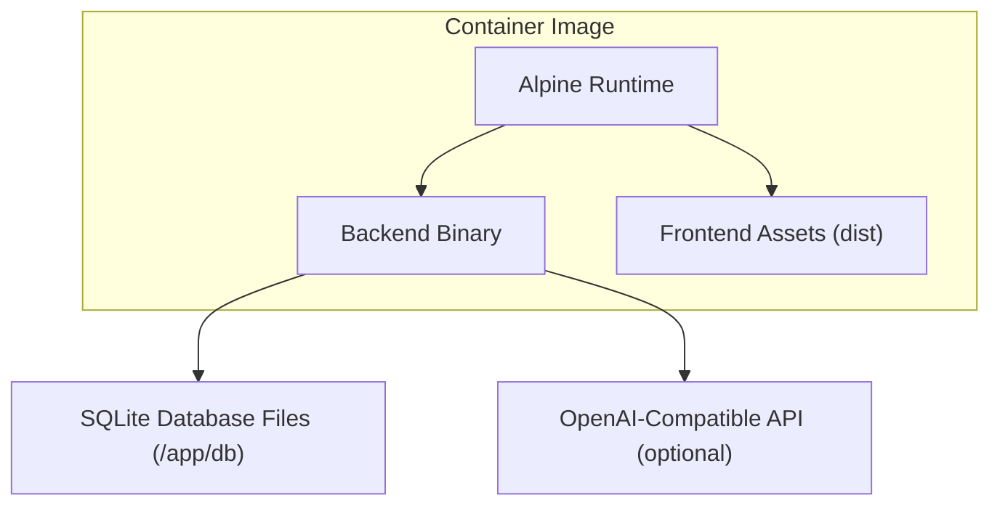
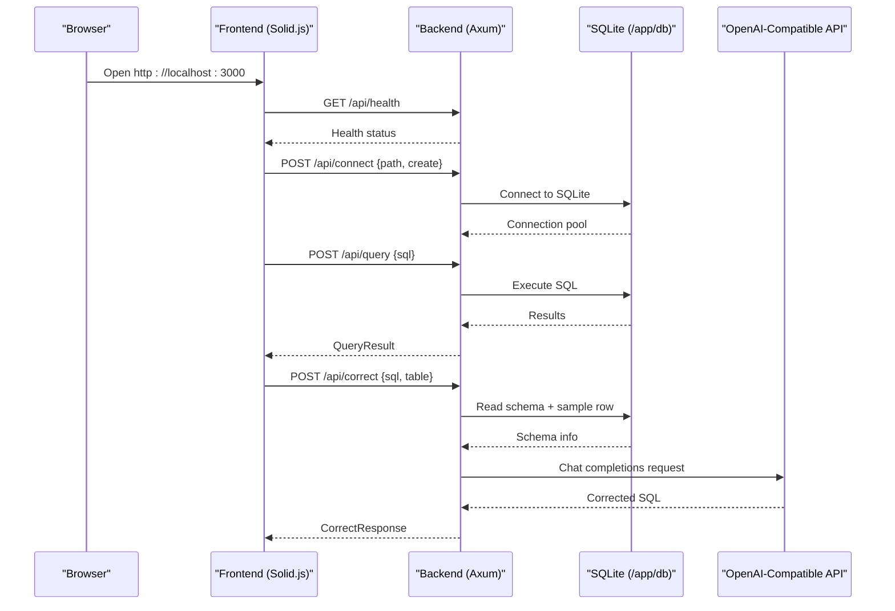
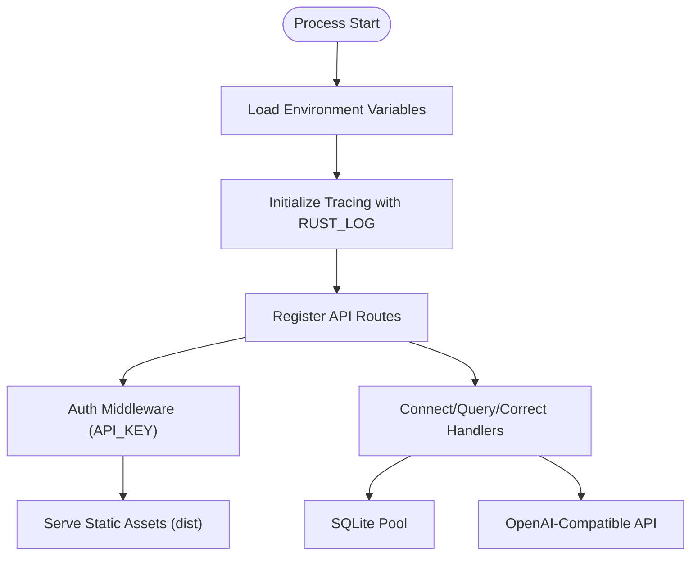

# Getting Started

<cite>
**Referenced Files in This Document**
- [README.md](file://README.md)
- [Dockerfile](file://Dockerfile)
- [main.rs](file://backend/src/main.rs)
- [ai.rs](file://backend/src/handlers/ai.rs)
- [api.ts](file://frontend/src/lib/api.ts)
</cite>

## Table of Contents
1. [Introduction](#introduction)
2. [Project Structure](#project-structure)
3. [Core Components](#core-components)
4. [Architecture Overview](#architecture-overview)
5. [Detailed Component Analysis](#detailed-component-analysis)
6. [Dependency Analysis](#dependency-analysis)
7. [Performance Considerations](#performance-considerations)
8. [Troubleshooting Guide](#troubleshooting-guide)
9. [Conclusion](#conclusion)

## Introduction
CrabLite is an extremely lightweight SQLite Web administration tool built with Rust and Solid.js. It provides a small Docker image, fast runtime memory usage, and an optional AI assistant that can correct or translate natural language into SQL.

Key highlights:
- Minimal footprint for containerized deployments
- Built-in authentication via API key header
- Optional OpenAI-compatible AI assistant integration
- Simple configuration through environment variables

## Project Structure
At a high level, the repository contains:
- Backend (Rust/Axum): HTTP server, database handlers, and optional AI assistant logic
- Frontend (Solid.js/Vite): Web UI served by the backend in production builds
- Containerization: Multi-stage Docker build producing a minimal runtime image
- Documentation and examples in the root README

**Diagram sources**
- [Dockerfile:37-55](file://Dockerfile#L37-L55)
- [main.rs:51-65](file://backend/src/main.rs#L51-L65)

**Section sources**
- [README.md:10-26](file://README.md#L10-L26)
- [Dockerfile:1-55](file://Dockerfile#L1-L55)

## Core Components
- Backend server: Axum-based HTTP service exposing REST endpoints under /api and serving the frontend static assets from dist.
- Authentication: Enforced via x-api-key header matching the API_KEY environment variable.
- Database access: Connects to SQLite files under /app/db; supports recursive scanning and subdirectory mounts.
- AI assistant: Optional integration with OpenAI-compatible APIs using OPENAI_API_KEY, OPENAI_BASE_URL, and OPENAI_MODEL.

Environment variables overview:
- API_KEY: Default value is your-super-secure-key. Used to authenticate requests via the x-api-key header.
- RUST_LOG: Default value is rust_sqlite_webui=debug,tower_http=debug. Controls logging verbosity.
- OPENAI_API_KEY: No default. Required to enable AI assistant features.
- OPENAI_BASE_URL: Default value is https://api.openai.com/v1. Base URL for the OpenAI-compatible chat completions endpoint.
- OPENAI_MODEL: Default value is gpt-5.4-mini. Model name used for AI-assisted SQL correction/translation.

For development, you can place these variables in a .env file under backend/.

**Section sources**
- [README.md:70-83](file://README.md#L70-L83)
- [main.rs:22-33](file://backend/src/main.rs#L22-L33)
- [main.rs:39-45](file://backend/src/main.rs#L39-L45)
- [ai.rs:28-30](file://backend/src/handlers/ai.rs#L28-L30)

## Architecture Overview
The application serves both the API and the static frontend in a single process when running the production binary. The frontend sends authenticated requests to the backend, which connects to SQLite and optionally calls an OpenAI-compatible API for SQL assistance.

**Diagram sources**
- [main.rs:51-65](file://backend/src/main.rs#L51-L65)
- [ai.rs:24-148](file://backend/src/handlers/ai.rs#L24-L148)
- [api.ts:12-15](file://frontend/src/lib/api.ts#L12-L15)

## Detailed Component Analysis

### Installation and Deployment

#### Recommended: Docker Run
Run the official image and mount a local SQLite file into /app/db. Set API_KEY to protect the API.

Example steps:
- Create a local sqlite.db file if needed.
- Start the container with port mapping and volume mount.
- Provide API_KEY via environment variable.
- Access the UI at http://localhost:3000.

Notes:
- The container exposes port 3000.
- Database files are scanned recursively under /app/db. You can mount subdirectories like ./rust/data/db:/app/db/rust.

**Section sources**
- [README.md:29-40](file://README.md#L29-L40)
- [README.md:70-72](file://README.md#L70-L72)
- [Dockerfile:49-55](file://Dockerfile#L49-L55)

#### Docker Compose Setup
Use a compose file to define the service, ports, volumes, and environment variables.

Example steps:
- Define a service named sqlite-webui using the official image.
- Map host port 3000 to container port 3000.
- Mount a volume for sqlite.db at /app/db/sqlite.db.
- Set API_KEY in environment.

After starting the stack, open http://localhost:3000.

**Section sources**
- [README.md:42-55](file://README.md#L42-L55)

#### Prebuilt Binary (Linux/macOS)
If you prefer not to use containers:
- Download the archive for your OS and architecture from GitHub Releases.
- Extract the archive and keep the dist directory intact (it contains the WebUI assets).
- Run the binary with API_KEY set.
- Open http://localhost:3000.

Target triple examples include x86_64-unknown-linux-gnu and aarch64-apple-darwin.

**Section sources**
- [README.md:57-68](file://README.md#L57-L68)

### Environment Variables Reference
| Variable | Default | Description |
| --- | --- | --- |
| API_KEY | your-super-secure-key | Authentication key for accessing the WebUI. Requests must include x-api-key header. |
| RUST_LOG | rust_sqlite_webui=debug,tower_http=debug | Logging level configuration. |
| OPENAI_API_KEY | - | OpenAI API key required for AI assistant. |
| OPENAI_BASE_URL | https://api.openai.com/v1 | OpenAI API base URL. |
| OPENAI_MODEL | gpt-5.4-mini | OpenAI model name. |

Development tip: Place these variables in a .env file under backend/.

**Section sources**
- [README.md:70-83](file://README.md#L70-L83)
- [main.rs:22-33](file://backend/src/main.rs#L22-L33)
- [main.rs:39-45](file://backend/src/main.rs#L39-L45)
- [ai.rs:28-30](file://backend/src/handlers/ai.rs#L28-L30)

### Practical Deployment Scenarios

#### Mounting Database Files
- Single file: Mount your sqlite.db to /app/db/sqlite.db.
- Subdirectories: Mount a folder structure such as ./rust/data/db:/app/db/rust. The app scans /app/db recursively.

Verification:
- After connecting in the UI, list tables to confirm the correct database is loaded.

**Section sources**
- [README.md:70-72](file://README.md#L70-L72)

#### Configuring Authentication
- Set API_KEY to a strong secret.
- The frontend automatically includes the x-api-key header on API calls.
- If the header does not match, the server returns 401 Unauthorized.

Operational tips:
- Use secrets management to inject API_KEY at runtime.
- Restrict network exposure to trusted networks or reverse proxies.

**Section sources**
- [main.rs:22-33](file://backend/src/main.rs#L22-L33)
- [api.ts:12-15](file://frontend/src/lib/api.ts#L12-L15)

#### Setting Up AI Assistant Integration
- Provide OPENAI_API_KEY to enable AI-assisted SQL correction.
- Optionally configure OPENAI_BASE_URL and OPENAI_MODEL.
- When calling /api/correct, the backend reads the selected table’s schema and a sample row, then calls the configured chat completions endpoint.

Behavior:
- If OPENAI_API_KEY is missing, the response indicates it is not configured.
- Network or API errors return structured error messages.

**Section sources**
- [ai.rs:28-37](file://backend/src/handlers/ai.rs#L28-L37)
- [ai.rs:39-96](file://backend/src/handlers/ai.rs#L39-L96)
- [ai.rs:99-148](file://backend/src/handlers/ai.rs#L99-L148)

### Initial Configuration and First-Time Setup
- Ensure API_KEY is set before first launch.
- Prepare your SQLite file(s) under a known path and mount them to /app/db.
- Start the container or run the prebuilt binary.
- Open http://localhost:3000 in your browser.
- In the UI, connect to your database file and verify tables appear.
- For AI assistance, set OPENAI_API_KEY and test the “correct” feature.

**Section sources**
- [README.md:29-40](file://README.md#L29-L40)
- [README.md:57-68](file://README.md#L57-L68)
- [README.md:70-83](file://README.md#L70-L83)

## Dependency Analysis
The backend initializes tracing/logging based on RUST_LOG, sets up routes under /api, and serves static assets from dist. The AI handler depends on environment variables and makes outbound HTTP requests to the configured OpenAI-compatible endpoint.

**Diagram sources**
- [main.rs:35-72](file://backend/src/main.rs#L35-L72)
- [ai.rs:24-148](file://backend/src/handlers/ai.rs#L24-L148)

**Section sources**
- [main.rs:35-72](file://backend/src/main.rs#L35-L72)
- [ai.rs:24-148](file://backend/src/handlers/ai.rs#L24-L148)

## Performance Considerations
- The container image is optimized for size and uses a minimal Alpine runtime.
- The backend runs with low memory overhead and serves both API and static assets.
- Enable appropriate RUST_LOG levels in production to reduce log volume.
- Keep database files on persistent storage for durability.

[No sources needed since this section provides general guidance]

## Troubleshooting Guide
- 401 Unauthorized:
  - Cause: Missing or incorrect x-api-key header.
  - Fix: Ensure API_KEY matches the header sent by the client.
- AI assistant not working:
  - Cause: OPENAI_API_KEY not set or invalid credentials.
  - Fix: Provide OPENAI_API_KEY; verify OPENAI_BASE_URL and OPENAI_MODEL if using a custom provider.
- Cannot connect to database:
  - Cause: Volume not mounted or wrong path.
  - Fix: Verify the file exists at /app/db/<path>. Check recursive scanning behavior.
- Port conflicts:
  - Cause: Another process using port 3000.
  - Fix: Change host port mapping or stop conflicting services.

**Section sources**
- [main.rs:22-33](file://backend/src/main.rs#L22-L33)
- [ai.rs:28-37](file://backend/src/handlers/ai.rs#L28-L37)
- [README.md:70-72](file://README.md#L70-L72)

## Conclusion
You can deploy CrabLite quickly using Docker or the prebuilt binary. Configure API_KEY for security, mount your SQLite files under /app/db, and optionally enable the AI assistant with OPENAI_API_KEY. The provided environment variables cover logging and AI integration defaults, making initial setup straightforward while remaining flexible for production environments.