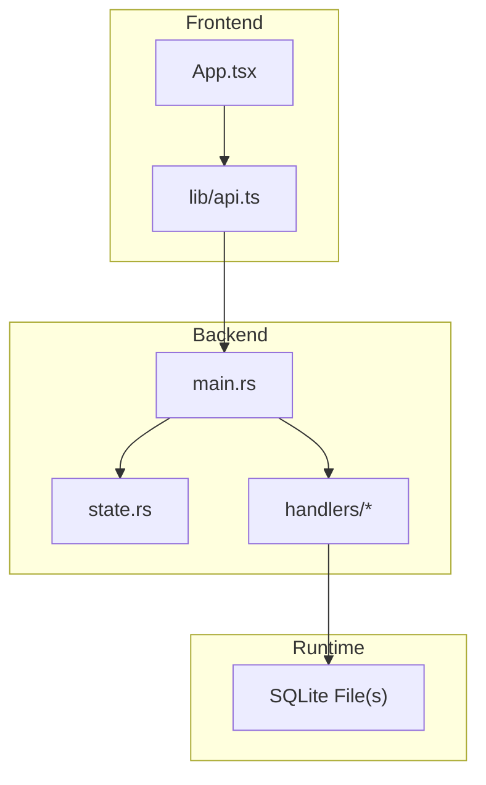
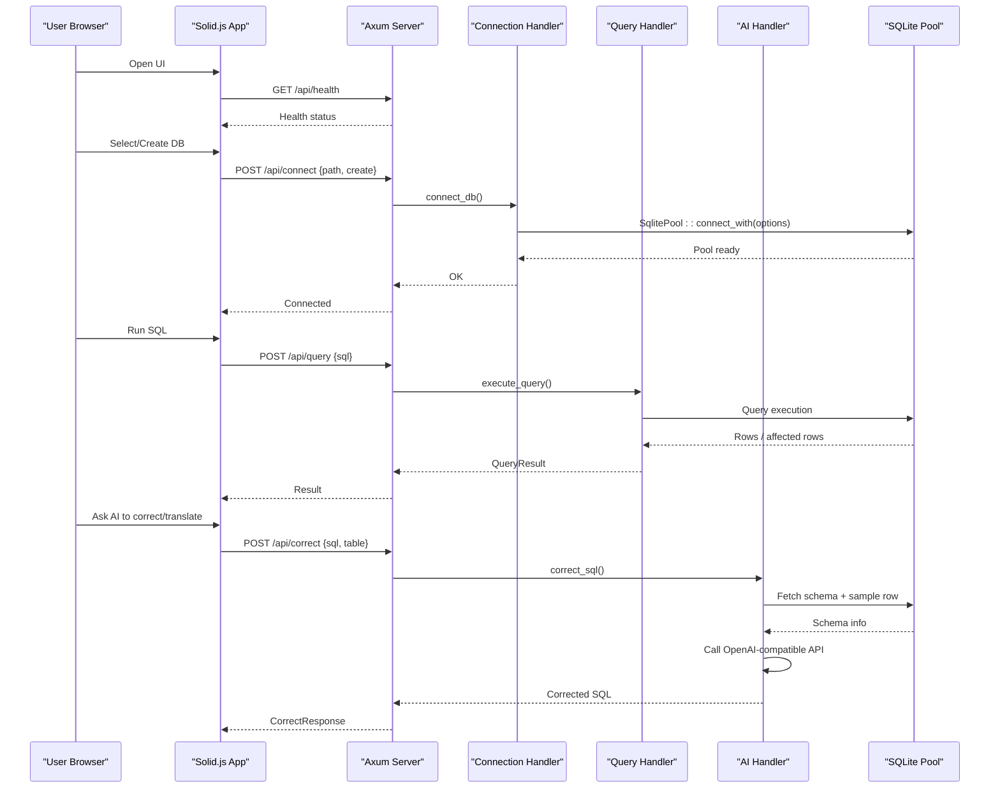
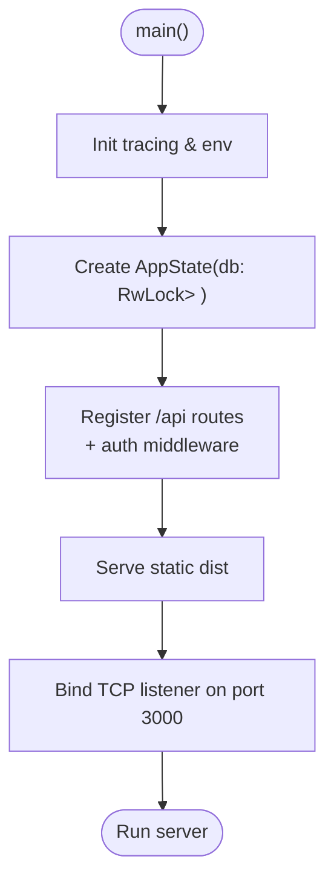
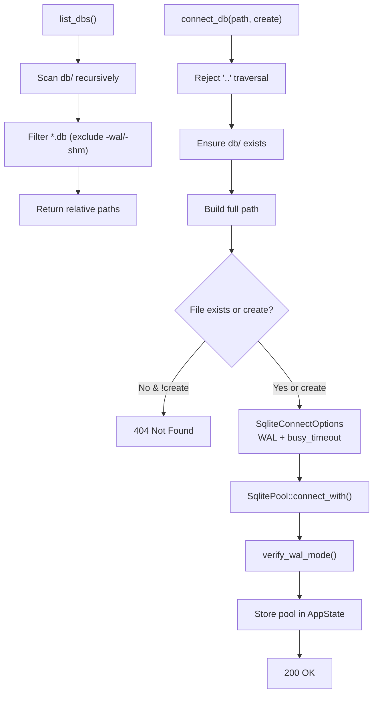
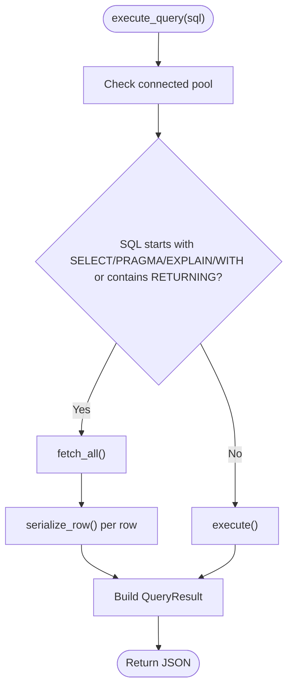
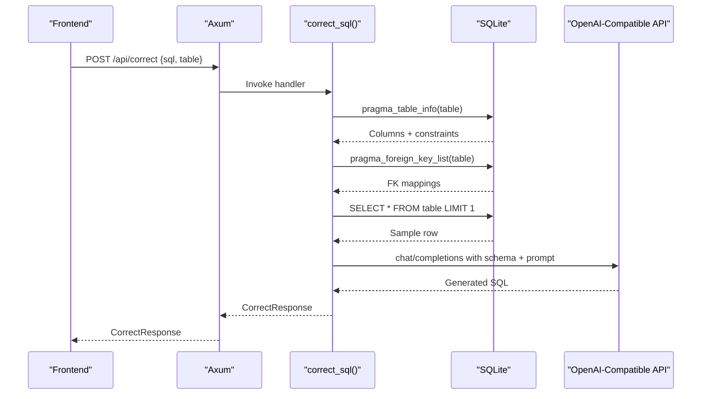
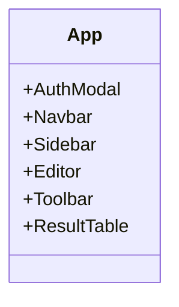
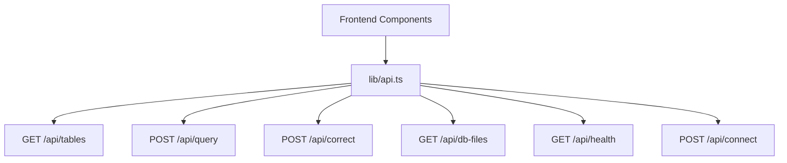
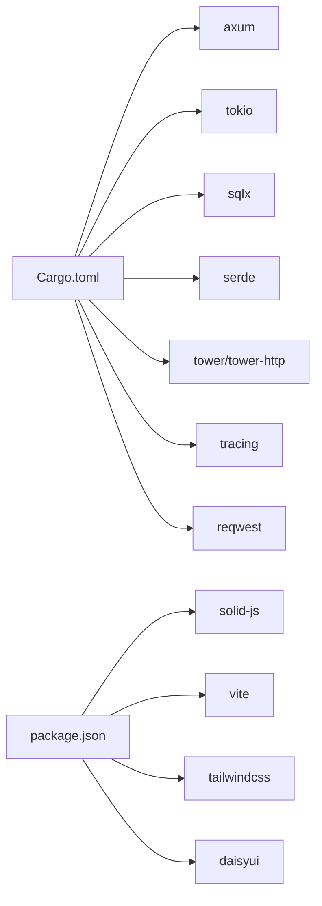

# Project Overview

<cite>
**Referenced Files in This Document**
- [README.md](file://README.md)
- [Dockerfile](file://Dockerfile)
- [backend/Cargo.toml](file://backend/Cargo.toml)
- [frontend/package.json](file://frontend/package.json)
- [backend/src/main.rs](file://backend/src/main.rs)
- [backend/src/state.rs](file://backend/src/state.rs)
- [backend/src/handlers/mod.rs](file://backend/src/handlers/mod.rs)
- [backend/src/handlers/connection.rs](file://backend/src/handlers/connection.rs)
- [backend/src/handlers/query.rs](file://backend/src/handlers/query.rs)
- [backend/src/handlers/ai.rs](file://backend/src/handlers/ai.rs)
- [frontend/src/App.tsx](file://frontend/src/App.tsx)
- [frontend/src/lib/api.ts](file://frontend/src/lib/api.ts)
- [doc/design.md](file://doc/design.md)
</cite>

## Table of Contents
1. [Introduction](#introduction)
2. [Project Structure](#project-structure)
3. [Core Components](#core-components)
4. [Architecture Overview](#architecture-overview)
5. [Detailed Component Analysis](#detailed-component-analysis)
6. [Dependency Analysis](#dependency-analysis)
7. [Performance Considerations](#performance-considerations)
8. [Troubleshooting Guide](#troubleshooting-guide)
9. [Conclusion](#conclusion)
10. [Appendices](#appendices)

## Introduction
CrabLite is an extreme lightweight SQLite Web administration tool built with Rust and Solid.js. It provides a minimal, high-performance interface for managing local SQLite database files directly from the browser. The project emphasizes simplicity, speed, and small footprint:
- Docker image size around ~10MB
- Runtime memory usage around ~1MB
- AI-powered SQL assistance that corrects or translates natural language into SQLite queries

It combines a Rust/Axum backend with a Solid.js frontend to deliver a fast, responsive experience while keeping deployment simple and efficient.

**Section sources**
- [README.md:10-26](file://README.md#L10-L26)
- [doc/design.md:5-13](file://doc/design.md#L5-L13)

## Project Structure
The repository follows a clear separation between backend (Rust) and frontend (Solid.js), with shared configuration and build artifacts integrated at runtime:
- Backend: Axum-based HTTP server exposing REST endpoints for connection management, query execution, and AI-assisted SQL correction
- Frontend: Solid.js application served statically by the backend in production
- Build pipeline: Multi-stage Docker build compiles the frontend and backend into a single Alpine-based runtime image

**Diagram sources**
- [frontend/src/App.tsx:1-29](file://frontend/src/App.tsx#L1-L29)
- [frontend/src/lib/api.ts:1-116](file://frontend/src/lib/api.ts#L1-L116)
- [backend/src/main.rs:1-74](file://backend/src/main.rs#L1-L74)
- [backend/src/state.rs:1-9](file://backend/src/state.rs#L1-L9)
- [backend/src/handlers/mod.rs:1-10](file://backend/src/handlers/mod.rs#L1-L10)

**Section sources**
- [doc/design.md:39-60](file://doc/design.md#L39-L60)
- [Dockerfile:1-56](file://Dockerfile#L1-L56)

## Core Components
CrabLite’s core value proposition centers on three pillars:
- Extreme lightweight footprint: ~10MB Docker image and ~1MB runtime memory usage
- High performance: Fast startup and low overhead using Rust and Tokio
- AI-powered SQL assistance: Natural language to SQL conversion and SQL correction via OpenAI-compatible APIs

Key capabilities include:
- Database connection management: Connect to existing SQLite files under /app/db, create new ones, and list available databases
- SQL query execution: Execute SELECT and non-SELECT statements with typed results and timing metrics
- Natural language to SQL conversion: Generate or correct SQL based on table schema and sample data

Technology stack:
- Backend: Rust, Axum, SQLx, Tokio
- Frontend: Solid.js, Vite, TailwindCSS, DaisyUI

**Section sources**
- [README.md:10-26](file://README.md#L10-L26)
- [backend/Cargo.toml:1-24](file://backend/Cargo.toml#L1-L24)
- [frontend/package.json:1-23](file://frontend/package.json#L1-L23)

## Architecture Overview
At runtime, the backend serves both API endpoints and static frontend assets. Authentication is enforced via an API key header. The frontend communicates with the backend through a thin API client.

**Diagram sources**
- [backend/src/main.rs:22-65](file://backend/src/main.rs#L22-L65)
- [backend/src/handlers/connection.rs:62-109](file://backend/src/handlers/connection.rs#L62-L109)
- [backend/src/handlers/query.rs:101-200](file://backend/src/handlers/query.rs#L101-L200)
- [backend/src/handlers/ai.rs:24-148](file://backend/src/handlers/ai.rs#L24-L148)
- [frontend/src/lib/api.ts:25-115](file://frontend/src/lib/api.ts#L25-L115)

## Detailed Component Analysis

### Backend Entry Point and Routing
- Initializes tracing/logging and environment variables
- Creates global state holding a thread-safe optional SQLite pool
- Registers API routes under /api with authentication middleware
- Serves frontend static assets from dist

**Diagram sources**
- [backend/src/main.rs:35-73](file://backend/src/main.rs#L35-L73)
- [backend/src/state.rs:5-8](file://backend/src/state.rs#L5-L8)

**Section sources**
- [backend/src/main.rs:1-74](file://backend/src/main.rs#L1-L74)
- [backend/src/state.rs:1-9](file://backend/src/state.rs#L1-L9)

### Connection Management
- Lists .db files recursively under db/, excluding WAL/SHM files
- Connects to a specified SQLite file with WAL mode and busy timeout
- Verifies journal_mode is WAL after connection
- Protects against directory traversal attacks

**Diagram sources**
- [backend/src/handlers/connection.rs:20-60](file://backend/src/handlers/connection.rs#L20-L60)
- [backend/src/handlers/connection.rs:62-109](file://backend/src/handlers/connection.rs#L62-L109)
- [backend/src/handlers/connection.rs:131-144](file://backend/src/handlers/connection.rs#L131-L144)

**Section sources**
- [backend/src/handlers/connection.rs:1-145](file://backend/src/handlers/connection.rs#L1-L145)

### SQL Query Execution
- Determines whether to fetch rows or return affected rows based on SQL prefix
- Serializes rows with type-aware mapping (NULL, INTEGER, REAL, BOOLEAN, BLOB, etc.)
- Returns columns, column types, rows, affected_rows, execution_time, and error

**Diagram sources**
- [backend/src/handlers/query.rs:101-200](file://backend/src/handlers/query.rs#L101-L200)
- [backend/src/handlers/query.rs:28-99](file://backend/src/handlers/query.rs#L28-L99)

**Section sources**
- [backend/src/handlers/query.rs:1-201](file://backend/src/handlers/query.rs#L1-L201)

### AI-Powered SQL Assistance
- Gathers table schema and foreign keys, plus one sample row
- Builds a prompt including schema and user input
- Calls an OpenAI-compatible chat completions endpoint
- Returns corrected/generated SQL or error

**Diagram sources**
- [backend/src/handlers/ai.rs:24-148](file://backend/src/handlers/ai.rs#L24-L148)

**Section sources**
- [backend/src/handlers/ai.rs:1-149](file://backend/src/handlers/ai.rs#L1-L149)

### Frontend Application Shell
- Renders AuthModal, Navbar, Sidebar, Editor, Toolbar, and ResultTable
- Uses Tailwind/DaisyUI classes for layout and styling

**Diagram sources**
- [frontend/src/App.tsx:1-29](file://frontend/src/App.tsx#L1-L29)

**Section sources**
- [frontend/src/App.tsx:1-29](file://frontend/src/App.tsx#L1-L29)

### Frontend API Client
- Provides functions to call backend endpoints: tables, query, correct, db-files, health, connect
- Attaches x-api-key header for authenticated requests
- Normalizes backend responses into frontend-friendly types

**Diagram sources**
- [frontend/src/lib/api.ts:1-116](file://frontend/src/lib/api.ts#L1-L116)

**Section sources**
- [frontend/src/lib/api.ts:1-116](file://frontend/src/lib/api.ts#L1-L116)

## Dependency Analysis
- Backend dependencies include Axum, Tokio, SQLx, Serde, Tower/Tower-HTTP, Tracing, Reqwest, Clap, and dotenv
- Frontend dependencies include Solid.js, Vite, TailwindCSS, DaisyUI, TypeScript, and related tooling
- Docker multi-stage build compiles frontend assets and Rust binary, then runs a minimal Alpine image

**Diagram sources**
- [backend/Cargo.toml:1-24](file://backend/Cargo.toml#L1-L24)
- [frontend/package.json:1-23](file://frontend/package.json#L1-L23)

**Section sources**
- [backend/Cargo.toml:1-24](file://backend/Cargo.toml#L1-L24)
- [frontend/package.json:1-23](file://frontend/package.json#L1-L23)

## Performance Considerations
- Binary optimizations: Release profile enables symbol stripping, link-time optimization, and reduced codegen units for smaller, faster binaries
- Concurrency: Tokio runtime and SQLx connection pooling enable efficient concurrent access
- WAL mode: Journal mode set to WAL with busy timeout improves concurrency safety, especially under Docker volume mounts
- Minimal runtime: Alpine base image reduces container size and attack surface

[No sources needed since this section provides general guidance]

## Troubleshooting Guide
- Authentication failures: Ensure the x-api-key header matches the configured API_KEY environment variable; default is provided if not set
- Database not found: Verify the requested path exists under db/ or pass create=true when connecting
- WAL verification warnings: If WAL mode is not active, check permissions and ensure SQLite supports WAL; the app sets WAL mode on connect
- AI assistant errors: Confirm OPENAI_API_KEY is set; verify OPENAI_BASE_URL and OPENAI_MODEL values; network issues may cause request failures

**Section sources**
- [backend/src/main.rs:22-33](file://backend/src/main.rs#L22-L33)
- [backend/src/handlers/connection.rs:66-83](file://backend/src/handlers/connection.rs#L66-L83)
- [backend/src/handlers/connection.rs:131-144](file://backend/src/handlers/connection.rs#L131-L144)
- [backend/src/handlers/ai.rs:28-37](file://backend/src/handlers/ai.rs#L28-L37)

## Conclusion
CrabLite delivers a focused, high-performance SQLite Web UI with minimal resource consumption and powerful features like AI-assisted SQL generation. Its clean architecture, straightforward installation options, and compact runtime make it suitable for developers who need a fast, reliable way to manage SQLite databases from the browser.

[No sources needed since this section summarizes without analyzing specific files]

## Appendices

### Installation Methods
- Docker run: Expose port 3000, mount a SQLite file under /app/db, and set API_KEY
- Docker Compose: Define service with ports, volumes, and environment variables
- Prebuilt binaries: Download release archives for Linux/macOS, extract, and run with API_KEY

**Section sources**
- [README.md:29-68](file://README.md#L29-L68)

### Quick Start Guide
1. Install Docker or download a prebuilt binary
2. Prepare a SQLite file under a mounted directory (e.g., ./sqlite.db)
3. Set API_KEY environment variable
4. Start the container or binary
5. Open http://localhost:3000 in your browser
6. Connect to your database file via the UI and start executing SQL

**Section sources**
- [README.md:29-68](file://README.md#L29-L68)