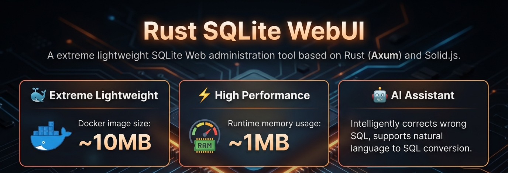
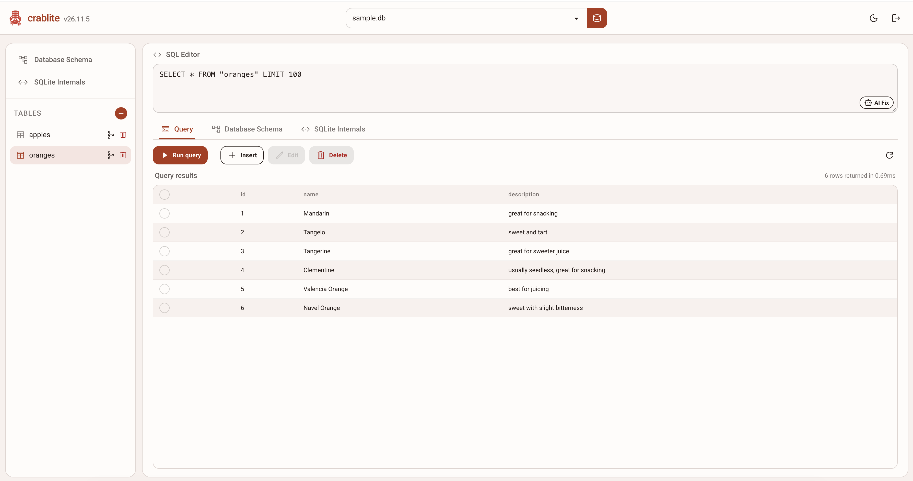

<div align="center">
  </img>
  <p><strong>crablite - An extremely lightweight SQLite web administration tool</strong></p>
</div>

# crablite

An extremely lightweight SQLite web administration tool based on Rust (Axum) and Solid.js.

- 🐳 **Extremely Lightweight**: Docker image is only **~10MB**.
- ⚡ **High Performance**: Runtime memory usage is only **~1MB**.
- 🤖 **AI Assistant**: Fixes incorrect SQL and supports natural language to SQL conversion.





## Features

- **Query workspace**: Multi-tab SQL editor (CodeMirror) with table name completion, paginated results, execution time, affected rows, and recent history.
- **AI Fix**: Sends table schema plus a sample row to an OpenAI-compatible API to correct, complete, or generate SQLite SQL.
- **Schema explorer**: Browse tables, views, indexes, and triggers, inspect per-table columns, foreign keys, indexes, triggers, and copy combined DDL.
- **SQLite internals**: Curated database, connection, and engine PRAGMAs plus full `sqlite_schema` entries.
- **Saved queries**: Per-database saved queries with name search and tags, stored in `.crablite_metadata.db` under `DB_DIR`.
- **Database file management**: Recursively lists `.db` files under `DB_DIR`, supports create, upload (validates SQLite header, 256 MiB limit), rename, and delete.
- **Authentication**: API-key login issues a signed HttpOnly session cookie (30 days); direct API/CLI calls can use the `x-api-key` header. Optional Cloudflare Turnstile CAPTCHA.
- **Usability**: Command palette (`Ctrl+K`), run query (`Ctrl+Enter`), save query (`Ctrl+S`), light/dark themes, and responsive layout.

## Tech Stack

- **Backend**: Rust, Axum, SQLx, Tokio
- **Frontend**: Solid.js, Solid Router, Vite, TailwindCSS v4, CodeMirror, Kobalte

## Usage

Using Docker is recommended.

### Docker Run

```bash
docker run -d \
  -p 3000:3000 \
  -v $(pwd)/data:/app/db \
  -e API_KEY=your_secret_key \
  --name crablite \
  wangyucode/crablite
```

### Docker Compose

```yaml
services:
  crablite:
    image: wangyucode/crablite
    ports:
      - "3000:3000"
    volumes:
      - ./data:/app/db
    environment:
      - API_KEY=your_secret_key
```

### Prebuilt Binary (Linux/macOS/Windows)

1. Download the archive for your operating system and architecture from [GitHub Releases](https://github.com/sutanto1010/crablite/releases).
2. Extract the archive and run the application from the extracted directory:

```bash
tar -xzf crablite-v<VERSION>-<TARGET>.tar.gz
cd crablite-v<VERSION>-<TARGET>
API_KEY=your_secret_key ./crablite
```

`<TARGET>` is the Rust target triple, e.g. `x86_64-unknown-linux-musl`, `aarch64-unknown-linux-musl`, or `x86_64-pc-windows-gnu`. Windows archives are `.zip` and contain `crablite.exe`. Keep `dist/` in the extracted directory because it contains the WebUI assets. Open `http://localhost:3000` after the application starts.

To update a prebuilt binary in place later, run from the extracted directory:

```bash
./crablite --update
```

This checks `sutanto1010/crablite` GitHub Releases, downloads the matching `<TARGET>` archive, and replaces the binary plus `dist/` (old binary kept as `.bak`). The install writes to a temp file and renames over the old binary, so updating while the old binary is running no longer fails with `Text file busy (ETXTBSY)`. Use `./crablite --update --check-only` to check only (exit `10` = update available), or `-y`/`--yes` to skip confirmation. Inside Docker use `docker pull` instead.

For system installs (e.g. `/opt/crablite`), use the shipped `update.sh` instead — it handles `sudo`, atomic binary replacement, `dist/` backup, and `systemd` restart:

```bash
sudo /opt/crablite/update.sh --dir /opt/crablite --yes
```

Each release archive contains `update.sh`, and it is also published as a standalone release asset:

```bash
curl -fsSL https://github.com/sutanto1010/crablite/releases/latest/download/update.sh | sudo bash -s -- --dir /opt/crablite --yes
```

Useful flags: `--check-only`, `--version X.Y.Z`, `--no-restart`, `--service NAME` (empty disables `systemd` handling), `--dir DIR`.

### Configuration

**DB files**: Database files are scanned recursively under `DB_DIR` (default: `db`, which is `/app/db` in Docker). Subdirectory paths (e.g., `rust/sqlite.db`) are supported for Docker volume mounts like `./rust/data/db:/app/db/rust`. The metadata database `.crablite_metadata.db` is created in the same directory and hidden from listings.

**Environment Variables**:

| Variable | Default | Description |
| --- | --- | --- |
| API_KEY | `your-super-secure-key` | Authentication key for accessing the WebUI and `x-api-key` API header. |
| DB_DIR | `db` (`/app/db` in Docker) | Directory used to discover and store SQLite database files. |
| PORT | `3000` | Port on which the backend listens. Must be a valid `u16` port number. |
| RUST_LOG | `crablite=debug,tower_http=debug` | Logging level configuration. Docker image defaults to `info`. |
| OPENAI_API_KEY | - | OpenAI API key (required for AI assistant). |
| OPENAI_BASE_URL | `https://api.openai.com/v1` | OpenAI API base URL. |
| OPENAI_MODEL | `gpt-5.4-mini` | OpenAI model name. |
| TURNSTILE_SECRET_KEY | - | Cloudflare Turnstile Secret Key (optional; enables CAPTCHA verification alongside API key). |
| TURNSTILE_SITE_KEY | - | Cloudflare Turnstile Public Site Key (optional; required if `TURNSTILE_SECRET_KEY` is configured). |
| SESSION_SECRET | Derived from `API_KEY` | Secret key used to sign HttpOnly session cookies (optional). |

To use a different database directory in Docker, set `DB_DIR` and mount your volume at the same path, for example `-e DB_DIR=/data -v $(pwd)/data:/data`. To use a different port, set `PORT` and publish the same container port, for example `-e PORT=8080 -p 8080:8080`.

> **Tip**: For development, create a `.env` file in `backend/` directory to configure these variables.

## API Overview

All endpoints except `GET /api/health` and `GET /api/auth/config` require either the session cookie from `POST /api/auth/login` or the `x-api-key` header.

- `GET /api/health` - health check with binary version.
- `POST /api/auth/login`, `POST /api/auth/logout`, `GET /api/auth/config` - session auth and Turnstile config.
- `GET /api/db-files`, `POST /api/connect`, `PUT /api/db-files/{path}`, `DELETE /api/db-files/{path}`, `POST /api/db-files/rename` - database file management.
- `GET /api/tables`, `GET /api/schema`, `GET /api/schema/table?name=...`, `GET /api/internals` - metadata for the connected database.
- `POST /api/query` - execute SQL; `SELECT`/`PRAGMA`/`EXPLAIN`/`WITH`/`RETURNING` queries are paginated (`limit` defaults to 100, max 1000) with `total_rows`.
- `POST /api/correct` - AI SQL correction (`{ sql, table }`).
- `GET/POST /api/saved-queries`, `PUT/DELETE /api/saved-queries/{id}` - saved queries scoped by `db` with optional `search` and `tag` filters.

## Development

### 1. Start Frontend Development Server

Node.js (v18+) and pnpm are required.

```bash
cd frontend
pnpm install
pnpm start
```

The frontend service runs at `http://localhost:5173` by default and proxies `/api` to `http://localhost:3000`.

### 2. Start Backend API Service

Rust (cargo) is required.

```bash
cd backend
cargo run
```

The backend service runs at `http://localhost:3000`.

### 3. Build for Release

**Build Frontend**:

```bash
cd frontend
pnpm build
```

The build artifacts are located in `frontend/dist`.

**Build Backend**:

```bash
cd backend
cargo build --release
```

The release binary is located in `backend/target/release`. At runtime the backend serves static files from `./dist`, so copy `frontend/dist` to `dist/` next to the binary for local runs.

## How to Release

Install and authenticate the [GitHub CLI](https://cli.github.com/) before publishing. Pushing to `master` also triggers the existing Docker image publish workflow.

1. Update `version` in `backend/Cargo.toml`, update the lockfile, and commit and push the changes:

```bash
cargo check --manifest-path backend/Cargo.toml
```

2. Run the release script from a clean worktree:

```bash
./release.sh
```

The script requires `cargo`, `cargo-zigbuild`, `gh`, `git`, `pnpm`, `rustc`, `rustup`, `tar`, `zip`, and `zig`. It builds the frontend, builds the backend for the host plus `x86_64-unknown-linux-musl`, `aarch64-unknown-linux-musl`, `x86_64-pc-windows-gnu`, and `aarch64-pc-windows-gnullvm`, packages each binary with `frontend/dist`, pushes the `v<VERSION>` tag, and publishes the archives to GitHub Releases. To add archives built on other platforms to an existing release, use `gh release upload "v${VERSION}" <ARCHIVE>`.

## Documentation

For detailed design documentation, please refer to [doc/design.md](doc/design.md).
