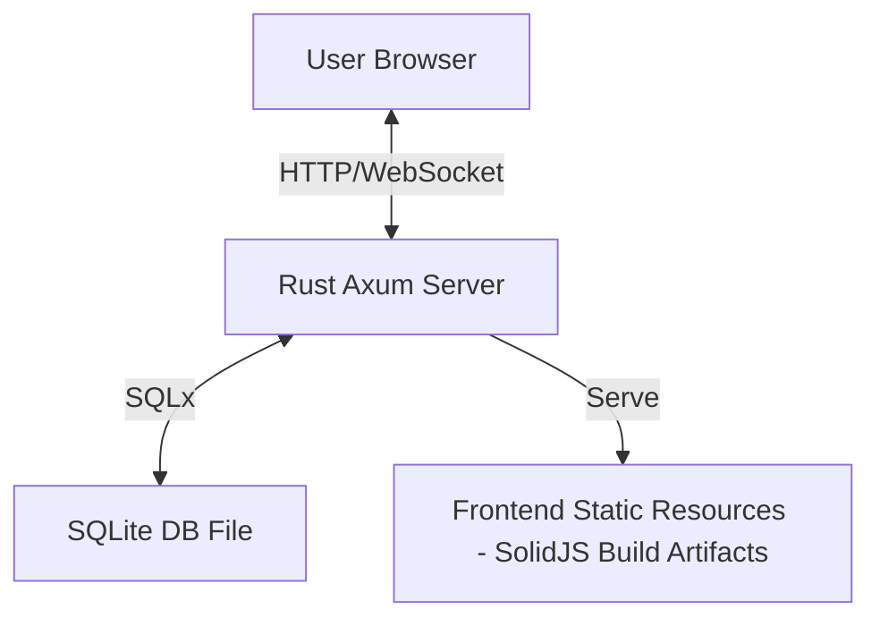

[English] | [简体中文](design_CN.md)

# crablite Design Document

## 1. Project Overview

This project aims to build a Rust + SolidJS SQLite database management tool, striving for ultimate simplicity and lightweight. Users can directly manage local SQLite database files, execute SQL queries, and view/edit data through a browser.

**Core Goals**:
- **Lightweight**: Single binary distribution, ready to use out of the box. Docker image size is only **~6.5MB**.
- **High Performance**: Runtime memory usage is only **~700KB**. Capable of smoothly handling large data displays.
- **Simple & Easy to Use**: UI design based on the "Less is More" principle, focusing on core SQL operations.

## 2. Tech Stack Architecture

### 2.1 Backend (Rust)
- **Web Framework**: `Axum` - High performance, ergonomic asynchronous Web framework.
- **Runtime**: `Tokio` - Standard for Rust asynchronous ecosystem.
- **Database Interaction**: `SQLx` - Pure Rust asynchronous SQL driver, supporting connection pools.
- **Serialization**: `Serde` + `Serde JSON` - Handling frontend-backend data exchange.

### 2.2 Frontend (Modern Web)
- **Framework**: `Solid.js` - High-performance reactive framework, no virtual DOM.
- **Build Tool**: `Vite` - Blazing fast development server and build tool.
- **UI Framework**: `TailwindCSS` + `DaisyUI` - Utility-first CSS framework and semantic component library.

## 3. System Architecture Design

### 3.1 Overall Architecture
Adopts a frontend-backend separation architecture, but in the production environment, frontend static resources will be embedded into the Rust binary and distributed via Axum's Static File service, achieving "single file deployment".



### 3.2 Directory Structure Planning
```text
crablite/
├── backend/            # Backend source code (Rust)
│   ├── Cargo.toml
│   └── src/
│       ├── main.rs     # Entry point & Routing
│       ├── state.rs    # Global state
│       └── handlers/   # API handlers
│           ├── mod.rs
│           ├── connection.rs
│           ├── query.rs
│           └── health.rs
├── frontend/           # Frontend source code (SolidJS)
│   ├── package.json
│   ├── vite.config.ts
│   └── src/
│       ├── App.tsx     # Root component
│       ├── lib/        # Logic & API client
│       └── components/ # UI Components
└── doc/                # Documentation
```

## 4. Core Functional Modules & API Design

### 4.1 Connection Management
Manage SQLite database connections.
| **API**:
  - `POST /api/connect`: Connect to a local SQLite file.
    - **Request**: `{ "path": "test.db", "create": true }`
    - Subdirectory paths are supported: `{ "path": "rust/sqlite.db" }` for mounted volumes like `./rust/data/db:/app/db/rust`
  - `GET /api/db-files`: List available database files in the `DB_DIR` directory (default: `./db`, recursively scans subdirectories).
  - `GET /api/health`: Health check.

### 4.2 Database Metadata
Used for displaying database structure through the read-only Schema Explorer.

**Schema Explorer scope and navigation**:
- **Table Schema**: Shows columns (including hidden and generated columns), declared types, nullability, defaults, primary-key positions, foreign keys, index columns/collation/order, triggers, and the original `CREATE TABLE` SQL.
- **Database Schema**: Browses user-defined tables, views, indexes, and triggers; inspects each object's stored SQL and copies the combined user-schema DDL. Objects without stored SQL, such as automatic indexes, are not included in the combined DDL.
- **SQLite Internals**: Shows curated database, connection, and engine metadata plus every `main.sqlite_schema` entry, with a filter for normally hidden `sqlite_%` objects. Uncommon PRAGMA queries remain available through the SQL editor.
- **Navigation**: Clicking a table continues to browse its rows. Separate Schema actions open table details and database-level Schema / Internals views in the main content area. On small screens, a table selector and action buttons replace the hidden sidebar.
- **Refresh behavior**: Successful `CREATE`, `DROP`, or `ALTER` statements for tables, views, indexes, and triggers refresh table and active metadata views. Refresh preserves the selected object when it still exists and returns to the database overview when it does not. Changing databases clears all metadata state.

**API**:
- `GET /api/tables`: Get all user table names in the current connection.
- `GET /api/schema`: Return `{ "objects": [...], "ddl": "..." }` for user-defined objects and their combined DDL.
- `GET /api/schema/table?name=<table>`: Return one table's complete typed schema. Names are bound parameters, including names containing quotes or other special characters; a missing table returns `404`.
- `GET /api/internals`: Return `{ "database": [...], "connection": [...], "engine": [...], "schema_entries": [...] }`.

All metadata endpoints require the existing `x-api-key` authentication and inspect only the `main` database. Attached databases are listed by `PRAGMA database_list` but their objects are not browsed. Table details use SQLite's table-valued PRAGMA functions with bound identifiers rather than interpolated PRAGMA statements.

The curated Internals inventory includes:
- **Database**: `database_list`, `page_size`, `page_count`, `freelist_count`, `journal_mode`, `encoding`, `user_version`, `schema_version`, `application_id`, and `auto_vacuum`.
- **Connection**: `foreign_keys`, `busy_timeout`, `synchronous`, and `cache_size` for the connection serving the request.
- **Engine**: `sqlite_version()` and `compile_options`.

### 4.3 SQL Executor
Core function for executing user-input SQL.
- **API**:
  - `POST /api/query`: Execute SQL statement.
    - **Request**: `{ "sql": "SELECT * FROM users LIMIT 100" }`
    - **Response**: 
      ```json
      {
        "columns": ["id", "name"],
        "column_types": ["INTEGER", "TEXT"],
        "rows": [[1, "Alice"], [2, "Bob"]],
        "affected_rows": null,
        "execution_time": 12.5,
        "error": null
      }
      ```

### 4.4 API Security
Basic security measures are implemented to protect the interface.
- **Authentication**: All API requests (except health check) require an `x-api-key` header.
  - The key is set via the `API_KEY` environment variable.
  - Default value: `your-super-secure-key`.
| **File Access Control**: Database files are restricted to the `DB_DIR` directory (default: `./db`). Directory traversal (e.g., `../`) is blocked. Subdirectory paths are allowed (e.g., `rust/sqlite.db`). |

### 4.5 WAL Mode Verification

After connecting, the `verify_wal_mode()` function checks that SQLite journal mode is set to WAL via `PRAGMA journal_mode`. This ensures WAL files (`.db-wal`, `.db-shm`) are properly managed for concurrent access scenarios typical in Docker volume mounts.

## 5. UI/UX Design Draft

Interface layout adopts a classic single page layout:

*   **Header**: Top bar, containing Logo, current database path, supports dropdown for history connections, new database button.
*   **Sidebar (Left)**: Database object browser.
    *   **Tables**: List of table names with drop table button.
    *   **Add Table**: Button to add a new table.
    *   Clicking a table name can generate a `SELECT` statement and quickly preview data.
*   **Main Content (Right)**: Tabbed workspace.
    *   **SQL Editor**: Remains available above the Query, Database Schema, and SQLite Internals workspaces.
    *   **Query**: Toolbar for SQL execution and selected-row CRUD operations, with compact result tables.
    *   **Schema Explorer**: Split object navigation and detail views for table definitions, database objects, combined DDL, and SQLite internals.

**Material 3 Theme Style**:
- Applies Material Design 3 surface, tonal color, navigation, button, dialog, and compact-data patterns through the existing Tailwind CSS and DaisyUI layer; no additional UI framework is introduced.
- Uses Rust-orange-derived OKLCH tonal tokens for explicit light and dark themes. The selected theme persists in `localStorage`.
- Uses standard-sized primary controls, compact schema/result tables, accessible focus states, and reduced-motion support.
- Bundles Latin Roboto weights and only the required Material Symbol SVGs locally, avoiding runtime CDN dependencies and a full multi-megabyte icon font.
